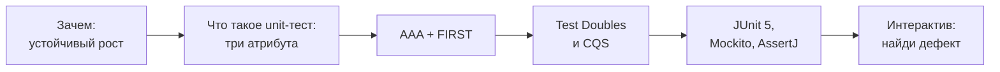
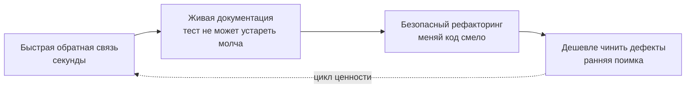
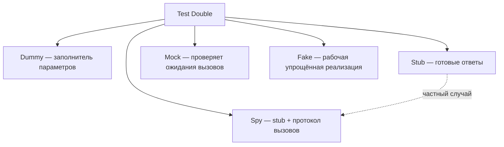
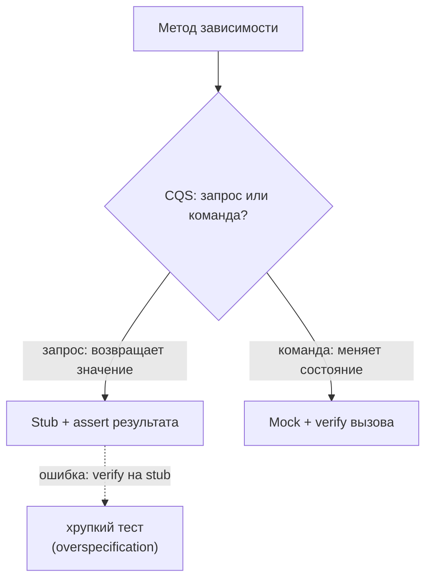
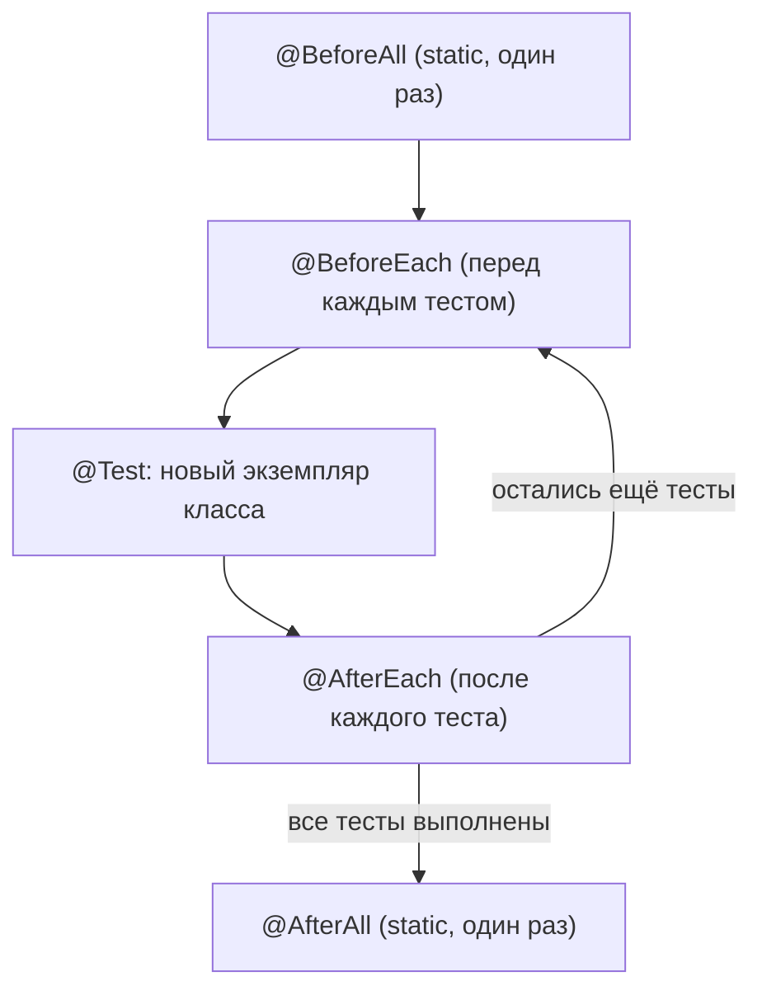
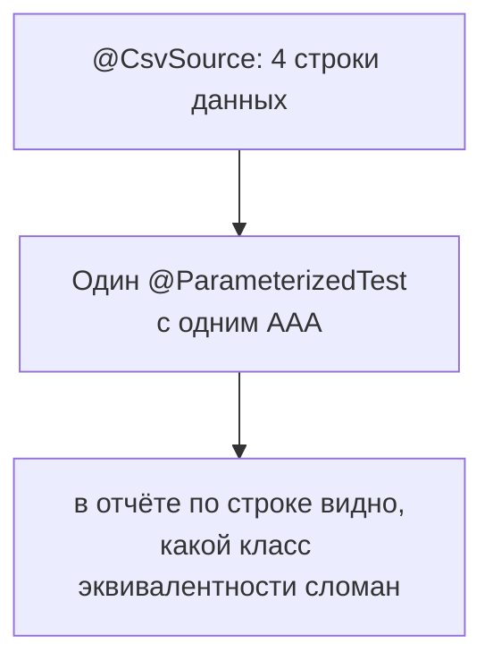

# Lecture 1: Unit-тестирование: принципы FIRST, AAA, test doubles

> **Модуль**: 4 — Unit-тестирование
> **Лекция**: 1 из 2
> **Длительность**: 1 астрономический час (60 мин)
> **Слайдов**: 17
> **Практика после лекции**: `practice/practice-01.md`
>
> **Соглашение о визуализации**: на каждом слайде есть блок **Визуализация** с описанием макета и рекомендацией по иллюстрации. Изображения пока только рекомендованы, имя файла и папка указаны условно; реальные файлы кладём в `Pictires/lecture-01/`. Диаграммы описаны кодом mermaid прямо в файле.

---

## Тайминг

| Время | Блок | Слайды | Содержание |
|-------|------|--------|-----------|
| 0:00–0:11 | Введение | 1–5 | План лекции, зачем unit-тесты, цель unit-тестирования, что такое unit-тест |
| 0:11–0:25 | AAA и FIRST | 6–8 | Структура теста, пять принципов |
| 0:25–0:40 | Test Doubles | 9–11 | Stub / Mock / Fake, Mockito, когда мокировать |
| 0:40–0:50 | JUnit 5 | 12–15 | Жизненный цикл, параметризация, AssertJ, лучшие практики |
| 0:50–0:55 | Интерактив | 16 | «Найди дефект теста»: разбор трёх тестов с дефектами |
| 0:55–1:00 | Закрепление и итоги | 17 | Викторина «Stub или Mock?» |

---

### Слайд 1. Титульный

**Слайд:**
- Модуль 4: Unit-тестирование
- Lecture 1: Принципы FIRST, AAA, Test Doubles
- Курс «Тестирование ПО», Lekton

**Визуализация:**
- Макет: полноэкранный титульный фон, поверх — название модуля и лекции.
- Иллюстрация: `Pictires/lecture-01/img-1-cover.jpg` — титульный фон из брендового набора курса.

**Speaker notes:**
> Добрый день! Сегодня мы начинаем четвёртый модуль нашего курса — Unit-тестирование. Это первая из двух лекций модуля. Сегодня мы разберём фундамент: что такое хороший unit-тест, из чего он состоит, какие принципы делают его надёжным, и как работать с внешними зависимостями через test doubles.
>
> Давайте сначала вспомним, где мы находимся в курсе. На первом модуле мы говорили о тестировании как о деятельности и познакомились с нашим сквозным проектом — симулятором процессингового центра, СМП. На втором модуле изучили техники тест-дизайна — классы эквивалентности, граничные значения, таблицы решений — и вы уже применяли эти техники на практике. На третьем модуле разобрали пирамиду тестирования и поняли, что unit-тесты — её основание: их должно быть больше всего, они самые быстрые и самые дешёвые. Сегодня мы наконец спускаемся на это основание и учимся его строить.
>
> Эта лекция — самая техническая из всех, что были до сих пор. Unit-тесты — это код, который тестирует код. И, как любой код, они могут быть написаны хорошо или плохо. Разница между хорошим и плохим unit-тестом — это не вкусовщина: плохой тест приносит отрицательную пользу, он мешает разработке, замедляет рефакторинг, падает без причины. Хороший — ускоряет разработку и служит документацией. Сегодняшняя лекция — о том, как писать хорошие.
>
> План на сегодня. Сначала поговорим о мотивации: зачем вообще нужны unit-тесты и в чём их главная цель по Хорикову. Потом разберём два фундаментальных набора принципов — структуру AAA, из которой состоит каждый тест, и принципы FIRST, которым каждый тест должен подчиняться. Затем — тема, которая вызывает больше всего вопросов у новичков: test doubles, то есть заглушки и моки, и когда какой тип применять. И в конце посмотрим на инструменты — JUnit 5, Mockito и AssertJ, а завершим двумя интерактивами: найдём дефекты в чужих тестах и проверим себя двумя мини-викторинами.

---

### Слайд 2. План лекции

**Слайд:**
- Зачем нужны unit-тесты: быстрая обратная связь, документация, цель — устойчивый рост
- Что такое unit-тест: три атрибута
- Структура теста AAA и принципы FIRST
- Test Doubles: Stub, Mock, Fake и главное правило CQS
- Инструменты: JUnit 5, Mockito, AssertJ
- Интерактив: «Найди дефект теста» + викторина «Stub или Mock?»

**Визуализация:**
- Макет: вертикальная дорожка из шести пунктов с номерами блоков по таймингу; интерактив в конце выделен акцентным цветом.
- Диаграмма: mermaid-схема ниже.



**Speaker notes:**
> Прежде чем погружаться в детали — карта на час вперед. Начнём с мотивации: зачем unit-тесты нужны и в чём их главная цель по Хорикову. Потом договоримся о терминах: что такое unit-тест — три атрибута по Хорикову. Дальше два фундамента хорошего теста — структура AAA и принципы FIRST. После этого самая большая часть — test doubles: как подменять зависимости и когда стаб, а когда мок. Затем инструменты — JUnit 5, Mockito, AssertJ. И в конце — интерактив: вы побываете в роли ревьюера и поищете дефекты в чужих тестах. Поехали.

---

### Слайд 3. Зачем нужны unit-тесты

**Слайд:**
- Быстрая обратная связь: секунды вместо минут/часов
- Документация поведения кода
- Безопасный рефакторинг
- Снижение стоимости исправления дефектов

**Визуализация:**
- Макет: четыре бенефита вокруг центра «unit-тесты»; стрелка «секунды → минуты/часы» для первого пункта.
- Диаграмма: mermaid-схема ниже.
- Иллюстрация: `Pictires/lecture-01/img-2-why.png`.



**Speaker notes:**
> Начнём с вопроса «зачем». Unit-тесты — самый быстрый способ получить обратную связь о корректности кода. Вы изменили одну строчку — и через несколько секунд знаете, не сломали ли вы что-то в другом конце системы. Сравните с ручным тестированием: развернуть приложение, поднять базу, прокликать сценарий, проверить результат — это минуты, а то и часы. Экономический смысл прост: цена итерации обратной связи определяет, сколько итераций вы можете себе позволить. Секунды — тысячи итераций в день. Часы — три-четыре.
>
> Кент Бек в книге «Test Driven Development: By Example» приводит замечательную метафору. Он называет тесты «Камнем Программиста» — по аналогии с философским камнем, который превращает свинец в золото. Тесты, по словам Бека, превращают страх в скуку: когда у вас есть полный набор тестов, вы не боитесь менять код. Вы просто запускаете тесты — и вам скучно, потому что они всегда зелёные. И наоборот, Бек описывает «спираль смерти»: чем больше стресс, тем меньше вы тестируете; чем меньше тестируете, тем больше ошибок; чем больше ошибок, тем больше стресс. Unit-тесты разрывают эту спираль в самом начале.
>
> Вторая функция — документация. Фриман и Прайс в «Growing Object-Oriented Software, Guided by Tests» пишут, что тесты — это живая документация: она не может устареть, потому что если тест врёт о поведении кода — он падает. Обычная документация в вики устаревает молча и врёт годами. Тест врёт ровно до первого запуска. Читая тесты незнакомого класса, вы за минуту понимаете, как его вызывать, какие граничные случаи он обрабатывает и что он гарантирует. 
>
> Третье — безопасный рефакторинг. Владимир Хориков в «Unit Testing: Principles, Practices, and Patterns» называет защиту от регрессий первым и главным столпом хорошего теста. Код без тестов рефакторить страшно: любое улучшение структуры может незаметно изменить поведение, и вы узнаете об этом от клиентов. Код с тестами меняется смело — тесты стоят на страже и кричат, если поведение изменилось.
>
> И наконец, экономика. Чем позже найден дефект, тем дороже его исправление — об этом следующий слайд.
>
> Есть и честная обратная сторона, о которой пишет Хориков: сами тесты тоже код, и они тоже стоят денег — их надо писать, читать, поддерживать. Плохие тесты увеличивают энтропию проекта: они хрупкие, их боятся менять, их со временем отключают, и набор тестов превращается в свалку. Поэтому цель — не «больше тестов», а «больше ценных тестов». Ценность теста — это защита от регрессий минус стоимость поддержки. Всё, о чём мы сегодня говорим, — это способы увеличить числитель и уменьшить знаменатель.

---

### Слайд 4. Цель unit-тестирования: устойчивый рост

**Слайд:**
- Цель — не «покрытие» и не «зелёная полоса», а **устойчивый рост проекта** (Khorikov, гл. 1)
- Тесты — страховка, которая позволяет менять код без страха сломать
- Тесты = исполняемая спецификация: читая их, новичок понимает, как должен работать класс
- Антицель: тесты, привязанные к деталям реализации, тормозят рефакторинг
- Перекличка с модулем 1: график стоимости дефекта — чем раньше, тем дешевле

**Визуализация:**
- Макет: четыре карточки в сетке 2×2 (цель, страховка, спецификация, антицель); снизу две выноски — про модуль 1 и про девиз модуля.
- Иллюстрация: `Pictires/lecture-01/img-3-goal.png` — растущее дерево под щитом.

**Speaker notes:**
> Теперь самый важный идеологический слайд. Зачем мы пишем unit-тесты? Ответ «чтобы было покрытие» — неправильный. Ответ «потому что так требуют» — тоже неправильный. Хориков формулирует цель так: unit-тестирование — это техника, которая позволяет проекту расти устойчиво, то есть наращивать функциональность и рефакторить код без деградации качества.
>
> Давайте разберём, что это значит. Код в живом проекте постоянно меняется: новые фичи, исправления, рефакторинг. Каждое изменение несёт риск регрессии. Если у вас нет тестов, единственный способ проверить, что вы ничего не сломали, — ручной регресс. А мы уже считали в модуле 3: полный ручной регресс по СМП — это дни работы. Когда цена проверки высока, люди начинают бояться менять код. Появляется феномен «работает — не трогай». Код гниёт, проект замедляется.
>
> Тесты меняют экономику. Проверка регрессии стоит миллисекунды и выполняется автоматически в CI. Вы можете смело рефакторить: если что-то сломалось, тест упадёт за секунды и укажет на конкретное место. Вспомните график стоимости дефекта из модуля 1: баг, пойманный на unit-уровне, стоит минуты работы, тот же баг в проде — часы, а иногда и репутацию банка. Важен сам принцип — чем раньше, тем дешевле.
>
> Есть и вторая ценность, о которой часто забывают. Тесты — это исполняемая спецификация. Читая тесты класса, новый разработчик за десять минут понимает, как класс должен себя вести: какие входы, какие выходы, какие граничные случаи. Это лучше любой документации, потому что документация врёт, а тесты — нет: они исполняются на каждом push.
>
> Но есть и обратная сторона, которая станет темой следующей лекции. Если тесты привязаны к деталям реализации, они начинают ломаться при каждом рефакторинге, даже когда поведение не изменилось. Такие тесты не страховка, а балласт: они тормозят ровно то, для чего созданы. Поэтому девиз модуля: тесты должны проверять поведение, а не устройство кода.

---

### Слайд 5. Что такое unit-тест: три атрибута

**Слайд:**
- Три атрибута unit-теста (Khorikov, гл. 2):
  - проверяет **маленький кусок кода** — одну единицу поведения, а не всю систему
  - выполняется **быстро** — миллисекунды, а не секунды и минуты
  - **изолирован** — не зависит от других тестов и от окружения
- ISTQB-аналог: component testing, самый низкий уровень тестирования
- Правило курса: мокируем только то, что мешает скорости и детерминированности

**Визуализация:**
- Макет: три атрибута в виде трёх карточек.
- Иллюстрация: `Pictires/lecture-01/img-4-definition.png`.

**Speaker notes:**
> Мы всё время говорим «unit-тесты», но ещё не договорились, что такое этот самый unit. На первый взгляд всё просто: тест, который проверяет один метод. Но это не совсем точно, и вот почему. Владимир Хориков даёт определение через три атрибута: unit-тест — это тест, который проверяет маленький кусок кода, выполняется быстро и изолированно. Все три атрибута важны, и каждый мы ещё развернём сегодня.
>
> Первый атрибут: маленький кусок кода. Важно понимать — единица здесь не метод, а единица поведения. Один публичный метод может содержать несколько сценариев поведения. Возьмём знакомый нам по примерам `authorize`: успешное одобрение, отклонение по заблокированной карте, отклонение по отрицательной сумме. Каждый сценарий — отдельный тест. Поэтому на один метод часто приходится пять-десять тестов — и это нормально.
>
> Второй: быстро — миллисекунды. Это напрямую связано с ценой бага с прошлого слайда: быстрые тесты вы запускаете после каждого изменения кода, значит, дефект ловится в момент внесения, по цене один икс. Медленный тест — это дорогая обратная связь, и его ценность тает.
>
> Третий: изолированно. Запустили один тест — зелёный. Запустили весь набор — зелёный. В любом порядке, на любой машине, в любое время суток. Если тест зелёный только когда перед ним выполнился другой — это не unit-тест. Принципы FIRST, к которым мы перейдём через слайд, углубят именно эту мысль.
>
> Для синхронизации терминологии: в стандарте ISTQB этому уровню соответствует component testing — самый низкий уровень тестирования.
>
> На этом с определением всё. Дальше нас ждёт типичная ошибка overspecification — verify на всём подряд; мы встретим её в интерактиве, а правило CQS чуть позже покажет, как её избежать.

---

### Слайд 6. Структура теста: Arrange — Act — Assert

**Слайд:**
```java
@Test
void shouldDeclineWhenCardIsBlocked() {
    // Arrange
    CardRepository repo = mock(CardRepository.class);
    when(repo.findByPan(PAN)).thenReturn(blockedCard());
    AuthService service = new AuthService(repo);

    // Act
    AuthResult result = service.authorize(request(PAN, 1000));

    // Assert
    assertThat(result.getStatus()).isEqualTo(DECLINED);
    assertThat(result.getReason()).isEqualTo(CARD_BLOCKED);
}
```

**Визуализация:**
- Макет: код теста с цветовой подсветкой секций; сбоку расшифровка Arrange / Act / Assert и правило «один act».
- Код: пример теста ниже.
- Иллюстрация: `Pictires/lecture-01/img-5-aaa.png`.

**Speaker notes:**
> Любой хороший unit-тест имеет чёткую трёхчастную структуру — AAA: Arrange, Act, Assert. Паттерн популяризировал Билл Уэйк, а детально его разобрал Хориков в третьей главе своей книги. Давайте пройдём по примеру на слайде — это тест из домена нашего СМП: авторизация транзакции по заблокированной карте.
>
> Первая секция — Arrange, подготовка. Здесь мы приводим систему в нужное начальное состояние: создаём мок репозитория карт — про моки подробно через несколько слайдов, — учим его возвращать заблокированную карту на запрос по конкретному PAN, и собираем сервис авторизации с этой зависимостью.
>
> Важное уточнение по фабричным методам `blockedCard()` и `request(PAN, 1000)`: их НЕТ в production-коде СМП. Это приватные хелперы самого тест-класса — в терминах Месзароша это паттерны Object Mother и Test Data Builder. Например, `blockedCard()` — это три-пять строк `new Card(...)` с полями PAN, статус BLOCKED, срок действия и лимиты, спрятанные за говорящим именем; `request(PAN, 1000)` — сборка объекта `AuthorizationRequest`. Оба метода живут внутри тест-класса рядом с тестами. Зачем они нужны: без них секция Arrange разрослась бы до десяти строк настройки полей, и суть сценария («заблокированная карта, транзакция на тысячу») утонула бы в шуме. Хелперы делают Arrange читаемым: читатель видит по имени, какая карта и какой запрос используются, а не разбирается в сеттерах.
>
> Вторая секция — Act, действие. Ровно один вызов тестируемого метода: `service.authorize(...)`. Это важное правило: один тест — одно действие. Если у вас в секции Act два вызова тестируемого кода — скорее всего, вы тестируете два сценария в одном тесте, и при падении вы не поймёте, какой из них сломан. Исключение бывает, когда нужно привести объект в состояние, но и тогда лучше задуматься, не относится ли это к Arrange.
>
> Третья секция — Assert, проверка. Проверяем результат: статус — отклонено, и причина — карта заблокирована. Две проверки на один Act — допустимо, потому что это одна логическая проверка: «решение об отказе корректно полностью». Но проверять здесь же что-то про другую функциональность — нельзя.
>
> Несколько тонкостей от Хорикова. Первое: секции должны быть визуально отделены — пустыми строками или комментариями. Если тест большой — комментарии лучше; если маленький — достаточно пустых строк, двойное выделение — шум. Второе: секция Arrange обычно самая большая, и это нормально. Но если она раздувается до экрана — это сигнал вынести часть подготовки в приватные фабричные методы, как мы и сделали. Третье: если вам трудно отличить Arrange от Act — например, сам конструктор содержит логику, — значит, этот код стоит реструктурировать: конструкторы должны быть простыми.
>
> Есть и альтернатива AAA — стиль Given-When-Then из BDD. По сути это то же самое: Given — это Arrange, When — Act, Then — Assert. Разница только в подаче: Given-When-Then читается как пользовательский сценарий и часто используется в тестах на более высоких уровнях.
>
> И последнее — имя теста: `shouldDeclineWhenCardIsBlocked`. Оно читается как предложение на английском и описывает поведение при условии. Это часть паттерна: тест документирует, ЧТО система делает, а не КАК она это делает. К именам мы ещё вернёмся на слайде лучших практик.

---

### Слайд 7. Принципы FIRST

**Слайд:**
- **F**ast — быстрые: миллисекунды на тест
- **I**solated — изолированные: не зависят друг от друга и от порядка
- **R**epeatable — повторяемые: одинаковый результат везде
- **S**elf-validating — самопроверяемые: pass/fail без ручного анализа
- **T**imely — своевременные: пишутся вместе с кодом (или до — TDD)

**Визуализация:**
- Макет: пять карточек F / I / R / S / T в ряд, у каждой принцип и типовое нарушение.
- Иллюстрация: `Pictires/lecture-01/img-6-first.png` — акроним FIRST крупно.

**Speaker notes:**
> Хороший unit-тест подчиняется пяти принципам, собранным в аббревиатуру FIRST. Пойдём по каждому — не торопясь, потому что нарушение каждого из них я видела в реальных проектах, и каждое обходилось дорого.
>
> Fast — быстрые. Тест должен выполняться за миллисекунды. Это не эстетика, это экономика обратной связи: если запуск всех тестов занимает секунды, разработчик запускает их после каждого изменения, и баги ловятся в момент внесения. Если минуты — раз в час, и баг живёт час. Если десятки минут — раз в день, и это уже не обратная связь, а археология. Что делает тест медленным? Обращения к реальной базе, к файловой системе, к сети, Thread.sleep. Всё это — верный признак, что вы пишете не unit-тест, а интеграционный, и ему место в другом слое пирамиды — об этом модуль 6.
>
> Isolated — изолированные. Тесты не должны зависеть друг от друга и от порядка выполнения. Кент Бек в главе «Isolated Test» объясняет: когда один тест оставляет после себя состояние, от которого зависит другой, падение одного теста вызывает каскад ложных падений — и вы тратите часы на расследование фантомных проблем, а настоящий баг теряется в шуме. Каждый тест должен сам создавать свой мир и сам его очищать. Хориков добавляет важное следствие: тесты должны быть изолированы и для параллельного запуска — два теста, пишущие в один общий файл или таблицу, дадут недетерминированные результаты при параллельном выполнении.
>
> Repeatable — повторяемые. Тест должен давать один и тот же результат на машине разработчика, на CI, ночью и днём, в понедельник и в пятницу тринадцатого. Классические нарушители: зависимость от текущего времени — тест падает в полночь или первого числа месяца; зависимость от случайных чисел без фиксированного seed; зависимость от локали и таймзоны операционной системы; зависимость от внешних сервисов, которые могут лежать. Решение для времени — передавать Clock как зависимость и подменять в тесте; это же улучшает дизайн.
>
> Self-validating — самопроверяемые. Тест сам говорит, прошёл он или нет — зелёный или красный, без посредников. Если для проверки результата нужно открыть лог глазами и поискать строчку — это не автоматический тест, это ручное тестирование с лишними шагами. Каждый тест должен заканчиваться утверждением.
>
> Timely — своевременные. Тесты пишутся вместе с кодом, а не «потом, когда будет время». Потом времени не будет — это проверено поколениями разработчиков. Бек идёт дальше и предлагает писать тест первым — Test First, основа TDD (цикл Red → Green → Refactor). У этого есть два бонуса: во-первых, тесты точно будут написаны; во-вторых, код, который вы пишете под уже существующий тест, сам получается тестируемым — а тестируемый код обычно и спроектирован лучше: с явными зависимостями и маленькими методами.

---

### Слайд 8. Первый тест: итоговый пример

**Слайд:**
```java
class MoneyTest {
    @Test
    void shouldAddSameCurrency() {
        Money five = Money.dollars(5);

        Money result = five.plus(Money.dollars(3));

        assertThat(result).isEqualTo(Money.dollars(8));
    }
}
```

**Визуализация:**
- Макет: код теста по центру; справа чек-лист FIRST и AAA с отметками, что пример проходит по всем пунктам.
- Код: пример ниже.
- Иллюстрация: `Pictires/lecture-01/img-7-money.png`.

**Speaker notes:**
> Соберём всё сказанное в одном простом примере — это классика из книги Бека, тест на сложение денег. Пример намеренно простой, чтобы на нём было видно каждый принцип без отвлечения на предметную область.
>
> Проверим его по FIRST. Fast: никакой инфраструктуры, чистая арифметика в памяти — микросекунды. Isolated: тест создаёт свои объекты и ничего не оставляет после себя — следующий тест начнёт с чистого листа. Repeatable: нет времени, случайности, внешних систем — результат детерминирован на любой машине. Self-validating: один assert, который сам решит — зелёный или красный. Timely: у Бека этот тест написан до реализации метода `plus` — сначала красный, потом реализация, потом зелёный. Это и есть цикл TDD: Red → Green → Refactor.
>
> Теперь проверим по AAA: одна строка подготовки, одна строка действия, одна строка проверки. Идеальные пропорции. В реальных тестах секция Arrange будет больше — реальные объекты сложнее, — но Act и Assert почти всегда должны оставаться короткими. Если Act длинный — вы тестируете сценарий, а не unit; если Assert длинный — возможно, вы проверяете несколько поведений сразу.
>
> Ещё одна важная деталь: сравнение идёт через `equals` у значимого объекта — Money — а не через копание в его внутренностях, не через геттеры полей. Это иллюстрация принципа: тест проверяет наблюдаемое поведение, а не внутреннее состояние. Хориков подчёркивает, что тесты, привязанные к внутреннему устройству класса, ломаются при любом рефакторинге, даже когда поведение не изменилось. Такие тесты обладают низким сопротивлением рефакторингу — а это второй из четырёх столпов хорошего теста, которые мы подробно разберём на второй лекции.
>
> И последнее: обратите внимание, что тест читается вслух как спецификация: «должен складывать суммы одной валюты: пять долларов плюс три доллара — восемь долларов». Если ваш тест нельзя прочитать вслух как требование — это повод его переписать. Пока запомните простую эвристику: хороший тест отвечает на вопрос «что объект делает», а не «как он устроен внутри».

---

### Слайд 9. Test Doubles: классификация

**Слайд:**
- Проблема: у кода есть зависимости (БД, сеть, часы, другие сервисы)
- **Dummy** — заполнитель параметров, не используется
- **Stub** — отвечает готовыми данными на вызовы
- **Spy** — stub + записывает, как его вызывали
- **Mock** — проверяет ожидания вызовов (кто, с какими аргументами, сколько раз)
- **Fake** — рабочая упрощённая реализация (in-memory БД)

**Визуализация:**
- Макет: дерево таксономии Месароша — от общего «Test Double» к пяти типам, у каждого подпись «что умеет».
- Диаграмма: mermaid-схема ниже.
- Иллюстрация: `Pictires/lecture-01/img-8-doubles.png`.



**Speaker notes:**
> Переходим к теме, которая отличает unit-тесты от всех остальных уровней: работа с зависимостями. Почти любой полезный код ссылается на что-то внешнее — репозиторий, клиент другого сервиса, очередь сообщений, системные часы. В unit-тесте мы не можем и не хотим поднимать всё это по-настоящему: реальная база нарушит Fast, реальная сеть нарушит Repeatable, общее состояние нарушит Isolated. Все три принципа — одним ударом.
>
> Решение — подменить зависимость. Общий термин для всех подмен — Test Double, «тестовый дублёр», по аналогии с каскадёрами-дублёрами в кино: на экране неотличим от настоящего актёра, но работает в опасных сценах. Термин и классификацию ввёл Джерард Месарош в книге «xUnit Test Patterns». Разобраться здесь важно, потому что в индустрии всё это называют словом «мок» — и из-за этого возникает путаница и неправильное использование.
>
> Dummy — пустышка. Объект, который нужен только чтобы заполнить параметр в сигнатуре, но никогда не используется в данном сценарии. Например, тестируемая ветка кода до этой зависимости просто не доходит — но конструктор требует её передать. Передаём пустышку и не думаем о ней.
>
> Stub — заглушка. Отвечает на вызовы заранее приготовленными данными: «когда спросят карту по этому PAN — верни заблокированную карту». Stub ничего не проверяет и ничего не записывает — он только отдаёт ответы, чтобы тестируемый код мог продолжить работу.
>
> Spy — шпион. Это stub, который дополнительно ведёт протокол: какие методы вызывали, с какими аргументами, сколько раз. Протокол можно проверить в конце теста. Частный случай — оборачивание реального объекта: вызовы идут в настоящую реализацию, но записываются.
>
> Mock — мок в узком, правильном смысле. Объект, которому заранее задают ожидания: «ты должен получить вызов `send` ровно один раз с таким-то уведомлением» — и который сам проверяет эти ожидания. Мок проверяет не данные, а поведение — сам факт и форму взаимодействия.
>
> Fake — фальшивка. Рабочая, но упрощённая реализация: классический пример — in-memory репозиторий на HashMap вместо PostgreSQL. Она ведёт себя почти как настоящая — можно сохранить и потом найти, — но быстро и без инфраструктуры. Testcontainers и Hoverfly, которые вы увидите в модуле 6, — это по сути фейки нового поколения.
>
> Зачем такая терминологическая точность? Затем, что от типа дублёра зависит, как его правильно использовать и что проверять. А неправильное использование — главный источник хрупких тестов. Об этом — следующий слайд.

---

### Слайд 10. Stub vs Mock: принцип CQS

**Слайд:**
- Запрос (query) — возвращает значение, не меняет состояние → **Stub**
- Команда (command) — меняет состояние, ничего не возвращает → **Mock**
- Проверяем результат stub'а — через Assert теста
- Проверяем вызовы mock'а — через verify
- НИКОГДА не verify вызовы stub'а — хрупкий тест!

**Визуализация:**
- Макет: развилка «query / command» с исходами «stub + assert» и «mock + verify»; красный бейдж на ветке ошибки.
- Диаграмма: mermaid-схема ниже.
- Иллюстрация: `Pictires/lecture-01/img-9-cqs.png`.



**Speaker notes:**
> Ключевой практический вопрос: когда использовать stub, а когда mock? Хориков в пятой главе даёт очень чёткий ответ через принцип CQS — Command-Query Separation, разделение команд и запросов. Этот принцип придумал Бертран Мейер: каждый метод — либо команда, либо запрос, но не оба сразу.
>
> Смотрите на метод зависимости. Если это запрос — метод возвращает значение и не меняет состояние мира — используйте stub. `findByPan` возвращает карту — это запрос, это stub. И вот главное: проверять, что stub вызвали, не нужно и вредно. Почему? Потому что результат запроса уже отражён в результате самого тестируемого метода. Если сервис не спросил карту у репозитория — он не сможет принять правильное решение, и тест упадёт на Assert сам, без всяких verify. Вызов stub'а — это деталь реализации пути к результату, а не сам результат.
>
> Если это команда — метод меняет состояние внешнего мира и ничего не возвращает — используйте mock и проверяйте вызов через verify. `notificationClient.send(notification)` — команда. Её единственный наблюдаемый эффект — сам факт вызова: уведомление улетело во внешний мир. Здесь verify уместен и необходим: без него вы никак не узнаете, что уведомление отправлено, — из возвращаемого значения этого не видно.
>
> Теперь самая распространённая ошибка, которую вы будете делать поначалу: verify на вызовах stub'ов. Выглядит безобидно — «проверю-ка я заодно, что репозиторий вызвали, так надёжнее». Не надёжнее. Хориков называет это overspecification, чрезмерная спецификация. Что происходит? Вы переписываете внутренний алгоритм метода в тест. Завтра разработчик оптимизирует код — добавит кэш, и метод перестанет ходить в репозиторий при повторном запросе. Поведение системы не изменилось — клиент получает тот же ответ, — но тест красный. Вы получили ложное падение и потратили вечер. Тесты, которые краснеют без реальной регрессии, подрывают доверие ко всему набору: их начинают игнорировать, потом отключать, потом набор тестов мёртв. Это прямой путь к энтропии, о которой мы говорили в начале.
>
> Эмпирическое правило, которое стоит записать: verify — только для команд, порождающих наблюдаемые побочные эффекты наружу. Всё остальное проверяется через конечный результат.
>
> Ещё одна важная граница от Фримана и Прайса: мокируйте только типы, которыми владеете. Мокировать чужую библиотеку — значит зафиксировать в тестах своё понимание её поведения, которое может оказаться неверным или измениться в следующей версии. Чужие зависимости оборачивают в тонкий адаптер своего кода — и мокируют адаптер. И наоборот: моки помогают проектировать свои интерфейсы — когда вы пишете тест с моком до реализации, вы буквально проектируете протокол общения между объектами. Фриман и Прайс называют это «interface discovery».
>
> Связанный принцип из той же книги — «Tell, Don't Ask»: не спрашивайте у объекта данные, чтобы самим принять решение, — говорите объекту, что делать. Код, построенный по этому принципу, тестируется командами и моками; код, построенный на геттерах, — стабами и проверками состояния. Оба стиля рабочие, но смешивать их хаотично — путь к запутанным тестам.

---

### Слайд 11. Mockito: минимальный набор

**Слайд:**
```java
@ExtendWith(MockitoExtension.class)
class AuthServiceTest {
    @Mock CardRepository cardRepository;
    @Mock NotificationClient notificationClient;
    @InjectMocks AuthService service;

    @Test
    void shouldNotifyOnDecline() {
        when(cardRepository.findByPan(PAN)).thenReturn(blockedCard());

        service.authorize(request(PAN, 1000));

        verify(notificationClient).send(argThat(n -> n.getPan().equals(PAN)));
    }
}
```

**Визуализация:**
- Макет: код теста по центру; справа легенда «аннотация / вызов → что делает» для @Mock, @InjectMocks, when, verify, argThat.
- Код: пример ниже.
- Иллюстрация: `Pictires/lecture-01/img-10-mockito.png`.

**Speaker notes:**
> Посмотрим, как всё это выглядит в Mockito — стандартном фреймворке мокирования для Java.
>
> Разберём аннотации. `@ExtendWith(MockitoExtension.class)` — подключает расширение JUnit 5, которое управляет жизненным циклом моков: создаёт их перед каждым тестом и проверяет корректность использования после. `@Mock` над полем — создать мок-объект указанного типа. `@InjectMocks` — создать тестируемый объект и внедрить в него моки через конструктор.
>
> Осторожно с `@InjectMocks`: это удобно для демо и слайдов, но в реальном коде надёжнее создавать объект явно — `new AuthService(cardRepository, notificationClient)` в `@BeforeEach`. Почему? Потому что при неявном внедрении легко пропустить новую зависимость: добавили в конструктор третий параметр, забыли объявить третий мок — и тесты падают с непонятным NullPointerException глубоко внутри. Явное создание даёт ошибку компиляции вместо загадочного рантайма. На практике покажу оба варианта, чтобы вы сами почувствовали разницу.
>
> Строка `when(cardRepository.findByPan(PAN)).thenReturn(blockedCard())` — настройка stub-поведения: «когда вызовут findByPan с этим аргументом — верни заблокированную карту». Посмотрите на неё через признак CQS с прошлого слайда: метод возвращает значение — это запрос, мы настраиваем ответ и НЕ проверяем вызов. Всё сходится.
>
> Строка `verify(notificationClient).send(...)` — проверка команды. `send` ничего не возвращает, его эффект — отправленное уведомление, поэтому verify здесь уместен. По умолчанию verify проверяет ровно один вызов; есть варианты `verify(mock, times(2))`, `verify(mock, never())`, `verify(mock, atLeastOnce())`.
>
> `argThat` — матчер аргументов: проверяем не конкретный объект по equals, а его значимые свойства — «уведомление с таким PAN». Это хорошая практика: тест меньше привязан к деталям реализации, например к тому, какие ещё поля есть у уведомления.
>
> Частая ловушка новичков: смешивание в одном вызове сырых значений и матчеров. `verify(m).send(eq(PAN), "text")` — работает; `verify(m).send(PAN, anyString())` — упадёт с InvalidUseOfMatchersException. Правило железное: либо все аргументы — матчеры, либо все — конкретные значения.
>
> И ещё две вещи, которые пригодятся. `verifyNoMoreInteractions(mock)` — проверка, что кроме ожидаемого ничего не вызывали. Используйте очень умеренно: это сильная форма overspecification, уместная только на критичных границах — например, «никаких лишних списаний со счёта». И `lenient()` — если Mockito ругается на UnnecessaryStubbingException: по умолчанию фреймворк следит, чтобы каждая настроенная заглушка реально использовалась, и это хорошая защита от мёртвого кода в тестах — не отключайте её без причины.

---

### Слайд 12. JUnit 5: жизненный цикл

**Слайд:**
```java
@BeforeAll  static void initAll()    // один раз до всех тестов (static!)
@BeforeEach void init()              // перед КАЖДЫМ тестом
@Test       void test1()             // тест
@AfterEach  void tearDown()          // после КАЖДОГО теста
@AfterAll   static void tearDownAll()// один раз после всех (static!)
```

**Визуализация:**
- Макет: горизонтальная шкала жизненного цикла с пятью метками-аннотациями; подпись «новый экземпляр класса на каждый @Test».
- Диаграмма: mermaid-схема ниже.
- Иллюстрация: `Pictires/lecture-01/img-11-lifecycle.png`.



**Speaker notes:**
> Теперь инструментарий. JUnit 5 — стандарт де-факто для unit-тестов в Java. Архитектурно он разделён на три части: Platform — запускалка тестов, которую используют IDE и системы сборки; Jupiter — сам движок и API, которым пользуемся мы; и Vintage — поддержка старых тестов на JUnit 4, чтобы старые и новые тесты могли жить в одном проекте во время миграции. Когда говорят «пишем на JUnit 5» — имеют в виду Jupiter.
>
> Жизненный цикл тестового класса. Ключевой факт, который нужно понять: JUnit по умолчанию создаёт НОВЫЙ экземпляр тестового класса для каждого тестового метода. Это сделано специально ради изоляции: поля экземпляра физически не могут протечь из одного теста в другой — каждый тест получает свежий объект. Помните принцип Isolated из FIRST? Вот как фреймворк помогает его соблюдать.
>
> Отсюда следует расписание вызовов. `@BeforeEach` выполняется перед каждым тестом — здесь общая часть Arrange: создание тестируемого объекта, базовых данных. `@AfterEach` — после каждого теста: очистка ресурсов, закрытие файлов.
>
> `@BeforeAll` и `@AfterAll` — один раз на весь класс. Но так как экземпляр класса пересоздаётся для каждого теста, эти методы обязаны быть static — и это их главное ограничение: они не видят полей экземпляра. Используются для дорогих общих ресурсов: поднять контейнер, открыть соединение. В unit-тестах нужны редко — дорогих ресурсов в unit-тестах быть не должно, — а вот в интеграционных, в модуле 6, будут на каждом шагу.
>
> Теперь важная дисциплинарная мысль от Хорикова: общий setup — палка о двух концах. Если `@BeforeEach` готовит состояние, нужное не всем тестам класса, — тесты становятся связанными неявным контекстом. Чтобы понять такой тест, надо мысленно склеить его с setup-методом, а иногда и с setup родительского класса. Читаемость падает. Хороший признак здорового setup: каждый тест класса использует почти всё, что тот создаёт. Если нет — разбейте класс на несколько или перенесите подготовку в приватные фабричные методы внутри самих тестов. Имена фабрик — `blockedCard()`, `request(pan, amount)` — делают Arrange самодокументируемым, как вы видели на слайде с AAA.
>
> Ещё три полезные аннотации. `@Disabled("причина")` — временно выключить тест; причина в строке обязательна, иначе тест отключат навсегда и забудут. `@Timeout(1)` — упасть, если тест выполняется дольше секунды: защита от случайных слипов и дедлоков, поддерживает принцип Fast. И `@Nested` — вложенные классы для группировки тестов по сценариям; подробнее поговорим о нём на второй лекции, когда будем обсуждать читаемость больших наборов тестов.

---

### Слайд 13. Параметризованные тесты

**Слайд:**
```java
@ParameterizedTest(name = "{0} + {1} => {2}")
@CsvSource({
    "100,  OK,      APPROVED",
    "0,    OK,      DECLINED",
    "-50,  OK,      DECLINED",
    "100,  BLOCKED, DECLINED"
})
void shouldAuthorizeByAmountAndStatus(long amount, CardStatus status, Decision expected) {
    // один Arrange-Act-Assert на все наборы данных
}
```

**Визуализация:**
- Макет: сверху — таблица @CsvSource, снизу — метод с одним AAA; строки таблицы подсвечиваются при прогоне.
- Диаграмма: mermaid-схема ниже.
- Иллюстрация: `Pictires/lecture-01/img-12-parameterized.png`.



**Speaker notes:**
> Вспомните модуль 2 — техники тест-дизайна: классы эквивалентности и граничные значения. Для логики вида «решение по транзакции зависит от суммы и статуса карты» у нас есть набор входных данных и ожидаемый результат для каждого набора. Писать на каждый набор отдельный тест-метод — копипаста, которая через месяц разъедется: поменяете логику в одном месте, забудете в трёх других.
>
> `@ParameterizedTest` решает это: один метод-тест, много наборов данных. JUnit прогонит метод для каждой строки и отчитается по каждой отдельно — упадёт только та строка, которая реально нарушена, остальные останутся зелёными. Это важно: вы сразу видите, какой класс эквивалентности сломан.
>
> Посмотрите на данные на слайде — они не случайны, это прямое применение модуля 2. Сумма сто — внутри допустимого класса, ожидаем одобрение. Ноль — граница: разрешаем ли мы нулевую транзакцию? Минус пятьдесят — вне допустимого класса. И четвёртая строка — комбинация валидной суммы с заблокированной картой: здесь решает статус, а не сумма. Каждая строка таблички — это классы эквивалентности и граничные значения из модуля 2, превращённые в код: знания из тест-дизайна напрямую превращаются в unit-тесты.
>
> Источники данных. `@ValueSource` — простой список значений одного типа: удобно, когда параметр один, например список невалидных PAN. `@CsvSource` — табличка «входы → ожидание», как на слайде: каждая строка раскладывается по параметрам метода, JUnit сам конвертирует строки в long, boolean и enum. `@MethodSource` — когда данные сложные и их проще собрать кодом в статическом методе: например, конструировать целые объекты запросов с десятью полями.
>
> Атрибут `name` — шаблон отображения: `{0}`, `{1}`, `{2}` подставляют аргументы, и в отчёте вы видите «100 + OK => APPROVED» вместо мистического «[1]». При падении сразу понятно, какой сценарий сломался — без чтения кода теста.
>
> Связь с AAA: внутри параметризованного теста секция Arrange обычно минимальна — данные уже пришли параметрами, остаётся собрать объект под тестом. Act и Assert не меняются.
>
> Когда параметризованный тест НЕ подходит? Когда у сценариев разная структура Arrange или принципиально разные проверки — тогда это действительно разные тесты, и склеивать их через if внутри теста — анти-паттерн. Запомните жёсткое правило: ветвлений и циклов в теле теста быть не должно вообще. Тест — это линейный сценарий от Arrange к Assert; любая логика в тесте — это код, который сам никем не протестирован.

---

### Слайд 14. AssertJ: читаемые проверки

**Слайд:**
```java
// JUnit
assertEquals(DECLINED, result.getStatus());

// AssertJ
assertThat(result.getStatus()).isEqualTo(DECLINED);
assertThat(result.getErrors())
    .hasSize(2)
    .containsExactly(CARD_BLOCKED, LIMIT_EXCEEDED);
assertThatThrownBy(() -> service.authorize(null))
    .isInstanceOf(InvalidRequestException.class)
    .hasMessageContaining("pan");
```

**Визуализация:**
- Макет: два столбца — слева JUnit-ассерты, справа эквиваленты AssertJ; внизу — пример diff-сообщения при падении.
- Код: сравнение ниже.
- Иллюстрация: `Pictires/lecture-01/img-13-assertj.png`.

**Speaker notes:**
> Проверки тоже бывают читаемыми и нет. Встроенные ассерты JUnit работают, но у них два недостатка. Первый — порядок аргументов: `assertEquals(expected, actual)` — ожидаемое значение ПЕРВЫМ. Перепутаешь — получишь зеркальное сообщение об ошибке и потратишь время на отладку в неверном направлении. Второй — бедность сообщений при падении и неудобство сложных проверок.
>
> AssertJ решает обе проблемы через fluent API: `assertThat(фактическое).isEqualTo(ожидаемое)`. Читается как английское предложение, и порядок перепутать невозможно — фактическое значение всегда одно, в `assertThat`, а дальше цепочка проверок автодополняется IDE.
>
> Сила AssertJ — в типизированных проверках под конкретный тип. Для коллекций: размер, содержимое с учётом и без учёта порядка, `extracting` для проверки свойств элементов — например, «у всех транзакций в списке статус APPROVED» одной строкой. Для строк: contains, startsWith, matches по регексу. Для исключений — `assertThatThrownBy`: проверяем и тип исключения, и фрагмент сообщения одной цепочкой; встроенный `assertThrows` заставляет писать заметно больше кода для той же проверки сообщения.
>
> При падении AssertJ даёт отличные diff'ы: для строк покажет позицию первого расхождения, для коллекций — каких элементов не хватает и какие лишние, для объектов — какие поля различаются. Это экономит минуты на каждом красном тесте, а красных тестов за жизнь проекта будут тысячи.
>
> Правило из курса: одна логическая проверка на тест. «Логическая» — значит, можно проверять несколько полей одного результата цепочкой, как в примере со списком ошибок: размер и содержимое — это одна история, «ответ содержит ровно эти две ошибки». Но проверять в одном тесте и статус ответа, и запись в базу, и отправленное уведомление — это уже три теста: они упадут по разным причинам, в разное время, и должны падать независимо. Хориков формулирует так: тест должен рассказывать историю об одном факте поведения системы. Если в истории есть слово «и ещё» — это две истории.
>
> В проектах СМП используйте AssertJ с самого начала: он уже есть в зависимостях шаблона, а читаемость проверок — одно из качеств хорошего теста, о которых мы говорили. Мешать JUnit-ассерты и AssertJ в одном проекте — плохой тон: выберите AssertJ и держитесь его.

---

### Слайд 15. Лучшие практики: чек-лист

**Слайд:**
- Один тест — одна проверка поведения
- Имя теста = спецификация (`should...When...`)
- Не тестировать приватные методы напрямую
- Не дублировать логику продакшн-кода в тесте
- Тест — это код: ревью, рефакторинг, чистота
- Избегать if/loop в тестах — линейный сценарий

**Визуализация:**
- Макет: чек-лист из шести пунктов с чекбоксами; пункт про приватные методы выделен как сигнал дизайна.
- Иллюстрация: `Pictires/lecture-01/img-14-checklist.png`.

**Speaker notes:**
> Соберём лучшие практики в чек-лист — сохраните его, он пригодится вам на практике.
>
> Первое: один тест — одно поведение. Уже обсуждали на прошлом слайде: тест — это история об одном факте системы. Признак нарушения — слово «и» в описании того, что тест делает.
>
> Второе: имя теста — спецификация. `shouldDeclineWhenCardIsBlocked` — из имени понятны и условие, и ожидание. Плохие имена: `test1`, `testAuthorize`, `testAuthorizeCorrect` — они заставляют читать код, чтобы понять сценарий, а значит, тест не выполняет функцию документации. Фриман и Прайс настаивают: набор имён тестов класса — это оглавление его поведения; прочитав только имена, вы должны понять, что класс умеет. Да, имена получаются длинными — это нормально, тест не вызывается из кода, длинное имя ничего не стоит, а экономит время каждому читателю. Альтернативу — `@DisplayName` с описанием на русском — разберём на второй лекции.
>
> Третье: не тестируйте приватные методы напрямую. Это самый частый соблазн: метод приватный, логика сложная, рука тянется к рефлексии или к смене модификатора «чтобы протестировать». Остановитесь. Если приватный метод сложный и просится в тест — это сигнал дизайна: он хочет стать публичным методом отдельного класса с собственной ответственностью. Тестирование приватных методов привязывает тесты к реализации — и убивает сопротивление рефакторингу: переименовал приватный метод — упали тесты, хотя поведение не менялось. Тестируйте через публичный API; приватные методы покроются через него, если логика настоящая.
>
> Четвёртое: не дублируйте логику продакшна в тесте. Классическая ошибка — вычислять ожидаемое значение тем же алгоритмом, что в коде: «складываем комиссию по той же формуле». Тогда тест проверяет не «код правильный», а «код совпадает с моей копией кода» — и обе копии могут содержать одинаковый баг. Ожидаемые значения — константы, посчитанные вручную или взятые из спецификации, из ТЗ на сервис.
>
> Пятое: тест — это код. Его ревьюят, рефакторят, в нём называют переменные осмысленно. При этом в тестах допустим компромисс: небольшое дублирование лучше хитрой абстракции — тест должен читаться сам по себе, без прыжков по пяти вспомогательным классам. Подробнее про баланс DRY в тестах — на второй лекции, это целая тема.
>
> Шестое: никаких if и циклов в тестах. Ветвление означает, что тест проверяет несколько сценариев — разделите на несколько тестов или используйте параметризацию. Логика в тесте — это код, который сам никем не протестирован, и баг в нём даст вам ложнозелёный тест — худшее, что может случиться.
>
> И седьмое, не на слайде, но важное: если тест упал — разберитесь, не отключайте. Красный тест — это сигнал; удалённый или заигноренный красный тест — это заглушённая пожарная сигнализация. Долг вернётся багом в продакшене, и уже по цене сто икс.

---

### Слайд 16. Интерактив: «Найди дефект теста»

**Слайд:**
- Перед вами три теста — в каждом спрятан дефект
- Найдите проблему и назовите нарушенный принцип: FIRST / AAA / CQS
- Обсуждаем вместе, по минуте на тест
- Бонус: как починить?

```java
// Тест A
@Test
void testAuthorize() {
    service.authorize(request(PAN, 1000));
    service.authorize(request(PAN, -5));
    assertThat(service.getHistory()).isNotEmpty();
}

// Тест B
@Test
void shouldDeclineWhenCardIsBlocked() {
    when(cardRepository.findByPan(PAN)).thenReturn(blockedCard());

    AuthResult result = service.authorize(request(PAN, 1000));

    verify(cardRepository).findByPan(PAN);
    assertThat(result.getStatus()).isEqualTo(DECLINED);
}

// Тест C
static final List<AuthResult> RESULTS = new ArrayList<>();

@Test
void shouldApproveValidTransaction() throws Exception {
    Thread.sleep(500);
    RESULTS.add(service.authorize(request(PAN, 1000)));
    assertThat(RESULTS).isNotEmpty();
}
```

**Визуализация:**
- Макет: три код-карточки A / B / C в ряд; при разборе рядом с карточкой появляется подпись «дефект → нарушенный принцип → починка».
- Код: три теста с дефектами ниже.

**Speaker notes:**
> Закрепим теорию делом — вы сейчас побываете в роли ревьюера. На слайде три теста, и в каждом спрятан дефект. Формат: даю минуту на чтение, вы с мест называете проблему и — главное — нарушенный принцип: FIRST, AAA или правило CQS. Если группа молчит, у меня заготовлены наводящие вопросы — они будут в разборе каждого теста. Это тренировка глаза, который понадобится вам на code review и на практике: чужие дефекты находить труднее, чем свои.
>
> Тест A. Здесь три дефекта сразу. Первый — имя: testAuthorize не спецификация, из него не понять ни условие, ни ожидание; вспомните правило should-When со слайда лучших практик. Второй — в секции Act два вызова тестируемого метода: валидная транзакция и транзакция с отрицательной суммой — два сценария в одном тесте; при падении мы не узнаем, какой именно сломался. Третий — assert: isNotEmpty проверяет лишь «что-то вернулось», а решение сервиса не проверено вовсе; такой тест позеленеет даже при баге. Починка: разделить на shouldApproveValidTransaction и shouldDeclineWhenAmountIsNegative, каждый с одним Act и конкретной проверкой статуса решения. Наводящий вопрос для группы: «прочитайте имя теста вслух — понятно, что он проверяет? а сколько здесь сценариев?»
>
> Тест B. На первый взгляд образцовый: AAA разделены, имя говорит, assert конкретный. Но есть verify на stub. findByPan — запрос по CQS: он возвращает значение, и его вызов уже отражён в результате теста. Если бы сервис не спросил репозиторий, он не смог бы вернуть DECLINED — тест упал бы на assert и без всякого verify. Хориков называет это overspecification. Живой сценарий: разработчик добавил кэш карт — при повторном запросе сервис больше не ходит в репозиторий; поведение для клиента не изменилось, а тест покраснел. Починка — просто удалить verify. Наводящий вопрос: «разработчик добавил кэш — какие тесты покраснеют, хотя система работает как раньше?»
>
> Тест C. Два дефекта. Первый: статическое поле RESULTS — общее состояние между тестами, прямое нарушение Isolated: результат зависит от порядка выполнения и от того, что наловили предыдущие тесты; при параллельном прогоне поведение становится недетерминированным. Второй: Thread.sleep(500) — нарушение Fast: полсекунды ожидания без причины в каждом прогоне; чаще всего sleep — симптом скрытой асинхронности, которую надо чинить в дизайне, а не ждать в тесте. И бонусный дефект: assert проверяет накопленную свалку RESULTS, а не результат конкретного вызова. Починка: убрать статическое поле, работать с возвращаемым значением, убрать sleep. Наводящий вопрос: «запустите тесты в другом порядке — изменится ли результат?»
>
> Резюме интерактива — запишите три класса дефектов. Первый — структура сценария: имя-спецификация, один Act, точный assert. Второй — избыточная спецификация: verify на запросах. Третий — нарушение изоляции: общее состояние и sleep. Ровно эти три класса дефектов вы будете искать в тестах друг друга на code review — на второй лекции у нас будет для этого формальный чек-лист.

---

### Слайд 17. Проверим себя: «Stub или Mock?»

**Слайд:**
**Интерактив — «Stub или Mock?»** (и нужен ли verify?):
- `cardRepository.findByPan(pan)` → ?
- `notificationClient.send(notification)` → ?
- `currencyService.getRate("USD")` → ?
- `auditLog.write(event)` → ?

**Визуализация:**
- Макет: четыре вызова зависимостей, ответы открываются по ходу разбора.
- Иллюстрация: `Pictires/lecture-01/img-16-quiz.png`.

**Speaker notes:**
> Финальная проверка понимания — быстрый интерактив «Stub или Mock?», минут пять. Называю вызов зависимости, вы хором отвечаете — стаб это или мок и нужен ли verify. Это не экзамен, а разминка перед практикой: если где-то ошиблись — здесь и разберём.
>
> Разбор «Stub или Mock?». findByPan — запрос, возвращает значение: stub, verify не нужен — результат уже проверен через assert. send — команда, ничего не возвращает, её эффект существует только как факт вызова: mock, verify нужен. getRate — запрос: stub, verify не нужен. write в аудит — команда: mock, verify нужен — для банковской системы аудит критичный побочный эффект. Правило одной строкой, записывайте: запрос — стаб и проверка через assert; команда — мок и проверка через verify.
>
> Подведём итог лекции. Мы разобрали, что такое unit-тест, структуру AAA и принципы FIRST, научились подменять зависимости тестовыми дублёрами и усвоили главное правило их использования — CQS.  На следующей лекции говорим о качестве самих тестов. Вопросы?

---

## Источники

- Хориков В. «Unit Testing: Principles, Practices, and Patterns» (2020) — гл. 1–6, 9, 11: четыре столпа теста, AAA, mock vs stub, CQS, стили тестирования, анти-паттерны
- Beck K. «Test Driven Development: By Example» (2002) — Test (noun), Isolated Test, Test First, метафора Programmer's Stone
- Meszaros G. «xUnit Test Patterns» (2007) — таксономия Test Doubles (Dummy/Stub/Spy/Mock/Fake)
- Freeman S., Pryce N. «Growing Object-Oriented Software, Guided by Tests» (2009) — Tell Don't Ask, моки, тесты как живая документация, interface discovery
- Fowler M. «Mocks Aren't Stubs» (martinfowler.com) — разница между моками и стабами
- Tahchiev P. et al. «JUnit in Action» (2015) — JUnit 5, параметризация, жизненный цикл
- ISTQB Foundation Level Syllabus — экономика дефектов (стоимость растёт с уровнем)
