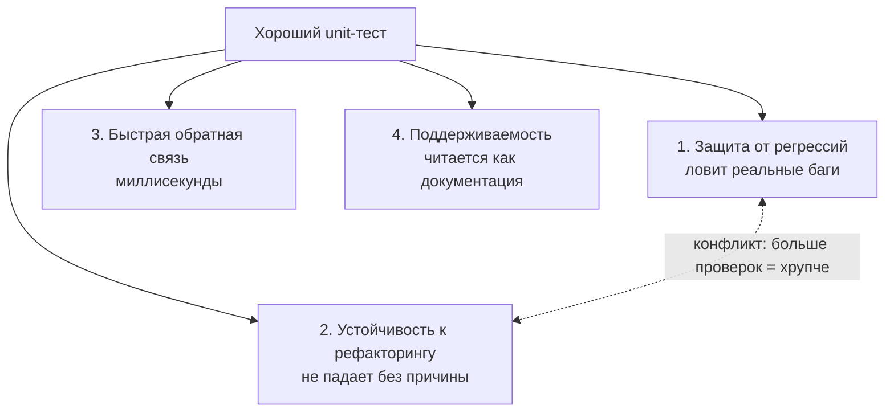
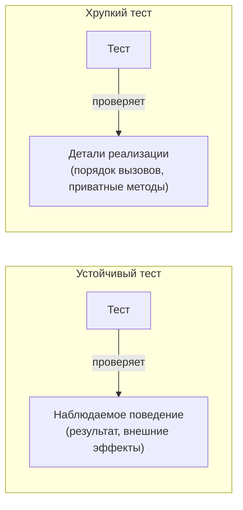
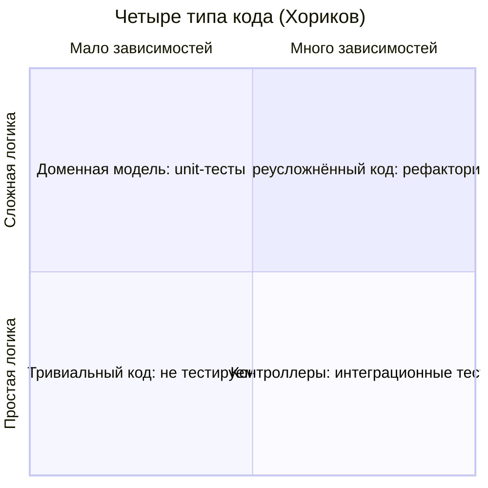

# Lecture 2: Качество unit-тестов: четыре столпа, покрытие, maintainability

> **Модуль**: 4 — Unit-тестирование на Java / JUnit 5
> **Лекция**: 2 из 2
> **Длительность**: 65 минут
> **Слайдов**: 17
> **Формат**: Markdown, каждый слайд — раздел `###`
> **Структура слайда**: Заголовок + буллеты + визуализация + speaker notes
> **Дата**: 03.08.2026
> **Литература**: см. [Источники](#источники) в конце файла
>
> **Соглашение о визуализации**: на каждом слайде есть блок **Визуализация** с описанием макета и рекомендацией по иллюстрации. Изображения пока только рекомендованы, имя файла и папка указаны условно; реальные файлы кладём в `Pictires/lecture-02/`. Диаграммы описаны кодом mermaid прямо в файле.

---

## Тайминг

| Время | Блок | Слайды | Назначение |
|:---:|---|:---:|---|
| 0:00–0:07 | Ввод | 1–3 | Связь с лекцией 1, проблема «тесты есть, уверенности нет» |
| 0:07–0:12 | Рамка качества | 4 | Четыре столпа хорошего теста |
| 0:12–0:29 | Метрики покрытия | 5–8 | Branch coverage, JaCoCo, закон Гудхарта, мутации |
| 0:29–0:34 | Интерактив | 9 | Параметризованные тесты: выбери источник данных |
| 0:34–0:50 | Качество тестов | 10–14 | Читаемость, хрупкость, overmocking, стили, типы кода, антипаттерны |
| 0:50–0:55 | Интерактив | 15 | Разбор четырёх плохих тестов |
| 0:55–0:59 | Code Review | 16 | Чек-лист ревьюера |
| 0:59–1:05 | Итоги | 17 | Итоги модуля, анонс модуля 5 |

---

### Слайд 1. Титульный

**Слайд:**
- Модуль 4. Лекция 2
- Качество unit-тестов: четыре столпа, покрытие, maintainability
- Лектор: Ирина Габанова, компания Lekton
- ИТМО, 4 курс

**Визуализация:**
- Макет: полноэкранный титульный фон, поверх — название модуля и лекции.
- Иллюстрация: `Pictires/lecture-02/img-1-cover.jpg` — титульный фон из брендового набора курса.

**Speaker notes:**

> Продолжаем Модуль 4. МНа прошлой лекции мы разобрали инструменты: JUnit 5, Mockito, паттерн AAA и принципы FIRST. Вы теперь знаете как писать unit-тест. Сегодня вопрос другой и более неприятный: как сделать так, чтобы ваши тесты через полгода не превратились в балласт, который никто не может поддерживать. Качество тестового кода так же важно, как и качество production-кода, — а платить за его отсутствие приходится дольше.
>
> Небольшое вступление, чтобы настроить нас на правильную волну. На прошлой лекции я говорила: тесты — это тоже код. А у любого кода есть жизненный цикл: его пишут, читают, меняют, рефакторят и в конце концов удаляют. Тестовый код живёт дольше, чем вы думаете: unit-тест, написанный сегодня, будет запускаться в CI после каждого коммита вашей команды годами. Каждый его недостаток умножается на количество запусков и на количество людей, которые будут его читать и чинить. Один плохой тест, который падает при каждом рефакторинге, за год съест больше человеко-часов, чем потребовалось бы на его правильное написание.
>
> Бывают проекты, где тестов было больше, чем production-кода, но они приносили больше вреда, чем пользы. Тесты падали при каждом рефакторинге, их отключали, и в итоге команда переставала им доверять: зелёный прогон уже никого не радовал, потому что все знали — падают они невпопад, а значит, и настоящий баг можно пропустить. Это та самая энтропия, о которой говорил Хориков на прошлой лекции. Сегодня разберём, как её не допустить: честные метрики — покрытие и мутационное тестирование, — читаемость и устойчивость к рефакторингу, и как всё это контролировать на code review.

---

### Слайд 2. План лекции

**Слайд:**
- Проблема: тесты есть, а уверенности нет
- Четыре столпа хорошего теста (Хориков)
- Метрики: Branch Coverage, JaCoCo, закон Гудхарта
- Мутационное тестирование (PITest)
- Интерактив: параметризованные тесты — выбери источник данных
- Читаемость, хрупкость, overmocking, стили тестирования
- Интерактив: разбор плохих тестов + чек-лист ревьюера

**Визуализация:**
- Макет: нумерованный список из семи пунктов; блоки «метрики» и «качество» выделены цветом как две половины лекции.
- Иллюстрация: `Pictires/lecture-02/img-2-plan.png`.

**Speaker notes:**

> План нашей второй лекции модуля. Сначала я покажу, почему «у нас есть тесты» и «нам не страшно рефакторить» — это две разные вещи. Затем введём рамку на всю лекцию — четыре столпа хорошего теста по Хорикову, — и дальше каждый блок будет прикреплён к одному из столпов.
>
> Первая большая часть — метрики. Разберёмся, что реально означает «сто процентов покрытия» и почему это ничего не гарантирует; подключим JaCoCo и поставим Quality Gate, который вы будете использовать на практике; и закончим мутационным тестированием — единственным способом проверить, что тесты вообще что-то проверяют.
>
> Вторая часть — то, что не измеряется метриками: читаемость, устойчивость к рефакторингу, злоупотребление моками и три стиля тестирования. Между частями — интерактив про параметризованные тесты: повторим материал первой лекции и углубим его. В конце — ещё один интерактив, как в прошлый раз: я покажу четыре теста с типовыми дефектами, а вы будете их находить. И финализируем всё чек-листом ревьюера — он пригодится вам всякий раз, когда вы читаете чужие тесты.

---

### Слайд 3. Проблема: тесты есть, а уверенности нет

**Слайд:**
- Ситуация: 800 тестов, покрытие 85% — и инцидент в проде
- Тесты зелёные ≠ код работает
- Признаки «мёртвого» набора тестов:
  - тесты падают при каждом рефакторинге;
  - новый баг не ловится ни одним тестом;
  - никто не помнит, что проверяет половина тестов
- Вопрос лекции: как отличить полезный тест от бесполезного?

**Визуализация:**
- Макет: слева — «приборная панель» с зелёными индикаторами (800 тестов, 85% coverage), справа — красный алерт «инцидент в проде».
- Иллюстрация: `Pictires/lecture-02/img-3-false-confidence.png` — зелёная панель приборов и горящий двигатель.

**Speaker notes:**

> Начну с истории, которую можно встретить в реальной жизни. Проект, восемьсот unit-тестов, JaCoCo показывает восемьдесят пять процентов покрытия, все индикаторы зелёные. И при этом — инцидент в проде: после очередного релиза клиентам неверно считает комиссию. Разбор показывает обидное: метод, в котором был баг, покрыт тестами. Тесты его вызывают. Просто ни один из них не проверяет результат расчёта — они проверяли, что метод «не падает».
>
> Это иллюстрация главного тезиса лекции: зелёные тесты — не синоним работающего кода. Тест может выполнять код и не проверять ничего. Тест может проверять то, что неважно. Тест может быть настолько хрупким, что команда привыкла его игнорировать, — и тогда он не ловит даже то, что мог бы.
>
> Как распознать «мёртвый» набор тестов? Три симптома. Первый: тесты падают при каждом рефакторинге — вы переименовали внутренний метод, и краснеет тридцать тестов, хотя поведение системы не изменилось. Второй: новый баг, пришедший с прода, не ловится ни одним тестом — набор формально большой, а защиты от регрессий нет. Третий, самый честный: спросите автора через месяц, что проверяет конкретный тест, — и он пойдёт читать код. Тест, который нельзя понять по имени и структуре, не выполняет роль документации.
>
> Значит, нам нужен критерий, по которому можно отличить полезный тест от бесполезного — не на глазок, а системно. Такой критерий есть, и сейчас мы его введём.

---

### Слайд 4. Четыре столпа хорошего теста

**Слайд:**
- Хориков, гл. 4: хороший тест держится на четырёх столпах
- **Защита от регрессий** — тест ловит реальные баги
- **Устойчивость к рефакторингу** — тест не падает, пока поведение не изменилось
- **Быстрая обратная связь** — тест выполняется за миллисекунды
- **Поддерживаемость** — тест легко читать и чинить
- Столпы 1 и 2 в конфликте: чем больше проверяешь, тем хрупче тест
- Ценность теста = пойманные баги − ложные срабатывания − стоимость поддержки

**Визуализация:**
- Макет: античный фронтон на четырёх колоннах; между первой и второй колонной — молния «конфликт».
- Диаграмма: mermaid-схема ниже.
- Иллюстрация: `Pictires/lecture-02/img-4-pillars.png` — четыре колонны с подписями.



**Speaker notes:**

> Владимир Хориков в четвёртой главе своей книги предлагает модель, на которой мы построим всю сегодняшнюю лекцию, — четыре столпа хорошего unit-теста. Первый столп — защита от регрессий: тест должен ловить баги, которые иначе дошли бы до продакшена. Это главная функция теста, ради неё всё затеяно. Второй — устойчивость к рефакторингу: тест остаётся зелёным, когда вы меняете реализацию, но не поведение. Третий — быстрая обратная связь: тест выполняется за миллисекунды, иначе его не будут запускать. Четвёртый — поддерживаемость: тест легко читать, понять и починить.
>
> Третий и четвёртый столпы вы частично знаете из прошлой лекции: быстрота — это буква F в FIRST, поддерживаемость начинается с AAA и хороших имён. Сегодняшний фокус — на первых двух, потому что между ними существует фундаментальный конфликт. Чем больше деталей проверяет тест, тем лучше он защищает от регрессий — но тем чаще он падает при безобидных изменениях. Проверяешь каждый вызов каждой зависимости — поймаешь любое отклонение, но и каждый рефакторинг будет красным. Проверяешь только финальный результат — тест стабилен, но часть багов пройдёт мимо. Мастерство написания тестов — это умение находить баланс на этом конфликте.
>
> Хориков предлагает и формулу: ценность теста равна его вкладу в поимку багов минус стоимость ложных срабатываний и минус стоимость поддержки. Запомните три слагаемых — сегодня каждый блок лекции будет про одно из них. Метрики покрытия и мутации — про первое слагаемое, ловит ли тест баги. Хрупкость и overmocking — про второе, ложные срабатывания. Читаемость и DRY — про третье, стоимость поддержки.
>
> И ещё одно важное следствие: из четырёх столпов два — устойчивость к рефакторингу и поддерживаемость — не измеряются никакой метрикой. JaCoCo не скажет вам, что тест хрупкий. Их видит только человек при чтении кода. Именно поэтому code review тестов — не бюрократия, а единственный инструмент контроля половины качества. Мы вернёмся к этому в конце лекции, когда будем собирать чек-лист ревьюера.

---

### Слайд 5. Statement vs Branch Coverage

**Слайд:**
- **Line/Statement coverage**: какие строки выполнились при прогоне
- **Branch coverage**: пройдены ли обе ветки каждого условия
- Один зелёный тест: строки 4 из 5 (80%), ветки 1 из 2 (50%)
- В СМП: каждый `if` в авторизации требует теста на обе ветки + границы

Классический пример Хорикова (гл. 1, листинг 1.1): метод определяет, «длинная» ли строка (больше пяти символов), и один тест:

```java
boolean isStringLong(String input) {
    if (input.length() > 5)     // условие выполнено, ветка true — нет
        return true;            // НЕ покрыта тестом
    return false;               // покрыта тестом
}

@Test
void test() {
    boolean result = isStringLong("abc");   // длина 3 ≤ 5
    assertFalse(result);
}
```

**Визуализация:**
- Макет: слева код с подсвеченной непокрытой строкой; справа мини-таблица «1 тест: строки 4/5 (80%), ветки 1/2 (50%)».
- Иллюстрация: `Pictires/lecture-02/img-5-branch-coverage.png` — фрагмент отчёта JaCoCo с жёлтым ромбиком на ветвлении.

**Speaker notes:**

> Первая половина лекции — метрики, и начнём с тонкости, которая напрямую влияет на количество пропущенных багов: разница между покрытием строк и покрытием ветвлений. Line coverage отвечает на вопрос «какие строки кода выполнились при прогоне тестов». Branch coverage — на вопрос «пройдены ли обе ветки каждого условия: и true, и false».
>
> Смотрите на код — это классический пример Хорикова из первой главы, листинг 1.1, я только перевела его с C# на Java. Метод определяет, является ли строка «длинной» — то есть длиннее пяти символов, — и один-единственный тест проверяет строку "abc" длиной три. Прогоним мысленно. Тест заходит в метод, вычисляет условие — три не больше пяти, ветка false — и возвращает false через нижний return. Какие строки выполнились? Сигнатура метода, условие, `return false`, закрывающая скобка — четыре из пяти: фигурные скобки Хориков тоже считает строками. А строка `return true;` не выполнилась ни разу. Line coverage — восемьдесят процентов, не сто. А теперь посчитаем ветки. Условие одно, веток две: длина больше пяти и не больше. Тест прошёл только ветку false. Branch coverage — одна из двух, пятьдесят процентов. Видите: две метрики дают два разных числа на одном и том же прогоне, и ни одно из них — не сто процентов, хотя тест зелёный и «метод покрыт».
>
> И вот здесь Хориков делает красивый ход, который мы ещё вспомним на слайде про закон Гудхарта. Смотрим на тот же метод после рефакторинга: заменили `if` на один return — `return input.length() > 5;`. Тест тот же самый. Line coverage выросло до ста процентов: все три строки выполняются. Тесты стали лучше? Ни на йоту — они проверяют ровно то же самое. А branch coverage как было пятьдесят, так и осталось: ветвей две, пройдена одна, и от формы записи это не зависит. Вот почему line coverage — метрика, которую легко обмануть компактной записью кода, а branch coverage — честнее: он считает ветвления, а не строки.
>
> Это не академическая разница. В финансовых системах ветвления — это деньги: ошибка в `>` вместо `>=` означает, что транзакция ровно на границе лимита пройдёт или упадёт некорректно. Вспомните Модуль 2 и граничные значения: каждая ветка требует тестов не где-то в середине класса эквивалентности, а на границе — рубль до, ровно граница, рубль после. Branch coverage и граничные значения — это одна и та же дисциплина, посмотренная с двух сторон: метрика показывает дыру, техника тест-дизайна говорит, какие данные её закроют.
>
> Отдельно замечу: даже `if` без `else` имеет две ветки — условие выполнилось и не выполнилось. JaCoCo считает именно так, поэтому его цифра всегда строже, чем кажется. А для сложных составных условий существуют ещё более строгие критерии — MC/DC применяют в авиации и медицине; в банковском enterprise достаточно branch.
>
> Практический вывод: смотрим на branch coverage, а не на line. Каждый `if` в бизнес-логике — это пара тестов: положительный и отказный сценарий. Т.е. касательно нашего проекта это будут  успешная авторизация, различные отказы : по лимиту, отказ по статусу карты, отказ по сроку действия — каждой ветке по тесту.

---

### Слайд 6. JaCoCo: отчёт и Quality Gate

**Слайд:**
- JaCoCo инструментирует байт-код и пишет отчёт при прогоне тестов
- HTML-отчёт — для людей: красные строки, жёлтые ромбики на ветвлениях
- XML-отчёт — для машин: его читает Quality Gate в CI
- `jacoco:check`: сборка падает, если branch coverage < 70%
- Жёлтый ромбик в отчёте = конкретное место для нового теста

```xml
<execution>
    <id>check</id>
    <goals><goal>check</goal></goals>
    <configuration>
        <rules>
            <rule>
                <element>BUNDLE</element>
                <limits>
                    <limit>
                        <counter>BRANCH</counter>
                        <value>COVEREDRATIO</value>
                        <minimum>0.70</minimum>
                    </limit>
                </limits>
            </rule>
        </rules>
    </configuration>
</execution>
```

**Визуализация:**
- Макет: слева скриншот HTML-отчёта JaCoCo (зелёные/красные строки, жёлтый ромбик), справа фрагмент pom.xml; внизу схема «коммит → CI → gate → мерж/отказ».
- Иллюстрация: `Pictires/lecture-02/img-6-jacoco.png`.

**Speaker notes:**

> Как этим пользоваться на практике. JaCoCo — стандартный инструмент измерения покрытия в Java-мире. Работает он так: при запуске тестов агент инструментирует байт-код вашего приложения и записывает, какие строки и ветки выполнились. Подключение — один плагин в pom.xml: цель `prepare-agent` для инструментации и `report` для генерации отчёта. В своём проекте вы добавляете эту конфигурацию один раз, поэтому запомните минимум: два execution-блока, и отчёт появляется в `target/site/jacoco` после `mvn verify`.
>
> Отчётов два, и у них разные потребители. HTML — для вас: открываете в браузере и видите исходный код с подсветкой. Зелёное — покрыто, красное — не выполнялось, и самое полезное — жёлтые ромбики на ветвлениях: ветвление пройдено частично. Жёлтый ромбик — это не абстрактная цифра, а конкретное место, куда нужно написать тест. Рабочий цикл выглядит так: написал тесты, прогнал, открыл отчёт, увидел ромбик у проверки лимита, добавил параметризованный тест на обе ветки и границу. Так покрытие превращается из отчёта «для начальства» в рабочий список задач.
>
> XML-отчёт — для машин. Его забирает CI, и здесь появляется понятие Quality Gate — автоматического правила, которое не пускает код в main. На слайде третий execution плагина — цель `check`: сборка падает, если покрытие ветвлений ниже семидесяти процентов. Смысл в том, что решение «можно ли интегрировать этот код» принимает машина по объективному критерию, а не человек под давлением дедлайна. Тест упал или покрытие просело — мерж запрещён. Так работают зрелые команды, и так будет устроен ваш CI в курсе: баг, который ловит хоть один тест, физически не доедет до main.
>
> Конкретное значение порога — договорённость команды, а не закон природы. В нашем курсе — семьдесят процентов по ветвям: достаточно, чтобы гарантировать проверку decline-сценариев, и не настолько высоко, чтобы вы начали писать тесты на геттеры. В критичных финансовых модулях пороги бывают выше, в транспортной обвязке — ниже или вовсе без порога: её покрывают интеграционными тестами. Дифференцированный подход экономит недели по сравнению с «сто процентов везде».

---

### Слайд 7. Закон Гудхарта: пределы покрытия

**Слайд:**
- «Когда метрика становится целью, она перестаёт быть хорошей метрикой»
- Тест без assert выполняет код — и покрытие растёт
- Покрытие — хороший **негативный** индикатор, плохой **позитивный**
- 10% — точно плохо; 100% — ничего не гарантирует
- Покрытие — инструмент поиска дыр, а не цель

**Визуализация:**
- Макет: слева тест без assert-ов с зелёной галочкой «100%», справа формула «исполнен ≠ протестирован».
- Иллюстрация: `Pictires/lecture-02/img-7-goodhart.png` — термометр, который греют снаружи.

**Speaker notes:**

> Теперь — почему я на прошлом слайде всё время оговаривалась «покрытие — не цель». Экономист Чарльз Гудхарт сформулировал закон: когда метрика становится целью, она перестаёт быть хорошей метрикой. Покрытие — идеальная иллюстрация. Как только команда получает задачу «догнать до девяноста процентов», появляются тесты, которые вызывают метод и ничего не проверяют. Строки выполняются, метрика растёт, план выполнен — а защиты от регрессий ноль. Формально код исполнен, фактически его результат никто не сверил с ожиданием.
>
> Есть и более тонкие способы обмануть метрику. Хориков приводит пример: рефакторите метод из четырёх строк с `if` в одну строку с тернарным выражением — строк стало меньше, покрытие выросло. Тесты стали лучше? Нет, они проверяют ровно то же самое. Числитель не изменился, знаменатель уменьшился — метрика «улучшилась» сама собой. Любая метрика, которую можно улучшить, не улучшая систему, — плохая цель.
>
> Отсюда точная формулировка Хорикова, которую стоит запомнить дословно: покрытие — это хороший негативный индикатор, но плохой позитивный. Если покрытие десять процентов — это однозначно плохо: девяносто процентов кода никто никогда не запускал в тестах, там могут жить любые баги, и рефакторинг идёт вслепую. Низкое покрытие достоверно сигналит о проблеме. Но сто процентов не гарантирует ничего: они говорят лишь, что весь код запускался, а не что его результаты проверялись. Метрика честно отвечает «где точно плохо» и не умеет отвечать «где точно хорошо».
>
> Как этим пользоваться, не становясь жертвой Гудхарта? Три правила. Первое: покрытие — это гигиенический минимум и инструмент поиска дыр, а не цель. «Догнать до семидесяти» — нормальная задача; «выжать сто любой ценой» — нет: ради последних процентов вы начнёте тестировать DTO, геттеры и конфигурацию, где нет логики и нечему ломаться. Второе: смотрите не на процент, а на конкретные непокрытые ветки — они и есть работа. Третье: если хочется метрику, которая отвечает на вопрос «а тесты вообще что-то проверяют?», — она существует, и это следующий слайд.

---

### Слайд 8. Мутационное тестирование

**Слайд:**
- Как проверить, что тесты реально проверяют результат?
- PITest вносит мутации в байт-код: `>` → `>=`, `+` → `−`, удаляет вызовы
- Тесты упали → мутация **убита** (тесты работают)
- Тесты зелёные → мутация **выжила** (дыра в тестах)
- Mutation Score — доля убитых мутаций; дорого, запускают ночами

**Визуализация:**
- Макет: слева «здоровый» код, справа мутант с изменённым знаком; стрелка к двум исходам — красный прогон «убита» / зелёный прогон «выжила».
- Иллюстрация: `Pictires/lecture-02/img-8-mutation.png` — пожарная сигнализация и подожжённая спичка.

**Speaker notes:**

> Даже честный branch coverage не отвечает на главный вопрос: а проверяет ли тест результат? Код может исполняться, все ветки пройдены — а assert сверяет не то. Крайний случай вы уже знаете: тест без assert-ов. Случай похитрее: ожидаемое значение в тесте вычисляется той же формулой, что в production-коде. Покрытие сто процентов, а защиты ноль: обе копии формулы содержат одинаковый баг, и тест вечно зелёный.
>
> Раз качество тестов нельзя измерить напрямую, его измеряют косвенно: подсовывают в код известные баги и смотрят, поймают ли тесты. Это и есть мутационное тестирование. Инструмент — в Java-мире это PITest — берёт скомпилированный код и вносит мутации: меняет больше на больше-или-равно, плюс на минус, true на false, удаляет вызовы методов. Каждая мутация — это маленький искусственный баг.
>
> Дальше PITest прогоняет ваш набор тестов против каждого мутанта. Если тесты упали — отлично: баг обнаружен, мутация убита, тесты работают. Если тесты прошли зелёным — тревожно: есть изменение поведения, которое никто не заметил, мутация выжила. Выжившая мутация — это конкретная дыра: инструмент покажет класс, строку и что именно он изменил. Итоговая метрика — Mutation Score, доля убитых мутаций. Она честнее покрытия ровно потому, что обмануть её приёмом «вызвать без assert» невозможно: мутация меняет поведение, и без настоящей проверки тест её не заметит.
>
> Посмотрите, как красиво это стыкуется с прошлыми слайдами. PITest заменил `>` на `>=` в проверке лимита, и ваш тест не упал — значит, у вас нет теста ровно на границу. Добавили тест на сумму, равную лимиту, — мутация умерла. Branch coverage показывает непройденные ветки, а мутации показывают, что даже пройденные ветки могут быть проверены мимо границы.
>
> Цена вопроса: мутационное тестирование дорогое. Сотни мутантов, и на каждого — полный прогон набора. Поэтому его не запускают на каждый коммит: обычно ночью, по расписанию, и не на всём коде, а на критичной бизнес-логике. Если хотите попробовать PITest - он подключается к Maven одним плагином.
>
> Метафора для запоминания. Покрытие показывает, что пожарная сигнализация установлена в каждой комнате. Мутационное тестирование поджигает спичку и проверяет, что сигнализация действительно сработает. Установленная, но не срабатывающая сигнализация — это и есть тесты без assert-ов.

---

### Слайд 9. Интерактив: параметризованные тесты — выбери источник данных

**Слайд:**
- Игра: четыре сценария — выберите источник данных для каждого
- Сценарий 1: шесть невалидных PAN (короткий, буквы, неверная контрольная сумма)
- Сценарий 2: авторизация — сумма × статус карты → решение, восемь комбинаций
- Сценарий 3: отказ для ЛЮБОГО неактивного статуса карты
- Сценарий 4: запросы с десятью полями, собранные билдером

```java
// Разбор сценария 3 — новинка дня
@ParameterizedTest
@EnumSource(value = CardStatus.class, names = "ACTIVE",
            mode = EnumSource.Mode.EXCLUDE)
void shouldDeclineWhenCardNotActive(CardStatus status) {
    Decision decision = service.authorize(requestWith(cardWith(status)));
    assertThat(decision).isNotEqualTo(Decision.APPROVED);
}
```

**Визуализация:**
- Макет: четыре карточки-сценария слева, четыре «фишки» источников справа (`@ValueSource`, `@CsvSource`, `@EnumSource`, `@MethodSource`); правильные пары соединяются стрелками по ходу разбора.
- Иллюстрация: `Pictires/lecture-02/img-9-parameterized.png`.

**Speaker notes:**

> Середина лекции — самое время встряхнуться. Скажу честно: эта тема отчасти повторение первой лекции, где мы разбирали `@ParameterizedTest`, а отчасти — углубление: в прошлый раз живых примеров было мало, и `@EnumSource` мы не успели вовсе.
>
> Правила игры простые. По каждому сценарию называете источник данных — `@ValueSource`, `@CsvSource`, `@EnumSource` или `@MethodSource` — и, главное, объясняете почему. Источники могут повторяться, а у одного сценария может быть два приемлемых ответа — тогда сравниваем их.
>
> Сценарий первый: шесть невалидных PAN — короткий номер, буквы в середине, неверная контрольная сумма Луна. Что берём? Да, `@ValueSource`: один параметр, простой список строк, ничего больше не нужно. Это самый лёгкий источник — одно значение на прогон.
>
> Сценарий второй: авторизация зависит от суммы и статуса карты, восемь комбинаций с ожидаемым решением. Здесь `@CsvSource`: таблица «входы → ожидание», каждая строка — отдельный прогон, JUnit сам сконвертирует строки в long и enum. Это тот самый пример с первой лекции.
>
> Сценарий третий — и это новинка дня. Бизнес-правило: неактивная карта — всегда отказ, независимо от того, какой именно статус неактивности. Перечислять BLOCKED, EXPIRED, FROZEN руками в `@CsvSource`? Можно, но завтра в enum добавят статус LOST — и тест молча его не проверит. Для этого существует `@EnumSource`: он перебирает значения перечисления. А режим EXCLUDE с `names = "ACTIVE"` решает задачу элегантно: тест прогонится на всех статусах, кроме ACTIVE, и автоматически подхватит любой новый статус, который добавят в enum. Это тест, который сам становится строже по мере роста системы — редкий случай, когда код теста работает на вас в будущем.
>
> Сценарий четвёртый: запросы с десятью полями, каждый собирается билдером. В CSV такое не впишешь — здесь `@MethodSource`: статический метод возвращает поток готовых объектов. Правило выбора получается простое: одно примитивное значение — `@ValueSource`, таблица примитивов — `@CsvSource`, перечисление — `@EnumSource`, сложные объекты — `@MethodSource`.
>
> И два напоминания из первой лекции, которые относятся ко всем четырём источникам. Первое: каждый набор данных — отдельная строка в отчёте, поэтому используйте шаблон `name` с подстановкой аргументов — при падении сразу видно, какой сценарий сломался, а не загадочное «[3]». Второе: никаких if внутри параметризованного теста — если сценарии требуют разной логики, это разные тесты, а не один тест с ветвлением.

---

### Слайд 10. Читаемость: тест как документация

**Слайд:**
- Имя — оглавление поведения: `should...When...` (лекция 1)
- Числа рассказывают историю: никаких магических констант без имён
- Подготовка шума — в фабричные методы: `blockedCard()`, `cardWithLimit(5000)`
- DRY в тестах — с осторожностью: правило RULE
- Mystery Guest: данные, которых не видно в тесте, — антипаттерн

**Визуализация:**
- Макет: слева «плохой» тест с `assertEquals(1500, ...)` и пятью строками инициализации, справа «хороший» — именованные константы и фабричный метод.
- Иллюстрация: `Pictires/lecture-02/img-10-readability.png`.

**Speaker notes:**

> Вторая половина лекции — качества, которые метрикой не измерить. Начнём с читаемости. Подумайте, сколько раз за жизнь теста его читают. Пишут один раз. А читают десятки: ревьюер при пулл-реквесте, автор через месяц, команда при разборе упавшего теста ночью, новый сотрудник, изучающий систему. Фримен и Прайс называют тесты живой документацией: новичок должен уметь прочитать тесты и понять, как работает система. Если для этого нужно раскрыть пять вспомогательных классов — тест написан плохо.
>
> Про имена мы говорили на прошлой лекции, напомню суть одной фразой: имя теста — это оглавление поведения класса в формате should-When. `shouldDeclineTransactionWhenCardIsBlocked` — читатель понимает сценарий, не открывая тело; `testCard` — не понимает. Тест не вызывается из кода, поэтому длинное имя ничего не стоит — не экономьте на нём. Если в команде принято, добавляйте `@DisplayName` с человекочитаемым описанием — его видно в отчётах; но помните, что DisplayName не оправдывает плохое имя метода.
>
> Вторая тема — магические числа. Видите в тесте `assertEquals(1500, result)` — откуда взялось полторы тысячи? Результат формулы? Граница лимита? Читатель вынужден держать в голове всю арифметику и вести расследование. Гораздо лучше: `int expectedBalance = INITIAL_BALANCE - TRANSACTION_AMOUNT`. Читаемый тест читается как проза: подготовили баланс десять тысяч, отправили транзакцию на три, ожидаем семь. Числа должны рассказывать историю.
>
> Третья тема — баланс дублирования. В production-коде святой принцип DRY: каждое знание имеет одно представление. В тестах уравнение другое: тест должен читаться автономно. Когда создание карты спрятано в десяток виртуальных методов базовых классов, читатель не знает — карта заблокированная или активная? — и прыгает по файлам, чтобы просто понять сценарий. Месарос называет это Mystery Guest, таинственный гость: тест зависит от данных, которых в нём не видно. Поэтому в тестах действует смягчённая эвристика RULE: Reduce, Reuse, but don't Over-abstract. Дублируйте то, что читателю важно видеть, — входные данные и ожидания. Абстрагируйте шум — создание инфраструктуры, рутинную валидацию. Механический приём — не наследование, а фабричные методы в том же классе: `blockedCard()`, `cardWithLimit(5000)`. Имя сценария появляется прямо в месте использования.
>
> И предостережение про `@BeforeEach` с прошлой лекции: если выносите Arrange в setup, убедитесь, что он нужен каждому тесту в классе. Иначе получите «пыльный» setup: половина состояния там, половина в тесте, и их переплетение понятно только автору. Если группы тестов требуют разного контекста — лучше разделить их по `@Nested`-классам, у каждого свой setup.

---

### Слайд 11. Хрупкие тесты: поведение vs реализация

**Слайд:**
- Brittle test: падает при изменении реализации, а не поведения
- Over-specification: тест прибит гвоздями к внутреннему устройству
- Ложное срабатывание = разрушенное доверие к набору тестов
- Критерий: меняется реализация — тест зелёный; меняется поведение — тест красный
- Приватный метод «просит тест» → это сигнал выделить класс

**Визуализация:**
- Диаграмма: mermaid-схема ниже.
- Иллюстрация: `Pictires/lecture-02/img-11-brittle.png` — тест, «привязанный» верёвками к внутренним шестерёнкам класса.



**Speaker notes:**

> Главный убийца наборов тестов — хрупкость. Вы поменяли формат внутреннего DTO — и упало пятьдесят тестов, хотя поведение системы не изменилось ни на йоту. Каждое такое ложное падение стоит команде времени: открыть, понять, что бага нет, поправить, дождаться CI. А самое дорогое — психологическое: после нескольких ложных падений красный тест перестаёт восприниматься как сигнал. Сигнализация, которая срабатывает от порыва ветра, в итоге просто отключается — вместе со всей защитой.
>
> Причина хрупкости почти всегда одна — избыточная спецификация, over-specification: тест проверяет не результат, а то, как метод устроен внутри. Классический пример Хорикова: тест проверяет, что рендерер сообщения использует именно HeaderRenderer, BodyRenderer и FooterRenderer в конкретном порядке. Заменили BodyRenderer на BoldRenderer — результат тот же, а тест красный. Правильный тест проверял бы: выход содержит заголовок, тело и подвал. Всё. Приём для самопроверки: возьмите каждое утверждение в тесте и спросите — изменится ли наблюдаемое поведение системы, если оно перестанет выполняться? Нет — это не проверка, а украшение реализации, удаляйте.
>
> Это развитие того, что мы разбирали на прошлой лекции на примере CQS. Там правило было про verify: только команды с внешними эффектами, никогда — запросы и входящие вызовы. Здесь тот же принцип в масштабе всего теста: каждая лишняя проверка внутренней структуры — ещё один крючок, за который тест зацепится при рефакторинге. Кстати, вспомните интерактив прошлой недели: тест B падал именно из-за verify на вызове stub'а — реализацию чуть поменяли, поведение не изменилось, а тест покраснел. Это и был over-specification в миниатюре.
>
> Отсюда же правило про приватные методы, теперь с обоснованием. Приватный метод — деталь реализации по определению. Тест, который дёргает его через рефлексию, умирает при первом же рефакторинге, даже если публичный контракт не изменился. Если приватному методу «отчаянно нужен собственный тест» — это не проблема тестирования, это сигнал дизайна: логика просится в отдельный класс с публичным интерфейсом.
>
> Запомните критерий, тест должен падать тогда и только тогда, когда сломалось наблюдаемое поведение. Меняется реализация — тест зелёный. Меняется поведение — тест красный. Всё остальное — дефект теста, а не кода.

---

### Слайд 12. Overmocking и три стиля тестирования

**Слайд:**
- Overmocking: моки там, где можно реальный объект
- Три симптома: мок на каждый чих; verify больше, чем arrange; тест дублирует код метода
- Три стиля проверки (по убыванию предпочтения):
  - **Output-based** — проверяем возвращаемое значение
  - **State-based** — проверяем состояние объекта
  - **Communication-based** — проверяем взаимодействие (mock verify)
- Мок — только для внешних эффектов: сеть, БД, уведомления

**Визуализация:**
- Макет: три карточки стилей с «медалями» золото/серебро/бронза; рядом предупреждающий знак «mock overload».
- Иллюстрация: `Pictires/lecture-02/img-12-styles.png`.

**Speaker notes:**

> Обратная сторона хрупкости — злоупотребление моками, overmocking. Мок — это скальпель, а не кухонный нож: режем только там, где без него нельзя — реальная база, сеть, системное время. Три симптома, по которым я узнаю overmocking на ревью. Первый: мок на каждую зависимость, включая простые объекты-значения и коллег по пакету, которые прекрасно работают вживую. Второй: verify-строк больше, чем arrange — тест описывает хореографию вызовов вместо результата. Третий, самый показательный: тест дублирует код тестируемого метода — вы читаете настройки моков и понимаете, что это тот же алгоритм, переписанный на Mockito. Такой тест зелёный при любом поведении и умирает при любом рефакторинге: каждый мок заменяет часть реальности фантазией, и чем больше моков, тем быстрее фантазия устаревает.
>
> Чтобы выбирать способ проверки осознанно, Хориков предлагает классификацию из трёх стилей. Первый — output-based: скармливаете методу входные данные и проверяете возвращаемое значение. Метод не трогает состояние и зависимости — это функциональный стиль, самый устойчивый к рефакторингу, потому что проверяется только наблюдаемый результат. Второй — state-based: вызываете метод и проверяете состояние объекта или системы после вызова. Чуть более связан с реализацией, но всё ещё проверяет то, что видно снаружи. Третий — communication-based: проверяете через моки, как метод общался с зависимостями. Самый хрупкий стиль: он буквально прибит к деталям взаимодействия.
>
> Порядок предпочтения — именно такой: output лучше state, state лучше communication. Это не значит, что третьим стилем пользоваться нельзя: «уведомление антифрода отправлено», «запись в историю выполнена» — это внешние эффекты, их иначе не проверить. Но по умолчанию тянитесь к более устойчивому стилю. Если метод возвращает результат — проверяйте результат, а не то, какие методы он при этом дёргал. Это ровно то же правило CQS с прошлой лекции, посмотренное с другой стороны: verify — только для команд с внешними эффектами.
>
> Практический вопрос для ревью: «можно ли этот тест переписать в более устойчивом стиле?» Если communication-based тест легко превращается в state-based — проверить состояние объекта вместо verify, — его надо превратить. Каждая такая замена убирает один крючок, за который тест зацепится при рефакторинге.

---

### Слайд 13. Что тестировать: четыре типа кода

**Слайд:**
- Два измерения: сложность логики × количество зависимостей
- **Доменная модель** (сложная, мало зависимостей) — unit-тесты, максимальная отдача
- **Тривиальный код** (простой, мало зависимостей) — не тестируем вовсе
- **Контроллеры** (простые, много зависимостей) — интеграционные тесты
- **Переусложнённый код** (сложный, много зависимостей) — рефакторить!
- Humble Object: выносим логику из контроллера в домен

**Визуализация:**
- Диаграмма: mermaid-матрица 2×2 ниже.
- Иллюстрация: `Pictires/lecture-02/img-12-code-types.png` — матрица с примерами классов СМП в квадрантах.



**Speaker notes:**

> Остался стратегический вопрос: что вообще тестировать unit-тестами, а что — нет.  «а надо ли тестировать контроллер? а DTO? а конфиг?» У Хорикова есть матрица, которая отвечает исчерпывающе. Два измерения: насколько код сложный — сколько в нём ветвлений и бизнес-правил, — и сколько у него внешних зависимостей. Получаются четыре квадранта.
>
> Сложная логика, мало зависимостей — доменная модель: расчёт лимитов, проверка статусов карты, валидация транзакции. Это золотая жила unit-тестирования: тесты пишутся легко, выполняются мгновенно, ловят самые дорогие баги. Максимальная отдача на вложенный час — здесь. Простая логика, мало зависимостей — тривиальный код: геттеры, простые DTO, мапперы в одну строку. Тестировать не нужно вообще: нечему ломаться, а каждый такой тест — это стоимость поддержки без отдачи. Простая логика, много зависимостей — контроллеры и оркестраторы: принять запрос, вызвать три сервиса, собрать ответ. Unit-тесты здесь бессмысленны — логики почти нет, а тест выродится в проверку хореографии моков. Это территория интеграционных тестов, Модуль 6.
>
> И четвёртый квадрант, самый интересный: сложная логика плюс много зависимостей — переусложнённый код. Классический сервис на тысячу строк, который и лимит считает, и в базу ходит, и уведомления шлёт. Unit-тестировать его больно: десять моков на один тест. Но правильный ответ не «терпеть и мокать», а рефакторинг. Паттерн Humble Object, «скромный объект»: оставляем в контроллере или сервисе-обёртке только склейку — простую, которую проверят интеграционные тесты, — а всю сложную логику выносим в чистый доменный класс без зависимостей. После такого разделения сложная часть переезжает в квадрант доменной модели и покрывается дешёвыми unit-тестами.
>
> Это важный сдвиг в сознании: тестируемость — не свойство тестов, а свойство дизайна. Если код тяжело тестируется unit-тестами, проблема почти всегда в самом коде. Тесты — это первый клиент вашего дизайна, и они голосуют за разделение ответственности честнее любого архитектурного ревью. Вспомним формулу ценности: тест на переусложнённый код дорог в поддержке — высокое третье слагаемое; рефакторинг в Humble Object уменьшает его в разы.

---

### Слайд 14. Антипаттерны: знать врага в лицо

**Слайд:**
- **Ice Cream Cone**: много E2E, мало unit — перевёрнутая пирамида
- **Generous Leftovers**: тест оставляет данные, следующие на них полагаются
- **One Giant Test**: один метод проверяет пять вещей
- **Leaking Domain Knowledge**: формула продублирована в тесте
- **Test Logic in Production**: `if (testMode)` в основном коде

**Визуализация:**
- Макет: пять «плакатов розыска» с портретами-иконками: рожок мороженого, тарелка с объедками, гигантский монстр, дырявое ведро, маска.
- Иллюстрация: `Pictires/lecture-02/img-14-antipatterns.png`.

**Speaker notes:**

> Соберём типовые болезни тестов в каталог — большую часть собрал Месарос, и, зная их в лицо, вы будете узнавать их на ревью за секунды. Первый — «мороженое», Ice Cream Cone: перевёрнутая пирамида из Модуля 3, когда команда пишет много ручных и E2E-тестов и почти не пишет unit. Прогон CI занимает часы, тесты нестабильны, каждый сбой окружения выглядит как баг. Лекарство — расширять основание: бизнес-логику вниз, в unit.
>
> Второй — «щедрые остатки», Generous Leftovers: тест оставляет после себя данные в общей коллекции или файле, а следующий неявно на них рассчитывает. Уберите первый тест — падает второй, и никто не понимает почему. Или набор проходит последовательно, но краснится в параллельном прогоне. Это нарушение буквы I из FIRST: тесты не должны влиять друг на друга, порядок не должен иметь значения.
>
> Третий — «один гигантский тест»: метод создаёт объект, вызывает, проверяет, вызывает ещё раз, проверяет, удаляет, проверяет удаление. Несколько Act-секций, чередующихся с assert, — это по структуре уже интеграционный сценарий, и главное — он не диагностирует: упал, а что сломалось — создание, изменение или удаление — неизвестно без отладчика. Десяток маленьких тестов падают каждый по своей причине и указывают прямо на неё. Это правило одного Act с прошлой лекции, теперь вы знаете цену его нарушения.
>
> Четвёртый — «утечка знаний о предметной области»: в тесте `assertEquals(0.15, result)`, а 0.15 — результат формулы комиссии, посчитанной в уме. Формула изменится — тест упадёт, и никто не поймёт почему: магическое ожидание без контекста. Ещё хуже обратный вариант: формула продублирована в тесте — и тест вечно зелёный, даже когда обе копии содержат одинаковый баг. Помните, это ровно та лазейка, которую находит мутационное тестирование. Правильно: ожидания — именованные константы, посчитанные вручную или взятые из спецификации, с комментарием об источнике.
>
> Пятый, редкий, но коварный — «логика тестов в продакшене»: ради тестируемости в основной код добавляют ветки, нужные только тестам, — `if (testMode)`, флаги, дефолтные значения «для удобства». Это мёртвый код в проде и скрытые ветки, которые надо тестировать. Тестируемость достигается не ветками, а внедрением зависимостей через конструктор.
>
> Запомните как чек-лист ревьюера: перевёрнутая пирамида, щедрые остатки, гигантский тест, магические ожидания, тестовые ветки в проде. Любой из них — сигнал, что набор скоро начнёт болеть.

---

### Слайд 15. Интерактив: найди дефекты

**Слайд:**

```java
// Тест 1
@Test
void processTransaction() {
    service.process(validRequest());
}

// Тест 2
@Test
void shouldAuthorize() {
    when(repository.findCard(PAN)).thenReturn(activeCard());
    AuthorizeResult result = service.authorize(request);
    verify(repository).findCard(PAN);
    assertEquals(AuthorizeResult.APPROVED, result);
}

// Тест 3
@Test
void shouldFailOnBlockedCard() {
    assertThrows(Exception.class, () -> service.authorize(blockedRequest()));
}

// Тесты 4-8: пять методов shouldDecline1()...shouldDecline5(),
// отличающихся только суммой и статусом карты
```

**Визуализация:**
- Макет: четыре карточки с кодом; дефекты подсвечиваются по ходу разбора (анимация по клику).
- Иллюстрация: `Pictires/lecture-02/img-15-interactive.png`.

**Speaker notes:**

> Время интерактива — как и в прошлый раз, я показываю тесты(упрощенные), а вы находите дефекты. Смотрите на первый. Что не так? Да: тест вообще без assert-ов. Он вызывает метод и проверяет ровно одно — что не брошено исключение. JaCoCo нарисует красивое покрытие, а защиты ноль: любое неверное поведение пройдёт незамеченным. Это тот самый случай, который ловит мутационное тестирование, — и мой самый частый вердикт на ревью: «где assert?».
>
> Второй тест. На первый взгляд он выглядит хорошо: есть assert на результат — `assertEquals(APPROVED, result)`: authorize возвращает решение, и это наблюдаемое поведение. Но смотрите на строку перед ним: verify на вызове findCard. А findCard — это запрос, stub, мы настраивали его поведение двумя строками выше. Проверять, что stub был вызван, — значит прибивать тест к реализации: завтра сервис закеширует карту или прочитает её дважды, поведение не изменится, а тест покраснеет. Assert спасает тест от «пустоты», но не отменяет правило: лишний verify на запросе — хрупкость. Это в точности правило CQS с прошлой лекции и тест B из нашего прошлого интерактива: verify — только команды с внешними эффектами.
>
> Третий. `assertThrows(Exception.class, ...)` — что здесь плохого? Проверка слишком широкая: тест пройдёт при любом исключении — хоть NullPointerException из-за бага в самом сервисе, хоть ошибке конфигурации. Мы хотели проверить бизнес-правило «заблокированная карта — отказ», а проверили «где-то что-то упало». Мутация, которая заменит CardBlockedException на IllegalStateException, выживет. Правильно: конкретный тип исключения и, если есть, проверка кода отказа.
>
> Четвёртый случай — пять методов, отличающихся только данными: сумма, статус карты. Это скрытая параметризация — вы уже знаете лекарство с прошлой лекции: один `@ParameterizedTest` с `@CsvSource`, и пять методов схлопываются в один с таблицей сценариев. Заметьте, тут два дефекта сразу: дублирование, которое умножает стоимость поддержки, и плохие имена — shouldDecline1 не говорит, что за сценарий.
>
> Посмотрите, как интерактив собрал всю лекцию: тест без assert — метрики врут, verify на stub — хрупкость, широкий assertThrows — слабая защита от регрессий, пять копий — стоимость поддержки. Четыре дефекта — три слагаемых формулы ценности теста.

---

### Слайд 16. Code Review тестов: чек-лист ревьюера

**Слайд:**
- Тесты — production-код: проходят ревью наравне с основным
- Пять вопросов ревьюера:
  1. Имя описывает сценарий и ожидание?
  2. Проверяется поведение, а не реализация?
  3. Есть ли негативные сценарии (не только happy path)?
  4. Моки по делу: SUT не замокирован, verify — только команды?
  5. Нет ли магических чисел и Mystery Guest?
- Порядок чтения: имена → тела → моки → данные

**Визуализация:**
- Макет: чек-лист из пяти пунктов с чекбоксами; рядом «стоп-слова» ревьюера: `test1`, `times(3)`, `verify(stub)`, `@Mock` на SUT.
- Иллюстрация: `Pictires/lecture-02/img-16-review-checklist.png`.

**Speaker notes:**

> В Lekton автотесты проходят такое же строгое ревью, как основной код, и пулл-реквест не мержится, если тесты написаны для галочки. Почему так строго — вы уже знаете: два из четырёх столпов, устойчивость к рефакторингу и поддерживаемость, не измеряются никакой метрикой, их видит только человек. Ревью — единственный контрольно-пропускной пункт для половины качества теста. Вот чек-лист из пяти вопросов — применяйте его всякий раз, когда читаете чужие тесты на ревью.
>
> Первый вопрос: имя описывает сценарий и ожидаемый результат? Ревьюер читает имена тестов как оглавление: если оглавление не читается, придётся читать все тела, и это разорвёт процесс. `shouldReturnDeclineWhenCardIsExpired` — хорошо, `testCard` — вернуть на доработку. Второй: проверяется поведение, а не реализация? Стоп-слова здесь — `verify(repository, times(3))`. Почему три? Потому что так устроена реализация. Оптимизировали до одного запроса — тест упал при неизменном поведении. Спрашивайте: «мы проверяем контракт или внутренности?».
>
> Третий вопрос: есть ли негативные сценарии? Happy path only — самый частый дефект студенческих и не только наборов: транзакция прошла — и всё. В финансовых системах отказные сценарии защищают деньги: ложное одобрение стоит дороже ложного отказа. Открыли класс тестов — ищите decline-кейсы: лимит, статус карты, срок действия. Четвёртый вопрос — моки. Классика жанра: `@Mock` на типе, который стоит после `@InjectMocks`, — студент замокировал сам тестируемый класс и тестирует моки. Такой тест зелёный всегда и создаёт иллюзию защиты, что хуже отсутствия теста. И проверяйте, что verify стоят только на командах с внешними эффектами.
>
> Пятый: данные. Магические числа без имён, ожидания без источника, состояние, спрятанное в `@BeforeEach` базового класса, — Mystery Guest во всех проявлениях. И два быстрых сигнала с прошлой лекции: `if` или цикл в теле теста — почти всегда скрытая параметризация; тест без assert — вообще не тест.
>
> Практический алгоритм, который делает ревью быстрым: сначала читаете только имена — составляете в голове оглавление поведения. Потом открываете одно-два тела — проверяете AAA. Потом смотрите моки — нет ли замокированного SUT и verify на запросах. В конце — данные. Если оглавление и тела рассказывают согласованную историю — ревью занимает минуты. Если нет — именно этот пулл-реквест возвращается с комментариями. И помните правило хорошего ревью: предлагайте исправление, а не только замечание. «Здесь мок лишний, замени на реальный объект» полезнее, чем «зачем тут мок?».

---

### Слайд 17. Итоги модуля

**Слайд:**
- Unit-тесты проверяют бизнес-логику быстро и изолированно — основание пирамиды
- AAA и FIRST — гигиена каждого теста
- Четыре столпа — рамка для любого спорного теста
- Покрытие — инструмент поиска дыр, мутации — проверка, что тесты работают
- Качество теста видит только ревьюер
- Вопросы?

**Визуализация:**
- Макет: пять пунктов-итогов в виде карточек; внизу тизер следующего модуля — иконка API.
- Иллюстрация: `Pictires/lecture-02/img-17-summary.png`.

**Speaker notes:**

> Завершаем Модуль 4 — соберём его в пять пунктов, а потом быстрый квиз, как договаривались. Первое: unit-тесты проверяют бизнес-логику быстро и изолированно — это основание пирамиды и самое дешёвое место поимки бага: помните правило — баг, пойманный unit-тестом, стоит минуты, баг с прода стоит инцидент. Второе: AAA и FIRST — гигиена каждого теста: подготовка, одно действие, проверка; быстрый, изолированный, повторяемый, самопроверяемый, своевременный. Правила простые, но именно они отличают набор, который живёт годами, от свалки, которую отключают через полгода.
>
> Третье: четыре столпа Хорикова — ваша рамка для любого спорного теста. Защита от регрессий, устойчивость к рефакторингу, быстрая обратная связь, поддерживаемость. Спорите о тесте — спросите, какой столп шатается, и спор станет предметным. Четвёртое: покрытие — инструмент поиска дыр, а не цель; хороший негативный индикатор, плохой позитивный. Смотрим на branch, а не на line. А проверку того, что тесты реально ловят баги, делает мутационное тестирование: поджечь спичку и убедиться, что сигнализация сработала. Пятое: два столпа из четырёх не измеряются метриками — их видит только ревьюер. Поэтому code review тестов — не бюрократия, а единственный контрольно-пропускной пункт.
>
> Теперь квиз, отвечаем хором. Тест вызывает метод и ничего не проверяет, покрытие сто процентов — защита от регрессий есть? Нет. Поменяли реализацию, поведение то же, тест покраснел — какой столп сломан? Устойчивость к рефакторингу. JaCoCo рисует жёлтый ромбик на условии — что это? Непройденная ветка, пишем тест. PITest заменил «больше» на «больше-или-равно», тесты зелёные — как называется? Выжившая мутация, и нет теста на границу. Verify на вызове stub'а — можно? Нельзя, это запрос, а не команда.
>
> Запомните главное: unit-тесты — это не про цифры в отчёте. Это про уверенность. Уверенность, что вы можете изменить код, не сломав систему. Что коллега не отключит важную проверку случайно. Что когда тест упал — это реальный баг, а не ложное срабатывание. Именно это Бек называл превращением страха в скуку.
>
> В следующем модуле мы выйдем за пределы одного класса и займёмся тестированием API. Увидите, как сегодняшние принципы масштабируются на интеграционные тесты: те же FIRST и AAA, но вместо моков — реальные сервисы в Testcontainers. Вопросы?

---

## Источники

1. **Khorikov, V.** (2020). *Unit Testing: Principles, Practices, and Patterns*. Manning. ISBN 978-1617295271. — Гл. 1 (цели и метрики), гл. 3 (структура и именование), гл. 4 (четыре столпа), гл. 6 (покрытие и мутационное тестирование), гл. 8 (четыре типа кода, Humble Object), гл. 11 (антипаттерны).
2. **Meszaros, G.** (2007). *xUnit Test Patterns: Refactoring Test Code*. Addison-Wesley. — Mystery Guest, Generous Leftovers, антипаттерны тестов.
3. **Freeman, S., & Pryce, N.** (2009). *Growing Object-Oriented Software, Guided by Tests*. Addison-Wesley. — Тесты как живая документация.
4. **Beck, K.** (2002). *Test Driven Development: By Example*. Addison-Wesley Professional. — Изолированные тесты (гл. 25), «страх → скука».
5. **Crispin, L., & Gregory, J.** (2009). *Agile Testing: A Practical Guide for Testers and Agile Teams*. Addison-Wesley. — Пирамида тестирования.
6. **Tudose, C.** (2020). *JUnit in Action, Third Edition*. Manning. — JUnit 5: аннотации, параметризация.
7. **Coles, H.** PIT Mutation Testing. https://pitest.org/ — документация PITest, мутационные операторы.
8. **JaCoCo** Java Code Coverage Library. https://www.jacoco.org/ — счётчики line/branch, цель check.
