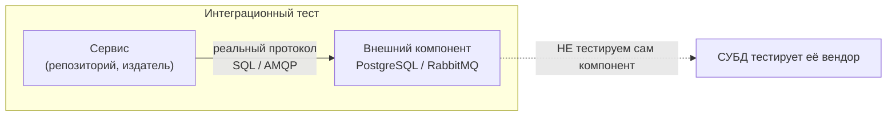
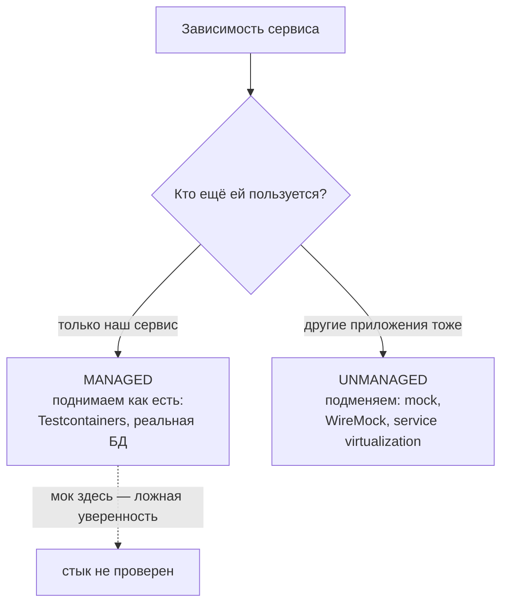
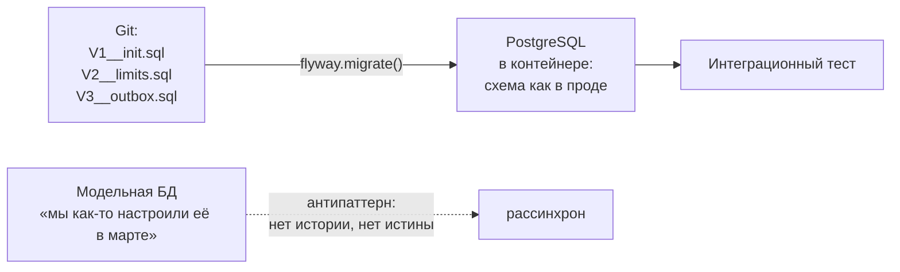
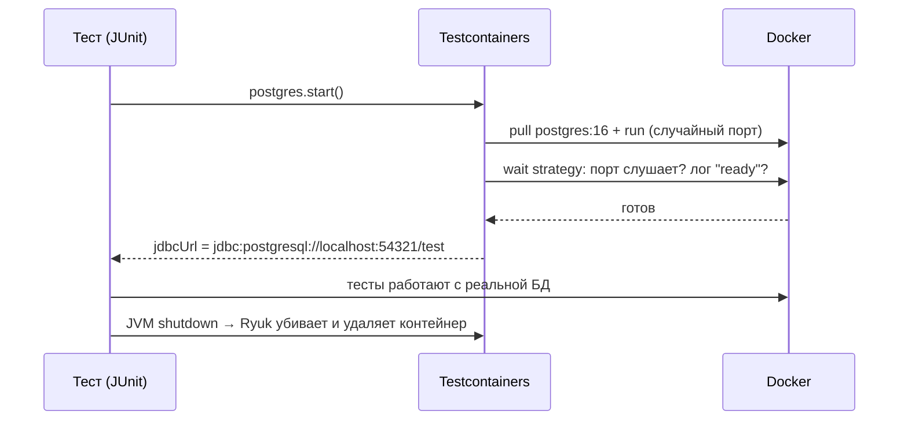
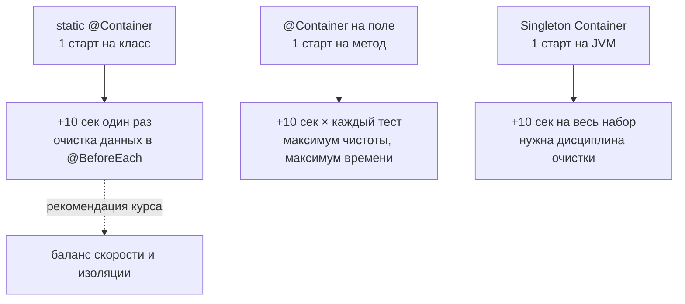

# Lecture 1: Интеграционное тестирование: границы уровня, Testcontainers, тестирование базы данных

> **Модуль**: 6 — Интеграционное тестирование с БД в контейнерах
> **Лекция**: 1 из 2
> **Лектор**: Ирина Габанова
> **Длительность**: 1,5 астрономических часа (слот 90 мин: ~70 мин рассказа по speaker notes + интерактив внутри блоков + вопросы; остаток слота — резерв на обсуждение)
> **Слайдов**: 15
> **Практика после лекции**: `practice/practice-01.md`
>
> **Соглашение о визуализации**: на каждом слайде есть блок **Визуализация** с описанием макета и рекомендацией по иллюстрации. Изображения пока только рекомендованы, имя файла и папка указаны условно; реальные файлы кладём в `Pictires/lecture-01/`. Диаграммы описаны кодом mermaid прямо в файле.

---

## Тайминг

| Время | Блок | Слайды | Содержание |
|-------|------|--------|-----------|
| 0:00–0:14 | Введение | 1–4 | План модуля, место интеграционных тестов в пирамиде, зачем отдельный интеграционный уровень |
| 0:14–0:30 | Границы уровня | 5–7 | Интеграционный тест в микросервисах: определение, managed vs unmanaged зависимости, граница с unit-уровнем |
| 0:30–0:48 | База данных | 8–10 | Почему H2 — антипаттерн, миграции как код, Testcontainers: устройство и API |
| 0:48–1:02 | Практика Testcontainers | 11–13 | Жизненный цикл контейнера, первый интеграционный тест на PostgreSQL, чек-лист persistence-тестов |
| 1:02–1:15 | Интерактив | 14 | «Unit или интеграционный?» — разбор пяти тестов |
| 1:15–1:20 | Итоги | 15 | Выводы и анонс лекции 2 |
| 1:20–1:30 | Резерв | — | Вопросы, разбор кода по запросу аудитории, буфер на обсуждение |

> Тайминг приведён для слота 90 минут (четверг 13:30–15:00): чистый рассказ по speaker notes — ~70 минут (темп ~140 слов в минуту), интерактив и итоги — ~10 минут внутри блоков, остаток — резерв на вопросы.

---

### Слайд 1. Титульный

**Слайд:**
- Модуль 6: Интеграционное тестирование с БД в контейнерах
- Lecture 1: Границы уровня, Testcontainers, тестирование базы данных
- Курс «Тестирование ПО», Lekton

**Визуализация:**
- Макет: полноэкранный титульный фон, поверх — название модуля и лекции.
- Иллюстрация: `Pictires/lecture-01/img-1-cover.jpg` — титульный фон из брендового набора курса.

**Speaker notes:**
> Добрый день! Начинаем шестой модуль курса — интеграционное тестирование с базами данных в контейнерах. Это первая из двух лекций модуля. Сегодня мы разберёмся, что такое интеграционный тест в микросервисном мире — и поверьте, это не то же самое, что в учебниках десятилетней давности, — почему in-memory базы вроде H2 вредят больше, чем помогают, и как Testcontainers превращает тяжёлое интеграционное окружение в пару строк кода в тесте. На второй лекции перейдём к асинхронности: RabbitMQ, очереди, eventual consistency и борьба с нестабильными тестами.
>
> Прежде чем начать, скажу пару слов о том, почему этот модуль стоит именно здесь, в середине курса, а не где-нибудь в конце. До сих пор вы работали с уровнями тестирования, которые либо полностью живут в памяти — unit-тесты, либо смотрят на систему снаружи — API-тесты (API — Application Programming Interface, программный интерфейс приложения). В обоих случаях инфраструктура была чужой проблемой: базу мокали, очередь мокали, внешние сервисы мокали. Такая стратегия правильна для своих уровней, но она оставляет без проверки самый ненадёжный элемент любой enterprise-системы — стык кода с реальным миром. Сегодня мы впервые в курсе сознательно идём навстречу этой ненадёжности: поднимаем настоящую инфраструктуру и проверяем, как наш код с ней разговаривает.
>
> И ещё одна рамка на весь модуль. Интеграционное тестирование — это первый уровень, где тесты стоят заметных денег: секунды вместо миллисекунд, Docker вместо пустой машины, дисциплина данных вместо наивных фикстур. Поэтому весь модуль будет крутиться вокруг одного вопроса: как получить максимум уверенности за разумную цену. Каждый слайд сегодня — это либо способ купить уверенность дёшево, либо предупреждение о покупке, которая не окупается. Держите этот экономический фильтр в голове — он понадобится вам и на практике, и в восьмом модуле, когда мы будем собирать финальную тестовую стратегию.
>
> Скажу сразу, чего на этих двух лекциях не будет, чтобы ожидания были точными. Не будет повторения SQL (Structured Query Language, языка структурированных запросов) — предполагается, что простой SELECT и JOIN вы читаете свободно. Не будет глубокого погружения в Docker — нам достаточно пользовательского уровня: образ, контейнер, порт, всё это у вас уже есть с первой практики. И не будет соревнования фреймворков: Testcontainers в Java-мире — де-факто стандарт, и время лекции лучше потратить на принципы, которые переживут любую замену инструмента. Если какая-то из этих тем для вас пробел — отметьте себе и подтяните до пятничной практики: там пробелы мгновенно всплывут в коде.

---

### Слайд 2. План лекции

**Слайд:**
- Где мы в курсе: unit → API → интеграционные → E2E
- Интеграционный тест в микросервисах: определение и границы уровня
- Managed vs unmanaged зависимости: что мокировать, а что поднимать
- Почему H2 и in-memory БД — антипаттерн
- Testcontainers: устройство, жизненный цикл, первый тест на PostgreSQL
- Интерактив: «Unit или интеграционный?»

**Визуализация:**
- Макет: вертикальная дорожка из шести пунктов с номерами блоков по таймингу; интерактив в конце выделен акцентным цветом.
- Диаграмма: mermaid-схема ниже.


**Speaker notes:**
> Давайте вспомним, где мы находимся в курсе. В модуле 4 вы написали unit-тесты для бизнес-логики четырёх сервисов СМП (Симулятора процессингового центра) — с моками, по принципам FIRST (Fast, Independent, Repeatable, Self-validating, Timely) и AAA (Arrange — Act — Assert). В модуле 5 вы поднялись на уровень выше и научились тестировать контракты REST (Representational State Transfer) через REST-assured: статус-коды, заголовки, схемы JSON (JavaScript Object Notation). Но и там и там был один общий приём: всё неудобное мы подменяли. Базу данных — моком репозитория. Внешний сервис — моком клиента. Очередь — моком издателя.
>
> Сегодня мы убираем моки с ключевых стыков и проверяем интеграцию по-настоящему: реальный PostgreSQL в Docker-контейнере, реальные SQL-запросы, реальные миграции схемы. На следующей лекции — реальный RabbitMQ. Это самый «материальный» модуль курса: тесты будут поднимать настоящую инфраструктуру, и вы почувствуете на себе всю экономику интеграционного уровня — и его ценность, и его цену.
>
> План на сегодня. Сначала договоримся о терминах: что вообще называть интеграционным тестом в микросервисной архитектуре и где проходит граница между unit- и интеграционным уровнем — вы увидите, что граница эта неочевидная и в индустрии её проводят по-разному. Потом ключевое различие модуля: managed и unmanaged зависимости Хорикова, и правило, что мокировать нельзя, а что — обязательно. Затем разберём самую дорогую ошибку в тестировании persistence-слоя — замену PostgreSQL на H2 — и почему она даёт ложную уверенность. И в оставшееся время — Testcontainers: как он устроен, как пишется первый тест и как управлять жизненным циклом контейнера, чтобы тесты не ползли, а летали. Завершим интерактивом «Unit или интеграционный?».
>
> Сразу предупрежу о структуре: лекция делится на две половины разного характера. Первые сорок минут — концепции и правила: определения, критерии, антипаттерны. Это та часть, которую нельзя «нагуглить в моменте» — неверное решение здесь закладывается один раз и дорого исправляется потом. Вторая половина — ремесло: Testcontainers, аннотации, жизненный цикл, полный код первого теста. Там всё наоборот: детали всегда можно подсмотреть в документации, но важно один раз увидеть целиком, как кусочки складываются в работающий тест. Поэтому в первой половине слушайте и спорьте, во второй — следите за кодом и записывайте названия классов.
>
> И небольшое обещание. Всё, что будет на слайдах сегодня и на следующей лекции, — это не абстрактные рекомендации «из учебника». Каждое правило я покажу на коде реального СМП: на репозитории карт, на таблице лимитов Authorization, на журнале Transaction Logger. С этого момента теория курса сливается с реальной системой в одну картину.
>
> Пара слов о литературе, на которую опирается модуль, — чтобы вы могли копнуть глубже. Основных источника четыре. «Testing Java Microservices» Сото Буэно и коллег — глава пять про определение интеграционного уровня и главы восемь-девять про Docker-инструментарий и виртуализацию сервисов. «Принципы юнит-тестирования» Хорикова — главы восемь и десять: именно оттуда взяты managed-зависимости, запрет in-memory баз и дисциплина миграций. «Непрерывная поставка ПО» Хамбла и Фарли — глава двенадцать про управление данными и схемой как часть пайплайна. И «xUnit Test Patterns» Месароса — энциклопедия фикстур и тестовых данных, она понадобится на второй лекции. Все четыре книги лежат в материалах курса, и цитаты на слайдах сверены с ними.

---

### Слайд 3. Модуль 6 в карте курса

**Слайд:**
- Модуль 4: unit-тесты — логика в изоляции, всё внешнее замокано
- Модуль 5: API-тесты — контракт между сервисами, HTTP-стык
- **Модуль 6: интеграционные тесты — сервис + его реальная инфраструктура (БД, очередь)**
- Модуль 7: E2E — вся цепочка сквозным сценарием
**Визуализация:**
- Макет: пирамида тестирования из четырёх ярусов, подсвечен второй снизу ярус.
- Иллюстрация: `Pictires/lecture-01/img-2-pyramid.png`.

**Speaker notes:**
> Посмотрим на пирамиду, которую мы строили с третьего модуля. Основание — unit-тесты: тысячи проверок логики в изоляции, миллисекунды на тест. Выше — сервисный уровень, и вот тут начинается терминологическая путаница, которую важно распутать сразу. В модуле 5 вы писали API-тесты: они проверяли контракт — сервис отвечает на запрос правильным статусом, телом и заголовками. Вопрос там был «правильно ли сервис говорит по-HTTP (HyperText Transfer Protocol, протоколу передачи гипертекста)?». Сегодняшний вопрос другой: «правильно ли сервис работает со своей инфраструктурой?» — с базой данных, с очередью сообщений, с миграциями схемы.
>
> Почему это отдельный уровень, а не продолжение API-тестов? Потому что здесь другой объект проверки и другая техника. В API-тесте вы снаружи: отправили запрос, проверили ответ, не лезете внутрь. В интеграционном тесте вы идёте в хранилище и проверяете реальное состояние: легла ли запись в таблицу, применилась ли миграция, ушло ли сообщение в очередь. Помните серый ящик из модуля 3? Это он и есть: для HTTP-интерфейса мы чёрный ящик, а для схемы БД (базы данных) — белый, потому что сами её готовим и сами проверяем.
>
> Здесь же зафиксирую рабочий словарь модуля, чтобы дальше не возвращаться. Persistence-слой — это код и схема, которые переживают перезапуск процесса: таблицы, миграции, репозитории. Брокер — инфраструктура сообщений со своей топологией: обменники, очереди, привязки. Стык — место, где наш код встречается с чужим протоколом: SQL, AMQP (Advanced Message Queuing Protocol, протокол очередей сообщений), HTTP. Интеграционный тест всегда привязан к конкретному стыку и называется его именем: репозиторный тест — про стык с базой, консьюмер-тест — про стык с очередью.
>
> Важная оговорка про терминологию, чтобы вы не путались при чтении статей. В Testing Trophy Кента Доддса, о котором мы говорили в модуле 3, слово integration означает «компоненты собраны вместе в памяти, без реальных внешних зависимостей» — фактически это тесты поведения. В нашем курсе интеграционное тестирование — это строго наоборот: реальная база в контейнере, реальный брокер, реальная сеть внутри Docker. Одно слово — два разных смысла. Всё, что я сегодня говорю, относится ко второму смыслу.
>
> Чтобы вы представляли масштаб каждого яруса в нашем проекте, приведу ориентировочные числа СМП. Unit-набор сервиса вроде Authorization — это сотни тестов, прогон за десятки секунд, полное покрытие ветвей `authorize`: статусы, сроки, лимиты, баланс. API-набор — десятки тестов на эндпоинт, минуты, проверка контракта по спецификации. Интеграционный набор, который вы построите в этом модуле, — единицы-десятки тестов на сервис: репозиторий карт, таблица использования лимитов, журнал транзакций. И E2E (End-to-End, сквозное тестирование) в седьмом модуле — считанные сценарии: выпуск карты, авторизация, отмена, журнал. Каждый ярус на порядок меньше предыдущего по числу тестов и на порядок дороже за тест — именно поэтому пирамида имеет форму пирамиды, а не цилиндра.
>
> Ещё одна полезная проекция — «цвет ящика» на каждом уровне. Unit-тест — белый ящик: вы знаете код, покрываете ветви, смотрите мутации. API-тест — чёрный: только контракт и спецификация. Интеграционный тест — серый: код вы знаете, но проверяете его через реальную внешнюю среду, которую не контролируете до конца. Понимание этого «цвета» важно для тест-дизайна: на сером уровне применимы и техники белого ящика — например, вы сознательно направляете тест в конкретную ветку обработки ошибки СУБД (системы управления базами данных), — и техники чёрного — классы эквивалентности для данных в таблице.
>
> Закрою и вопрос, который неизбежно возникает на этом слайде: а почему интеграционный уровень идёт после API, а не до? Ведь база «ниже» API по архитектуре. Дело в логике наращивания уверенности: сначала мы учимся проверять контракты снаружи — это проще и не требует владения инфраструктурой, — а потом спускаемся внутрь сервиса к его стыкам, где понадобится и Docker, и знание схемы. Плюс есть управленческий резон: API-набор вы писали против поднятого СМП целиком, а интеграционный набор пишется против одного сервиса — это другой рабочий процесс, и ему нужен был фундамент из unit- и API-дисциплины, чтобы не превратиться в хаос.

---

### Слайд 4. Зачем нужен отдельный интеграционный уровень

**Слайд:**
- Unit-тесты с моками проверяют логику, но не проверяют **стык**: SQL, маппинг, транзакции, протокол брокера
- Класс дефектов, невидимый для unit-тестов: ошибка в SQL, несовпадение схемы, неприменённая миграция, неверная сериализация сообщения
- Дефект на интеграционном уровне в 10 раз дороже unit-уровня, но в 10 раз дешевле E2E (правило 1:10:100)
- Микросервисы усиливают риск: стыков больше, чем в монолите

**Визуализация:**
- Макет: слева — мок-конус «логика проверена, стык — нет», справа — список «невидимых» дефектов; внизу шкала стоимости дефекта 1 → 10 → 100.
- Иллюстрация: `Pictires/lecture-01/img-3-why.png`.

**Speaker notes:**
> Начнём с вопроса «зачем». У вас уже есть unit-тесты с восьмидесятипроцентным покрытием по ветвям и API-тесты на все эндпоинты. Казалось бы — что ещё ловить? А вот что. Мок репозитория в unit-тесте отвечает так, как вы его настроили. Но репозиторий — это код, который вы тоже написали: SQL-запрос, маппинг колонок на поля объекта, поведение транзакции. И этот код может содержать ошибки, которые мок принципиально не покажет, потому что мок — это вы, а вы ошибку в свой мок не заложите.
>
> Перечислю класс дефектов, который живёт только на этом уровне. Опечатка в SQL: запрос синтаксически собрался в строке, но падает на реальной базе. Несовпадение схемы: код ждёт колонку `decline_reason`, а миграция создала `decline_code` — unit-тест зелёный, прод красный. Неприменённая миграция: новая колонка есть в коде, но не попала в скрипты — на старой схеме всё падает. Особенности диалекта: запрос, работающий на H2, не работает на PostgreSQL — к этому вернёмся подробно. Неверная сериализация: событие в RabbitMQ улетает с полем `pan`, а подписчик ждёт `cardNumber` — мок издателя этого не видит вообще. Поведение транзакций: код открывает четыре транзакции вместо одной, и при сбое посередине данные остаются в противоречивом состоянии — без реальной базы это не воспроизвести.
>
> Приведу живой пример из нашего СМП, чтобы класс перестал быть абстрактным. В Authorization лимиты проверяются методом `checkAndUpdateLimits`, который делегирует всю работу одному SQL-запросу — атомарному upsert в таблицу `limit_usage`: вставить строку для карты и даты, если её нет, иначе нарастить `daily_amount` и `monthly_amount`, но только если новые суммы не превысят пороги. Вся корректность авторизации по лимиту зависит от того, верно ли написано условие в WHERE этого запроса. Unit-тест с моком репозитория проверить его не может в принципе: мок просто вернёт единичку. Только реальный PostgreSQL выполнит этот запрос честно — с реальным unique-ограничением на пару «карта-дата», с реальной гонкой двух параллельных авторизаций по одной карте, с реальным отказом, когда лимит исчерпан ровно до копейки. Вот зачем этот уровень.
>
> Экономику вы знаете с первого модуля: правило один к десяти к ста. Дефект, пойманный unit-тестом, стоит условную единицу. На интеграционном уровне — десять. На E2E — сто. В проде — тысячу и репутацию банка. Интеграционный уровень — это последний рубеж, где стыковые дефекты стоят дёшево.
>
> И заметьте: в микросервисной архитектуре этот уровень важнее, чем в монолите. В монолите стык с базой один, в СМП у нас десять сервисов, и хотя база PostgreSQL одна общая, таблицы в ней разделены по владельцам — плюс брокер, и каждый сервис имеет собственный persistence-слой. Стыков много, и каждый — потенциальное место поломки. Хамбл и Фарли в «Continuous Delivery» формулируют это как общий принцип: если интеграция болезненна — делайте её чаще и раньше, чтобы боль была маленькой и управляемой. Интеграционные тесты в CI (Continuous Integration, непрерывная интеграция) — это ровно воплощение принципа: интегрируемся на каждый коммит, а не раз в релиз.
>
> Последний аргумент «зачем» — психологический, и он важнее технических. Пока стык не проверен автоматически, команда его боится: любое изменение схемы, любой рефакторинг репозитория превращается в ритуал с ручной проверкой на стенде. Страх — главный тормоз разработки. Зелёный интеграционный набор превращает страшное изменение в обычное: поменяли тип колонки суммы, прогнали тесты, увидели зелёное — и спокойно идёте дальше. Хориков называет это главным критерием ценности тестового набора: хороший набор — тот, который даёт смелость менять код. Интеграционные тесты дают эту смелость для самых рискованных изменений.
>
> Разверну психологический аргумент в наблюдаемую картину, потому что у команд она у всех одинаковая. Команда без интеграционных тестов ведёт себя предсказуемо: задачи на изменение схемы откладываются до последнего, рефакторинг репозитория объявляется «опасным» и замораживается, а перед релизом кто-то идёт на стенд и полдня руками прогоняет «критичные сценарии». Это не лень — это рациональный ответ на отсутствие защиты. Теперь посмотрите на команду, у которой стык покрыт: миграция добавляется в тот же пул-реквест, что и код, ревьюер видит зелёный прогон на свежей схеме, и единственный ритуал перед релизом — посмотреть на статус пайплайна. Та же система, те же люди — другая смелость. Именно эту разницу вы должны почувствовать на практике: первый раз, когда ваш `CardRepositoryIT` поймает реальную опечатку в SQL до ревью, вы поймёте, зачем всё это было.

---

### Слайд 5. Что такое интеграционный тест в микросервисах

**Слайд:**
- Классика: тест взаимодействия модулей, собранных вместе, — сборка подсистемы
- В микросервисах смысл сдвигается (TJM — «Test-Driven Java Development», Farcic/Garcia, гл. 5): проверяем, что **подсистема сервиса корректно общается с внешним компонентом** — БД, брокером, другим сервисом
- Цель — проверить **коммуникацию**, а не сам внешний компонент
- Идеальный сценарий — **без тестовых дублёров** на внешних компонентах
- Покрываем только базовые пути успеха и ошибки интеграции, а не всю логику

**Визуализация:**
- Макет: схема «сервис → внешний компонент», рамка теста охватывает сервис и линию связи, но не сам компонент; рядом анти-пример «тестируем PostgreSQL» перечёркнут.
- Диаграмма: mermaid-схема ниже.



**Speaker notes:**
> Теперь формальное определение, и здесь будет сюрприз для тех, кто читал классику. В классической литературе интеграционное тестирование — это проверка взаимодействия модулей, собранных вместе: берём несколько классов, собираем в подсистему и смотрим, как они сотрудничают. Стратегии сборки — сверху вниз, снизу вверх, «большой взрыв» — всё это вы встретите в материалах ISTQB (International Software Testing Qualifications Board, Международного совета по квалификации тестировщиков).
>
> Почему классика формулировалась именно так — стоит понять, чтобы не потерять нить. Классическое определение родилось в эпоху монолитов, где система собиралась из модулей, написанных разными командами, и главный риск был в том, что модули, отлично работающие по отдельности, не сойдутся интерфейсами. Интеграционное тестирование было этапом сборки: сначала собрали два модуля, потом три, потом подсистему, и на каждом шаге проверяли совместную работу. Стратегии сборки были важны, потому что сборка была долгой, и порядок её определял, когда вы найдёте дефект.
>
> Авторы «Testing Java Microservices» — Сото Буэно, Портер и Гумбрехт — честно пишут в пятой главе: в микросервисном мире у этого термина смысл немного другой. Сервис сам по себе — уже собранная подсистема: контроллеры, сервисы, репозитории внутри него проверяются unit- и компонентными тестами. Интеграционный тест в микросервисе проверяет не сборку внутренних модулей, а связь сервиса с внешним компонентом: базой данных, брокером сообщений, другим сервисом. В анатомии микросервиса это два слоя: gateway-слой — клиенты внешних сервисов, — и слой репозиториев и мапперов данных.
>
> Обратите внимание на тонкость в формулировке цели: мы проверяем, что наша подсистема умеет общаться с внешним компонентом, а не что внешний компонент работает правильно. Правильность PostgreSQL тестирует PostgreSQL Global Development Group, у них свой набор тестов. Мы проверяем наше умение с ним разговаривать: правильный ли SQL, тот ли маппинг, применены ли миграции, корректно ли объявлена очередь. Поэтому — и это важно — в идеальном интеграционном тесте на внешних компонентах нет тестовых дублёров. Мок базы данных в интеграционном тесте — это оксюморон: мы пришли проверить стык, а подменили его.
>
> Разберём границу на конкретном примере, потому что она тоньше, чем кажется. Тест, который проверяет, что PostgreSQL корректно сортирует `NULLS LAST`, — это тест СУБД, он не нужен: вендор уже это проверил. А тест, который проверяет, что наш запрос журнала содержит `NULLS LAST`, потому что требование говорит «неотменённые транзакции сначала», — это тест стыка, и он обязателен. Внешне оба теста делают одно и то же — выполняют запрос на реальной базе. Разница в намерении: первый проверяет чужой код, второй — наш. Хороший критерий: если дефект можно починить только патчем вендору — тест чужой; если правкой нашего репозитория — наш.
>
> Отсюда следует и правило объёма. Интеграционные тесты не дублируют покрытие unit-уровня: вся комбинаторика бизнес-правил, все классы эквивалентности и границы — там, внизу, где дёшево. Здесь мы покрываем базовые пути успеха и ошибки самой интеграции: запись сохранилась и прочиталась обратно, запись не сохранилась при нарушении ограничения, сообщение опубликовано и потреблено, потребитель корректно пережил «ядовитое» сообщение. Несколько тестов на стык — не десятки.
>
> У этого правила есть и организационное измерение. Когда интеграционный тест падает, владелец ответа — команда, владеющая сервисом: стык — это наш код. Когда падает E2E, начинается расследование «чей сервис виноват», и в десятисервисной цепочке это часы. Чем ниже уровень, на котором дефект ловится, тем точнее он приписывается команде и тем быстрее чинится. Это ещё одна причина держать интеграционные тесты сфокусированными: их ценность не только в раннем обнаружении, но и в однозначной локализации.
>
> Подчеркну ещё одно следствие определения, которое сэкономит вам часы на практике: интеграционный тест не обязан запускать всё приложение. Сервис — это контроллеры, бизнес-логика, репозитории, клиенты; для проверки стыка с базой нужен только репозиторий и реальная база, поднимать весь Spring-контекст с контроллерами и брокером — избыточно. Тест, который поднимает всё, чтобы проверить один SQL-запрос, платит за старт контекста десятки секунд и получает хрупкость от ненужных зависимостей. Правильный масштаб — минимальный срез, в котором живёт стык: репозиторий плюс база, издатель плюс брокер, клиент плюс виртуализированный сервис. Фриман и Прайс называют это «тестируйте на уровне ответственности»: рамка теста должна совпадать с рамкой проверяемого стыка, не больше и не меньше.

---

### Слайд 6. Managed и unmanaged зависимости

**Слайд:**
- **Managed** (управляемые): зависимость, которой владеет только наше приложение — его база данных → **поднимаем как есть**, мок запрещён
- **Unmanaged** (неуправляемые): внешний сервис, SMTP, чужой API → **подменяем** (mock, stub, service virtualization)
- Критерий: можем ли мы «сломать» её состояние для других? Если нет — managed
- В СМП: PostgreSQL и RabbitMQ сервиса — managed; BIN-сервис и внешний процессинг — unmanaged

**Визуализация:**
- Макет: две колонки «managed / unmanaged» с примерами из СМП; между ними весы «владеем состоянием?».
- Диаграмма: mermaid-схема ниже.
- Иллюстрация: `Pictires/lecture-01/img-4-managed.png`.



**Speaker notes:**
> Ключевой вопрос практика: вот передо мной зависимость — поднимать её по-настоящему или подменять? Хориков в восьмой и десятой главах даёт критерий через разделение зависимостей на managed и unmanaged — управляемые и неуправляемые.
>
> Managed-зависимость — та, которой пользуется только ваше приложение и никто больше. Канонический пример — база данных приложения: никакое другое приложение к ней не подключается, её состояние полностью в нашей власти. Такие зависимости в интеграционных тестах включаются как есть — мок здесь исключён по определению: состояние управляемой зависимости не видно никому снаружи, оно наблюдаемо только через само приложение, и подменять её — значит отказаться от проверки самой ценной части стыка.
>
> Unmanaged-зависимость — та, чьё состояние видно снаружи или разделяется с другими: внешний API платёжной сети, сервер SMTP (Simple Mail Transfer Protocol, протокол отправки электронной почты), чужой микросервис, которым пользуются десять команд. Здесь реальную зависимость поднимать нельзя: во-первых, вы не контролируете её состояние и не можете сбросить его между тестами; во-вторых, ваши тесты начнут мусорить в общей системе и падать от чужих данных. Такие зависимости подменяются — моком, а лучше полноценной виртуализацией сервиса вроде WireMock или Hoverfly — про это отдельный разговор в главе девять TJM и частично на следующей лекции.
>
> Стоит уточнить, что критерий — не «внутренняя или внешняя система», а именно «разделяемое ли состояние». Это тонкость, которая путает многих. Внутренний сервис вашей же компании — unmanaged, если им пользуются другие команды: вы не можете очистить его базу под свой тест, не поломав чужой прогон. И наоборот: внешняя по деплою система — managed, если её инстанс поднят только под вас. Поэтому критерий Хорикова формулируется через наблюдаемость состояния извне: если состояние зависимости видимо только через ваше приложение — она ваша, делайте с ней что хотите; если видимо кому-то ещё — руки прочь.
>
> Приложим к СМП. PostgreSQL в СМП один на всех сервисов — но таблицы `cards`, `bin_issuers`, `reservations` пишет и читает только Card Management: остальные идут за данными карт по HTTP. По дисциплине доступа это managed-зависимость, и в тестах мы поднимаем настоящий PostgreSQL в контейнере. RabbitMQ — интересный случай: формально брокер общий, но очереди и exchange, которыми пользуется наш сервис, принадлежат ему; в тестах мы поднимаем свой изолированный брокер в контейнере — то есть обращаемся с ним как с managed. А вот внешний сервис проверки BIN (Bank Identification Number, банковского идентификационного номера — первых цифр номера карты) — unmanaged: его в тестах Authorization подменяем.
>
> Отдельно остановлюсь на архитектурном принципе, который стоит за нашей классификацией СМП, — database per service. В зрелой микросервисной системе у каждого сервиса собственная база, и чужая база недоступна. СМП реализует этот принцип не отдельными базами, а дисциплиной владения таблицами в общей базе: Authorization не делает SELECT из таблиц Card Management, он вызывает его API. Именно поэтому в тестах Authorization нам понадобятся оба приёма сразу: реальный PostgreSQL-контейнер для своей таблицы `limit_usage` — managed-часть, и виртуализированный клиент Card Management для чужих карт — unmanaged-часть. Если бы архитектура позволяла читать чужие таблицы напрямую, граница managed/unmanaged размылась бы, и вместе с ней — вся дисциплина тестов. Принцип «свои данные на сервис» — это не только про прод, это и про тестируемость.
>
> Почему критерий именно такой? Потому что цена ошибки асимметрична. Подменили managed-зависимость — потеряли защиту от регрессий на самом опасном стыке и не заметили. Подняли по-настоящему unmanaged — получили нестабильные тесты, мусор в чужих системах и конфликты с другими командами. Правило короткое: managed — как есть, unmanaged — подменять.
>
> И практический совет напоследок: когда классификация зависимости вызывает спор в команде — а она будет вызывать, — задавайте не философский вопрос «чья это система», а операционный: «можем ли мы в тесте привести её в любое нужное состояние, не спрашивая никого?». Можем — managed, поднимаем. Не можем — unmanaged, виртуализируем. Этот вопрос переводит архитектурный спор в инженерную плоскость, где ответ проверяем.
>
> Покажу на пальцах, как этот операционный вопрос работает для RabbitMQ — самого спорного случая. Можем ли мы в тесте создать любую очередь, положить в неё любое сообщение, удалить всё после прогона, не спрашивая никого? Если брокер поднят контейнером под наш тест — да, безоговорочно: он наш от рождения до смерти. Если это общий брокер тестового контура — нет: там чужие очереди, чужие консьюмеры, и наша очистка сломает соседнюю команду. Одна и та же технология — два разных ответа в зависимости от способа развёртывания. Именно поэтому решение «поднимаем RabbitMQ в контейнере» — это не просто удобство, это смена классификации зависимости с unmanaged на managed со всеми вытекающими правами: теперь мы можем гонять её состояние как угодно, и подменять её моком становится таким же абсурдом, как мокать собственную базу.

---

### Слайд 7. Граница между unit- и интеграционным тестом

**Слайд:**
- Один и тот же класс (например, `CardRepository`) тестируется дважды — по-разному:
  - unit-тест сервиса: репозиторий замокан, проверяем логику сервиса
  - интеграционный тест репозитория: реальная БД, проверяем SQL и маппинг
- Это НЕ дублирование: разные объекты проверки — логика vs стык
- Признак интеграционного теста: тест падает, если стык с реальным компонентом сломан, даже когда логика верна

**Визуализация:**
- Макет: два теста рядом на один и тот же код: слева мок, справа контейнер; под каждым подпись «что ловит».
- Иллюстрация: `Pictires/lecture-01/img-5-boundary.png`.

**Speaker notes:**
> Самая частая претензия к интеграционным тестам звучит так: «это дублирование, мы это уже проверили в unit-тестах». Разберём её на конкретном примере, потому что она в корне неверна — но понять это можно только через различие объектов проверки.
>
> Возьмём Authorization. В unit-тесте `AuthServiceImpl` вы мокали `LimitUsageRepository`: настроили «верни лимит десять тысяч», вызвали `authorize`, проверили решение. Объект проверки — бизнес-логика: правильное ли решение принял сервис при таких данных. Репозиторий здесь — дублёр, он гарантированно ведёт себя идеально, потому что это вы сами.
>
> Теперь интеграционный тест того же репозитория. Поднимаем PostgreSQL в контейнере, применяем миграции, выполняем реальный `upsertLimitUsage` дважды по одной карте и дате и читаем строку через реальный `findById`. Объект проверки — сам репозиторий как код стыка: верен ли SQL, правильно ли замаплены колонки, не нарушит ли unique-ограничение повторную вставку, корректен ли тип колонки для суммы. Эти два теста не пересекаются ни в одном пункте: первый упадёт при ошибке в логике даже с идеальной базой, второй упадёт при ошибке в SQL даже с идеальной логикой.
>
> Есть простой мысленный эксперимент, который я рекомендую применять, когда сомневаетесь в уровне теста. Спросите: «Если стык с реальным компонентом сломан — запрос не выполняется на настоящей СУБД, — а вся логика верна, упадёт ли этот тест?» Если нет — это не интеграционный тест, как бы он ни назывался. И обратный вопрос: «Если логика сломана, а стык идеален — упадёт ли?» Интеграционный тест не обязан падать в этом случае — для этого есть unit-уровень.
>
> Разберём на примере из СМП, как два теста на один класс ловят разные баги. Вспомним `upsertLimitUsage` из Authorization: один SQL-запрос, который вставляет или наращивает счётчики использования. Unit-тест сервиса настроит мок: «upsert вернул ноль — значит, лимит превышен — ждём EXCEEDS_AMOUNT_LIMIT». Он проверяет: правильно ли сервис трактует ноль из репозитория, тот ли код отказа, то ли событие опубликовано. А теперь баги, которые ловит только интеграционный тест этого метода: опечатка в имени колонки — `daily_amout` вместо `daily_amount`; неверное условие в WHERE — строгое «больше» вместо «больше или равно», и транзакция ровно на остаток лимита отклоняется; отсутствующий unique-индекс на пару «карта-дата» — и две параллельные авторизации вставляют две строки вместо одной. Ни один из этих багов не существует в мире мока: там репозиторий — это строчка `when(...).thenReturn(...)`.
>
> Фриман и Прайс в «Growing Object-Oriented Software» называют это разделением слоёв тестирования: тесты, проверяющие «что система делает», и тесты, проверяющие «что система корректно подключена к миру», — это разные семьи тестов с разными причинами падения. Когда обе семьи зелёные, у вас есть и верная логика, и верный стык. Когда есть только одна — половина правды.
>
> И последнее наблюдение про границу — оно пригодится вам на ревью. Признак того, что тест стоит на неправильном уровне, — это несоответствие имени и содержимого. Класс называется `SomethingIT`, но внутри моки всех репозиториев — это unit-тест, который обманывает пайплайн и выполняется на тяжёлой фазе сборки. И наоборот: класс называется `SomethingTest`, но поднимает контекст и ходит в базу — это интеграционный тест, который тормозит быстрый unit-прогон на каждый коммит. Имя теста — это контракт с пайплайном: суффикс определяет, на какой стадии сборки тест выполнится. Нарушение контракта — это не стилистика, это сломанная экономика CI.
>
> И чтобы граница окончательно перестала быть теоретической, продиктую практическое правило для парного ревью, которым вы будете пользоваться на практиках. Когда смотрите чужой тест, задавайте три вопроса по порядку. Первый: что сломается, если убрать из кода все моки и оставить только реальные зависимости — тест останется осмысленным? Если да — это интеграционный тест. Второй: что сломается, если поменять SQL-запрос на эквивалентный по результату, но другой по форме? Unit-тест не должен заметить, интеграционный — не должен тоже, а вот тест маппинга — должен. Третий: за что отвечает этот тест при падении — за логику, за стык или за контракт? Если ответ «за всё сразу» — тест пытается стоять на двух уровнях, и его надо расщепить. Три вопроса, тридцать секунд — и уровень теста диагностирован точнее, чем по любому суффиксу в имени.

---

### Слайд 8. Почему H2 — антипаттерн

**Слайд:**
- Соблазн: подменить PostgreSQL на in-memory H2/SQLite — быстро, без Docker
- Проблема (Khorikov, гл. 10): in-memory СУБД **несовместима функционально** с боевой
  - другой диалект SQL, другие типы, другие ограничения, другое поведение последовательностей и JSONB
  - режимы совместимости не спасают: это подмножество, а не эквивалент
- Последствие: **false positives** (тест зелёный, прод красный) и false negatives
- Правило: в тестах — та же СУБД, что в проде; сегодня это дёшево благодаря контейнерам

**Визуализация:**
- Макет: карточка-соблазн «H2: быстро и без Docker» → развилка «тест зелёный / прод красный» с красным предупреждением; внизу табличка расхождений диалектов.
- Иллюстрация: `Pictires/lecture-01/img-6-h2.png`.

**Speaker notes:**
> Прежде чем говорить про Testcontainers, надо закрыть вопрос, который у вас уже мог возникнуть: зачем Docker, если есть H2? Поставил зависимость, база поднялась в памяти, тесты летают, никаких контейнеров. Так делали десять лет, так до сих пор делается в половине туториалов. И это одна из самых дорогих ошибок в тестировании persistence-слоя.
>
> Сначала честно признаем, почему соблазн так велик — иначе мы не поймём, как его избегать. H2 стартует мгновенно, не требует Docker, живёт в той же JVM (Java Virtual Machine, виртуальной машине Java) и умирает вместе с ней — никакой очистки вообще. Для разработчика под давлением дедлайна это выглядит как бесплатный сыр: тот же интерфейс JDBC (Java Database Connectivity, стандартный API доступа к базам данных из Java), тот же Hibernate сверху, а скорость — как у unit-теста. Проблема в том, что бесплатный сыр здесь — в мышеловке, и пружина её срабатывает не в тестах, а в проде.
>
> Хориков в десятой главе формулирует прямо: избегайте in-memory баз данных. Аргумент не в скорости и не в идеологии, а в функциональной несовместимости. In-memory СУБД — это другая база данных, написанная другими людьми с другими решениями. У неё другой диалект SQL: запрос с `ILIKE`, с `RETURNING`, с `jsonb`-операторами работает на PostgreSQL и не существует на H2. Другие типы: `BIGSERIAL`, `NUMERIC` с фиксированной точностью, `timestamptz` — у каждого аналога есть свои граничные различия. Другое поведение ограничений: где-то регистр сравнения строк другой, где-то уникальный индекс обрабатывает NULL иначе, где-то транзакционная изоляция реализована иначе. Даже когда H2 включают в «режим совместимости с PostgreSQL» — это режим эмуляции подмножества, а не эквивалентности.
>
> Разберём конкретный пример расхождения диалектов, потому что абстрактное «другая СУБД» не убеждает. Вспомним наш `upsertLimitUsage`: в PostgreSQL он естественно пишется через `INSERT ... ON CONFLICT (pan, usage_date) DO UPDATE SET daily_amount = limit_usage.daily_amount + :amount WHERE limit_usage.daily_amount + :amount <= :dailyLimit` — один атомарный оператор, проверенный планировщиком, защищённый уникальным индексом. H2 такой синтаксис исторически поддерживал частично и с оговорками — через собственный `MERGE INTO` с другой семантикой. Что делает разработчик, у которого тесты на H2? Он переписывает атомарный запрос на два шага: «проверить существование, потом вставить или обновить». Тесты зеленеют. И в проде две параллельные авторизации по одной карте проходят между этими двумя шагами — и обе успевают «проверить», и обе вставляют, и лимит молча пробивается. Тест на H2 не просто не поймал гонку — он спровоцировал архитектуру, в которой гонка возможна.
>
> Чем это бьёт по тестам? Двумя видами лжи. False positive: тест зелёный на H2, а в проде падает — потому что в проде PostgreSQL, и ваш запрос с оконной функцией или `ON CONFLICT` H2 просто не выполнял никогда по-настоящему. Это худший случай: зелёный набор тестов создаёт уверенность, а защиты ноль. И false negative: тест красный, а код правильный — вы тратите вечер на «починку» корректного SQL под капризы другой СУБД, а то и переписываете рабочий запрос на худший, лишь бы он шёл на обоих. Хориков подчёркивает: с такими тестами вы никогда не получите надёжной защиты и всё равно будете регрессионно проверять вручную — то есть заплатили за тесты дважды и не получили главного.
>
> Пятнадцать лет назад у этого соблазна было оправдание: поднять настоящий PostgreSQL на каждой машине разработчика и на CI было дорого — установка, инициализация кластера, порты, очистка. Docker и Testcontainers сняли это оправдание полностью: настоящая СУБД в тесте теперь стоит одну аннотацию и десяток секунд на весь класс. Поэтому правило модуля железное: в интеграционных тестах — та же СУБД и та же мажорная версия, что в проде. В СМП это PostgreSQL — значит, PostgreSQL и будет, в контейнере.
>
> И заметьте один нюанс в формулировке правила: «та же мажорная версия». Не «примерно PostgreSQL», не «PostgreSQL последней», а ровно та мажорная версия, что развёрнута в проде, — в СМП это прописано в docker-compose и должно совпадать с тегом образа в тестах. Поведение оптимизатора, набор операторов, семантика `SERIALIZABLE` меняются между мажорными версиями, и тест на пятнадцатой не гарантирует поведение шестнадцатой. Тег `postgres:16-alpine` в коде теста — это не мелочь, это часть контракта теста с продом. Когда прод мигрирует на следующую версию, тег в тестах мигрирует в том же коммите — иначе вы тестируете прошлое.

---

### Слайд 9. Схема БД — это код: миграции

**Слайд:**
- Схема БД хранится в Git вместе с кодом — единый источник истины (Khorikov, 10.1)
- Два подхода к поставке схемы: state-based (эталонная БД + diff-скрипты) — антипаттерн; migration-based — версионируемые скрипты Flyway/Liquibase
- Reference data — часть схемы: справочники, без которых приложение не работает, тоже в миграциях
- Тест поднимает «боевой» путь: контейнер → миграции → схема как в проде
- Отдельный инстанс БД на разработчика — никаких общих тестовых баз

**Визуализация:**
- Макет: временная ось миграций V1 → V2 → V3, от неё стрелка в контейнер; рядом перечёркнутая «модельная база».
- Диаграмма: mermaid-схема ниже.



**Speaker notes:**
> Сначала договоримся о термине. Миграция — это маленький SQL-скрипт, который меняет схему базы: создать таблицу, добавить колонку, построить индекс. У каждого скрипта есть версия в имени, и инструмент вроде Flyway применяет их строго по порядку — как коммиты в Git, только для базы.
>
> Чтобы тестировать на реальной базе, нужно сначала ответить на вопрос: а откуда в тесте возьмётся правильная схема? Ответ начинается задолго до тестов — с дисциплины управления схемой. Хориков называет три предпосылки тестирования базы: схема в системе контроля версий, отдельный инстанс на разработчика и миграционный подход к поставке. Разберём каждую.
>
> Первая: схема — это код. Она хранится в Git рядом с кодом приложения, изменяется только через коммиты, ревьюится как код. Антипаттерн — «модельная база»: выделенный инстанс, который кто-то когда-то настроил руками, а при деплое инструмент сравнивает его с продом и генерирует скрипты. Почему это плохо: нет истории изменений — нельзя откатиться к схеме прошлого релиза для воспроизведения бага; и два конкурирующих источника истины — Git и модельная база — неизбежно расходятся, потому что руки тянутся поправить «временно» прямо на инстансе.
>
> Посмотрите, как это реализовано в СМП — у нас образцовый пример дисциплины. Откройте репозиторий Card Management: каталог `src/main/resources/db/migration` содержит последовательность `V5.1__init_cards_table.sql`, `V5.2__init_bin_issuers_table.sql`, `V5.3__init_reservations_table.sql`, `V5.4__init_reservations_rollbacks_table.sql`, `V5.5__init_outbox_events_table.sql` — и дальше оптимизации индексов. Первая миграция создаёт таблицу `cards` с колонками `pan`, `bin`, `status`, `daily_limit`, `monthly_limit`, `available_balance` — ровно та модель, из которой вы брали статусы и лимиты для тест-дизайна во втором модуле. Каждое изменение схемы — отдельный маленький скрипт с понятным именем, и вся история эволюции базы читается как changelog. Когда на практике вы поднимете `PostgreSQLContainer` и примените эти миграции, вы получите схему, байт-в-байт идентичную боевой, — без единого ручного шага.
>
> Вторая: миграционный подход вместо state-based. При state-based вы храните финальное состояние и надеетесь на diff-инструмент. При migration-based вы храните последовательность явных скриптов: V1 создаёт таблицы, V2 добавляет лимиты, V3 — outbox. Каждая миграция — маленький, обозримый, версионируемый шаг; применяются они строго по порядку, и любой инстанс — пустая база в контейнере, стейджинг, прод — приводится к одному и тому же состоянию одной командой. Инструменты стандарта индустрии — Flyway и Liquibase; в нашем стеке — Flyway. Хамбл и Фарли в двенадцатой главе «Continuous Delivery» добавляют управленческий аргумент: миграции — единственный способ сделать изменение схемы частью автоматического деплоя, а не ритуалом с участием DBA в три ночи.
>
> Скажу два слова о различии инструментов, потому что на собеседованиях спрашивают. Flyway хранит миграции как чистый SQL в файлах с версией в имени и применяет их в порядке версий, ведя таблицу `flyway_schema_history` с контрольными суммами: попытка тихо отредактировать уже применённую миграцию — а такое руки любят делать — обнаруживается при следующем старте. Liquibase описывает изменения декларативно — XML (eXtensible Markup Language), YAML (YAML Ain't Markup Language) или SQL с маркерами — и умеет генерировать откаты, что ценят в регламентированных средах. Для курса и для СМП важно не различие, а общее: оба инструмента воплощают migration-based подход, оба делают схему повторяемой, и оба идеально стыкуются с контейнерами — свежая база плюс `migrate()` равно боевое состояние.
>
> Тонкость, которую часто упускают: reference data — это часть схемы. Справочники, без которых приложение не работает, — типы карт, коды валют, статусы — должны накатываться миграциями как INSERT-ы, а не заводиться руками. Простой критерий от Хорикова: если приложение может изменить данные — они обычные; если не может — это reference data, и им место в миграции.
>
> Здесь есть и обратная сторона, о которой честно предупреждает Хориков, — миграции не должны тащить в тестовую базу мусор. Миграция, которая вставляет тестовые карты «для удобства разработчика», применится и в проде. Тестовые данные — ответственность самих тестов, и на второй лекции мы разберём, как готовить их через фикстуры. В миграциях — только то, без чего система не работает у всех: схема, индексы, справочники.
>
> И третья предпосылка: своя база у каждого разработчика и у каждого прогона. Общая тестовая база — это интерференция чужих тестов, блокировки и баги «у меня работает, у тебя нет». Заметьте, как изящно контейнеры закрывают и этот пункт: чистый PostgreSQL на прогон — это и есть отдельный инстанс, дешевле не бывает.
>
> Небольшое лирическое отступление о том, откуда взялась эта дисциплина. Десять лет назад изменение схемы в enterprise-проекте выглядело так: разработчик пишет заявку, DBA (Database Administrator, администратор баз данных) выполняет скрипт на стенде, потом на проде, ночью, в окно обслуживания, и потом все молятся. Цикл — недели. Идея «схема — код» перевернула это: скрипт едет в том же релизе, что и код, который его требует, применяется тем же пайплайном, и версия схемы всегда согласована с версией приложения. Интеграционный тест на контейнере — это миниатюрная репетиция всего этого процесса у вас на ноутбуке: те же скрипты, тот же порядок, та же проверка — только быстро и без ночных молитв.
>
> Свяжу это с наблюдением из прошлого разбора СМП, потому что там есть поучительный контрпример. В Card Management схема управляется миграциями Flyway — образцово. А в Authorization таблица `limit_usage` создаётся не миграцией, а автогенерацией Hibernate по аннотациям сущности — hbm2ddl. Что это значит для тестов? Что схема `limit_usage` в тесте определяется не скриптом из Git, а текущим состоянием класса `LimitUsage`: переименовали поле — Hibernate молча создаст таблицу с новым именем колонки, и ни один тест на свежей базе этого не заметит, потому что он тестирует схему, порождённую тем же кодом, который её использует. Тест становится самосбывающимся пророчеством. В проде при этом таблица уже существует со старой структурой — и расхождение вылезет именно там. Мораль для ваших практик: тестируя Authorization, помните, что его схема собирается иначе, чем у Card Management, — и что перевод таких таблиц на миграции — типичная первая задача техдолга в зреющем проекте.

---

### Слайд 10. Testcontainers: как это устроено

**Слайд:**
- Библиотека для Java: управляет Docker-контейнерами из тестового кода
- Что происходит под капотом: pull образа → старт контейнера → ожидание готовности (wait strategy) → проброс случайного порта → инъекция URL в тест → остановка и удаление (Ryuk)
- Типизированные модули: `PostgreSQLContainer`, `RabbitMQContainer`, `GenericContainer` для любого образа
- Готовность ≠ старт: контейнер «up» не значит «PostgreSQL принимает соединения» — wait strategy решает
- Требование: Docker на машине разработчика и на CI-агенте

**Визуализация:**
- Макет: последовательность из пяти шагов жизненного цикла контейнера с таймингами; отдельная плашка про Ryuk-уборщика.
- Диаграмма: mermaid-схема ниже.
- Иллюстрация: `Pictires/lecture-01/img-7-testcontainers.png`.



**Speaker notes:**
> Итак, Testcontainers — библиотека, которая позволяет управлять Docker-контейнерами прямо из тестового кода. Глава восьмая «Testing Java Microservices» посвящена ровно этому: как Docker меняет экономику высокоуровневых тестов. До контейнеров интеграционное окружение описывалось в вики-странице на пятнадцать шагов, поднималось раз в спринт и постоянно «протухало». После — окружение это код, и живёт оно рядом с тестами.
>
> Пройдём по шагам, что происходит, когда вы пишете `postgres.start()`. Первое: библиотека проверяет наличие образа локально и при необходимости тянет его из registry — первый запуск медленный, дальше образ кэширован. Второе: стартует контейнер, причём порт маппится на случайный свободный порт хоста — это важнейшее решение, потому что оно позволяет запускать параллельные прогоны без конфликтов и не требует резервировать порты. Третье — и самое недооценённое — wait strategy: контейнер формально запущен не значит, что СУБД готова принимать соединения. PostgreSQL внутри ещё инициализирует кластер, восстанавливает WAL, открывает сокет. Если тест полезет в базу в этот момент — получите Connection refused и нестабильный тест. Поэтому Testcontainers ждёт реальной готовности: по умолчанию — слушающего порта плюс для типизированных контейнеров проверки на уровне протокола, а для произвольных образов вы можете задать свою стратегию — ждать строки в логе, HTTP-ответа health-эндпоинта. Помните паузу после health-check в smoke-скрипте из модуля 3? Это ровно та же проблема асинхронного старта, решённая системно.
>
> Четвёртое: библиотека отдаёт в тест параметры подключения — `getJdbcUrl()`, `getUsername()`, `getPassword()`, и вы инжектируете их в конфигурацию приложения. Пятое: по завершении JVM срабатывает механизм Ryuk — маленький контейнер-уборщик, который гарантированно останавливает и удаляет всё поднятое, даже если тестовый процесс убит по SIGKILL. Никаких висящих контейнеров на машине после прогона.
>
> API делится на три уровня. Типизированные модули — `PostgreSQLContainer`, `RabbitMQContainer`, `MySQLContainer` — с готовыми wait-стратегиями и удобными геттерами; используйте их всегда, когда есть модуль. `GenericContainer` — для любого образа без модуля, с явной настройкой портов и ожидания. И высокоуровневые аннотации JUnit 5 — `@Testcontainers` и `@Container` — которые связывают жизненный цикл контейнера с жизненным циклом тестового класса; их разберём на следующем слайде.
>
> Требование одно: Docker. На машине разработчика — Docker Desktop, на CI-агенте — доступ к Docker-демону; в GitHub Actions это есть из коробки. В СМП Docker у вас уже стоит с первой практики — так что инфраструктурный барьер модуля для вас нулевой.
>
> Остановлюсь подробнее на wait-стратегиях, потому что это главный источник flaky-тестов у новичков. У типизированного `PostgreSQLContainer` стратегия уже встроена: библиотека ждёт, пока порт начнёт слушаться, а потом ещё и выполняет пробное JDBC-соединение — то есть проверяет готовность на уровне протокола СУБД, а не на уровне сокета. Если вы поднимаете `GenericContainer` с чем-то экзотическим, стратегию надо задать руками: `Wait.forLogMessage(".*database system is ready to accept connections.*")` для самописного образа PostgreSQL, `Wait.forHttp("/health").forStatusCode(200)` для HTTP-сервиса. Эмпирическое правило: стратегия должна проверять то, что реально нужно тесту. Тесту нужна база, готовая принять соединение, — значит, ждём именно это, а не «контейнер запущен».
>
> Отдельно про Ryuk, потому что это элегантная инженерия, которую приятно разобрать. Проблема: тестовая JVM может умереть внезапно — kill из терминала, OOM (Out Of Memory, нехватка памяти), закрытая крышка ноутбука. Хуки JVM не успеют остановить контейнеры, и на машине останутся сироты, съедающие порты и память. Решение Testcontainers: при первом старте любого контейнера поднимается маленький служебный контейнер Ryuk, которому библиотека отдаёт список «подопечных» и держит с ним открытое соединение. Разорвалось соединение — значит, JVM умерла — Ryuk сам останавливает и удаляет все контейнеры из списка, а затем завершается сам. Уборщик, который гарантированно переживёт хозяина. Вам про это знать не обязательно, пока однажды вы не увидите в `docker ps` загадочный контейнер `testcontainers/ryuk` — теперь вы знаете, что это не вирус, а страховка.
>
> И сразу типичная грабля первого знакомства — медленный первый запуск. Образ `postgres:16-alpine` весит порядка двухсот мегабайт; первый прогон тянет его из registry, и кажется, что «всё зависло». Не зависло — качается. Дальше образ в локальном кэше, и старт занимает секунды. На CI кэш тоже есть, но не вечный: образы периодически обновляются, и раз в какое-то время прогон снова будет «долгим». Закладывайте это в таймауты пайплайна и не пугайтесь.
>
> Историческая справка для контекста. Testcontainers появился в 2015 году как внутренняя библиотека одного проекта, которому надоело поддерживать «эталонный» тестовый PostgreSQL на выделенной машине — он вечно отличался от прода версией и настройками. Идея «БД как зависимость теста, а не как инфраструктура» оказалась настолько заразительной, что сегодня порты библиотеки есть под Java, Go, .NET, Python, Node.js и Rust. Хамбл и Фарли в «Continuous Delivery» описывали эту мечту ещё в 2010-м — «окружение из кода по нажатию кнопки» — но тогда это требовало виртуальных машин и получаса ожидания. Контейнеры сделали мечту дешёвой: та же идея, но секунды вместо минут и ноутбук вместо выделенного стенда.

---

### Слайд 11. Жизненный цикл контейнера: per-class, per-method, singleton

**Слайд:**
- `@Container` + **static** поле → контейнер один на класс: старт ~10 сек один раз, тесты делят базу
- `@Container` + обычное поле → контейнер на каждый метод: чистая база всегда, но +10 сек × N тестов
- Singleton Container: ручной `static` старт без JUnit-аннотаций — один контейнер на весь набор классов
- Правило курса: static per-class + очистка данных в начале теста; singleton — когда классов много
- Изоляция достигается очисткой данных, а не пересозданием контейнера

**Визуализация:**
- Макет: три режима в виде трёх карточек с таймингом «стоимость старта» и «чистота»; отмечен рекомендованный.
- Диаграмма: mermaid-схема ниже.



**Speaker notes:**
> Главный практический вопрос Testcontainers — сколько раз поднимать контейнер. Старт PostgreSQL в контейнере — это порядка десяти секунд: pull закэшированного образа, инициализация кластера, ожидание готовности. Десять секунд — мало, но умножьте на сотню тестовых методов — и получите лишних семнадцать минут. Поэтому выбор режима жизненного цикла — это всегда сделка между скоростью и чистотой.
>
> Режим первый — per-method: поле с `@Container` без `static`. Testcontainers поднимает свежий контейнер перед каждым тестовым методом и гасит после. Максимальная изоляция: каждая тест начинается с девственно чистой базы, вообще никакой очистки писать не надо. И максимальная цена: десять секунд на метод. Используется редко — для особо грязных сценариев, где состояние невозможно надёжно сбросить.
>
> Режим второй — per-class: `static` поле с `@Container`. Один контейнер на весь тестовый класс: старт один раз, все методы класса работают с одной базой. Это рекомендация курса и индустрийный дефолт. Но цена — разделяемое состояние: данные, оставленные первым тестом, видит второй. Значит, изоляцию обеспечиваем не контейнером, а данными: очистка в начале каждого теста. Почему в начале, а не в `@AfterEach` — отдельная важная история, разберём её на второй лекции; короткий ответ Хорикова: очистка в конце пропускается при падении и при остановке в отладчике, очистка в начале — никогда.
>
> Режим третий — singleton container: контейнер создаётся вручную в статическом блоке, без аннотаций, и живёт весь прогон JVM — все классы набора делят один PostgreSQL. Плюс — десять секунд на весь набор; минус — состояние разделяют уже все классы, и дисциплина очистки становится критичной: уникальные идентификаторы данных на тест, отдельные схемы на класс. К этому режиму приходят, когда тестовых классов становится много. В TJM («Test-Driven Java Development», Farcic/Garcia) он описан как способ ускорить набор, и на практике мы его покажем.
>
> Заметьте, как переосмысливается принцип Isolated из FIRST: на интеграционном уровне изоляция — это не «у каждого теста свой мир», а «каждый тест начинает с гарантированно чистого состояния». Мир общий, состояние — нет. И ещё связка с прошлым модулем: помните, `@BeforeAll` в unit-тестах почти не нужен? Здесь он — основной инструмент: дорогой ресурс поднимается один раз, дешёвая очистка — на каждый тест.
>
> Посчитаем экономику на пальцах, чтобы выбор режима был осознанным. Пусть старт контейнера — десять секунд, тестовый набор — десять классов по пять методов. Per-method: пятьдесят стартов, восемь с лишним минут только на подъёмы — набор невозможно запускать на каждый коммит. Per-class: десять стартов, сто секунд — приемлемо, но заметно. Singleton: один старт, десять секунд — почти бесплатно. При этом цена ошибки растёт в обратном порядке: в per-method утечка данных между тестами невозможна физически, в singleton утечка между классами — вопрос времени. Поэтому траектория зрелости обычно такая: начинаете с per-class, выстраиваете дисциплину очистки, и только когда набор упирается в минуты — переходите на singleton с уже готовыми привычками.
>
> Есть и четвёртый, гибридный приём, который вы встретите в зрелых проектах: общий контейнер плюс перезапуск между классами не контейнера, а схемы. Подняли PostgreSQL один раз, а в `@BeforeAll` каждого класса — `DROP SCHEMA public CASCADE; CREATE SCHEMA public;` и накат миграций заново. Десять секунд превращаются в долю секунды на класс, а чистота — как у свежего контейнера. Это уже оптимизация, и к ней стоит приходить после того, как простой режим освоен, — но знать о её существовании полезно, потому что именно так ускоряют большие наборы в промышленных проектах.
>
> И важное уточнение про параллелизм. JUnit 5 умеет выполнять тестовые классы параллельно, и Testcontainers это поддерживает: каждый класс получит свой контейнер, случайные порты не конфликтуют. Но singleton-режим при параллельном выполнении превращается в минное поле: два класса одновременно чистят и наполняют одну базу. Если включаете параллелизм — либо per-class контейнеры, либо изоляция данных по схемам и уникальным ключам. Связка «параллельные тесты плюс один разделяемый ресурс» — классический источник flaky-тестов, про которые вторая лекция.

---

### Слайд 12. Первый интеграционный тест: PostgreSQL в Testcontainers

**Слайд:**
```java
@DataJpaTest
@Testcontainers
@AutoConfigureTestDatabase(replace = AutoConfigureTestDatabase.Replace.NONE)
@Import(CardRepositoryPersistenceAdapter.class)
class CardRepositoryIT {

    @Container
    @ServiceConnection
    static PostgreSQLContainer<?> postgres =
        new PostgreSQLContainer<>("postgres:16-alpine");

    @Autowired
    private CardRepository repository;

    @Test
    void shouldCreateAndFindCard() {
        // Arrange
        Card card = new Card(UUID.randomUUID(), PAN, BIN, "IVAN IVANOV",
            YearMonth.now().plusYears(3), CardStatus.ACTIVE, "643",
            new BigDecimal("10000"), new BigDecimal("300000"),
            new BigDecimal("1000000"), "issuer-1", Instant.now());

        // Act
        Card saved = repository.create(card);
        Optional<Card> found = repository.findByPan(PAN);

        // Assert
        assertThat(found).isPresent();
        assertThat(found.get().status()).isEqualTo(CardStatus.ACTIVE);
        assertThat(found.get().dailyLimit()).isEqualByComparingTo("10000");
    }
}
```

**Визуализация:**
- Макет: код теста по центру; справа легенда «аннотация → что делает» для `@Testcontainers`, `@Container`, `@ServiceConnection`.
- Код: пример выше.
- Иллюстрация: `Pictires/lecture-01/img-8-first-it.png`.

**Speaker notes:**
> Собираем всё в первый работающий пример — интеграционный тест репозитория карт. Пройдём по аннотациям и по структуре — вы увидите, что AAA и принципы из модуля 4 никуда не делись, просто изменилась физика секций.
>
> `@Testcontainers` над классом — расширение JUnit 5, которое находит все поля с `@Container` и управляет их жизненным циклом: старт до тестов, остановка после. Поле `postgres` — static, то есть режим per-class с прошлого слайда: один контейнер на класс. Образ — `postgres:16-alpine`: та же СУБД и та же мажорная версия, что в проде, — правило слайда про H2. Остальные параметры — имя базы, пользователь, пароль — контейнер сгенерирует сам, потому что в тесте это не секреты, а часть фикстуры, и забирать их мы всё равно будем из контейнера.
>
> `@ServiceConnection` — мост между контейнером и конфигурацией приложения. Проблема в том, что JDBC-URL известен только после старта контейнера — вспомните случайный порт, — а Spring читает конфигурацию при поднятии контекста. Эта аннотация из `spring-boot-testcontainers` решает её в одну строку: Spring видит тип контейнера, дожидается его готовности и сам регистрирует `spring.datasource.url`, `spring.datasource.username` и `spring.datasource.password` из геттеров контейнера. В старших версиях Spring Boot и в чужих примерах вы встретите более многословный вариант — метод с `@DynamicPropertySource` и тремя вызовами `registry.add(...)`; механика та же, просто явная. В репозиторном тесте без Spring вы бы передавали URL в конструктор `DataSource` руками — идея одна и та же.
>
> Осталось три аннотации над классом. Первая — `@DataJpaTest`. Она говорит Spring: подними не всё приложение, а только работу с базой. Поднимется пул соединений, Hibernate и репозитории. Бонусом поднимется и Flyway: он сам накатит наши миграции на пустой контейнер. Поэтому таблица `cards` в тесте появляется сама, без единой строчки кода.
>
> Вторая — `@AutoConfigureTestDatabase(replace = NONE)`. Здесь ловушка: `@DataJpaTest` по умолчанию молча подменяет вашу базу на встроенную H2 — «для удобства». Нам это не нужно, мы как раз хотим настоящий PostgreSQL. Эта аннотация отменяет подмену: используй ту базу, которую дал контейнер. Без неё контейнер поднимется, а тест побежит против H2 — ровно тот антипаттерн, про который был отдельный слайд.
>
> И третья — `@Import`. Срез видит только стандартные Spring Data-репозитории. Наш `CardRepository` — это доменный порт, его реализация-адаптер в срез не входит. `@Import` добавляет адаптер вручную. Без неё репозиторий не откуда взять, и тест упадёт ещё до первого метода.
>
> Теперь структура теста — и здесь пример повторяет реальный код СМП, а не упрощённый псевдокод. Arrange: заполняем доменную карту — в card-management это record с двенадцатью полями: PAN, BIN, имя держателя, срок действия, статус, валюта, дневной и месячный лимиты, баланс, эмитент. Репозиторий мы не конструируем руками: в СМП `CardRepository` — это доменный порт, интерфейс, и его реализацию — персистентный адаптер — собирает Spring; поэтому в тесте он просто инжектится через `@Autowired`, а аннотация `@Import` подключает адаптер к урезанному JPA-контексту. Act: два вызова — `create` и `findByPan`; обратите внимание, в реальном порте метод называется не `save`, а `create` — и при дубликате PAN он бросает доменное исключение. Внимательные заметят нарушение правила «один Act» из модуля 4 — и будут неправы в формальном смысле: в persistence-тестах пара «записал-прочитал» это один сценарий проверки round-trip; записать без чтения бессмысленно, прочитать без записи невозможно. Хориков прямо рекомендует для интеграционных тестов отдельные транзакции на секции arrange, act и assert — каждая секция работает со своей транзакцией, чтобы тест повторял продовое поведение, а не жил внутри одной долгой транзакции. Assert: запись нашлась, статус и лимит совпали. Обратите внимание на `isEqualByComparingTo` для суммы: тип колонки NUMERIC и тип поля BigDecimal сравниваются по значению, а не по строке — это маленький, но характерный нюанс реальной базы, которого у мока нет. И ещё одна деталь реального кода: у record-полей акцессоры без префикса get — `status()`, `dailyLimit()` — а не `getStatus()`.
>
> И последнее: суффикс имени класса — `IT` (Integration Test), не `Test`. Это не вкусовщина: в Maven-мире `*Test` подхватывается surefire-плагином на фазе test, а `*IT` — failsafe-плагином на фазе integration-test. Такая конвенция позволяет развести быстрые unit-тесты и тяжёлые интеграционные по разным стадиям пайплайна: unit — на каждый коммит, интеграционные — чуть позже в том же CI.
> Это не жёсткий стандарт для всех. В некоторых командах и проектах предпочитают другие подходы — например, группировать тесты по подпапкам или использовать другие суффиксы (например, IntTest). 
stackoverflow.com
Конвенция легко настраивается. Если в проекте используется Maven, поведение плагинов можно переопределить через конфигурацию, если принято другое соглашение именования. 
>
> Разберём, откуда вообще берётся рабочий `DataSource`. В проекте без Spring вы построили бы пул соединений руками — HikariCP с URL, логином и паролем контейнера — и закрывали бы его в `@AfterAll`. В Spring-проекте, как наша СМП, этим занимается контекст: `@ServiceConnection` подменяет свойства, и `DataSource` собирается автоконфигурацией. А связка `@DataJpaTest` плюс `@AutoConfigureTestDatabase(replace = NONE)` делает две вещи: поднимает только JPA-слой — без веб-сервера и лишних бинов — и, что критично, запрещает Spring подменять наш контейнерный PostgreSQL на встроенную H2. По умолчанию `@DataJpaTest` как раз пытается это сделать, и без `Replace.NONE` мы вернулись бы к антипаттерну со слайда про H2. Оба пути правильные; важно одно — тест всегда получает параметры подключения из контейнера, а не из файла конфигурации. Жёстко прописанный `jdbc:postgresql://localhost:5432/...` в тесте — это возвращение к «эталонному стенду», который мы сегодня хоронили.
>
> Ещё один вопрос, который неизбежно возникает в зале: а где здесь очистка? В примере её нет нарочно — тест один на класс. В реальном классе с пятью методами в начале каждого теста была бы строка `jdbcTemplate.execute("TRUNCATE cards CASCADE")` или эквивалентная. Почему `TRUNCATE`, а не `DELETE FROM`: быстрее, сбрасывает identity-счётчики, и `CASCADE` корректно обходит внешние ключи связанных таблиц. Вспомните модель СМП: у карты есть резервирования в отдельной таблице — очистка с `CASCADE` снимает вопрос порядка удаления. Подробно про стратегии очистки — вторая лекция, там это целый слайд; сейчас зафиксируйте принцип: очистка — часть Arrange, а не уборка после.
>
> И про выбор данных для round-trip. Новички проверяют «сохранил карту — карта нашлась» и на этом останавливаются. Сильный вариант — сохранить значения на границах домена: лимит с копейками `9999.99`, статус из середины перечисления, дату истечения ровно на границе месяца, PAN (Primary Account Number, номер карты) с ведущими нулями. Каждое такое значение — это маленькая проверка маппинга типов: NUMERIC в BigDecimal, VARCHAR в enum, DATE в LocalDate, CHAR с сохранением нулей. Мок репозитория вернёт вам объект ровно в том виде, в каком вы его положили, — реальная база прогонит данные через типы колонок, и вот это преобразование туда-обратно и есть объект проверки интеграционного теста.
>
> Небольшое предупреждение про ловушку фреймворков — оно касается прямо нашего примера. Мы использовали `@DataJpaTest`, а этот тестовый срез по умолчанию оборачивает каждый тест в транзакцию с откатом. Удобно — очистка не нужна, и в примере её поэтому нет. Но цена скрытая: тест живёт внутри транзакции, которой в проде не будет, и целый класс багов — поведение на коммите, видимость данных другим соединениям, триггеры на commit — становится невидимым. Хориков поэтому настаивает: интеграционный тест должен коммитить, как прод. В нашем тесте это не больно: `create` внутри среза делает `saveAndFlush` и дожидается ошибок целостности от самой базы, так что round-trip честный. Но если завтра вы будете проверять конкурентный доступ или поведение после коммита — отключайте откат через `@Transactional(propagation = NOT_SUPPORTED)` и добавляйте очистку руками. Пользуясь срезами, понимайте, какую часть реальности вы выключили.

---

### Слайд 13. Что проверять в persistence-тестах: чек-лист

**Слайд:**
- Round-trip: сохранил → прочитал → поля совпали (включая типы, точность, NULL)
- Ограничения: unique, not-null, FK — нарушение даёт ожидаемое исключение
- Миграции: свежая база + все миграции = код работает (схема не «модельная»)
- Запросы с диалектом: фильтры, сортировки, пагинация, JSONB — на реальной СУБД
- Транзакционность: сбой посередине операции → состояние согласовано (rollback)
- НЕ проверяем: бизнес-правила и комбинаторику — это unit-уровень

**Визуализация:**
- Макет: чек-лист из шести пунктов с иконками; последний пункт серый с замочком «не здесь».
- Иллюстрация: `Pictires/lecture-01/img-9-checklist.png`.

**Speaker notes:**
> Чтобы вы не писали интеграционные тесты «на всякий случай», зафиксирую чек-лист: что именно имеет смысл проверять на этом уровне — и что здесь проверять категорически не надо.
>
> Первое и главное — round-trip: сохранили, прочитали, сверили. Звучит банально, но именно здесь ловится самая частая порода багов: несовпадение маппинга. Колонка `card_status`, поле `cardStatus` — если маппер настроен с опечаткой, поле молча останется null. Типы и точность: сумма NUMERIC(15,2) режет копейки, тест с суммой в сто рублей девяносто девять копеек это ловит. NULL: поле необязательное в коде, но колонка NOT NULL в схеме — вставка упадёт только на реальной базе. Всё это — проверки соответствия двух миров: объектной модели и реляционной схемы.
>
> Второе — ограничения. Unique на PAN: повторная вставка должна дать нарушение, и ваш код должен перевести его в осмысленную доменную ошибку, а не в голый SQLException. Внешние ключи: нельзя сохранить лимит для несуществующей карты. Эти проверки тестируют не только схему, но и то, как ваш код обращается с ошибками СУБД.
>
> Третье — миграции. Сам факт того, что тест стартует на пустом контейнере и накатывает все миграции с нуля, уже является тестом миграций: если V3 не применяется на чистую базу — вы узнаете об этом до прода, а не во время него. Это бесплатная проверка, которую даёт Testcontainers-подход по построению, — не выключайте её «оптимизациями» вроде готового snapshot-образа с данными.
>
> Четвёртое — всё, что завязано на диалект СУБД: нетривиальные фильтры, сортировка с NULLS LAST, пагинация, работа с jsonb, `FOR UPDATE` при конкурентном чтении лимита. Пятое — транзакционность: операция из нескольких записей, сбой на второй — проверяем, что первая откатилась; это прямая проверка того, о чём говорил Хориков: бизнес-операция атомарна.
>
> И граница: бизнес-правила сюда не тащим. Двадцать классов эквивалентности суммы авторизации — в unit-тестах с моком, здесь — один-два представителя, чтобы проверить стык. Иначе получите медленный набор, дублирующий покрытие, и пирамиду, перевёрнутую набок.
>
> Приложу чек-лист к нашей СМП, чтобы он перестал быть абстрактным. Round-trip: сохранение карты в `cards` и чтение её обратно с проверкой всех полей лимитов и баланса — ловит маппинг `dailyLimit` в `daily_limit`. Ограничения: повторная вставка того же PAN ловит `uk_cards_pan`; вставка карты без валютного кода ловит NOT NULL. Миграции: сам старт теста проверяет всю цепочку V5.1–V5.8 на чистой базе — включая то, что `uk_cards_pan` реально существует как индекс, а не как пожелание. Диалект: в Authorization — атомарный `INSERT ... ON CONFLICT` по `limit_usage`, плюс sequence `rrn_seq` с циклическим переполнением на девяноста девяти тысячах девятистах девяноста девяти — попробуйте воспроизвести цикличность sequence на H2 и поймёте, зачем нужен настоящий PostgreSQL. Транзакционность: в `AuthServiceImpl.authorize` аннотация `@Transactional(rollbackFor = Exception.class)` — тест, который провоцирует исключение после резервирования, проверяет, что резервирование откатилось.
>
> Обратите внимание на последний пример — он про стык кода и транзакционных границ. Аннотация `@Transactional` — это декларация, а не гарантия: опечатка в `rollbackFor`, потерянный прокси при самовызове метода, checked-исключение вместо unchecked — и отката не произойдёт. Unit-тест с моком такого не увидит принципиально: мок не знает про транзакции. Поэтому один-два теста вида «вызываем операцию, кидаем исключение посередине, проверяем отсутствие следов в базе» — обязательная часть интеграционного набора любого сервиса с транзакционной логикой.
>
> И ещё один пункт, который в чек-лист не вошёл как отдельная строка, но живёт между строк: проверка чтения, которое зависит от конкурентности. PostgreSQL по умолчанию работает в изоляции READ COMMITTED; если ваш код читает лимит и потом его обновляет, корректность при параллельных запросах обеспечивается либо атомарным SQL — как `upsertLimitUsage`, — либо явными блокировками. Написать тест «два потока одновременно авторизуют по одной карте» сложно, но даже сам факт того, что атомарный upsert корректно отклоняет превышение, уже проверяется простым последовательным сценарием: наполнили лимит под завязку, попробовали ещё рубль — получили отказ. Не усложняйте тест ради имитации продовой нагрузки; проверяйте инвариант.

---

### Слайд 14. Интерактив: «Unit или интеграционный?»

**Слайд:**
Классифицируйте тест и найдите проблему, если она есть:
- A: `AuthServiceTest` — мок репозитория, проверка decline по лимиту
- B: `CardRepositoryIT` — H2 в режиме PostgreSQL, round-trip сохранения карты
- C: `LimitServiceIT` — Testcontainers, PostgreSQL, проверка 15 классов эквивалентности суммы
- D: `BinClientTest` — мок HTTP-клиента, проверка маппинга ответа BIN-сервиса
- E: `CardRepositoryIT` — Testcontainers, проверка unique-ограничения на PAN

**Визуализация:**
- Макет: пять код-карточек A–E в столбец; при разборе рядом появляется вердикт «unit / IT / IT с дефектом» и причина.
- Иллюстрация: `Pictires/lecture-01/img-10-quiz.png`.

**Speaker notes:**
> Закрепим делом. Пять тестов на слайде — для каждого ответьте на два вопроса: какого он уровня и всё ли с ним в порядке. Минута на чтение, потом разбираем по одному. Отвечаем с мест, аргументируем через сегодняшние правила: managed-зависимости, объект проверки, чек-лист persistence-тестов.
>
> Тест A — `AuthServiceTest` с моком репозитория, проверяет отказ по превышению лимита. Это unit-тест, и он на своём месте: бизнес-правило «сумма больше лимита — decline» — чистая логика, база тут не нужна. Всё в порядке. Наводящий вопрос, если зал сомневается: «что здесь объект проверки — логика или стык?»
>
> Тест B — репозиторный тест на H2 в режиме совместимости с PostgreSQL. По форме это интеграционный тест, по сути — ложь. Мы подменили managed-зависимость другой СУБД: диалект не тот, типы не те, поведение ограничений иное. Результат — риск false positive: тесты зелёные, в проде PostgreSQL ведёт себя иначе. Починка: заменить H2 на `PostgreSQLContainer` — цена вопроса десять секунд на класс. Это ровно слайд про антипаттерн H2.
>
> Тест C — интеграционный тест `LimitService` на реальном PostgreSQL, но внутри проверяются пятнадцать классов эквивалентности суммы. Уровень правильный, объём — нет. Комбинаторика бизнес-правил — обязанность unit-уровня с моками: там она стоит миллисекунды. Здесь каждый класс эквивалентности платит цену реальной базы, а новой информации о стыке не даёт. Починка: оставить один-два представителя, остальное перенести в `LimitServiceTest` с моком. Признак на будущее: если в интеграционном тесте раздел Arrange с параметризованным источником данных длиннее самого теста — вы, скорее всего, тащите чужую работу.
>
> Тест D — `BinClientTest` с моком HTTP-клиента. Хитрый случай. BIN-сервис для Authorization — unmanaged-зависимость, подменять её правильно. Но мок собственного клиента проверяет не стык, а вашу фантазию о стыке: вы сами решили, как выглядит ответ, и сами проверили, что парсите свою фантазию. Правильный уровень для этого — интеграционный тест gateway-слоя с виртуализацией сервиса: WireMock, который отвечает записанным реальным контрактом, — про это вторая лекция. Unit-вариант допустим только как проверка чистого маппинга готового JSON — тогда и называть его надо mapper-тестом.
>
> Тест E — репозиторный тест unique-ограничения на PAN. Идеальный интеграционный тест: managed-зависимость как есть, объект проверки — поведение схемы и кода на нарушении ограничения, один сценарий, быстрая очистка. Эталон этого модуля.
>
> Резюме интерактива: три диагноза. Правильный уровень, но ложная база — тест B. Правильный уровень, но чужой объём — тест C. Правильная интуиция подмены, но фантазия вместо контракта — тест D. Все три вы встретите в ревью чаще, чем просто «теста нет».
>
> Если разбор пошёл быстро, задайте залу встречный вопрос — придумайте шестой тест сами. Хорошие варианты, которые обычно рождаются: тест, который проверяет, что Transaction Logger прочитал событие из RabbitMQ, — правильный ответ «интеграционный, вторая лекция»; тест, который проверяет, что `getCard` вернул 404, — правильный ответ «зависит: мок клиента — фантазия, WireMock с контрактом — интеграционный». Этот приём переворачивает интерактив: студенты перестают угадывать «что хочет лектор» и начинают применять правила как инструмент.
>
> И последнее замечание для лектора на этом слайде: следите за формулировками ответов. Если студент говорит «тест B плохой, потому что H2 медленный» — это неверная диагностика: H2 как раз быстрый, в этом его соблазн; проблема в том, что он другой. Если говорят «тест C плохой, потому что длинный» — уточните: не длинный, а на чужом уровне; длина — симптом, болезнь — неправильное распределение ответственности между уровнями пирамиды. Точность формулировок здесь — это точность будущих ревью, которые они будут делать друг другу на практиках.

---

### Слайд 15. Выводы и анонс

**Слайд:**
- Интеграционный тест в микросервисе проверяет стык с внешним компонентом, а не сборку внутренних модулей
- Managed — поднимаем как есть; unmanaged — подменяем
- H2/in-memory — антипаттерн: другая СУБД, ложная уверенность
- Схема — код: миграции в Git, reference data в миграциях
- Testcontainers: реальная СУБД в тесте за одну аннотацию; изоляция — очисткой данных, не пересозданием контейнера
- Лекция 2: RabbitMQ, асинхронность, Awaitility, тестовые данные и flaky-тесты

**Визуализация:**
- Макет: шесть тезисов карточками; финальная плашка-анонс с иконкой очереди.
- Иллюстрация: `Pictires/lecture-01/img-11-summary.png`.

**Speaker notes:**
> Подведём итог. Сегодня мы договорились о главном: интеграционный тест в микросервисной архитектуре — это проверка коммуникации сервиса с внешним компонентом, а не сборка внутренних модулей. Мы проверяем, что умеем говорить с PostgreSQL, а не что PostgreSQL работает. Разделили зависимости на managed и unmanaged: свою базу поднимаем как есть, чужой сервис подменяем. Похоронили H2: другая СУБД в тестах — это ложная уверенность, а не оптимизация. Узнали, что схема базы — это код, который живёт в миграциях. И написали первый тест на Testcontainers: реальный PostgreSQL, реальные миграции, round-trip с проверкой маппинга.
>
> На следующей лекции добавляем вторую managed-зависимость СМП — RabbitMQ. Это другой мир: синхронный запрос-ответ сменяется публикацией и потреблением, проверка результата — ожиданием eventual consistency, а Thread.sleep превращается в главного врага. Разберём Awaitility, изоляцию очередей, тестовые данные и самую дорогую болезнь интеграционных наборов — flaky-тесты. Всё, что сегодня было на слайдах, станет фундаментом для этой второй части. Вопросы?
>
> Дам вам один мысленный эксперимент на дорогу домой — он хорошо консолидирует материал. Представьте, что завтра в СМП появляется новый сервис — антифрод, который по каждой авторизации пишет решение в свою базу и шлёт событие в отдельный обменник. Вопросы к вам: какие зависимости у этого сервиса managed, какие unmanaged? Сколько контейнеров понадобится в его интеграционных тестах? Что будет в чек-листе его persistence-тестов? Если вы можете ответить на эти три вопроса, не заглядывая в слайды, — лекция достигла цели. Если сомневаетесь в ответе про managed-зависимости — пересмотрите слайд шесть, это сердцевина темы.
>
> И маленькая административная деталь напоследок. На практике вам понадобится Docker, запущенный до старта IDE (Integrated Development Environment, среды разработки), — не во время: Testcontainers ищет демон при первом обращении, и если Docker Desktop ещё грузится, первый тест упадёт с загадочной ошибкой про невозможность подключения к docker daemon. Частая ситуация у новичков: «у меня не работает Testcontainers» — это не Testcontainers, а незапущенный Docker. Проверяйте `docker ps` перед запуском тестов — эта команда должна стать рефлексом.
>
> И последняя мысль, которую я хочу оставить от первой лекции, — она про статус сегодняшнего материала в вашей голове. Всё, что мы разобрали, может показаться набором запретов: не используйте H2, не мокайте managed, не лейте тестовые данные в миграции, не переиспользуйте транзакцию. Но за каждым запретом стоит освобождение, и я хочу, чтобы вы увидели именно его. Запрет H2 освобождает вас от отладки расхождений диалектов — вы никогда не будете тем человеком, который два дня ищет, почему MERGE INTO зелёный, а ON CONFLICT красный. Поднятие настоящего PostgreSQL освобождает вас от вопроса «а так ли это работает в проде» — вы знаете, что так, потому что СУБД та же, до версии. Миграции в тесте освобождают вас от ручной синхронизации схем — одна команда, и тестовая база идентична боевой. Хорошие правила — это не клетка, это рельсы: они сужают пространство решений ровно настолько, чтобы вы тратили умственную энергию на тест-дизайн, а не на борьбу с инфраструктурой. К пятничной практике эти рельсы должны быть уложены — дальше по ним пойдут уже ваши собственные тесты.

---

## Источники

- Soto Bueno A., Porter J., Gumbrecht A. «Testing Java Microservices» (Manning, 2018) — гл. 5 (интеграционное тестирование микросервисов: цель, границы, gateway и repository слои), гл. 8 (Docker и тестирование, Testcontainers, режимы жизненного цикла контейнеров)
- Хориков В. «Unit Testing: Principles, Practices, and Patterns» (Manning, 2020) — гл. 8 (managed/unmanaged зависимости), гл. 10 (тестирование базы данных: миграции, очистка данных, антипаттерн in-memory СУБД, транзакции в тестах)
- Humble J., Farley D. «Continuous Delivery» (Addison-Wesley, 2010) — гл. 12 (управление данными и миграциями в CI), гл. 4 (стратегия тестирования)
- Meszaros G. «xUnit Test Patterns» (Addison-Wesley, 2007) — Fresh Fixture vs Shared Fixture, изоляция фикстур
- Документация Testcontainers: https://testcontainers.com/ — модули PostgreSQL/RabbitMQ, wait strategies, singleton container pattern
- Документация Flyway: https://flywaydb.org/ — миграционный подход
- Спецификация СМП: `docs/architecture.md`, `docs/api-spec.md` — карта persistence-слоёв сервисов Card Management, Transaction Logger, Authorization

> **Для лектора**: тайминг держать на слайдах 8–12 — это ядро; если отстаёте, слайд 13 (чек-лист) можно пройти бегло. Интерактив 14 не выкидывать: он закрывает три самые частые ошибки студентов.
