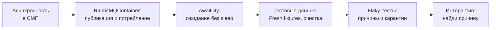
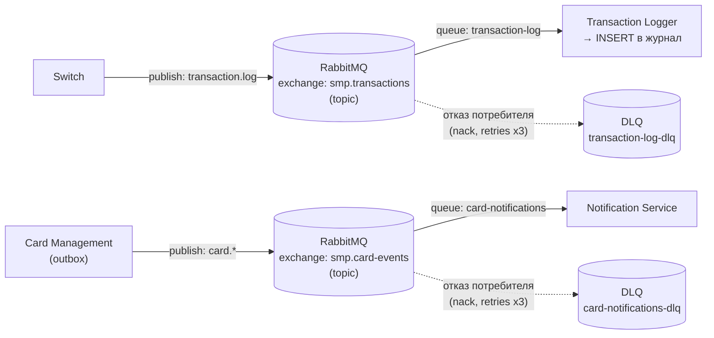

# Lecture 2: Асинхронные интеграционные тесты: RabbitMQ, тестовые данные, изоляция и flaky-тесты

> **Модуль**: 6 — Интеграционное тестирование с БД в контейнерах
> **Лекция**: 2 из 2
> **Лектор**: Ирина Габанова
> **Длительность**: 1,5 астрономических часа (слот 90 мин: ~70 мин рассказа по speaker notes + интерактив внутри блоков + вопросы; остаток слота — резерв на обсуждение)
> **Слайдов**: 15
> **Связь с лекцией 1**: `lecture-01.md` (границы уровня, managed/unmanaged, Testcontainers, PostgreSQL)
> **Соглашение о визуализации**: на каждом слайде есть блок **Визуализация** с описанием макета и рекомендацией по иллюстрации. Изображения пока только рекомендованы, имя файла и папка указаны условно; реальные файлы кладём в `Pictires/lecture-02/`. Диаграммы описаны кодом mermaid прямо в файле.

---

## Тайминг

| Время | Блок | Слайды | Содержание |
|-------|------|--------|-----------|
| 0:00–0:13 | Введение | 1–4 | Связь с лекцией 1, асинхронность в СМП, чем асинхронный тест отличается от синхронного |
| 0:13–0:32 | RabbitMQ в тестах | 5–7 | RabbitMQContainer, паттерн «опубликовал — потребил», Awaitility, ядовитое сообщение и DLQ |
| 0:32–0:52 | Тестовые данные и изоляция | 8–11 | Shared vs Fresh fixtures, очистка в начале, транзакции в тестах, уникальные данные, WireMock |
| 0:52–1:07 | Нестабильность | 12–13 | Flaky-тесты: причины, диагностика, карантин; параллелизм |
| 1:07–1:18 | Интерактив | 14 | «Найди причину flaky»: разбор четырёх дел |
| 1:18–1:22 | Итоги | 15 | Выводы модуля, связка с артефактом 4 и модулем 7 |
| 1:22–1:30 | Резерв | — | Вопросы, разбор кода по запросу аудитории, буфер на обсуждение |

> Тайминг приведён для слота 90 минут (четверг 13:30–15:00): чистый рассказ по speaker notes — ~70 минут (темп ~140 слов в минуту), интерактив и итоги — ~15 минут внутри блоков, остаток — резерв на вопросы.

---

### Слайд 1. Титульный

**Слайд:**
- Модуль 6: Интеграционное тестирование с БД в контейнерах
- Lecture 2: RabbitMQ, тестовые данные, изоляция и flaky-тесты
- Курс «Тестирование ПО», Lekton

**Визуализация:**
- Макет: полноэкранный титульный фон, поверх — название модуля и лекции.
- Иллюстрация: `Pictires/lecture-02/img-1-cover.jpg` — титульный фон из брендового набора курса.

**Speaker notes:**
> Добрый день! Вторая лекция шестого модуля. На прошлой мы договорились, что интеграционный тест в микросервисе — это проверка стыка с внешним компонентом, научились поднимать реальный PostgreSQL в Testcontainers и писать репозиторные тесты. Сегодня добавляем вторую управляемую зависимость СМП (Симулятора процессингового центра) — брокер RabbitMQ — и с ней принципиально новый режим работы: асинхронность. После этой лекции у вас будет полный инструментарий интеграционного уровня: база, очередь, тестовые данные и защита от нестабильности.
>
> Скажу сразу про характер сегодняшнего материала — он другой, чем в первой лекции. Там мы разбирали правила и определения: что такое managed-зависимость, почему H2 запрещён. Это решения, которые принимаются один раз и навсегда. Сегодня почти весь материал — про дисциплину: как ждать, как чистить, как диагностировать. Дисциплина отличается от правил тем, что её нельзя «понять и забыть» — её надо выстроить привычкой. Поэтому почти каждый слайд сегодня заканчивается коротким запретом или предписанием: не проверяй без ожидания, не увеличивай таймаут, не чисти в конце. Это не назидательность — это дистиллят чужих бессонных ночей, и я буду каждый раз объяснять, из какой именно бессонной ночи он родился.
>
> И ещё одно предупреждение, на этот раз честное: сегодняшняя тема — главный источник боли в интеграционном тестировании вообще. Если спросить у индустрии, что убивает тестовые наборы, ответ будет не «сложный SQL» и не «непонятные аннотации», а именно нестабильность: тесты, которые краснеют без причины. Мы специально поставили эту тему в конец модуля, когда у вас уже есть весь инструментарий, — чтобы вы увидели: flaky-тест это не мистика и не погода, а конечное множество причин, каждая из которых диагностируется и лечится. К концу лекции у вас будет полная классификация этих причин и протокол действий для каждой.
>
> Добавлю личную рамку, откуда я знаю эту боль. В каждой команде, где я работала с интеграционными наборами, был свой «тот самый тест» — тот, который краснел раз в неделю, никогда в четверг, никогда у одного и того же разработчика. Вокруг него складывался фольклор: шутки в чате, ритуальные перезапуски, дежурная фраза «да он всегда так». И в каждой команде история заканчивалась одинаково: когда мы наконец садились и классифицировали его по тем четырём причинам, что разберём сегодня, причина находилась за полчаса — гонка, пропущенная очистка, чужое расписание. Полчаса системной работы против месяцев фольклора. Эта лекция — попытка сэкономить вам эти месяцы: я хочу, чтобы первый же flaky-тест в вашей карьере вы встречали не шуткой в чате, а классификацией на слайде двенадцать.

---

### Слайд 2. План лекции

**Слайд:**
- Асинхронность в СМП: кто публикует, кто потребляет
- RabbitMQ в Testcontainers: топология, публикация, потребление
- Awaitility: как ждать eventual consistency без Thread.sleep
- Тестовые данные: Fresh vs Shared fixtures, очистка, транзакции
- Flaky-тесты: причины, диагностика, карантин
- Интерактив: «Найди причину flaky»

**Визуализация:**
- Макет: вертикальная дорожка из шести пунктов с номерами блоков; интерактив выделен акцентным цветом.
- Диаграмма: mermaid-схема ниже.



**Speaker notes:**
> Напомню, где мы остановились. Мы научились тестировать синхронный стык: вызвал метод репозитория — получил результат в той же строке кода. Асинхронный стык устроен иначе: вызвал метод издателя — и всё, метод вернул управление, а сообщение ещё только летит в брокер, потом в очередь, потом в потребителя, и только потом меняется состояние. Проверить результат сразу после вызова нельзя — его ещё нет. Это меняет всё: структуру Arrange-Act-Assert, работу с данными и главный источник нестабильности.
>
> План. Сначала посмотрим на асинхронные связи СМП — вы уже рисовали их в практике модуля 3 на sequence-диаграммах, сегодня превратим их в тесты. Потом техническая часть: RabbitMQContainer и паттерн «опубликовал — потребил — проверил состояние». Затем Awaitility — библиотека, которая заменяет Thread.sleep и спасает от самой глупой породы flaky-тестов. Второй блок — тестовые данные: почему общие фикстуры убивают наборы тестов, как чистить данные правильно и почему очистка в начале теста надёжнее очистки в конце. Третий блок — flaky-тесты как явление: классификация причин, диагностика и карантинная политика. Завершим интерактивом, где вы будете диагностировать нестабильные тесты, как настоящие детективы.
>
> Обращаю ваше внимание на структуру этих трёх блоков — она не случайна, это цепочка причин и следствий. Асинхронность порождает проблему ожидания: результат приходит «когда-нибудь», и нужен способ его дождаться. Ожидание и параллельные процессы порождают проблему данных: тесты начинают видеть чужое состояние. А нерешённые проблемы ожидания и данных порождают flaky-тесты. То есть каждый следующий блок лечит болезни, которые запустил предыдущий. Если выстроить дисциплину в правильном порядке — сначала научиться ждать, потом научиться чистить, — то к блоку про flaky у вас останется только классифицировать чужие ошибки, а не свои. На практике советую идти ровно в этом порядке: сначала позитивный тест на потребление, потом очистка данных, и только потом отрицательные и хитрые сценарии.
>
> И ещё одно наблюдение про план — на этот раз про то, чего в нём нет. Вы не найдёте здесь отдельного блока «как писать асинхронные тесты быстро» или «как гонять их параллельно». Это осознанное решение, и оно продиктовано приоритетом курса: на интеграционном уровне цена неверного сигнала выше цены медленного сигнала. Тест, который проходит за десять секунд, но честно говорит о состоянии системы, — актив. Тест, который проходит за секунду, но врёт раз в неделю, — пассив, и больший, чем отсутствие теста, потому что он разрушает доверие ко всему набору. Поэтому сегодняшние оптимизации — только те, что не трогают честность: опрос вместо сна, TRUNCATE вместо пересоздания, общий контейнер вместо контейнера на метод. Всё, что экономит время ценой изоляции, мы сознательно откладываем — вы услышите почему на слайде про параллелизм.

---

### Слайд 3. Асинхронные связи СМП

**Слайд:**
- Синхронные: Gateway → Switch → Authorization → CMS/BIN (HTTP, запрос-ответ) — это тестировали в модуле 5
- Асинхронные: Switch → RabbitMQ → Transaction Logger; CMS outbox → RabbitMQ → Notification Service
- Проверка асинхронной связи: сообщение ушло → подписчик получил → состояние изменилось
- DLQ: при отказе потребителя сообщение должно попасть в dead-letter queue — это тоже тест

**Визуализация:**
- Макет: карта СМП с двумя цветами связей: синие синхронные стрелки, оранжевые асинхронные через брокер; у каждой асинхронной — подпись очереди.
- Диаграмма: mermaid-схема ниже.



**Speaker notes:**
> Вспомним карту взаимодействий, которую вы строили в практике третьего модуля. Тогда мы разделили связи СМП на два типа. Синхронные: Gateway вызывает Switch, Switch вызывает Authorization, Authorization спрашивает Card Management и BIN-сервис (сервис проверки BIN — Bank Identification Number, банковского идентификационного номера) — всё по HTTP (HyperText Transfer Protocol, протоколу передачи гипертекста), всё запрос-ответ, всё вы проверили API-тестами (API — Application Programming Interface, программный интерфейс приложения) в модуле 5: отправили запрос, в той же строке получили ответ, проверили статус и тело.
>
> Асинхронные связи устроены принципиально иначе. Switch после авторизации публикует событие транзакции в topic-exchange `smp.transactions` с routing key `transaction.log`, и на этом его работа заканчивается — ответ клиенту уже ушёл. Transaction Logger независимо слушает очередь `transaction-log`, вычитывает событие и пишет запись в журнал. Card Management использует паттерн outbox: запись сперва ложится в таблицу `outbox_event` в той же транзакции, что и бизнес-данные, а отдельный релей `OutboxProcessor` переносит её в topic-exchange `smp.card-events` — оттуда событие потребляет Notification Service через очередь `card-notifications`. Так достигается гарантия «и база, и сообщение» без распределённой транзакции. Сам Authorization в брокер ничего не публикует: он работает синхронно, а журналирование его решений происходит транзитом через Switch.
>
> Из этого следует формула асинхронного интеграционного теста, запишите её: сообщение ушло, подписчик получил, состояние изменилось. Три проверки вместо одной. Между первой и третьей — время, которое мы не контролируем: миллисекунды на локальной машине, секунды на загруженном CI (Continuous Integration, сервере непрерывной интеграции). Именно это время — источник девяноста процентов сложностей сегодняшней лекции.
>
> И не забудем про отрицательный сценарий. Если потребитель упал на обработке сообщения — например, событие пришло в неожиданном формате, так называемое «ядовитое» сообщение, poison message, — брокер после исчерпания попыток должен переложить его в очередь мёртвых писем. Попадание в DLQ (Dead Letter Queue, очередь мёртвых писем) — это наблюдаемое поведение системы, часть контракта надёжности, и оно тестируется так же: опубликовали битое сообщение, дождались, проверили DLQ. Такой тест обязателен в любом зрелом асинхронном наборе.
>
> Напомню, почему СМП вообще построена на асинхронных связях — это поможет вам понять, зачем так много внимания этой теме. Синхронная цепочка «Gateway → Switch → Authorization» — это критический путь запроса: пока звено не ответило, клиент ждёт, и длина цепочки напрямую складывается в задержку. А вот журналирование и уведомления — это события, которые не нужны для ответа клиенту: транзакция уже авторизована, и то, что запись о ней появится в журнале через двести миллисекунд, никому не мешает. Вынос таких побочных эффектов в очередь — классический приём: критический путь короче, отказ журнала не роняет авторизацию, нагрузка сглаживается брокером. Но у этого приёма есть цена, и цена эта — та самая eventual consistency, которую мы сегодня учимся тестировать. Архитектурное решение «сделать асинхронно» всегда подписывает команду на тестирование «подождать и проверить».
>
> И небольшая связка с первой лекцией, чтобы картина была цельной. Там мы классифицировали зависимости на managed и unmanaged и договорились, что RabbitMQ в СМП — managed: очереди и обменники принадлежат сервису, и в тестах мы поднимаем свой брокер. Сегодняшняя карта показывает следствие: раз брокер наш, мы можем делать с ним в тесте что угодно — объявлять топологию, публиковать яд, читать из DLQ, чистить очереди. Ничего из этого нельзя было бы сделать на общем брокере тестового контура — там каждое такое действие ломало бы чужие прогоны. Правило «managed — поднимаем как есть» здесь оборачивается свободой: полный контроль над состоянием брокера в обмен на десять секунд старта контейнера.
>
> Задержимся ещё на одном элементе карты — outbox в Card Management, потому что это самый зрелый паттерн из всех, что вы сегодня увидите, и на собеседованиях его спрашивают постоянно. Проблема, которую он решает, называется dual write, двойная запись: сервис должен и записать бизнес-данные в базу, и опубликовать событие в брокер, и эти две операции нельзя объединить в одну транзакцию — у PostgreSQL и RabbitMQ нет общего координатора, распределённая транзакция была бы слишком дорогой и хрупкой. Что происходит без outbox: записали в базу, закоммитили, пошли публиковать — и в этот момент процесс упал. База обновлена, событие не ушло, мир не узнал о новой карте. Или наоборот: событие опубликовано, а коммит откатился — мир узнал о карте, которой нет. Решение outbox изящно: в одной транзакции с бизнес-данными пишем событие в специальную таблицу outbox той же базы — тут уж атомарность гарантирована СУБД, — а отдельный фоновый релей читает таблицу и переносит записи в брокер с повторными попытками. Упал релей — догонит при перезапуске, записи никуда не денутся. Обратите внимание, что для тестирования это значит: outbox-таблица — обычная таблица, созданная миграцией V5.5, и её наполнение проверяется обычным репозиторным тестом из первой лекции; а вот перенос в брокер — уже асинхронный сценарий сегодняшнего дня. Один паттерн разлагается на два знакомых вам теста.

---

### Слайд 4. Чем асинхронный тест отличается от синхронного

**Слайд:**
- Синхронный: Act возвращает результат → Assert сразу (запрос-ответ в одном потоке)
- Асинхронный: Act только запускает цепочку → результат появляется «когда-нибудь» (eventual consistency)
- Нельзя: `publish(); assertThat(db.count()).isEqualTo(1)` — гонка, тест падает случайно
- Нельзя: `publish(); Thread.sleep(3000); assert...` — медленно и всё равно нестабильно
- Нужно: ожидание условия с таймаутом и опросом — polling

**Визуализация:**
- Макет: две временные шкалы: синхронная — запрос/ответ на одной линии; асинхронная — publish, затем пунктир времени, затем появление записи; под ними два перечёркнутых антипаттерна.
- Иллюстрация: `Pictires/lecture-02/img-2-async.png`.

**Speaker notes:**
> Зафиксируем различие, потому что от него зависит вся дальнейшая техника. В синхронном тесте мир детерминирован: строка Act вернула результат, строка Assert его проверила. Между ними нет времени.
>
> В асинхронном тесте Act не возвращает результат — он запускает процесс. Метод publish отработал, сообщение ушло в сокет, и всё. Где-то в другом потоке, другом процессе, а в проде — на другой машине потребитель когда-нибудь его обработает. Это и есть eventual consistency, согласованность в конечном счёте: система гарантирует, что состояние станет согласованным, но не говорит, когда именно. Мы впервые встречаемся с этим в тестах, но само явление вы уже видели в модуле 3 — помните паузу после health-check в smoke-скрипте: Gateway уже отвечает «ok», а downstream-сервисы ещё не договорили между собой.
>
> Первая реакция новичка — проверить сразу: publish, и следующей строкой assert по базе. Это гонка. На вашей быстрой машине потребитель успевает девятьсот девяносто девять раз из тысячи, а тысячный тест падает — как правило, ночью на CI перед дедлайном. Поздравляю, вы написали flaky-тест, хотя код системы безупречен.
>
> Вторая реакция — sleep: подождать три секунды «с запасом». Это лечит симптом и калечит набор. Во-первых, медленно: сто асинхронных тестов по три секунды ожидания — пять минут чистого сна, хотя девяносто девять процентов времени результат уже готов. Во-вторых, всё равно нестабильно: на загруженном CI-агенте три секунды превратятся в мало, и вы повысите до пяти, потом до десяти. Sleep — это не синхронизация, это надежда.
>
> Правильный приём — ожидание условия с опросом: проверять «появилась ли запись» каждые сто миллисекунд, пока не появится, но не дольше разумного таймаута. Тест проходит за фактическое время обработки — обычно сотни миллисекунд, — а не за фиксированный запас; и падает только когда условие не наступило вообще, то есть когда сломано что-то настоящее. Реализация этого приёма — на следующих двух слайдах.
>
> Отмечу одну тонкость в структуре асинхронного теста, которая путает новичков: где здесь граница между Act и Assert? В синхронном тесте всё было чётко: Act вернул значение — начался Assert. Здесь Act — это только публикация, а ожидание и проверка сливаются в одну конструкцию: `await().untilAsserted(...)` одновременно и ждёт, и проверяет. Это нормально и это задумано: ожидание — часть Assert-секции, потому что проверяемое условие само по себе асинхронно. Не пытайтесь искусственно разорвать их на «дождались флага — потом проверили»: получите два опроса вместо одного и двойную цену. В асинхронном мире AAA деформируется: Arrange остаётся, Act сжимается до одного выстрела, а Assert растягивается во времени. Это не нарушение структуры — это её честная адаптация к физике системы.
>
> И ещё посмотрите на проблему с точки зрения того, что именно мы ждём — это важно для тест-дизайна. В примерах выше мы ждём состояние: запись в базе, сообщение в DLQ. Альтернатива, которую новички иногда выбирают, — ждать событие: перехватить вызов метода, сработку листенера, строку в логе. Событие говорит «потребитель проснулся», состояние говорит «система сделала своё дело». Между ними — вся бизнес-логика: потребитель может проснуться, упасть с исключением и откатить транзакцию, и событие будет, а состояния не будет. Поэтому правило: в Assert всегда проверяем состояние мира — базу, очередь, исходящее сообщение, — а не факт вызова. Хориков формулирует это как тестирование наблюдаемого поведения; Месарош — как предпочтение state verification перед behaviour verification на этом уровне. Смысл один: тестируем результат, а не активность.
>
> Есть у этого правила и второе, экономическое обоснование, о котором молчат книги, но которое вы оцените в первый же рефакторинг. Проверка состояния устойчива к изменению реализации, проверка активности — нет. Завтра потребитель переедет с листенера на поллинг базы или сменит сигнатуру метода обработчика: тест, проверяющий «запись появилась в журнале», даже не заметит рефакторинга — и правильно, потому что контракт сервиса не изменился. Тест, проверяющий «метод handle был вызван один раз», упадёт, хотя система работает как прежде, — и вы потратите вечер на починку теста, который не нашёл никакого бага. Это ровно хрупкость из первой лекции, только на новом уровне: всё, что привязывает тест к механике вместо результата, превращает рефакторинг в кладбище тестов. Устойчивость к рефакторингу — тот самый четвёртый столп из Хорикова, и на асинхронном уровне он достигается одним приёмом: ждите и проверяйте состояние.

---

### Слайд 5. RabbitMQContainer и паттерн «опубликовал — потребил»

**Слайд:**
```java
@Testcontainers
class TransactionLoggerIT {

    @Container
    static RabbitMQContainer rabbit = new RabbitMQContainer(
            DockerImageName.parse("rabbitmq:3.13-management"));

    @Test
    void shouldConsumeTransactionEvent() throws Exception {
        // Arrange: соединение, топология, тестовое сообщение
        try (Connection conn = rabbit.getConnectionFactory().newConnection();
             Channel channel = conn.createChannel()) {
            channel.exchangeDeclare("smp.transactions", "topic", true);
            channel.queueDeclare("transaction-log", true, false, false, null);
            channel.queueBind("transaction-log", "smp.transactions", "transaction.log");

            // Act: публикуем событие как это делает Switch
            String event = """
                {"type":"TRANSACTION_AUTHORIZED","rrn":"000000123456",
                 "pan":"4000001234560001","amount":150000,"status":"APPROVED"}
                """;
            channel.basicPublish("smp.transactions", "transaction.log", null, event.getBytes(UTF_8));
        }

        // Assert: запись появилась в журнале (ожидание — на следующем слайде)
        await().atMost(5, SECONDS).untilAsserted(() ->
            assertThat(journalRepository.countByRrn("000000123456")).isEqualTo(1));
    }
}
```

**Визуализация:**
- Макет: код теста; справа легенда «шаг → зачем»: топология, публикация, ожидание-проверка.
- Код: пример выше.
- Иллюстрация: `Pictires/lecture-02/img-3-rabbit-it.png`.

**Speaker notes:**
> Смотрим на скелет асинхронного интеграционного теста — потребление события Transaction Logger'ом. Контейнер теперь `RabbitMQContainer` с официальным management-образом; жизненный цикл тот же, что у PostgreSQL на прошлой лекции, — static, один на класс. Брокер — управляемая зависимость: очереди и exchange нашего сервиса принадлежат нам, поэтому поднимаем настоящий RabbitMQ, а не мок.
>
> Разберём секции. Arrange: открываем соединение и канал к брокеру и объявляем топологию — exchange типа topic, очередь и привязку по routing key. Вопрос, который сейчас у вас должен возникнуть: а почему топологию объявляет тест, а не само приложение? Ответ: зависит от архитектуры сервиса. Есть два лагеря: сервисы, которые сами объявляют свои очереди при старте, — тогда в тесте топологию не трогаем, она появится при поднятии потребителя; и сервисы, которые ожидают готовую топологию от инфраструктуры. В реальном СМП топологию объявляют сами приложения при старте, а на слайде мы объявляем её в тесте явно — в учебных целях: заодно это тест самой топологии. Если routing key в привязке опечатан, событие мимо очереди пролетит, и тест честно упадёт по таймауту.
>
> Act: публикуем событие вручную, имитируя Switch. Обратите внимание на важную вещь: мы формируем сообщение в том формате, который реально публикует Switch. Это точка, где интеграционный тест встречается с контрактным: формат события — договорённость между сервисами, и если Switch завтра переименует поле pan в cardNumber, наш тест должен упасть. Поэтому шаблон сообщения правильно держать рядом со спецификацией, а не выдумывать в тесте.
>
> Assert — та самая строка await из библиотеки Awaitility: ждём до пяти секунд, периодически выполняя проверку «в журнале одна запись с таким RRN (Retrieval Reference Number, референс-номером транзакции)», и проходим, как только она выполнилась. Подробный разбор Awaitility — следующий слайд.
>
> Заметьте симметрию с репозиторным тестом: там был round-trip «записал — прочитал», здесь «опубликовал — дождался — проверил состояние». Один Act — одна асинхронная цепочка. Не публикуйте три события и не проверяйте три эффекта в одном тесте: при таймауте вы не поймёте, какая цепочка не дошла.
>
> Разберу ещё один вопрос, который неизбежно возникнет у вас при написании этого теста: где взять тот самый JSON (JavaScript Object Notation, формат представления данных) события и почему нельзя просто собрать его руками в строке? Формально можно — и на слайде так и сделано для читаемости. Но в зрелом проекте правильнее другое: сериализовать тот же класс события, который использует издатель. В СМП событие авторизации — это Java-record, и тест может создать его экземпляр и прогнать через тот же Jackson, что и продовый издатель. Тогда тест дополнительно проверяет сериализацию: переименовали поле в record — переименовалось и в тесте, и потребитель либо продолжит парсить, либо тест честно упадёт. Строка-литерал такой защиты не даёт: она застывает во времени и тихо расходится с реальным форматом. Это частный случай общего принципа, который мы пронесли через весь модуль: тест должен пользоваться теми же артефактами, что и прод, — теми же миграциями, той же СУБД, теми же сериализаторами.
>
> И про образ RabbitMQ — то же правило версионности, что с PostgreSQL. Тег `rabbitmq:3.13-management` выбран не случайно: он совпадает с версией брокера в боевом docker-compose СМП. Суффикс management добавляет веб-консоль управления — в тестах она не нужна функционально, но полезна при отладке: открываете проброшенный порт в браузере и видите свои очереди, привязки, скопившиеся сообщения глазами. Когда ваш тест «не потребляет», эта консоль — первое место, куда идти: привязка есть? сообщение дошло до обменника? застряло в очереди? Девяносто процентов отладки асинхронных тестов — это умение посмотреть на брокер снаружи, а не гадать по коду.
>
> Зафиксирую связку правил, потому что она теперь полная и будет повторяться в каждом вашем тесте. Правило версии: образ в тесте равен образу в проде — ни новее, ни старше, иначе вы проверяете другую систему. Правило конфигурации: топология объявляется тем же кодом, что в проде, — в СМП очереди и обменники декларируются приложением при старте, и тест просто ждёт готовности контейнера, ничего не настраивая руками. Правило изоляции: контейнер наш, делайте что хотите — публикуйте яд, чистите очереди, читайте DLQ. Три правила образуют контур: версия и конфигурация делают тест правдивым, изоляция делает его свободным. Когда ваш первый асинхронный тест не заработает с первого раза — а он не заработает, — проверяйте по этому контуру: та ли версия, та ли топология, тот ли виртуалхост. Девять из десяти поломок первого контакта — это нарушение одного из трёх.
>
> Разберу подробнее момент, который в примере сознательно оставлен компактным, — где живёт потребитель во время теста. В нашем скелете тест публикует сообщение и ждёт записи в журнале, но кто-то должен это сообщение обработать. Вариантов два. Первый: тест поднимает тестируемый потребитель как часть приложения — например, Spring-контекст с листener-контейнером, настроенным на контейнерный брокер через те же `@DynamicPropertySource`, что и для базы. Тогда тест сквозной внутри сервиса: сообщение проходит весь путь «брокер → листener → сервис → репозиторий → база». Второй: потребитель выделен и запускается программно в `@BeforeAll` — так делают, когда полный контекст тяжеловат. Оба варианта законны; объединяет их одно — потребитель настроен на настоящий брокер контейнера, а не на встроенный мок. И зеркальный вариант для теста издателя: когда проверяете, что ваш сервис публикует событие, потребителем становится сам тест — вы объявляете временную очередь, привязываете к обменнику и читаете сообщение сырьём, проверяя формат. Этот приём называется тестовый консьюмер: сервис авторизовал — событие улетело — тест прочитал его из брокера и сверил поля.

---

### Слайд 6. Awaitility: ожидание условия без sleep

**Слайд:**
- `await().atMost(5, SECONDS).untilAsserted(() -> assertThat(...))` — опрос условия, успех при первом выполнении
- Параметры: `pollInterval` (каждые 100 мс), `pollDelay`, `atMost` (таймаут)
- Таймаут — диагноз: если условие не наступило, сломана цепочка, а не «мало подождали»
- Подбор таймаута: 5–10× от наблюдаемого p99 обработки, фиксируется один раз в базовом классе
- Антипаттерн: наращивание sleep после каждого падения

**Визуализация:**
- Макет: временная шкала опроса: тики каждые 100 мс, галочка на 350 мс «условие выполнено — тест прошёл за 0,35 с»; рядом перечёркнутый sleep(3000).
- Код: мини-примеры вариантов Awaitility.
- Иллюстрация: `Pictires/lecture-02/img-4-awaitility.png`.

```java
// Классика: условие по возвращаемому значению
await().atMost(5, SECONDS).pollInterval(100, MILLISECONDS)
       .until(() -> journalRepository.countByRrn(RRN) == 1);

// Условие-assert: удобно, сообщение об ошибке сохраняется
await().atMost(5, SECONDS).untilAsserted(() ->
       assertThat(dlqRepository.findAll()).hasSize(1));

// Нестандартное ожидание: сначала пауза, потом опрос (холодный старт потребителя)
await().with().pollDelay(500, MILLISECONDS).and().atMost(10, SECONDS)
       .untilAsserted(() -> assertThat(notificationService.sentCount()).isPositive());
```

**Speaker notes:**
> Awaitility — маленькая библиотека, которая делает ровно одну вещь и делает её хорошо: ждёт выполнения условия, опрашивая его с интервалом, и либо проходит при первом успехе, либо падает по таймауту. Авторы TJM («Test-Driven Java Development», Farcic/Garcia) используют её для всех асинхронных проверок, и мы будем так же.
>
> Разберём семантику на первом примере. `atMost(5, SECONDS)` — верхняя граница: дольше пяти секунд не ждём никогда. `pollInterval(100, MILLISECONDS)` — каждые сто миллисекунд выполняем лямбду. `until(...)` — ждём, пока лямбда вернёт true. Ключевой эффект: если запись появилась через триста пятьдесят миллисекунд — тест прошёл за триста пятьдесят миллисекунд, а не за три секунды сна. На наборе из сотни асинхронных тестов это разница между минутой и десятью минутами.
>
> Второй вариант — `untilAsserted`: внутрь кладём обычные assert-ы; Awaitility ловит AssertionError и повторяет, а при таймауте бросает наружу последнее исключение — то есть в отчёте вы видите не бесполезное «condition not fulfilled», а настоящее «expected: 1, but was: 0» от AssertJ. Всегда предпочитайте untilAsserted — диагностика при падении бесценна.
>
> Теперь самое важное — философия таймаута. Таймаут — это не «сколько жалко подождать», это диагностическая граница: если за него условие не наступило, значит цепочка сломана — сообщение не опубликовано, очередь не привязана, потребитель упал. Поэтому таймаут не наращивают после каждого падения — его выбирают один раз: пять-десять крат от реального p99 (99-го перцентиля) времени обработки. На локальной машине обработка занимает миллисекунды, на холодном CI — секунду; пять секунд покрывают всё с огромным запасом. Если пять секунд не хватило — ищите баг, а не поднимайте до десяти.
>
> И третий пример для честности: `pollDelay` — начальная пауза перед первым опросом. Нужен редко, в основном когда потребитель сам ещё поднимается; злоупотреблять им — это тот же sleep, только спрятанный.
>
> Добавлю практические детали, которые сэкономят вам время на практике. Первая: интервал опроса. Сто миллисекунд — разумный дефолт для локальных тестов; слишком частый опрос — десять миллисекунд — не ускоряет тест, но нагружает базу холостыми запросами, а слишком редкий — секунда — добавляет каждому тесту полсекунды среднего ожидания впустую. На наборе из сотни тестов это минута разницы. Вторая: исключения внутри лямбды. Если ваш запрос к базе падает с исключением — например, соединение ещё не поднято, — Awaitility по умолчанию проглотит его и продолжит опрос, что обычно и нужно на холодном старте. Но знайте про `ignoreExceptions` и её противоположность: иногда исключение — это не «ещё не готово», а «сломано навсегда», и молчаливое проглатывание растянет диагноз на весь таймаут.
>
> Вторая практическая деталь — куда девать эти константы, когда тестов станет много. Не размазывайте магические числа по классам: заведите один базовый класс или утилиту `Await` с зафиксированными `atMost`, `pollInterval` и единым `untilAsserted`-обёрткой. Тогда таймаут настраивается в одном месте, все тесты ведут себя одинаково, и — что важнее всего — когда вы переедете на более медленный CI, вы поменяете одну константу осознанно, посмотрев на метрики, а не будете проходить крестовым походом «плюс две секунды» по тридцати файлам. Единая политика ожидания — это такой же элемент дизайна набора, как единая стратегия очистки.

---

### Слайд 7. Отрицательный сценарий: ядовитое сообщение и DLQ

**Слайд:**
- Poison message: потребитель падает на обработке (битый JSON, неизвестный тип)
- Ожидаемое поведение: nack → retry → после исчерпания попыток — в DLQ
- Тест: публикуем битое сообщение → await → сообщение в DLQ, основная очередь пуста, сервис жив
- Что НЕ проверяем: логику retry самого брокера — это забота RabbitMQ

**Визуализация:**
- Макет: схема движения ядовитого сообщения: очередь → потребитель ✗ → retry ×3 → DLQ ✓; рядом чек-лист из трёх проверок теста.
- Иллюстрация: `Pictires/lecture-02/img-5-dlq.png`.

**Speaker notes:**
> Позитивный сценарий «опубликовал — записалось» покрывает половину стыка. Вторая половина — отказ. Что происходит, когда потребитель не может обработать сообщение: JSON не парсится, тип события неизвестен, поле обязательное, а его нет? Такое сообщение называется ядовитым, poison message: его нельзя обработать никогда, и крутить его в цикле бесконечно — значит заблокировать очередь всем остальным.
>
> Правильная архитектура — и она реализована в СМП — такая: потребитель отвечает nack, брокер возвращает сообщение, после настроенного числа попыток перекладывает его в dead-letter queue — очередь мёртвых писем. Там оно лежит, доступное для разбора и повторной обработки после исправления кода. Это не авария, это штатный контур надёжности, и как всякий контур он требует теста.
>
> Тест устроен зеркально позитивному: публикуем заведомо битое сообщение — например, JSON без обязательного поля rrn, — ждём через Awaitility и проверяем три вещи. Первое: сообщение появилось в DLQ — читаем его оттуда тестовым консьюмером. Второе: основная очередь пуста — яд не крутится в retry бесконечно. Третье: сервис жив и обрабатывает следующее, нормальное сообщение — яд не уронил потребителя целиком. Три проверки — но это один логический сценарий «система пережила яд», поэтому один тест здесь уместен.
>
> Граница проверок: мы не тестируем механику retry самого RabbitMQ — то, что брокер честно отсчитывает попытки, гарантирует вендор. Мы тестируем нашу конфигурацию и наш код: что очередь объявлена с привязкой к DLX (Dead Letter Exchange, обменнику мёртвых писем), что потребитель шлёт nack, а не молча падает, что сервис после яда продолжает работать. Это ровно правило с первой лекции: проверяем коммуникацию и конфигурацию стыка, а не сам компонент.
>
> Скажу подробнее про третью проверку — «сервис жив», — потому что её ценность недооценивают. Классическая поломка в реальной жизни выглядит так: разработчик пишет потребителя, не оборачивает обработку в try-catch, исключение улетает в фреймворк, листener-контейнер останавливается — и потребитель молча умирает целиком. Сообщения копятся в очереди, мониторинг орёт, а причина — одно необработанное исключение от одного битого события. Ваш тест «яд плюс следующее нормальное сообщение» ловит ровно это: если после яда нормальное событие не обработалось — потребитель умер, и вы узнали об этом за секунды на своей машине, а не за часы на стенде. В терминах Фаулера это тест режима отказа: мы проверяем не только что система делает в норме, но и как именно она ломается — и требуем, чтобы ломалась она локально и восстановимо.
>
> И одна опасная тонкость про подсчёт попыток. Если retry настроен на стороне потребителя — например, через retry-интерцептор Spring AMQP (Advanced Message Queuing Protocol, протокол брокера сообщений) с тремя попытками и бэкоффом, — то ваш тест будет ждать, пока все попытки исчерпаются: три попытки с паузами могут занять секунды. Учитывайте это в таймауте Awaitility: пять секунд позитивного теста могут не покрыть отрицательный сценарий с тремя ретраями по две секунды. Решение — отдельный, больший таймаут для DLQ-тестов, и это законное исключение из правила «не крути таймаут»: вы крутите его не потому, что тест упал, а потому, что характеристики сценария объективно другие — вы можете это обосновать арифметикой «число попыток на паузу». Таймаут, который можно обосновать арифметикой, — правильный таймаут.
>
> Посмотрите на этот тест ещё и глазами тест-дизайнера из модуля 2 — он заслуживает. Здесь мы тестируем не функциональное требование «система журналирует», а нефункциональное «система устойчива к яду», причём тестируем его наблюдаемо: не читаем конфигурацию retry и не верим документации, а реально бросаем яд и реально смотрим, где он оказался. Это редкий случай, когда требование надёжности превращается в обычный исполняемый тест без героики. В банковской предметной области такие тесты ценны вдвойне: ядовитое сообщение в проде — это не абстракция, а регулярное событие — внешний процессинг обновит формат, соседняя команда добавит поле, кто-то опубликует событие мимо схемы. Команда, у которой DLQ-контур покрыт тестом, узнаёт о яде из алерта «одно сообщение в DLQ», а не из звонка «почему журнал пуст за последние три часа». Разница между этими двумя способами узнать — и есть цена сегодняшнего теста.

---

### Слайд 8. Тестовые данные: почему общие фикстуры — корень зла

**Слайд:**
- Shared Fixture (Месарош): общие заранее залитые данные на всех (data.sql «для всех тестов»)
- Последствия: тест зависит от данных, которых не создавал; изменение общих данных ломает чужие тесты; причина падения — археология
- Fresh Fixture: каждый тест создаёт свои данные и видит только их
- Цена Fresh: медленнее (создание на каждый тест) — компенсируется общим контейнером и быстрой очисткой
- В СМП: никаких общих «стандартных карт» в миграциях для тестов; тест создаёт карту себе сам

**Визуализация:**
- Макет: слева «общая корзина данных», от которой пять тестов тянут нитки, две нитки порваны; справа — каждый тест со своей маленькой корзиной.
- Иллюстрация: `Pictires/lecture-02/img-6-fixtures.png`.

**Speaker notes:**
> Переходим ко второму блоку — тестовые данные. Месарош в «xUnit Test Patterns» ввёл два термина, которые надо знать в лицо: Shared Fixture и Fresh Fixture. Shared Fixture — общие данные, подготовленные один раз на всех: пресловутый data.sql с «стандартной картой Ивана», которую используют тридцать тестов. Fresh Fixture — каждый тест строит свой мир с нуля.
>
> Почему shared — корень зла, хоть и выглядит экономно. Первая болезнь: тест зависит от данных, которых он не создавал. Читая тест, вы видите `findByPan(PAN_IVANA)` — но что это за карта, какой у неё лимит и статус — написано в другом файле, в другом месте, а то и в чужой голове. Тест перестаёт быть самодокументирующимся: помните из модуля 4 — тест отвечает на вопрос «что делает система», а с общей фикстурой ответ спрятан. Вторая болезнь: хрупкость по кругу. Разработчик меняет общую карту для своего теста — ломаются четыре чужих; те «чинят» под себя — ломаются ещё шесть. Третья болезнь: причина падения превращается в археологию — тест красный, а виноват не этот тест и не код, а коммит недельной давности в общий скрипт.
>
> Fresh Fixture решает всё это ценой скорости создания данных. Но смотрите, как складывается экономика модуля: контейнер у нас общий и дорогой — поднимается раз на класс; данные — дешёвые — INSERT стоит миллисекунды. Поэтому формула курса: дорогое общее, дешёвое свежее. Контейнер shared, данные fresh.
>
> Практическое правило для СМП: тестовых данных в миграциях быть не должно — миграции несут схему и reference data, то есть справочники, без которых приложение не работает. Тестовая карта — не reference data. Каждый тест создаёт себе карту через тот же репозиторий или прямым INSERT в Arrange-секции — и имена фабричных методов вы уже знаете: blockedCard(), cardWithLimit(10_000) — Object Mother и Test Data Builder из модуля 4 переезжают на новый уровень без изменений.
>
> Проведу границу между reference data и тестовыми данными на примере СМП, потому что здесь новички ошибаются чаще всего. Справочник BIN-эмитентов — таблица, которую Card Management читает, чтобы понять, какому эмитенту принадлежит карта: без неё выпуск карты невозможен, значит это reference data, и его место — в миграции V5.2, рядом со схемой. А вот конкретная карта с PAN (Primary Account Number, номером карты) «4000001234560001» и лимитом десять тысяч — это не справочник: система без неё прекрасно работает, она нужна только тесту, значит её место — в Arrange-секции теста. Простой операционный критерий, который я упоминал на первой лекции: если приложение в проде может изменить эти данные — они обычные; если изменение данных требует деплоя — это reference data. Миграция — это и есть «деплой данных».
>
> Ещё одна ловушка этого слайда, о которой стоит предупредить: соблазн «полусовместных» фикстур — когда данные создаются в `@BeforeAll` один раз на класс, а тесты их «только читают». Выглядит безопасно — чтение же ничего не портит. Но это иллюзия: во-первых, рано или поздно кому-то понадобится тест на изменение, и он изменит общую карту, сломав соседей неочевидным образом; во-вторых, «только читающие» тесты всё равно зависят от порядка, если хоть один пишущий тест в классе есть. Месарош называет такую конструкцию Immutable Shared Fixture и относит её к приемлемым компромиссам — но только при железной дисциплине «ни один тест не пишет». В нашем курсе мы её не используем: цена INSERT — миллисекунды, экономия ничтожна, а риск — реален. Дорогое общее, дешёвое свежее — без исключений.
>
> Свяжу это с принципами из модуля 4, потому что фикстуры — то место, где старые правила получают новое измерение. Принцип Readable из вашего чек-листа unit-тестов требовал: тест читается как спецификация, вся необходимая информация видна в теле теста. На интеграционном уровне это требование жёстче: данных больше, они в базе, и искать их происхождение по файлам втрое тяжелее. Поэтому фабричные методы здесь — не украшение, а необходимость: строка `Card card = cardWithLimit(dailyLimit(10_000))` в Arrange говорит читателю всё важное — это карта, у неё лимит десять тысяч, остальные поля дефолтные и несущественны для сценария. Сравните с альтернативой — семью строками сеттеров, где значимое утоплено в шуме. Месарош называет это Test Utility Methods и предупреждает об их обратной стороне: фабрика, которая прячет существенное для теста значение, — ложь в миниатюре. Правило: существенное для сценария передаём параметрами явно, несущественное прячем в дефолты фабрики. Лимит в тесте на превышение — существенен, в тесте на формат события — нет.
>
> И последнее про данные — то, что отличает зрелый набор от любительского: данные должны быть минимально достаточными. Новичок в тест на отказ по лимиту создаёт карту с пятнадцатью полями, двумя резервированиями и историей — «как в проде». Зрелый инженер создаёт ровно то, что нужно сценарию: карта, лимит, накопленное использование под завязку — всё. Причина не в эстетике, а в диагностике: когда такой тест падает, каждая строчка Arrange — подозреваемая, и чем их меньше, тем быстрее диагноз. Плюс скорость: лишний INSERT в трёх таблицах — миллисекунды, но умножьте на пятьсот тестов. Формула та же, что в экономике всего модуля: платите ровно за ту уверенность, которую проверяете, — ни копейкой данных больше.

---

### Слайд 9. Четыре стратегии очистки — и одна правильная

**Слайд:**
- Восстановление из бэкапа / пересоздание контейнера — надёжно, но секунды на тест
- Очистка в **конце** теста (@AfterEach) — быстро, но пропускается при падении и остановке в отладчике
- Обёртывание теста в транзакцию с rollback (@Transactional в тесте) — быстро, но меняет семантику: SUT живёт в чужой транзакции, отличной от прода
- **Очистка в начале теста (@BeforeEach)** — быстро, непропускаемо, семантика как в проде (Khorikov, гл. 10)

**Визуализация:**
- Макет: таблица 2×2 «стратегия × цена/риск», строка «очистка в начале» подсвечена зелёным.
- Иллюстрация: `Pictires/lecture-02/img-7-cleanup.png`.

```java
@BeforeEach
void cleanUp() {
    jdbcTemplate.execute("TRUNCATE transactions, cards, limits RESTART IDENTITY CASCADE");
}
```

**Speaker notes:**
> Fresh Fixture порождает вопрос: куда деваются данные после теста? Хориков в десятой главе перебирает все четыре варианта — и только один рекомендует. Пройдём по ним, потому что каждый вы встретите в чужом коде.
>
> Вариант первый: восстановление из бэкапа или пересоздание контейнера перед каждым тестом. Абсолютная чистота, но секунды на каждый метод — это режим per-method с прошлой лекции, мы его уже отложили для особых случаев.
>
> Вариант второй: очистка в конце теста, в @AfterEach. Быстро и вежливо — «убери за собой». Проблема: конец теста не гарантирован. Тест упал с ошибкой до @AfterEach — данные остались. Вы остановили прогон в отладчике посреди метода — данные остались. CI-агент убил процесс по таймауту — данные остались. Каждый такой пропуск отравляет следующие тесты, и вы получаете нестабильный набор с совершенно мистическими падениями «только по вторникам».
>
> Вариант третий — самый соблазнительный: обернуть тест в транзакцию и никогда её не коммитить — @Transactional над тестовым классом в Spring делает ровно это. Быстро, идеально чисто, откат гарантирован самой СУБД (системой управления базами данных). Но Хориков запрещает, и причина глубокая: вы меняете семантику выполнения. Тестируемый код в проде живёт в своих транзакциях — открыл, закоммитил, открыл новую. В тесте с внешней транзакцией все его коммиты становятся вложенными в вашу обёртку: поведение при сбоях другое, видимость данных между соединениями другая, целый класс транзакционных багов — тот самый, ради которого мы вообще пришли на этот уровень, — становится невоспроизводимым. Вы проверяете не продовую конфигурацию, а специальную тестовую. Помните правило: тест должен воспроизводить прод как можно ближе.
>
> Вариант четвёртый, правильный: очистка в начале теста, в @BeforeEach. Смотрите, как это работает даже когда всё идёт не так: прошлый тест упал, отладчик прервал, CI убил процесс — неважно, ваш тест начинается с TRUNCATE и стартует с чистого листа. Очистка не может быть пропущена, потому что она и есть начало самого теста. Пример на слайде: один TRUNCATE с RESTART IDENTITY CASCADE сбрасывает и данные, и последовательности, и каскадно чистит зависимые таблицы — три таблицы СМП за миллисекунды. И семантика прода не тронута: никаких внешних транзакций, SUT работает как в бою.
>
> Разберу синтаксис TRUNCATE детально, потому что каждое слово в этой строке что-то стоит. `TRUNCATE` вместо `DELETE FROM`: быстрее на порядки, потому что не пишет построчный журнал, и — важно — не срабатывает на триггеры уровня строк, которые могут вам помешать. `RESTART IDENTITY`: сбрасывает serial-счётчики, иначе через тысячу тестов ваши id уедут в миллионы и перестанут помещаться в ожидаемые значения — мелочь, а тесты «неожиданно» краснеют. `CASCADE`: подхватывает таблицы, ссылающиеся внешними ключами, — у нас это резервирования и откаты карт; без CASCADE вы получите нарушение FK-ограничения прямо в очистке. И последнее: список таблиц должен быть полным. Дисциплина простая — добавили миграцию с новой таблицей, в том же коммите добавили её в TRUNCATE-строку тестового базового класса. Забыли — получите растущую таблицу, которая в одну прекрасную пятницу начнёт влиять на соседние тесты, и вы будете искать причину по всем четырём категориям flaky-классификации, пока не догадаетесь посмотреть в очистку.
>
> Отдельно скажу про очистку очередей, потому что база — не единственное состояние в асинхронных тестах. Сообщения в RabbitMQ тоже переживают тест: опубликовали событие, потребитель не успел — оно лежит в очереди и ждёт следующего теста. Для очередей TRUNCATE нет, но есть `queuePurge` — и его место там же, в @BeforeEach, рядом с очисткой базы. Симметрия полная: тест должен начинать с гарантированно пустой базы и гарантированно пустой очереди. Особенно это важно для DLQ-тестов: если в DLQ осталось вчерашнее ядро, проверка «в DLQ ровно одно сообщение» упадёт не потому, что код сломан, а потому, что мусор старый. Второе следствие: уникальные ключи работают и здесь — RRN с номером теста позволяет проверять «сообщение именно моего теста», и тогда даже чужое застрявшее сообщение не роняет ваш assert.

---

### Слайд 10. Транзакции в интеграционном тесте и уникальные данные

**Слайд:**
- Не переиспользуем одну транзакцию/unit of work между секциями теста: Arrange, Act, Assert — каждая в своей транзакции (как в проде)
- Тест читает через новое соединение то, что SUT закоммитил, — иначе проверяем кэш, а не базу
- Уникальные бизнес-ключи на тест: `rrn = "000000" + testId` — тесты не видят данные друг друга даже без TRUNCATE
- Последовательный запуск интеграционных тестов — норма; параллелизм — отдельный проект

**Визуализация:**
- Макет: три коробки Arrange/Act/Assert, у каждой своя иконка транзакции; рядом пример генерации уникального RRN.
- Иллюстрация: `Pictires/lecture-02/img-8-transactions.png`.

**Speaker notes:**
> Две тонкости довершают картину данных. Первая — транзакции внутри самого теста. Хориков даёт правило: минимум три транзакции на интеграционный тест — по одной на Arrange, Act и Assert. Зачем? Если Assert читает данные в той же транзакции и через тот же контекст, что Act писал, вы рискуете проверить не базу, а кэш первого уровня — ORM (Object-Relational Mapping, объектно-реляционное отображение) с радостью вернёт вам объект из памяти, и тест пройдёт, даже если в базу ничего не записалось. Новая транзакция, новое соединение — и вы читаете то, что реально закоммичено, глазами внешнего наблюдателя, как это сделал бы другой сервис. Это особенно важно для Transaction Logger: смысл сервиса в том, что запись доступна другим, — вот и проверяйте с точки зрения другого.
>
> Вторая — уникальные бизнес-ключи. Даже с TRUNCATE в @BeforeEach сделайте себе привычку: каждый тест генерирует свои идентификаторы — RRN с номером теста, PAN из отдельного диапазона. Тогда данные тестов не пересекаются никогда, TRUNCATE становится страховкой, а не единственной линией обороны, и — бонус — по значению ключа в логах вы мгновенно понимаете, какой тест его создал. Вспомните Isolated из FIRST: на интеграционном уровне он звучит так — тест видит только то, что создал сам.
>
> И про параллелизм — коротко, чтобы снять соблазн. Unit-тесты JUnit 5 можно гонять параллельно одной настройкой. Интеграционные — нельзя: общая база, общие очереди, TRUNCATE одного теста снесёт данные другого на полуслове. Хориков прямо пишет: выполняйте интеграционные тесты последовательно; параллелизация требует изоляции на уровне схем или отдельных контейнеров на поток и обычно не окупается. Место экономии времени — не здесь, а в общем контейнере и быстрой очистке, мы её уже получили.
>
> Поясню экономику последнего утверждения, потому что она контринтуитивна. Кажется: параллелизм бесплатен — включил настройку, восемь ядер работают, набор летит в восемь раз быстрее. На деле цена параллелизма на этом уровне — изоляция: либо каждому потоку свой контейнер — и восемь PostgreSQL плюс восемь RabbitMQ съедают память агента и стартуют медленнее, чем экономят; либо каждому потоку своя схема и свой виртуалхост — и вы строите мини-оркестратор распределения ресурсов внутри тестового фреймворка. Оба пути рабочие, но оба — это проект на недели с постоянной поддержкой. А теперь сравните с уже полученной экономией: общий контейнер сэкономил десять секунд на класс, TRUNCATE стоит миллисекунды, Awaitility не спит лишнего. Большие рыбы уже пойманы — параллелизм гонится за мелкой и платит за неё большой сложностью. Когда набор интеграционных тестов вырастет до получаса — а это тысячи тестов, — вот тогда возвращайтесь к этому вопросу.
>
> И последняя деталь блока данных — про чтение своих записей, read-your-writes. Правило трёх транзакций имеет одно законное послабление, о котором стоит знать, чтобы не довести его до абсурда: если Assert проверяет отсутствие записи — например, «после отказа в резервировании в таблице резервирований пусто», — чтение через новое соединение остаётся обязательным, и именно оно здесь всё решает: кэш первого уровня в этом случае просто ничего не знает, и ложное «пусто» получить легко. Проверки отсутствия даже чувствительнее к кэшам, чем проверки наличия: объект в кэше хотя бы намекает, что он есть, а отсутствие объекта в кэше не говорит ровно ничего о базе. Поэтому формулировка правила точная: Assert всегда читает свежим соединением — независимо от того, чего мы ждём, наличия или отсутствия.
>
> Покажу, как правило трёх транзакций выглядит на живом сценарии из практики — отказ по превышению лимита в Authorization. Arrange, транзакция первая: создаём карту с лимитом десять тысяч и накопленное использование девять тысяч девятьсот — коммитим, данные в базе, видимы всем. Act, транзакция вторая: вызываем `authorize` на двести рублей — сервис внутри себя делает тот самый атомарный upsert, upsert обновляет ноль строк, потому что девять тысяч девятьсот плюс двести больше десяти тысяч, и возвращает отказ EXCEEDS_AMOUNT_LIMIT; транзакция сервиса коммитится — и важно, что коммитится она без изменения счётчиков. Assert, транзакция третья: свежим соединением читаем `limit_usage` — суммы остались девятью тысячами девятьюстами, отказ не оставил следов. Видите, что произошло: три транзакции воспроизвели продовую физику — подготовили мир, дёрнули систему, посмотрели глазами постороннего. А теперь представьте этот же тест в одной общей транзакции-обёртке: upsert работал бы внутри вашего контекста, откат был бы вложенным, и вы проверяли бы не поведение сервиса, а поведение сервиса-в-вашей-транзакции — другую систему с другими границами. Именно поэтому Хориков так категоричен против `@Transactional` над тестом: экономия пяти миллисекунд на очистке покупается ценой смысла самого теста.

---

### Слайд 11. Виртуализация unmanaged-зависимостей: WireMock на границе

**Слайд:**
- Authorization → BIN-сервис: unmanaged (чужой сервис) — реальный не поднимаем
- Мок клиента — фантазия о контракте; реальный сервис — нестабильность и мусор
- WireMock: HTTP-сервер-дублёр с записанным контрактом (stubs: URL + тело → ответ)
- Синхронный стык проверяем как интеграционный: реальный HTTP-клиент → WireMock → проверка маппинга и обработки ошибок (404, 500, таймаут)
- Связь с модулем 5: контракт из OpenAPI превращается в заглушки

**Визуализация:**
- Макет: треугольник «мок клиента / реальный сервис / WireMock» с оценками «правдивость» и «стабильность»; у WireMock обе высокие.
- Код: мини-пример WireMock-заглушки.
- Иллюстрация: `Pictires/lecture-02/img-9-wiremock.png`.

```java
binServiceStub.stubFor(get(urlEqualTo("/api/bin/400000"))
        .willReturn(okJson("""
            {"bin":"400000","bank":"Test Bank","country":"RU"}
            """)));
```

**Speaker notes:**
> Прежде чем перейти к flaky-тестам, закроем вопрос, который висел с первой лекции: как тестировать стык с unmanaged-зависимостью внутри интеграционного теста. Пример: Authorization при авторизации спрашивает BIN-сервис — чужой микросервис, которым пользуются другие команды. Поднимать настоящий в тесте нельзя: мы не контролируем его состояние и не хотим мусорить в общей системе.
>
> Два крайних решения вы уже знаете, и оба плохие. Мок BinLookupClient — это unit-тест: вы проверяете свою фантазию о том, как выглядит ответ BIN-сервиса. Если настоящий сервис пришлёт поле bankName вместо bank — мок зелёный, прод красный. Реальный сервис — нестабильность, мусор в чужих данных и невозможность воспроизвести ошибки: настоящий чужой сервис обычно не позволит вам вернуть 500 по команде или отвечать десять секунд.
>
> Третий путь — виртуализация сервиса, глава девять TJM («Test-Driven Java Development», Farcic/Garcia). WireMock поднимает локальный HTTP-сервер, который отвечает по записанному контракту: на GET /api/bin/400000 — вот такой JSON, на неизвестный BIN — 404, по команде — 500 или задержку. Ваш код работает с ним через настоящий HTTP-клиент, настоящий TCP (Transmission Control Protocol, транспортный протокол сети), настоящий JSON-парсер — то есть проверяется весь стык: сериализация запроса, заголовки, маппинг ответа, обработка ошибок, таймауты. Проверяется всё, кроме самого чужого сервиса — а его, по нашему правилу, тестирует его владелец.
>
> Заметьте красивую связку с модулем 5: контракт BIN-сервиса у вас уже описан в OpenAPI — заглушки WireMock это тот же контракт, только исполняемый. Спецификация → заглушка → проверка: круг замкнулся. Заметим для честности: в учебной СМП сам bin-lookup — уже симулятор с ручками для сбоев (`?fail`, `?delay`), но в реальной системе такой роскоши у внешней зависимости не будет — там WireMock незаменим. Типичный комбинированный тест для такого сервиса выглядит так: PostgreSQL и RabbitMQ — настоящие, а BIN — WireMock-заглушка, ровно по границе «managed как есть, unmanaged виртуализирован».
>
> Подчеркну одну деталь, которая отличает WireMock от мока на уровне кода, — она фундаментальная, запишите её. Мок клиента подменяет Java-объект: всё, что левее этого объекта — TCP, HTTP, сериализация заголовков, парсинг JSON, обработка таймаутов, — из проверки исчезает. WireMock подменяет сервер: весь клиентский стек остаётся настоящим, ваш код выполняет настоящий HTTP-запрос по настоящему сокету, и единственное ненастоящее звено в цепочке — чужая бизнес-логика за портом, которую мы по определению не тестируем. Разница в покрытии стыка колоссальная: опечатка в заголовке авторизации, неверный Content-Type, таймаут на сокете вместо таймаута на чтение — всё это ловится WireMock-вариантом и невидимо для мока. Поэтому граница «где подменять» — это граница протокола, а не граница класса: managed поднимаем за протоколом, unmanaged подменяем за протоколом, но сам протокол всегда настоящий.
>
> И ещё практический момент, который вам понадобится сразу на практике: откуда берутся ответы для заглушек. Плохой источник — фантазия: «наверное, BIN-сервис возвращает как-то так». Хорошие источники по убыванию правдивости: записанные реальные ответы — у WireMock есть режим прокси-записи, прогоняете запрос через него к настоящему сервису и сохраняете пару запрос-ответ; примеры из OpenAPI-спецификации — вы их уже читали в модуле 5; и ответы, согласованные с командой-владельцем сервиса. Первый вариант идеален, потому что ловит реальность целиком: реальные имена полей, реальные форматы дат, реальные необязательные поля, о которых в спецификации забыли написать. И держите заглушки рядом с тестами в Git: контракт версионируется вместе с кодом, который его потребляет.
>
> Остался у виртуализации один известный нам риск, и честность требует его назвать: заглушка может устареть. Настоящий BIN-сервис переименует поле, а ваша запись продолжит отдавать старое имя — тесты зелёные, прод красный. Это та же болезнь, что у мока, только в более мягкой форме: мок фантазирует с первого дня, заглушка фантазирует с момента изменения контракта. Индустрия лечит это двумя способами. Первый — контрактные тесты, Pact и подобные: владелец сервиса сам прогоняет ваши ожидания против своей реализации в своём конвейере — это тема модуля 8, там Михаил разберёт её подробно. Второй — дисциплина обновления: заглушки перезаписываются при каждом осознанном изменении контракта, а раз в квартал — профилактическая сверка с реальным сервисом. До модуля 8 работайте вторым способом: заглушка — это артефакт с датой производства, и вы обязаны знать, когда она записана.

---

### Слайд 12. Flaky-тесты: классификация причин

**Слайд:**
- **Гонки и асинхронность**: проверка до наступления результата (sleep-антипаттерн)
- **Разделяемое состояние**: общие данные, порядок тестов, пропущенная очистка
- **Внешние зависимости**: сеть, чужие сервисы, время и случайность
- **Ресурсы окружения**: порты, память, холодный старт контейнера на CI
- Цена flaky: доверие к набору → «это просто flaky, перезапусти» → мёртвые тесты

**Визуализация:**
- Макет: четыре карточки причин с типичным симптомом каждой; внизу спираль деградации доверия.
- Иллюстрация: `Pictires/lecture-02/img-10-flaky.png`.

**Speaker notes:**
> Теперь главный враг интеграционного уровня — flaky-тест, нестабильный: зелёный-зелёный-красный без изменения кода. Кент Бек писал про изоляцию ещё в xUnit, но именно на интеграционном уровне проблема расцветает, потому что здесь есть время, сеть, процессы и состояние. Разложу причины по полочкам — диагностика начинается с классификации.
>
> Причина первая и самая частая — гонки. Тест проверяет результат до того, как он наступил: assert до обработки сообщения, чтение до коммита, клик до ответа. Признак: локально почти всегда зелёный, краснеет на CI под нагрузкой. Лечение — Awaitility, мы его разобрали; профилактика — правило «в асинхронном тесте нет assert без ожидания».
>
> Причина вторая — разделяемое состояние. Общие данные, пропущенная очистка, зависимость от порядка выполнения. Признак: тест красный в полном наборе и зелёный при одиночном запуске — это почти стопроцентный маркер, запомните его. Лечение — Fresh Fixture, очистка в начале, уникальные ключи: весь сегодняшний второй блок.
>
> Причина третья — внешний мир. Настоящая сеть, чужие сервисы, системные часы, генератор случайных чисел. На этом уровне внешний мир должен быть виртуализирован — WireMock, фиксированный Clock, seed у рандома; всё остальное — самодельная рулетка. Признак: падает при отключённом VPN, в пятницу вечером, первого числа месяца.
>
> Причина четвёртая — ресурсы окружения. Занятый порт, нехватка памяти под два контейнера, холодный старт PostgreSQL на медленном CI-диске, когда пять секунд таймаута Awaitility тратятся не на обработку, а на поднятие инфраструктуры. Признак: краснеет волнами после добавления новых тяжёлых тестов в набор. Лечение — случайные порты Testcontainers, адекватные ресурсы агента, перенос старта контейнеров до тестов.
>
> Теперь о цене, потому что она не техническая, а социальная. Один flaky-тест, который «просто перезапусти», учит команду игнорировать красный. Через месяц красный игнорируют всегда — и настоящая регрессия тонет в привычном шуме. Хамбл и Фарли называют это нормализацией девиации. Нестабильный тест хуже отсутствующего: отсутствующий хотя бы не врёт.
>
> Разберу механику этой деградации по шагам, потому что она происходит быстро и незаметно. Неделя первая: тест упал, кто-то перезапустил, прошло — в логах команды появляется первое «он flaky, не обращай внимания». Неделя вторая: кто-то новый видит красный, идёт спрашивать, получает ответ «да это тот самый, перезапусти» — обучение состоялось, правило усвоено без единого документа. Неделя четвёртая: красный стал фоном, на него не смотрят вовсе. А теперь ключевой момент: именно на этой неделе в том же тесте происходит настоящая регрессия — меняется контракт события, — и тест падает уже заслуженно, но никто не замечает разницы, потому что «он и так всегда красный». Сигнализация, которая врёт один раз из двадцати, через месяц не работает вообще — это не метафора, это математика доверия: цена ложного срабатывания выше цены отключённой сигнализации, потому что вторая хотя бы честно молчит.
>
> И чтобы вы не ушли с мыслью «flaky — это удел слабых команд», приведу масштаб проблемы в индустрии. Google публиковал данные по своей монорепе: при миллионах прогонов в день даже доля процента flaky-тестов означает тысячи ложных падений ежедневно, и у них есть целая инфраструктура автоматического обнаружения и карантина — flaky там признано проблемой первого класса на уровне вице-президентских отчётов. Microsoft в своём блоге инженерных практик описывал многомесячную кампанию по вычистке нестабильных тестов в одном из продуктов — с метриками, дашбордами и выделенной командой. Вывод из этих историй не «у всех так», а вот какой: проблема неизбежна при росте набора, и единственная рабочая стратегия — системная: классификация, карантин, метрика. Ровно то, что мы разбираем сегодня в миниатюре.
>
> Вернёмся к нашей классификации и посмотрим на неё под углом профилактики, потому что лечить — хорошо, а не допускать — лучше. Гонки профилактируются одним правилом на ревью: в асинхронном тесте ищите `assert`, у которого нет `await` слева, — находите, отправляете на доработку, без обсуждений. Разделяемое состояние профилактируется тремя уже известными привычками: очистка в начале, уникальные ключи, запрет `@BeforeAll`-данных. Внешний мир профилактируется чек-листом зависимостей теста: есть ли в нём что-то, чего мы не контролируем, — часы, рандом, сеть, чужой сервис; если да — виртуализируем до мержа. Ресурсы профилактируются бюджетом: у набора есть лимит по памяти и времени на агенте, и новый тяжёлый тест — это расход из бюджета, за которым следят так же, как за расходом продовых ресурсов. Заметьте: каждая профилактика — это либо правило ревью, либо привычка, либо бюджет. Ни одна не требует героизма — и именно поэтому они работают.

---

### Слайд 13. Диагностика и карантинная политика

**Слайд:**
- Протокол: воспроизвести локально → классифицировать по 4 причинам → чинить причину, а не симптом
- Запрещённые «починки»: увеличить sleep/таймаут, @Disabled, повторить до зелёного (retry)
- Карантин: flaky-тест выносится из блокирующего прогона сразу, чинится с приоритетом, возвращается после N стабильных прогонов
- Метрика: доля flaky-падений; рост — сигнал остановить ленту и чинить набор
- Retry в CI — не лечение, а обезболивающее с рецептом

**Визуализация:**
- Макет: воронка «падение → диагноз → починка → карантин → возврат»; рядом красный список запрещённых приёмов.
- Иллюстрация: `Pictires/lecture-02/img-11-quarantine.png`.

**Speaker notes:**
> Что делать, когда flaky-тест всё же появился — а он появится, вопрос только когда. Во-первых, протокол диагностики. Шаг один: воспроизвести локально, причём в том же режиме, что падение, — полным набором, если тест зелёный в одиночку: этим вы уже сужаете диагноз до разделяемого состояния. Шаг два: классифицировать по четырём причинам с прошлого слайда — гонка, состояние, внешний мир, ресурсы; каждой соответствует свой маркер и своё лечение. Шаг три: чинить причину. Нестабильность — это баг теста или баг системы, третьего не дано; и заметьте, иногда flaky-тест — это настоящий баг: гонка в самом коде, которую тест первым и поймал. Прежде чем чинить тест, честно ответьте: а точно виноват тест?
>
> Во-вторых, три запрещённые починки. Увеличить sleep или таймаут — маскирует гонку и раздувает набор; таймаут меняется только при изменении характеристик системы, а не при падениях. @Disabled без тикета и срока — тихое убийство теста: через полгода никто не вспомнит, что он проверял. И автоматический retry до зелёного: вы превращаете вероятность падения в вероятность двух падений подряд и называете это надёжностью.
>
> В-третьих, карантин — индустрийная практика, описанная и у Google, и у Хамбла с Фарли. Тест, признанный flaky, немедленно выносится из блокирующего конвейера в отдельный карантинный прогон: он продолжает выполняться и собирать статистику, но не роняет билд и — главное — не приучает команду игнорировать красный. Починка карантинного теста — приоритетная задача, не фоновая. Возврат из карантина — только после серии стабильных прогонов, десять-двадцать подряд. Критична скорость вынесения: карантин через час после выявления — рабочий инструмент, через месяц — кладбище.
>
> И последнее: мерьте. Доля падений по flaky-причинам — метрика здоровья набора, как покрытие — метрика объёма. Растёт — остановитесь и почините фундамент: новые тесты на больном фундаменте — это новые flaky-тесты. Помните вывод модуля 4: ценность теста — защита от регрессий минус стоимость поддержки; flaky-тест максимизирует вычитаемое.
>
> Поясню, как мерить на практике, без инфраструктуры Google. Минимальный вариант: CI сохраняет историю прогонов — она есть из коробки в любом GitHub Actions, — и раз в неделю кто-то ответственный, например тест-лид пары, смотрит два числа: сколько прогонов падало и сколько из них прошло после перезапуска без изменения кода. Второе число и есть ваш flaky-уровень: перезапуск, который «починил» билд без коммита, — это по определению нестабильность, либо теста, либо системы. Пока это одна-две штуки в неделю — чините по одной через обычный протокол. Стало пять — звонок: нестабильность растёт экспоненциально, потому что каждый новый flaky-тест повышает шанс, что следующий спишут на «он и так падает». На практиках курса ваш набор мал, и недельный ритуал займёт пять минут — но сама привычка считать эту метрику дороже любого инструмента.
>
> Ещё одна вещь про карантин, которую команды понимают не сразу: карантин — это не наказание тесту и не отсрочка починки, это защита основного сигнала. Пока flaky-тест остаётся в блокирующем прогоне, он продолжает обучать команду игнорировать красный — то есть наносит ущерб каждым своим падением, даже когда вы уже «знаем, что он flaky». Вынос в карантин останавливает этот ущерб немедленно: основной прогон снова становится честным — красный значит красный, — а карантинный продолжает накапливать статистику: он выполняется на каждый коммит, просто не блокирует. Через десять стабильных прогонов после починки тест возвращается, и возврат — это маленькое торжество, а не формальность: вы вернули солдата в строй после госпиталя. Команды, у которых карантин работает, имеют характерный признак: их основной прогон краснеет редко, и каждое покраснение — событие, а не фон.
>
> И в завершение блока — про человеческий фактор, потому что карантин упирается не в инструменты, а в людей. Первая трудность: у flaky-теста всегда есть автор, и вынесение его теста в карантин он может воспринять как обвинение. Правильная риторика команды: карантин — это про набор, а не про автора; тест попал в карантин не потому, что плохо написан, а потому, что сейчас его сигнал недостоверен, а недостоверный сигнал дороже отсутствующего. Вторая трудность: карантинный тест невидим, и без ритуала он умрёт там тихо. Рабочие ритуалы простые: карантин — отдельный список на доске команды, раз в итерацию кто-то обязан его пройти, и у каждого теста в карантине есть срок — месяц без починки, и тест удаляется осознанно, с записью в трекере, что мы теряем. Звучит жестоко, но альтернатива хуже: кладбище из пятидесяти выключенных тестов, о котором в новом модуле 8 будет отдельный разговор, — это памятник команде, которая перестала верить своим тестам.

---

### Слайд 14. Интерактив: «Найди причину flaky»

**Слайд:**
- A: `LoggerIT` — `publish(e); assert count==1` — локально зелёный, на CI красный раз в ~20 прогонов
- B: `CardIT` — зелёный в одиночку, красный в полном наборе: «duplicate key value violates unique constraint»
- C: `AuthIT` — `publish(e); Thread.sleep(5000); assert...` — красный после переезда CI на более слабые агенты
- D: `NotificationIT` — использует общий RabbitMQ-виртуалхост с соседней командой; красный по понедельникам

**Визуализация:**
- Макет: четыре карточки A–D; при разборе рядом появляется «причина → лечение».
- Иллюстрация: `Pictires/lecture-02/img-12-quiz.png`.

**Speaker notes:**
> 

---

### Слайд 15. Выводы модуля и связка с практикой

**Слайд:**
- Асинхронный тест = publish → await → проверка состояния; assert без ожидания — гонка
- Awaitility заменяет sleep; таймаут — диагноз, а не ручка настройки
- Данные: Fresh Fixture, очистка в начале, уникальные ключи, три транзакции
- Unmanaged — WireMock/виртуализация; managed — только настоящее
- Flaky — баг с классификацией и карантином, а не погода
- Дальше — модуль 7: E2E-сценарии через всю цепочку

**Визуализация:**
- Макет: семь тезисов карточками; финальная плашка-анонс модуля 7 с иконкой сквозной цепочки.
- Иллюстрация: `Pictires/lecture-02/img-13-summary.png`.

**Speaker notes:**
> Закрываем модуль. Сегодняшняя формула асинхронного теста: опубликовал, дождался условия через Awaitility, проверил состояние — и никогда, слышите, никогда не проверяйте асинхронный результат без ожидания. Таймаут — это диагностическая граница, а не ручка, которую крутят после каждого падения. Данные: каждый тест строит свой мир, чистит в начале, подписывает ключи своим именем; Arrange, Act и Assert живут в трёх транзакциях, как в проде. Граница зависимостей: своё — настоящее, чужое — виртуализированное. И flaky-тест — это баг с именем и фамилией, а не погода: классифицировали, починили, карантин.
>
> Соберите в голове полную матрицу стыков СМП — она теперь вся вам доступна. Стык с базой: репозиторный тест с PostgreSQL в контейнере — миграции, round-trip, ограничения. Стык с брокером как потребитель: полный асинхронный цикл — RabbitMQContainer, публикация события, Awaitility, проверка состояния, плюс ядовитое сообщение в DLQ. Стык с брокером как издатель: тестовый консьюмер читает событие из обменника и сверяет формат. Стык с чужим HTTP-сервисом: WireMock с записанным контрактом. Четыре типа стыков — четыре шаблона теста, и любой сервис системы раскладывается по ним без остатка.
>
> В следующем модуле Ольга соберёт эти проверенные стыки в цепочку: E2E-сценарии (End-to-End, сквозные) — покупка, возврат, отказ — через все десять сервисов, полный путь транзакции от запроса до записи в журнале. Всё, что вы построили в этом модуле, — контейнеры, ожидание, данные, — там пригодится в полный рост. Вопросы?
>
> Прежде чем отпустить вас, соберу обе лекции в одну картину — модуль длинный, и важно увидеть его целиком. Лекция первая дала границы: что такое интеграционный тест в микросервисе, чем managed отличается от unmanaged, почему база в тесте — та же, что в проде, и как Testcontainers делает это дешёвым. Лекция вторая дала дисциплину: как ждать асинхронный результат, как строить и чистить данные, как диагностировать нестабильность. Первая без второй бесполезна: правильные контейнеры с неправильной дисциплиной данных дадут вам flaky-набор за неделю. Вторая без первой невозможна: дисциплина ожидания не нужна, если вы мокаете брокер. Вместе они — полный рецепт зрелого интеграционного набора: настоящая инфраструктура, свежие данные, честное ожидание, последовательный прогон, быстрый карантин.
>
> И финальная проверка на понимание — тот же приём, что на первой лекции. Представьте, что на следующей неделе в СМП появляется сервис фрод-мониторинга: он потребляет события авторизаций из брокера, пишет решения в свою базу и раз в минуту пересчитывает агрегаты. Вопросы к вам: сколько контейнеров в его интеграционном тесте и какие? Как проверить, что решение записано? Как очистить состояние между тестами? Что будет самой вероятной причиной flaky в его наборе? Если на все четыре вопроса у вас есть ответ без подглядывания — модуль усвоен, идите на практику. Если какой-то вопрос вызвал паузу — вы знаете, какой слайд пересмотреть: контейнеры — первая лекция, ожидание и очистка — слайды сегодняшние, причина flaky — классификация. До встречи на практике.
>
> И совсем последнее — закрою тему статуса интеграционного уровня в вашей карьере, потому что вопрос «а нужно ли это всё на собеседовании и в работе» повисает в воздухе на каждой такой лекции. Отвечу так. Джуниора от мидла отличает не знание синтаксиса Awaitility — его гуглят за минуту, — а поведение в момент, когда тест краснеет без причины. Джуниор перезапускает. Мидл спрашивает: какая из четырёх причин, — и идёт смотреть историю прогонов. Сеньор спрашивает: какая профилактика не сработала, — и идёт смотреть процесс. Материал этих двух лекций — ровно та лестница: сначала вы перестаёте писать flaky-тесты, потом перестаёте их принимать на ревью, потом строите командные ритуалы, которые не дают им появиться. Инструменты модуля — Testcontainers, Awaitility, TRUNCATE, карантин — через пять лет будут другими; классификация причин и культура честного сигнала останутся теми же. Это и есть то, что вы забираете с собой из шестого модуля. На этом всё — увидимся на практике, где вы впервые поднимете брокер собственными руками.

---

## Источники

- Soto Bueno A., Porter J., Gumbrecht A. «Testing Java Microservices» (Manning, 2018) — гл. 5 (интеграционное тестирование, изоляция асинхронных тестов), гл. 8 (Docker и тестирование, RabbitMQContainer), гл. 9 (виртуализация сервисов, WireMock/Hoverfly)
- Хориков В. «Unit Testing: Principles, Practices, and Patterns» (Manning, 2020) — гл. 10 (тестирование базы данных: очистка в начале теста, транзакции в тестах, антипаттерн @Transactional в тесте, последовательный запуск)
- Meszaros G. «xUnit Test Patterns» (Addison-Wesley, 2007) — Fresh Fixture vs Shared Fixture, паттерны фикстур, причины нестабильных тестов
- Humble J., Farley D. «Continuous Delivery» (Addison-Wesley, 2010) — гл. 12 (управление тестовыми данными), гл. 8 (нестабильные тесты и политика карантина)
- Документация Awaitility: http://www.awaitility.org/ — atMost, pollInterval, untilAsserted
- Документация Testcontainers (модуль RabbitMQ): https://testcontainers.com/
- Документация WireMock: https://wiremock.org/ — заглушки и проверка запросов
- Спецификация СМП: `docs/architecture.md` — топология RabbitMQ (exchange, очереди, DLQ), `docs/api-spec.md` — контракт BIN-сервиса

> **Для лектора**: ядро лекции — слайды 4–6 (гонки и Awaitility) и 8–9 (данные); при нехватке времени слайд 11 (WireMock) можно сжать до трёх предложений. Интерактив 14 проводить обязательно: маркеры «зелёный в одиночку» и «раз в N прогонов» студенты должны узнавать мгновенно.
