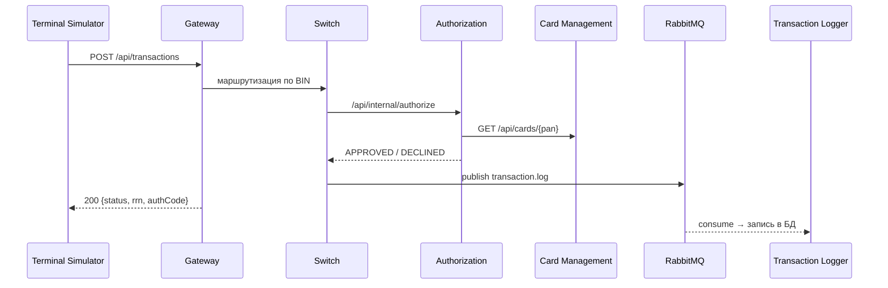

# Lecture 13: E2E-тестирование: сквозные сценарии и проверка результата

> **Модуль**: 7 — E2E и тестирование бизнес-сценариев
> **Лектор**: Ольга Лихачева
> **Длительность**: 1,5 астрономических часа (90 мин)
> **Слайдов**: 37
> **Формат**: Markdown, каждый слайд — раздел `###`
> **Структура слайда**: Заголовок + 3–5 тезисов + speaker notes; визуальная версия — `SlidevSlides/slides/module-07/lecture-13.md`
> **Связь с предыдущими лекциями**: пирамида и Testing Trophy — модуль 3, лекция 5; контракты и асинхронность — модуль 5, лекция 10; контейнеры и изоляция данных — модуль 6, лекция 2
> **Дата**: 26.11.2026
> **Литература**: см. [Источники](#источники) в конце файла

---

## Тайминг (90 минут)

| Время | Блок | Слайды | Назначение |
|:---:|---|:---:|---|
| 0:00–0:05 | Введение и план | 1–2 | Место лекции в модуле, обещание модуля 3 |
| 0:05–0:24 | Определение и границы уровня | 3–7 | Определение E2E, границы, отличие от системного тестирования, применимость |
| 0:24–0:38 | Место в стратегиях | 8–12 | Пирамида, Testing Trophy, формы наборов, экономика уровня |
| 0:38–1:00 | Сквозные сценарии СМП | 13–20 | Путь транзакции, точки наблюдения, бизнес- и технические сценарии |
| 1:00–1:15 | Проверка результата и стабильность | 21–26 | Трёхзвенная проверка, данные, асинхронность, нестабильность, диагностика |
| 1:15–1:28 | Паттерны, антипаттерны, метрики, конвейер | 27–34 | Паттерны, антипаттерны, разборы случаев, метрики, конвейер, границы автоматизации |
| 1:28–1:30 | Итоги и источники | 35–37 | Выводы, литература, вопросы |

---

### Ключевые положения лекции (памятка лектору)

1. Сквозная проверка определяется тремя признаками: вход на внешней границе, результат для потребителя, учёт отложенных последствий.
2. От системного тестирования уровень отличают объект проверки и источник ожиданий: система против бизнес-процесса, спецификация против сценария.
3. Сквозная проверка обоснована только там, где дефект не воспроизводится на нижних уровнях; объём набора ограничен экономикой уровня.
4. Результат подтверждается согласованием трёх звеньев; изоляция обеспечивается данными, асинхронность ожиданием условия.
5. Нестабильность уровня структурна: по данным 2025 года 75 процентов нестабильных тестов падают кластерами с общей причиной.

---

### Соответствие визуальной версии

Визуальная версия лекции (HTML-вёрстка, тема `slidev-theme-lekton`, 37 слайдов, экспорт в PDF): `SlidevSlides/slides/module-07/lecture-13.md`. Постановка практики 7 вынесена в отдельную деку `SlidevSlides/slides/module-07/practice-07-intro.md` (показывается на занятии 27.11). Нумерация разделов `### Слайд N` совпадает с порядком слайдов деки.

---

### Слайд 1. E2E-тестирование: сквозные сценарии и проверка результата

**Слайд:**

- Лекция 13. E2E-тестирование: сквозные сценарии и проверка результата
- Ольга Лихачева · Lekton
- 4 курс
- 26 ноября · Четверг 13:30–15:00

**Speaker notes:**

> Начинаем седьмой модуль, и открывается он самым верхним уровнем проверок. Впереди две лекции: сегодня разбираем, что такое сквозная проверка и как она устроена, на следующей перейдём к исследовательским сессиям и оформлению дефектов; вторая без первой повисает в воздухе.
>
> Курс шёл по уровням снизу вверх: модуль 4 дал модульные тесты, модуль 5 контракты и идемпотентность, модуль 6 реальные базы и брокер в контейнерах. Осталась вершина, и сложна она методологически: проверок здесь меньше всего, а соблазна проверять не то больше всего.
>
> И я должна закрыть обещание из модуля 3: Вера Терентьева упоминала трёхзвенную проверку, и сегодня разберём её до конца.

---

### Слайд 2. План лекции

**Слайд:**

- Определение E2E
- Границы уровня, применимость и отличие от системного тестирования
- Место в стратегиях: пирамида и Testing Trophy
- Сквозные сценарии СМП: бизнес-логика и отказоустойчивость
- Трёхзвенная проверка результата
- Тестовые данные, асинхронность, диагностика падений
- Паттерны и антипаттерны: примеры из практики
- Метрики и размещение проверок в конвейере

**Speaker notes:**

> План выстроен от определения к практике. Сначала договоримся о терминах: что считается сквозной проверкой, где проходят её границы и чем она отличается от системного тестирования; эту пару в отраслевых текстах смешивают постоянно.
>
> Затем перейдём к моделям распределения: пирамида и Testing Trophy стоят после определения сознательно, иначе треугольник запоминается картинкой без содержания. Вторая половина лекции прикладная: сценарии на нашем процессинге, трёхзвенная проверка результата, данные, асинхронность и диагностика падений. Закроем паттернами, метриками и местом проверок в конвейере.

---

### Слайд 3. Определение и границы уровня

**Слайд:**

- _(визуальный слайд)_

**Speaker notes:**

> Первый раздел короткий по форме и длинный по содержанию. Определение уместится в одну рамку, а вот границы уровня займут заметно больше времени, и это сознательный выбор: почти каждый тест, который в индустрии называют сквозным, при проверке признаков оказывается тестом соседнего уровня.
>
> Опорой служат ISTQB CTFL и словарь терминов, учебник Шпильнера и инженерные публикации 2025–2026 годов. К концу раздела у вас будет рабочий признак: по нему любой тест из вашего репозитория можно отнести к уровню без споров о формулировках.

---

### Слайд 4. Определение E2E

**Слайд:**

- Сквозное тестирование проверяет систему как единое целое на пути от внешней границы входа до наблюдаемого результата, включая последствия, возникающие после возврата ответа клиенту.
- Вход на внешней границе
- Проверка начинается на интерфейсе, которым пользуется клиент, а не на внутреннем вызове между сервисами.
- Результат для потребителя
- Оценивается исход операции, а не возвращаемое значение отдельного метода.
- Последствия после ответа
- Учитываются записи, уведомления и изменения состояния, в том числе возникающие асинхронно.

**Speaker notes:**

> Формулировка на слайде короткая, но работать она начнёт, только если разобрать её на три части; из каждой выводится половина методики этого модуля.
>
> Часть первая: вход на внешней границе. В нашем процессинге внешняя граница одна, Gateway на порту 8080, куда приходит запрос от эмулятора терминала. Тест, который дёргает внутренний эндпоинт авторизации, пусть даже через два сервиса, путь клиента не воспроизводит и к этому уровню отношения не имеет.
>
> Часть вторая: результат для потребителя. Оцениваем исход операции: прошла транзакция или нет, списались средства или нет. Возвращаемое значение отдельного метода и внутренние структуры сюда не входят.
>
> Часть третья чаще всего теряется: последствия после ответа. Клиент уже получил APPROVED, а система ещё работает: Switch публикует событие в RabbitMQ, логгер пишет запись, формируется уведомление. Дефект в этой части при проверке одного лишь ответа не виден никогда, а для клиента он обернётся отсутствием подтверждения при разборе операции.
>
> Формального определения уровня в стандарте нет: ISTQB описывает системное тестирование и отдельно упоминает сквозное, поэтому мы пользуемся признаками на слайде, их можно приложить к конкретному тесту. Связь с вашей практикой прямая: в модуле 1 вы поднимали стек и прогоняли smoke-скрипт от Gateway до записи в логе, то есть сквозную проверку вы уже делали, только вручную и без формальных ожиданий. Из третьей части следует и главная техническая неприятность: раз последствия асинхронны, assertEquals по ответу сценарий не закрывает, придётся ждать. Как ждать, разберём в четвёртом разделе; там же родится основная нестабильность ваших наборов.

---

### Слайд 5. Границы уровня: что относится к соседним уровням

**Слайд:**

- Относится к другим уровням
- Вызов внутреннего эндпоинта относится к API-тестам, даже при участии двух сервисов.
- Проверка одного сервиса с реальной базой данных относится к интеграционным тестам.
- Проверка интерфейса без бизнес-процесса относится к UI-тестам.
- Пограничные случаи
- Два сервиса соединены внутренним вызовом: уровень остаётся API-уровнем.
- Сценарий от Gateway проверяет только ответ: уровень остаётся API-уровнем.
- Один сервис, но проверка отложенных последствий через брокер: интеграционный уровень.
- Признак сквозной проверки. Внешняя граница входа и проверка сквозного исхода вместе с отложенными последствиями.

**Speaker notes:**

> Уровень удобнее всего очерчивать через отказ: называем, что к нему не относится, и большинство спорных случаев рассасывается само.
>
> Вызов внутреннего эндпоинта остаётся API-тестом в смысле модуля 5, даже если в цепочке участвуют два сервиса: путь клиента при этом не воспроизводится. Один сервис с настоящей базой в контейнере это интеграционный тест в смысле модуля 6. Проверка интерфейса без бизнес-процесса уходит в UI-тесты, которых в нашем процессинге нет вовсе.
>
> Пограничные случаи разберите по одному. Два сервиса, соединённых внутренним вызовом: уровень всё равно API. Сценарий стартует на Gateway, но сверяет только ответ: снова API, потому что исход для клиента и последствия не проверяются. Один сервис, зато проверяются отложенные последствия через брокер: ближе к интеграционному уровню.
>
> Признак в оранжевой рамке выработан именно под такие споры: внешняя граница входа плюс сквозной исход вместе с отложенными последствиями. Число сервисов в цепочке роли не играет.
>
> Проверить себя можно прямо сейчас. Возьмите любой тест из вашего репозитория и проверьте три признака: вход на внешней границе, сверка исхода для потребителя, учёт последствий после ответа. Три «да» дают сквозной уровень; любое «нет» отправляет тест ниже, и название файла его не спасёт. Тут студенты обычно спрашивают про монолит с длинным процессом: отвечаю тем же признаком; внешняя граница и сквозной исход есть, значит уровень сквозной внутри одной системы.

---

### Слайд 6. Сквозное и системное тестирование: различия

**Слайд:**

| Аспект | Системное тестирование | Сквозное тестирование |
|---|---|---|
| Предмет проверки | Платформа и её свойства: инфраструктура, интерфейсы, шифрование, защита данных | Бизнес-процесс: доводит ли операция клиента до ожидаемого результата |
| Источник ожиданий | Спецификация системы и нефункциональные требования | Сквозной бизнес-сценарий |
| Что проверяется дополнительно | Нефункциональные свойства: производительность, безопасность, совместимость | Стыки сервисов, полнота вызовов, отложенные последствия |
| Типичный дефект | Отказ платформы: несовместимость, ошибка шифрования, просадка производительности | Разрыв цепочки: данные не дошли, состояние не изменилось, событие не доставлено |
| Типовой вопрос | Соответствует ли система требованиям, включая нефункциональные | Доводит ли процесс до результата для клиента |

**Speaker notes:**

> В отраслевых текстах эти два термина смешивают до полной неразличимости, поэтому держите различие по двум осям: предмет проверки и источник ожиданий.
>
> Системное тестирование смотрит на систему в сборе как на чёрный ящик: на входе данные, на выходе сверка со спецификацией, включая нефункциональные требования. Его предмет это платформа: инфраструктура, интерфейсы, шифрование, защита данных, производительность, совместимость. Сквозное тестирование проверяет бизнес-процесс, который проходит через несколько сервисов и заканчивается результатом для клиента; ожидания берутся из бизнес-сценария, а в фокус попадают стыки, полнота вызовов и отложенные последствия.
>
> Из этого различия растут два практических вывода. Дефект на стыке двух систем не поймает системный тест ни одной из них, потому что существует он только между ними. И сквозной набор системный не заменяет: источники ожиданий разные, классы дефектов разные. Типичный дефект системного уровня это отказ платформы: несовместимость, ошибка шифрования, просадка производительности. Типичный дефект сквозного уровня это разрыв цепочки: данные не дошли, состояние не изменилось, событие не доставлено.
>
> Нюанс, который сбивает многих: стенд в обоих случаях один и тот же, полная сборка. Окружением виды не различаются, различаются предметом. Организационно работы тоже разведены: системное тестирование ведёт команда системы, сквозные проверки команда интеграций.
>
> И последнее следствие запомните к практике 7: отчёты об этих проверках читают разные люди. Отчёт системного тестирования читает инженерная команда, сквозной читает ещё и бизнес, поэтому дефект там описывается языком операции клиента; язык эндпоинтов оставьте инженерным отчётам. К оформлению баг-репортов вернёмся.

---

### Слайд 7. Применимость: когда сквозная проверка нужна

**Слайд:**

- Проверка оправдана
- Изменения, затрагивающие несколько сервисов одновременно.
- Целостность цепочки: данные и события доходят до всех потребителей.
- Корректность при отказе зависимости: откат, деградация, очередь недоставленных сообщений.
- Сквозной процесс, результат которого важен потребителю.
- Проверка не оправдана
- Логика внутри одного сервиса: расчёт лимитов, валидация, преобразования.
- Комбинаторика значений: техники тест-дизайна нижних уровней.
- Свойства сервиса, видимые только через его базу данных.
- Разметка интерфейса: отдельный класс задач.
- Объём набора. Объём ограничен и определяется рисками и числом затронутых сервисов.

**Speaker notes:**

> Прежде чем выбирать инструмент, решите вопрос о самой необходимости проверки. Критерий один: дефект, который вы ищете, на нижних уровнях не воспроизводится в принципе. Воспроизводится, значит пишем ниже: там дешевле, быстрее и стабильнее.
>
> Сквозная проверка оправдана в четырёх случаях с левой стороны: изменение затрагивает несколько сервисов сразу; нужно подтвердить целостность цепочки, что данные и события доходят до всех потребителей; проверяется поведение при отказе зависимости: откат резерва, деградация, очередь недоставленных сообщений; и, наконец, сам сквозной процесс с ценным для клиента результатом.
>
> Правая колонка требует дисциплины. Расчёт лимитов и правила валидации внутри одного сервиса закрываются модульными тестами из четвёртого модуля. Комбинаторику значений вы уже умеете сворачивать техниками модуля 2: классы эквивалентности, границы, pairwise. Свойства, видимые только через собственную базу сервиса, это интеграционный уровень. Разметка интерфейса живёт отдельно.
>
> Объём набора в рамке ограничен сознательно: он определяется рисками и числом затронутых сервисов. Сценарий, который годами ничего не находит, но ломается при каждом изменении чужого сервиса, считается расходом, хотя числится в покрытии. Когда сомневаетесь, считайте: если сценарий ловит дефект, который нижний уровень уже находит, вы платите за одно обнаружение дважды.
>
> Тут студенты обычно спрашивают: а можно написать сквозной тест «про запас», пока нижний уровень дырявый? Можно, как временную меру; но тогда заводите задачу на нижний уровень и срок удаления, иначе временное станет постоянным, и набор начнёт раздуваться и деградировать.

---

### Слайд 8. Место сквозных проверок в стратегиях тестирования

**Слайд:**

- _(визуальный слайд)_

**Speaker notes:**

> Второй раздел отвечает на вопрос о количестве: почему сквозных проверок должно быть мало и сколько именно. Разберём две модели распределения: пирамиду, которую вы знаете из модуля 3, и Testing Trophy Кента Доддса.
>
> Я ставлю их рядом и не выбираю одну: обе модели описательные. Они объясняют, почему наборы складываются именно так; предписаний в них нет. Пользоваться ими нужно как диагностикой: сравнили своё распределение с моделью и спросили, чем обосновано отличие. Завершит раздел экономика уровня в измеримых величинах.

---

### Слайд 9. Пирамида тестирования: повторение

**Слайд:**

- Пирамида тестирования, Майк Кон, 2009
- Основание: unit-тесты, около 70 процентов: проверка логики в изоляции, миллисекунды.
- Середина: API и интеграционные тесты, около 20 процентов: контракты между сервисами, реальные базы данных и брокер, сотни миллисекунд.
- Вершина: E2E, около 10 процентов: сквозной бизнес-процесс, секунды и десятки секунд.
- Суть модели: чем выше уровень, тем меньше проверок и тем дороже каждая.
- Следствия для сквозного уровня
- Пропорция описательная: она фиксирует устойчивое соотношение в командах, а не норму.
- Пропорция определяется экономикой: стоимость написания, скорость обратной связи, стоимость поддержки.
- Модель ограничивает область применения E2E, но не отменяет этот уровень.
- Правило 1 : 10 : 100. Стоимость обнаружения дефекта возрастает примерно на порядок при переходе на следующий уровень: unit 1, интеграционный 10, E2E 100, эксплуатация 1000.

**Speaker notes:**

> Сама модель вам знакома из модуля 3, поэтому повторю её коротко, а время потрачу на выводы. Майк Кон описал пирамиду в 2009 году: основание это модульные тесты, около семидесяти процентов набора, миллисекунды на проверку; середина это API и интеграционные тесты, около двадцати процентов, сотни миллисекунд; вершина это сквозные сценарии, около десяти процентов, секунды и десятки секунд.
>
> Честно скажу про статус цифр: нормы в них нет. Пропорция описательная, она фиксирует соотношение, которое устойчиво складывается в разных командах, и складывается оно из экономики: с ростом уровня дорожает написание, поддержка и ожидание результата.
>
> В рамке внизу правило 1 : 10 : 100: стоимость обнаружения дефекта растёт примерно на порядок с каждым уровнем: единица на модульном, десять на интеграционном, сто на сквозном и тысяча в эксплуатации. Возьмём ошибку в проверке лимита: модульный тест находит её за миллисекунды, сквозной сценарий за минуты прогона плюс заметно более долгую диагностику. Платим мы здесь за уровень, аккуратность исполнителя роли не играет.
>
> Практический вывод дерзкий: разбирая на консультации чужой набор, я почти всегда снимаю треть сквозных тестов, перенося их вниз без потери покрытия. Работает правило и в обратную сторону: дефект, который нижний уровень поймать не способен, дешевле от вашего желания не станет; вопрос лишь в готовности платить за его обнаружение.

---

### Слайд 10. Testing Trophy: сравнение с пирамидой

**Слайд:**

- Testing Trophy, Кент Доддс, 2018
- Основание: статический анализ и типизация; модульных тестов немного.
- Середина: интеграционные тесты, основная масса набора: взаимодействие компонентов, устойчивее сквозных проверок.
- Вершина: E2E, мало: только критические пути.
- Суть модели: «Write tests. Not too many. Mostly integration».
- Следствия для сквозного уровня
- Различие моделей относится к середине набора, а не к вершине.
- Обе модели ограничивают долю сквозных проверок.
- Инженерная практика 2026 года использует гибрид: модульные тесты для домена, интеграционные для API, сквозные для критических путей.
- Конфигурация для СМП. Середину набора образуют API и интеграционные проверки. Сквозной уровень содержит не более десяти сценариев: покупка, отказ по лимиту, отказ по балансу, возврат, деградация при отказе зависимости.

**Speaker notes:**

> Вторая модель моложе: Кент Доддс предложил Testing Trophy в 2018 году. В основании кубка статический анализ и типизация, модульных тестов немного, основную массу составляют интеграционные, а сквозных остаётся мало, только критические пути. Формула автора звучит так: «Write tests. Not too many. Mostly integration». Аргумент понятен: интеграционный тест проверяет фактическое взаимодействие компонентов и при этом устойчивее сквозного сценария. Основание кубка заслуживает отдельного слова: статический анализ и типизация ловят дефекты ещё до запуска, и обходятся такие находки дешевле любых тестов.
>
> Если поставить модели рядом, расходятся они в середине набора. Пирамида отдаёт основную массу модульным тестам, кубок интеграционным. В оценке верхнего уровня расхождений нет: сквозных проверок мало, потому что владение ими дорого.
>
> Инженерная практика 2026 года собрала гибрид: доменную логику покрывают модульные тесты, взаимодействие сервисов с реальными базами и брокером закрывают интеграционные, сквозные оставляют критическим путям. Признак, что набор пора сдвигать в сторону интеграций, звучит так: подготовка моков занимает больше места, чем сами проверки, а смена реализации ломает тесты без смены поведения.
>
> Есть и архитектурный аргумент: в микросервисной системе сервисы часто тонкие, и модульный тест там проверяет три строки кода на класс. Наш процессинг именно такой, поэтому конфигурация в рамке: середина из API и интеграционных проверок, а наверху не более десяти сценариев: покупка, отказ по лимиту, отказ по балансу, возврат, деградация при отказе зависимости.

---

### Слайд 11. Формы тестовых наборов и их предпосылки

**Слайд:**

| Форма | Происхождение | Основание | Условия применимости |
|---|---|---|---|
| Пирамида (Test Pyramid) | Майк Кон, 2009 | Модульные тесты, значительная доля | Развитый доменный слой, логика составляет основную ценность |
| Кубок (Testing Trophy) | Кент Доддс, 2018 | Статический анализ и интеграционные тесты | API-центричные системы, тонкий сервисный слой |
| Ромб (Test Diamond) | Практика микросервисов | Интеграционные тесты | Большое число межсервисных контрактов, мало интерфейсов |
| Гибрид | Инженерная практика, 2026 | Модульные тесты для домена, интеграционные для API | Большинство промышленных проектов |

**Speaker notes:**

> Таблица собирает четыре формы набора, и выбор между ними диктует архитектура системы, вкус тестировщика здесь ни при чём. Пирамида ложится на системы с развитым доменным слоем, где ценность сосредоточена в логике. Кубок ложится на API-центричные системы с тонким сервисным слоем. Ромб, Test Diamond, встречается в микросервисных проектах, где межсервисных контрактов много, а интерфейсов почти нет: там середина из интеграционных тестов получается закономерно широкой. У ромба нет одного автора с годом, он вырос из практики микросервисных команд. Гибрид из инженерной практики 2026 года закрывает большинство промышленных проектов: модульные тесты на домен, интеграционные на API.
>
> Отдельно проговорю перевёрнутый конус. Такое состояние означает, что нижние уровни не сформированы и вся уверенность держится на сквозных прогонах; держим его в голове как диагностический признак. Предпосылки из последнего столбца проговаривайте вслух, когда выбираете форму под свой проект.
>
> Вторая болезнь это смешанные наборы. Когда одна и та же логика проверяется на модульном, интеграционном и сквозном уровне одновременно, надёжность не растёт, растёт тройная стоимость поддержки. У каждой проверки один уровень ответственности; дублирование возникает, когда набор наращивают, не решая, где именно должен жить очередной тест.
>
> И практический совет тем, кто узнал в конусе свой проект: не чините его наверху и новых сквозных тестов не пишите. Чините низ: сначала модульные тесты на домен, потом интеграционные на стыки; когда низ держит форму, вершина начинает окупаться.

---

### Слайд 12. Экономика верхнего уровня

**Слайд:**

- Скорость
- Один сценарий выполняется секунды или десятки секунд, полный набор минуты. Результат поступает позже, чем на нижних уровнях.
- Стабильность
- Сценарий зависит от каждого сервиса на пути и от общей инфраструктуры: брокера, базы данных. Отказ любого звена отображается как падение теста.
- Стоимость поддержки
- Сквозные проверки дороже в сопровождении: тест ломается при изменении чужого сервиса, даже если логика проверки не менялась.

**Speaker notes:**

> Экономика верхнего уровня складывается из трёх величин, и все три вы сможете посчитать на своём наборе после практики 7.
>
> Скорость. Один сценарий идёт секунды или десятки секунд, полный набор занимает минуты. Пока прогон короткий, разработчик запускает его до переключения на другую задачу и получает ответ вовремя. Когда набор затягивается на десятки минут, локально его запускать перестают, и первое известие об ошибке приходит из конвейера с большим опозданием.
>
> Стабильность. Сквозной сценарий зависит от каждого сервиса на пути и от общей инфраструктуры: брокера и базы. Каждое звено это отдельная точка отказа, и отказ любого звена выглядит как падение теста. Доля ложных падений у верхнего уровня структурно выше, чем у нижних. Когда таких падений много, результаты разбирать перестают, и настоящий дефект проходит вместе с ложными.
>
> Стоимость поддержки. Тест ломается при изменении в чужом сервисе: поменялся формат ответа, переехал эндпоинт, изменился контракт асинхронного события, а ваша логика при этом не менялась.
>
> Все три величины сцеплены в одну систему. Медленный набор запускают реже, реже запускают, позже узнают о дефекте, диагностика дорожает. Нестабильный набор заставляет перезапускать, перезапуск растягивает прогон, растянутый прогон запускают ещё реже. Все три величины измеримы: время прогона берётся из конвейера, доля ложных падений из истории перезапусков, стоимость поддержки из числа правок после чужих релизов. Починить экономику уровня по одной проблеме за раз не получится.

---

### Слайд 13. Сквозные сценарии СМП

**Слайд:**

- _(визуальный слайд)_

**Speaker notes:**

> Третий раздел переносит определение на объект нашего курса, учебный процессинг. Пройдём путь транзакции, определим точки, в которых результат становится наблюдаемым, разберём три класса бизнес-сценариев и технические сценарии при отказах инфраструктуры.
>
> Схему вы видите в третий раз: в модуле 1 она учила предметной области, в модуле 6 вы искали на ней места интеграций, сегодня она становится рабочим инструментом проектирования набора. Одна схема, три способа чтения: для хорошей архитектурной документации это нормально.

---

### Слайд 14. СМП: путь транзакции

**Слайд:**

- Одиннадцать сервисов, синхронный путь авторизации и асинхронный след. Каждая стрелка обозначает границу, на которой проверяется контракт.

**Speaker notes:**

> Схему вы знаете наизусть, поэтому прочитаем её теперь как карту проверок: каждая стрелка здесь место, где контракт способен нарушиться незаметно для клиента. Эмулятор терминала играет роль внешнего клиента, с него начинается каждый сценарий практики.
>
> Синхронная часть идёт от эмулятора терминала через Gateway и Switch в авторизацию, которая обращается к управлению картами и к справочнику BIN. В этой части результат виден клиенту сразу: статус, код ответа, идентификаторы rrn и authCode. Асинхронная часть начинается после ответа: Switch публикует событие в очередь, логгер забирает его и пишет транзакцию в базу; отдельно управление картами отправляет карточные события в уведомления.
>
> Вывод для проектирования набора прямой: у сквозного сценария три точки проверки, и карта проверок совпадает с картой вызовов. Всего в системе одиннадцать сервисов, синхронный путь авторизации и асинхронный след, и каждый переход на схеме это граница, где вы в модуле 5 уже проверяли контракты по отдельности.
>
> Пунктир на асинхронной части имеет смысл: там время течёт иначе. В синхронной части результат можно сверить сразу после ответа; в асинхронной он возникает через непредсказуемое время. Время обработки видно клиенту в синхронной части, поэтому оно войдёт в первую точку проверки на следующем слайде. Поэтому третья точка проверки всегда строится на ожидании, и поэтому же она станет главным источником нестабильности всего набора. Завтра на практике вы это почувствуете на собственных прогонах.

---

### Слайд 15. Точки наблюдения результата

**Слайд:**

- Синхронная граница
- Ответ Gateway: статус транзакции, код ответа, идентификаторы rrn и authCode, время обработки.
- Состояние данных
- Баланс и лимиты в управлении картами, запись транзакции в таблице, создание или снятие резерва.
- Асинхронный след
- Запись у логгера, уведомление по карточному событию, отсутствие сообщений в очереди недоставленных сообщений.
- Что показывает каждая точка.
- Синхронная граница: что получил клиент.
- Состояние данных: изменились ли баланс, лимиты и записи.
- Асинхронный след: выполнено ли отложенное действие.

**Speaker notes:**

> Три точки наблюдения отвечают на три разных вопроса, и путать их нельзя: вопросы требуют разных способов проверки.
>
> Первый вопрос: что получил клиент. Ответ Gateway несёт статус, код ответа, идентификаторы rrn и authCode, время обработки. Это единственная точка, доступная внешнему потребителю, и одновременно наименее надёжная: успешный ответ сам по себе не доказывает, что средства списаны. Именно на этой точке останавливаются тесты, которые потом ничего не находят.
>
> Второй вопрос: изменились ли данные. Сверяем баланс и лимиты в управлении картами, запись транзакции в таблице, создание или снятие резерва. Здесь выясняется, есть ли у ответа клиента фактическое основание.
>
> Третий вопрос: выполнено ли отложенное действие. Проверяем запись у логгера, уведомление по карточному событию и отсутствие сообщений в очереди недоставленных. Эта точка отвечает, завершился ли процесс целиком.
>
> Состав точек определяйте до кода теста, вместе с ожиданиями. Сценарий, который сверяет только первую точку, относится к API-уровню, и его место в модуле 5.
>
> Тут студенты обычно спрашивают: а если состояние нельзя прочитать публично? Отвечу честно: тогда сквозная проверка упирается в ограничение системы, и это находка сама по себе. Чтение через чужую базу допустимо, но хрупко: вы привязываетесь к чужой схеме. В нашем процессинге состояние читается публичными эндпоинтами, пользуйтесь ими. Если тест всё же читает чужую базу, зафиксируйте это решение комментарием в коде: при смене чужой схемы такой тест упадёт первым, и падение должно быть осознанным.

---

### Слайд 16. Бизнес-сценарий: успешная покупка

**Слайд:**

- Предусловия и шаги
- Создаётся карта в статусе ACTIVE с балансом и лимитами, допускающими сумму.
- Запрос авторизации направляется на Gateway: POST /api/transactions, mti = 0100.
- Сумма передаётся в минорных единицах: 150000 соответствует 1500 рублям.
- Ожидаемый результат
- Статус APPROVED, код ответа 00, заполнены rrn и authCode.
- Баланс уменьшился на сумму операции; резерв учтён в лимитах.
- Транзакция доступна логгеру; при карточном событии создано уведомление.
- Требование к данным. Карта создаётся внутри сценария. Предзаполненный набор карт делает результат зависимым от порядка выполнения тестов.

**Speaker notes:**

> Успешная покупка это базовый сценарий: на нём покажу структуру проверки, которую дальше повторим во всех остальных. На нём же отлаживается вся механика: создание карты, запрос, три сверки; искать ошибки механики на отказных сценариях мучительно.
>
> Предусловие формулируем как состояние системы: существует карта в статусе ACTIVE, баланс покрывает сумму покупки, лимиты не исчерпаны. Карту создаём внутри самого сценария через публичный интерфейс. Это не формальность: карта, которую создал тест, не зависит от того, что выполнялось до него, и требование из оранжевой рамки проверяйте на чужом коде первым делом. Сценарий, берущий карту из скрипта инициализации, поодиночке проходит, а в наборе падает; такие тесты чаще всего и уезжают в карантин.
>
> Шаги повторяют путь клиента: запрос авторизации на Gateway, POST /api/transactions, тип сообщения mti 0100, обязательные поля на месте. Сумма передаётся в минорных единицах: 150000 соответствует полутора тысячам рублей; соглашение мы разбирали в модуле 5 и менять его здесь не будем. И держите в голове ловушку, которая срабатывает каждый год: если написать в запросе 1500, вы спросите у системы пятнадцать рублей вместо полутора тысяч. Проверьте это в первом же сценарии.
>
> Ожидаемый результат расписываем по трём точкам из прошлого слайда. Ответ: статус APPROVED, код 00, заполнены rrn и authCode. Состояние: баланс уменьшился ровно на сумму операции, резерв учтён в лимитах. След: транзакция доступна логгеру, при карточном событии создано уведомление.

---

### Слайд 17. Бизнес-сценарий: классы отказов

**Слайд:**

| Причина отказа | Код ответа | Условие воспроизведения | Дополнительная проверка |
|---|---|---|---|
| Карта не найдена | 14 | PAN отсутствует в системе | Отказ не создаёт записей; резерв не сформирован |
| Недостаточно средств | 51 | Сумма больше доступного баланса | Баланс не изменился; резерв не сформирован |
| Просроченная карта | 54 | Срок действия меньше текущей даты | Отказ зафиксирован в логе с причиной |
| Превышен лимит | 61 | Сумма больше дневного или месячного лимита | Счётчики лимитов не увеличены |
| Карта заблокирована | 05 | Статус карты BLOCKED, причина CARD_BLOCKED | Отсутствуют побочные эффекты для других карт |

**Speaker notes:**

> Отказные сценарии опаснее успешных: именно на них бизнес теряет деньги или приобретает обязательства, которых быть не должно.
>
> Таблица собирает классы отказов с кодами и условиями воспроизведения, но главный в ней последний столбец. В сквозной проверке отказа мы сверяем две вещи сразу: код ответа и отсутствие побочных эффектов. Баланс не изменился. Резерв не сформирован. Счётчики лимитов не увеличены. Для заблокированной карты добавляется причина CARD_BLOCKED и контроль, что другие карты не пострадали. Условия воспроизведения из третьего столбца готовятся набором значений: баланс ниже суммы, срок действия в прошлом, счётчик лимита у порога.
>
> Классический дефект этой группы устроен коварно: ответ клиенту корректен, а состояние системы нет. Ни модульный, ни API-тест такого не увидят: дефект виден только при совместной проверке ответа и состояния. Ради этого класса сквозной уровень и существует.
>
> Коды взяты из перечисления DeclineOutcome, которое вы разбирали в модуле 5, и из технических заданий сервиса авторизации в эталонном репозитории: 14 карта не найдена, 51 недостаточно средств, 54 просроченная карта, 61 превышен лимит.
>
> Два совета к практике. Самый дешёвый отказной сценарий это класс 14: несуществующий PAN не требует подготовки вообще, начните с него, если хотите быстрый старт. А класс 54 в продакшене почти никто не тестирует, потому что дату действия неудобно готовить; у нас она задаётся одним полем при создании карты, так что отговорки нет, класс обязан присутствовать в наборе.

---

### Слайд 18. Бизнес-сценарий: возврат и идемпотентность

**Слайд:**

- Возврат как разрезервирование
- Операция возврата выполняется сообщением mti = 0400 и связывается с исходной транзакцией по rrn.
- Ожидаемый результат: баланс восстановлен, запись резерва снята, факт возврата зафиксирован логгером.
- В техническом задании возврат отнесён к расширенным сценариям; наличие операции определяется реализацией команды.
- Идемпотентность: проверка повторного возврата
- Повторный возврат по тому же rrn не должен возвращать средства повторно.
- Аналогично проверяется повтор авторизации с тем же stan, что рассматривалось в модуле 5.
- Ожидаемый результат повтора: тот же ответ, отсутствие второго изменения состояния.

**Speaker notes:**

> Возврат интересен тем, что ломает самую очевидную реализацию. Написал разработчик «прибавить сумму обратно», и повторный запрос возвращает деньги второй раз: в отчётности возникает операция, которой не было.
>
> Сам возврат выполняется сообщением mti 0400 и связывается с исходной транзакцией по rrn. Ожидаемый результат: баланс восстановлен, запись резерва снята, факт возврата зафиксирован логгером. Идемпотентность означает: повторный идентичный запрос даёт тот же результат и не создаёт новых побочных эффектов. В модуле 5 вы проверяли это свойство на повторной авторизации с тем же STAN; здесь устройство то же, только ключом служит ссылка на исходную операцию.
>
> Отсюда приём, который возьмите в практику: проверка повторного возврата. Мы не столько подтверждаем заявленное поведение, сколько устанавливаем фактическое, и оно с документацией расходится чаще, чем хотелось бы. Это уже исследовательский приём, подробно о нём на следующей лекции.
>
> Про оранжевую рамку поговорим серьёзно. Техническое задание относит возврат к расширенным сценариям, и в реализации вашей ветки его может не быть. Правильное действие в этом случае: зафиксировать ограничение в отчёте. Тест, проверяющий несуществующее поведение, даёт недостоверный результат; на приёмке за такое снижают, как за ошибку.
>
> Тут студенты обычно спрашивают: как сверять повтор, если ответ должен совпасть с первым? Сравнивайте и код, и идентификаторы: у повтора тот же rrn, у базы та же сумма. Новый rrn означает: идемпотентности нет, каким бы красивым ни был код.

---

### Слайд 19. Технические сценарии: поведение при отказе

**Слайд:**

| Сбой | Механизм в системе | Наблюдаемый результат | Проверяемое свойство |
|---|---|---|---|
| Брокер не подтверждает публикацию | Подтверждение публикации брокером, ожидание 2 секунды | Ответ 96, резерв откатывается обратным запросом | Отсутствие одобренных транзакций без записи в логе |
| Брокер недоступен | Повтор доставки, затем очередь недоставленных сообщений, TTL 60 секунд | Сообщение в очереди недоставленных сообщений, разбор вручную | Отсутствие неограниченного повтора |
| Сервис Bin Lookup недоступен | Деградация на данные BIN-таблицы | Транзакция обрабатывается, идентификатор эмитента берётся из таблицы | Работоспособность при отказе необязательной зависимости |
| Управление картами недоступно | Таймаут 3 секунды на соединение, 5 секунд на чтение | Ответ 05, ISSUER_TIMEOUT в пределах таймаута | Отсутствие зависания запроса клиента |
| Потребитель остановлен | Сообщения накапливаются в очереди | Синхронный ответ без изменений; запись у логгера отсутствует | Корректное поведение при отложенной обработке |

**Speaker notes:**

> Технические сценарии проверяют поведение системы при сбое. От бизнес-сценариев они отличаются прежде всего подготовкой: вместо данных под кейс мы создаём управляемый отказ, останавливаем брокер, отключаем зависимость или приостанавливаем потребителя.
>
> Ожидаемый результат в каждой строке сформулирован измеримо: конкретный код ответа, конкретное изменение состояния, конкретное место сообщения. Формулировка «система работает» тут бесполезна, её невозможно проверить.
>
> Разберу первую строку. Если брокер не подтвердил публикацию за две секунды, Switch откатывает резерв обратным запросом и возвращает клиенту код 96. Проверяемая гарантия звучит так: одобренная транзакция не остаётся без записи в логе. Это ровно та область, где сквозная проверка незаменима: свойство существует только на стыке сервисов. Третья строка про Bin Lookup показывает деградацию: при отказе справочника транзакция обрабатывается, идентификатор эмитента берётся из локальной BIN-таблицы. Четвёртая, про недоступность управления картами, контролирует кроме кода 05 и причины ISSUER_TIMEOUT ещё и время: три секунды на соединение и пять на чтение. Зависший на полминуты запрос клиента это тоже дефект, и на сквозном уровне он виден сразу. Вторая строка следит, чтобы повтор доставки был конечным: после TTL в шестьдесят секунд сообщение уходит в очередь недоставленных и ждёт ручного разбора.
>
> Для практики 7 нужен один сценарий из таблицы; проще всего воспроизводятся недоступность потребителя и отказ публикации. Отказ готовится двумя способами: остановкой контейнера или штатным параметром зависимости, если он предусмотрен. Первый ближе к правде, второй воспроизводимее в конвейере; допустимы оба, но выбранный способ фиксируйте в отчёте, без него результат не повторит ни проверяющий, ни разработчик через месяц.

---

### Слайд 20. Бизнес-сценарий и технический: критерии выбора

**Слайд:**

- Бизнес-сценарий
- Получил ли потребитель ожидаемый результат?
- Технический сценарий
- Сохранила ли система корректность при сбое?
- Признак
- Подготовка данных
- Карта и сумма под бизнес-кейс
- Управляемый отказ: брокер, зависимость, таймаут
- Ожидаемый результат
- Статус, изменение баланса, уведомление
- Код ошибки, откат состояния, размещение сообщения
- Потребитель отчёта
- Менеджер продукта, заказчик
- Эксплуатация, дежурная смена
- Доля в наборе
- Большинство сценариев
- Один-два на критичный сбой
- Частота запуска
- Стадия E2E в конвейере
- Ночной прогон, перед релизом

**Speaker notes:**

> Два класса сценариев различаются прежде всего вопросом, на который отвечает проверка. Бизнес-сценарий спрашивает, получил ли потребитель ожидаемый результат. Технический спрашивает, сохранила ли система корректность, когда что-то вокруг сломалось. Из разного вопроса вырастает всё остальное: подготовка, ожидания, читатель отчёта.
>
> В бизнес-сценарии вы готовите данные: карту, баланс, сумму под операцию. В техническом готовите отказ: останавливаете брокер, отключаете зависимость, приостанавливаете потребителя. Отсюда и разные ожидания. У покупки это статус APPROVED и уменьшившийся баланс; у сбоя брокера это код 96, откат резерва и сообщение в строго определённом месте. Читают отчёты тоже разные люди: исход покупки интересен менеджеру продукта, а поведение при отказе брокера нужно эксплуатации и дежурной смене, потому что именно они разбирают инцидент в три часа ночи.
>
> Последние две строки таблицы организуют набор. Технических сценариев мало, один-два на критичный сбой, и запускают их реже: в ежедневном прогоне они почти всегда зелёные, их место в ночном расписании и перед релизом.
>
> Для практики 7 правило звучит так: из пяти сценариев четыре или пять бизнес-сценарии и минимум один технический. Способ воспроизведения сбоя запишите в отчёт отдельной строкой: остановили контейнер или применили штатный параметр зависимости. Без этой записи результат не повторит ни проверяющий, ни вы сами через месяц.
>
> И уберите из головы мысль о техническом сценарии как о втором сорте. Он проверяет гарантию, недоступную бизнес-сценарию: система не потеряет и не задвоит деньги при сбое. В продакшене такие сценарии окупаются первыми.

---

### Слайд 21. Проверка результата, данные, стабильность

**Слайд:**

- _(визуальный слайд)_

**Speaker notes:**

> Четвёртый раздел собирает воедино вопрос доверия: как сделать так, чтобы зелёный сквозной тест действительно означал работающую систему. Разберём трёхзвенную проверку, дисциплину данных, асинхронные ожидания и разбор падений; часть выводов опирается на эмпирические исследования нестабильных тестов 2025 года.
>
> Тут студенты обычно спрашивают, почему нельзя проверить всё одним большим assert. Потому что три звена ломаются по-разному и в разное время: ответ мгновенно, состояние транзакционно, след асинхронно. Один assert даст либо ложный успех, либо ложное падение. Звенья проверяются по отдельности и в строгом порядке.

---

### Слайд 22. Трёхзвенная проверка результата

**Слайд:**

- Звено 1. Ответ
- Что получил клиент: статус, код ответа, идентификаторы, время обработки.
- Звено 2. Состояние
- Что изменилось в данных: баланс, лимиты, запись резерва, наличие транзакции в базе.
- Звено 3. След
- Что выполнено отложенно: запись у логгера, уведомление, отсутствие недоставленных сообщений.
- Условие прохождения. Сценарий считается пройденным при согласовании всех трёх звеньев. Расхождение в любом звене означает падение, в том числе при корректном ответе.
- Асинхронность. Третье звено проверяется ожиданием условия. Интервал ожидания определяется сервисом.

**Speaker notes:**

> Эту конструкцию Вера Терентьева обещала ещё в модуле 3, когда разбирала уровни: сверяем ответ, запись в логе и баланс. Сегодня обещание получает реализацию. Смысл трёх звеньев в защите от ложно успешного результата: тест, который смотрит только на ответ, пропускает целый класс дефектов.
>
> Возьмём два примера. Первый: Gateway вернул APPROVED, клиент доволен, а резерв не сформирован. Проверка первого звена такой дефект пропустит, второго поймает. Второй пример зеркальный: средства зарезервированы, а записи в логе нет. Это дефект целостности, и виден он исключительно в третьем звене. Оба случая невидимы для модульных и API-тестов, потому что живут между сервисами.
>
> Способ проверки у звеньев разный. Ответ читаем обращением к Gateway, состояние запрашиваем у управления картами или читаем из базы, след ждём у логгера. С ожиданием связана главная боль: система согласуется не мгновенно, поэтому третье звено строится как ожидание условия. В модуле 5 вы ставили десять секунд, в модуле 6 пять; конкретное число зависит от сервиса и нагрузки стенда. Постоянен предмет ожидания: мы ждём событие; сам таймер ничего не решает.
>
> Порядок звеньев осмыслен: ответ, состояние, след, по времени появления результата. Проверять след до подтверждения состояния бессмысленно: найдётся запись о транзакции, которая ничего не списала. В коде теста звенья идут именно так, и на приёмке порядок будут смотреть.

---

### Слайд 23. Тестовые данные: изоляция и воспроизводимость

**Слайд:**

- Правила подготовки данных
- Данные создаются внутри сценария через публичный интерфейс.
- Идентификаторы уникальны для сценария: PAN, stan, terminalId, merchantId.
- Разделяемые данные из скрипта инициализации не используются.
- Сценарий не зависит от порядка выполнения и выдерживает повторный прогон.
- Почему откат транзакции неприменим
- Границы транзакции не совпадают с границей HTTP-вызова.
- Часть работы выполняется другим сервисом и брокером, вне области отката.
- В сквозных проверках применяется изоляция по данным, а не по транзакции, в отличие от модуля 6.
- Критерий качества данных. Сценарий проходит отдельно, в любом порядке и параллельно с другими.

**Speaker notes:**

> Первая из двух главных причин нестабильности сквозных наборов это данные, и лечится она дисциплиной; инструменты тут вторичны.
>
> Приём изоляции отличается от того, что вы применяли в модуле 6. Там работал транзакционный откат: тест завершился, изменения отменились. На сквозном уровне приём ломается: граница транзакции не совпадает с границей HTTP-вызова, а часть работы выполняет другой сервис и брокер, то есть вне зоны отката. Остаётся изоляция по данным: каждый сценарий приходит со своим набором, уникальность обеспечивают идентификаторы. PAN, stan, terminalId, merchantId у каждого теста свои.
>
> Рамка внизу это диагностический инструмент. Тест падает в одиночном запуске и проходит в наборе: ищите разделяемые данные. Проходит последовательно и падает при параллельном запуске: ищите неуникальный идентификатор, чаще всего stan или номер терминала.
>
> У дисциплины есть цена: создание карты внутри сценария удлиняет тест на несколько вызовов. Публикации 2026 года советуют готовить состояние программными вызовами напрямую, а сквозным путём проверять только предмет сценария. Время уходит на подготовку, зато результат воспроизводим.
>
> Тут студенты обычно спрашивают, можно ли взять одну карту на весь класс тестов, если создавать её долго. Нельзя. Переиспользованная карта копит историю: резервы, списания, счётчики лимитов от прошлых прогонов. Ожидание перестаёт быть проверяемым, потому что вы уже не знаете, какой баланс должен получиться. Своя карта на сценарий это условие проверяемости, и в практике 7 за этим будут следить.

---

### Слайд 24. Асинхронность: ожидание условия вместо паузы

**Слайд:**

- Фиксированная пауза
- Значение подбирается по времени локального прогона.
- На быстром окружении пауза избыточна, на нагруженном недостаточна.
- Недостаточность обнаруживается при первом запуске в конвейере.
- Ожидание условия
- Задаётся условие завершения и предельное время ожидания.
- Опрос выполняется с малым интервалом; при выполнении условия проверка продолжается.
- Превышение времени даёт диагностику: какое условие не выполнено.
- Масштаб издержек. В наборе из 200 сквозных тестов фиксированные паузы по 3 секунды дают 10 минут ожидания на прогон; часть пауз при этом недостаточна для медленных окружений.

**Speaker notes:**

> Вторая причина нестабильности это ожидания, и выбор между паузой и ожиданием условия решает сразу две задачи: надёжность и длительность прогона.
>
> У фиксированной паузы два независимых изъяна. Значение подбирается по времени локального запуска, поэтому на быстром окружении оно избыточно, а на нагруженном его уже не хватает. А когда его не хватает, дефект маскируется под случайное падение, и разбор начинается с чистого листа. Инженерные публикации называют фиксированные паузы самым частым источником нестабильности сквозных тестов, и с вашим опытом это согласуется: кто ставил sleep в модуле 5, тот видел, как зелёное дома становится красным в конвейере.
>
> Ожидание условия устроено иначе. Задаётся условие завершения и предельное время; библиотека опрашивает состояние с малым интервалом и продолжает проверку сразу, как только условие выполнилось. При истечении лимита вы получаете внятное сообщение: какое условие не сработало. В модуле 6 это делала Awaitility с пятью секундами; на сквозном уровне приём тот же, меняется только предмет ожидания.
>
> Арифметика в рамке показывает масштаб. Двести тестов с паузой по три секунды каждый это десять минут чистого ожидания на прогон, и на медленных стендах даже этих пауз не хватит.
>
> И тонкое различие напоследок: опрос в цикле с секундной задержкой это та же пауза, разрезанная на кусочки. Ожидание условия проверяет предмет: запись появилась, идём дальше. На медленном стенде первый вариант падает по таймауту, второй терпеливо ждёт до лимита и честно называет причину.

---

### Слайд 25. Диагностика падения: локализация звена

**Слайд:**

- Порядок разбора
- Установить звено, в котором результаты не согласованы: ответ, состояние или след.
- Проверить гипотезу одним обращением к конкретному сервису.
- Зафиксировать наблюдения: тела ответов, значения баланса, идентификаторы.
- Перезапуск стенда применять после локализации причины.
- Соответствие симптома и подсистемы
- Неверный ответ указывает на контракт или маршрутизацию: Gateway, Switch.
- Верный ответ при ином состоянии указывает на резервирование, транзакционность, конкуренцию.
- Верное состояние без следа указывает на брокер, потребителя, очередь недоставленных сообщений.
- Сохраняемые данные. Идентификаторы транзакции (stan, rrn, PAN), тела ответов, снимок состояния до и после операции, лог сервиса. Этот же набор используется при оформлении дефекта на следующей лекции.

**Speaker notes:**

> Сквозной тест падает неинформативно, и это свойство уровня: придраться к библиотеке тут не выйдет. Зато инструмент диагностики у вас уже есть, та же трёхзвенная декомпозиция.
>
> Разбор начинается с вопроса, какое звено разошлось: ответ, состояние или след. Дальше одна точечная проверка обращением к сервису, на который указывает симптом. Перезапуск стенда до локализации причины это выброшенное время: вы стираете состояние, по которому можно было разобраться.
>
> Соответствие симптома и подсистемы стоит выучить как таблицу умножения. Неверный ответ: контракт и маршрутизация, Gateway и Switch. Верный ответ при неправильном состоянии: резервирование, транзакционность, конкурентные операции. Верное состояние без следа: брокер, потребитель, очередь недоставленных сообщений. Три симптома, три зоны поиска.
>
> Набор в рамке совпадает с доказательствами для баг-репорта: stan, rrn, PAN, тела ответов, снимок состояния до и после операции, лог сервиса. Совет из горького опыта: снимайте эти данные сразу при падении. Через час стенд изменится, и воспроизводить придётся заново. Завтра на практике 7 этот набор уйдёт прямо в баг-репорты против сборки с внесёнными дефектами.
>
> И ещё один типовой случай: все три звена зелёные, а тест красный. Тогда красное это ожидание внутри теста. Читайте сообщение об ошибке, там написано, какое условие не выполнилось и на каком звене. Сквозной тест без внятного сообщения придётся переписывать вам же через месяц.

---

### Слайд 26. Паттерны, антипаттерны и практика

**Слайд:**

- _(визуальный слайд)_

**Speaker notes:**

> Пятый раздел сводит сказанное в перечень паттернов и антипаттернов, добавляет метрики набора, расписание запусков в конвейере и границу между автоматизацией и исследованием. Опора на инженерные публикации 2025 и 2026 годов.
>
> Полного справочника паттернов я сознательно не даю: он существует, ссылка в источниках. Берём то, что проверяется на приёмке практики 7. Остальное читайте дома: половина не пригодится в этом семестре, зато сработает в первый рабочий год.

---

### Слайд 27. Паттерны сквозных проверок

**Слайд:**

- **Сценарий от пользовательского пути.** Проверяется путь потребителя; внутренняя реализация остаётся за пределами проверки. Ожидания формулируются через наблюдаемый результат.
- **Подготовка состояния через интерфейс.** Состояние доводится до предусловия программными вызовами. Сквозным путём проверяется только предмет сценария.
- **Изоляция по данным.** Уникальные идентификаторы на сценарий, отсутствие разделяемых фикстур, независимость от порядка выполнения.

**Speaker notes:**

> Эти три паттерна собраны из инженерной практики последних двух лет, и отличают они наборы, которые живут годами, от наборов, которые разбирают на части через полгода после написания.
>
> Первый паттерн фиксирует предмет проверки: путь потребителя. Публикации отмечают, что значительная часть падений в зрелых наборах вызвана изменениями, никак не влияющими на поведение для пользователя: переименовали внутренний метод, поменяли структуру таблицы. По такому падению не скажешь, что сломалось для клиента.
>
> Второй и третий паттерны про подготовку. Состояние доводится до предусловия программными вызовами, а сквозным путём проверяется только предмет сценария. Изоляция держится на уникальных данных каждого сценария и отказе от общих фикстур. Оба пункта вытекают из того, что транзакционный откат на этом уровне не работает; мы разобрали это слайдом раньше.
>
> Проверка себя занимает минуту, три вопроса к любому своему тесту: какую операцию пользователя он воспроизводит, какие данные создаёт сам и что случится при параллельном запуске двух таких же. Три уверенных ответа, и тест построен верно.
>
> Честно скажу: «путь потребителя» звучит очевидно, а проверяется тяжело. Спросите у названия теста, какое действие пользователя за ним стоит, и половина наборов отвечает молчанием. Тест с именем testReserveRollback или testKafkaRetry почти наверняка про реализацию, и пользователя в нём нет. Переименование в testPurchaseApproved по пути клиента лечит уже на половину.

---

### Слайд 28. Паттерны: устойчивость и владение набором

**Слайд:**

- **Ожидание условия.** Асинхронный результат проверяется по условию с предельным временем ожидания; фиксированная пауза не применяется.
- **Диагностируемость.** Падение указывает несогласованное звено и сохраняет артефакты: ответы, состояние, записи в логах.
- **Регулярная ревизия.** Проверки, которые больше не нужны, удаляются. Нестабильные тесты выносятся в карантин с ограниченным сроком.

**Speaker notes:**

> Четвёртый паттерн вы уже знаете: ожидание условия вместо паузы, с ним разобрались в прошлом разделе. Пятый требует, чтобы падение читалось без повторного запуска: тест сохраняет тела ответов, снимок состояния и записи в логах, и по ним видно, какое звено разошлось.
>
> Шестой паттерн игнорируют чаще всех: набор это актив, и актив требует ревизии. Публикации предлагают жёсткое правило: тест, который не удалось стабилизировать за отведённый срок, удаляется.
>
> Здесь всегда звучит возражение: удаление теста это потеря покрытия. На деле происходит возврат набора к его области ответственности. Проверки, дублирующие нижние уровни, покрытия не добавляют, зато повышают стоимость владения: их приходится чинить при каждом изменении чужого сервиса. Ревизия раз в квартал стоит несколько часов и окупается уже на ближайшем релизе.
>
> Тут студенты обычно спрашивают: тест нестабилен по внешней причине, стенд чужой, мы его не чиним. Ответ: карантин с записанной причиной, владельцем и сроком. Карантин без срока это то же удаление, только под вежливым названием, и набор деградирует в нём так же.
>
> Свяжите это со своим опытом: в модуле 4 вы уже выбрасывали тесты, которые проверяли геттеры. Та же механика работает и наверху пирамиды: тест, который не защищает поведение, защищать нечего. В практике 7 ревизия маленькая, но привычка закладывается именно сейчас: перед сдачей пройдите по пяти сценариям и спросите у каждого, какой дефект он поймает.

---

### Слайд 29. Антипаттерны сквозных проверок

**Слайд:**

- **Составной сценарий.** Один тест проходит вход, покупку, возврат и просмотр истории. При падении шаг возникновения ошибки не устанавливается.
- **Фиксированная пауза.** Ожидание по времени вместо ожидания события: на быстром окружении ждёт лишнее, на нагруженном не дожидается результата.
- **Разделяемые данные.** Общая карта, общая учётная запись, общая очередь. Результат зависит от других тестов и порядка запуска.

**Speaker notes:**

> Антипаттерны это те же паттерны с обратным знаком, и первые три вы уже умеете распознавать по симптомам.
>
> Составной сценарий упаковывает в один тест вход, покупку, возврат и просмотр истории. При падении шаг отказа не установить, и разбор начинается с повторного прогона, а чтение отчёта ничего не даёт. Признак на глаз: в отчёте о падении больше пяти шагов и три разных бизнес-действия. Есть и вторая цена, о которой на слайде не сказано: составной сценарий нельзя локализовать по звену. Три звена покрывают три разных действия, и вы не понимаете, какое из них разошлось. Такой тест почти всегда заканчивается ручным разбором, а ручной разбор это десятки минут на каждое падение.
>
> Пауза и разделяемые данные дают нестабильность, но проявляются по-разному, и разница помогает в диагностике. Пауза падает под нагрузкой, чаще всего в конвейере, а локально воспроизводится редко. Разделяемые данные падают при параллельном запуске или на полном наборе, а поодиночке тест зелёный.
>
> Вспомните диагностику с прошлого слайда: эти два антипаттерна как раз те причины, которые вы ищете, когда тест ведёт себя по-разному в разных условиях запуска. Падает только в конвейере: проверяйте ожидания. Падает только в наборе: проверяйте данные. Эта пара причин покрывает большинство нестабильности, которую вы встретите и завтра на практике, и в первый рабочий год.

---

### Слайд 30. Антипаттерны: уровень и дисциплина

**Слайд:**

- **Проверка нижнего уровня.** Правила валидации, сортировка, форматирование, арифметика перенесены на верхний уровень в нарушение экономики 1 : 10 : 100.
- **Проверка реализации.** Утверждения о внутренних структурах и приватных эндпоинтах. Тест падает при рефакторинге и не выявляет дефектов.
- **Повтор вместо анализа.** Автоматический повтор падения без разбора причины маскирует дефект и снижает доверие к результату прогона.

**Speaker notes:**

> Три антипаттерна этого слайда объединяет тема дисциплины: все они про то, как набор разрушается постепенно, по чуть-чуть.
>
> Проверка нижнего уровня рождается из хороших побуждений. Дефект нашли в продакшене, вместо модульного теста написали сквозной, потому что так быстрее успокоиться, и через год таких тестов набралось сорок. Каждый нарушает экономику 1 : 10 : 100 из раздела про стратегии: дефект, который модульный тест ловил бы за миллисекунды, ловится за минуты и с дорогой диагностикой.
>
> Проверка реализации распознаётся по критерию из первого раздела: тест падает при рефакторинге, который поведение не меняет. Типичный вид: утверждения о структуре таблиц в базе или о вызовах внутренних методов. Такой тест дефектов не находит, он находит изменения.
>
> Повтор без разбора опаснее, чем выглядит. Как временная мера при расследовании он допустим; как постоянная практика он вреден, потому что набор перестаёт означать «всё работает» и начинает означать «иногда работает». Публикации формулируют жёстко: повтор без анализа превращает однократное падение в отложенный дефект.
>
> Тут студенты обычно спрашивают, всегда ли ретрай в конвейере это зло. Нет. Один автоматический ретрай с обязательной записью о нём это рабочая практика. Плохо, когда ретраев три, записи нигде не видно, и зелёная сборка означает «в третий раз повезло». Поэтому метрика «прошло при повторе» на следующем слайде так ценна: она делает ретраи видимыми.

---

### Слайд 31. Разбор практических случаев

**Слайд:**

- Случай 1. Разрастание набора. 200 сквозных тестов, прогон 42 минуты, доля успешных 91 процент. После удаления 80 тестов и разделения составных сценариев прогон занимает 12 минут, доля успешных 99 процентов, покрытие критических путей сохранено. Источник: Paulenko, QAPractices, 2026.
- Случай 2. Кластеризованная нестабильность. 75 процентов нестабильных тестов падают группами по общей причине. Преобладают сетевые взаимодействия и внешние зависимости. Устранение одной причины закрывает группу падений. Источник: Parry et al., 2025, arXiv:2504.16777.
- Случай 3. Границы ручной проверки. При высокой частоте релизов ручное сквозное тестирование не обеспечивает покрытия, а проверка на реальных пользователях создаёт риск. Nubank заменил её модельной средой: свыше 16 000 смоделированных диалогов до выпуска. Источник: Alcobaça et al., 2026, arXiv:2609.30137.
- Случай 4. Хрупкость сценарной автоматизации. Автоматизация, связанная с реализацией, требует постоянного сопровождения. Агентная система ARIA обнаружила все 5 известных дефектов пилота, но дала 52,6 процента ложных срабатываний против 72 у одноагентной конфигурации. Источник: Azevedo et al., 2026, arXiv:2609.04913.

**Speaker notes:**

> Четыре случая из материалов 2025 и 2026 годов, каждый подтверждает одно положение лекции.
>
> Первый, опубликованный опыт Матиаса Пауленко, про восстановление пропорции. Набор из 200 сквозных тестов шёл 42 минуты с долей успешных прогонов 91 процент. Удалили 80 тестов, разделили составные сценарии: прогон стал занимать 12 минут, доля успешных выросла до 99 процентов, покрытие критических путей сохранилось, потому что удаляли проверки чужого уровня.
>
> Второй случай, Parry и коллеги, 2025 год: 75 процентов нестабильных тестов падают группами по общей причине, преобладают сетевые взаимодействия и внешние зависимости. Вывод практический: упала группа тестов, ищите одну общую причину, и одна правка закроет всю группу.
>
> Третий, Alcobaça и коллеги, 2026, про границы ручной проверки в Nubank. При ежедневных релизах ручной сквозной прогон покрытия не даёт, а проверка на реальных пользователях создаёт риск. Ответ индустрии: модельная среда, свыше 16 000 смоделированных диалогов до выпуска. Это тот же аргумент, которым в модуле 1 обосновывали автоматизацию вообще.
>
> Четвёртый, Azevedo и коллеги, ESEM 2026: агентная система ARIA нашла все 5 известных дефектов пилота, но дала 52,6 процента ложных срабатываний против 72 процентов у одноагентной конфигурации. Для блокирующей стадии конвейера такой набор непригоден без настройки: половина падений ложная, и доверие сгорит за неделю.
>
> Заметьте контраст первого и четвёртого случаев: люди починили набор руками и получили втрое меньше времени; люди поручили набор агенту и получили половину ложных падений. Мораль про дисциплину: правила одни, независимо от того, кто ведёт набор.

---

### Слайд 32. Метрики сквозного набора

**Слайд:**

- Доля успешных прогонов выше 98 процентов
- При более низком значении падения перестают разбирать, и настоящие дефекты проходят вместе с ложными.
- Длительность набора до 10 минут
- При превышении набор перестают запускать локально, диагностика переносится в конвейер.
- Время диагностики до 15 минут
- Обеспечивается артефактами: снимками состояния, телами ответов, записями в логах, записью прогона.
- Трудозатраты до 4 часов в неделю
- Устойчивое превышение указывает на избыточный размер набора или разделяемое состояние между сценариями.
- Дополнительные показатели: покрытие критических путей 100 процентов; доля прогонов, прошедших только при повторе, отслеживается отдельно и служит индикатором скрытой нестабильности.

**Speaker notes:**

> Четыре числа на слайде взяты из инженерной практики 2026 года. Нормативами они не считаются, но как границы допустимого работают: метрики переводят разговор о качестве набора из оценочного в измеримый.
>
> Логика у границ одна. Доля успешных прогонов ниже 98 процентов: падения перестают разбирать, и настоящий дефект проходит вместе с ложными. Набор дольше десяти минут: его не запускают локально, и диагностика переезжает в конвейер с запозданием. Диагностика дольше пятнадцати минут: значит, падение не оставляет артефактов, и разбор идёт повторным прогоном.
>
> Трудозатраты до четырёх часов в неделю: единственная метрика, которая прямо измеряет стоимость владения. Устойчивое превышение говорит об одном из двух: набор великоват для своей задачи или сценарии разделяют состояние. Обе причины лечатся ревизией из паттернов.
>
> Показатель в нижней рамке ловит нестабильность, которую прячет авторетрай: доля прогонов, зазеленевших только при повторе. Общая доля успешных при этом может оставаться высокой, а набор уже деградирует: тесты «проходят со второго раза», и это легко принять за норму.
>
> В практике 7 метрики в упрощённом виде: набор укладывается в разумное время, проходит повторно, не зависит от порядка запуска. А как измерить трудозатраты, если часы никто не пишет? По истории коммитов: время между «тест сломан» и «тест починен» читается из трекера и веток. Точность грубая, но порядок величин виден сразу: если чинить набор стоит дороже, чем писать его заново, ответ вы уже знаете.

---

### Слайд 33. Сквозные проверки в конвейере

**Слайд:**

| Триггер | Состав проверок | Обоснование |
|---|---|---|
| Каждый коммит | Критические пути, пять-десять сценариев | Результат нужен за минуты, до переключения на другую задачу |
| Слияние в основную ветку | Критические пути целиком | Проверка перед вливанием в общую ветку |
| Ночной прогон | Полный набор, включая технические сценарии | Технические проверки длительные, для каждого изменения они не нужны |
| Перед релизом | Полный набор и проверки совместимости | Дополнительные виды проверок нужны на релизной границе |

**Speaker notes:**

> Расписание запусков определяет две вещи сразу: как быстро приходит результат и во сколько он обходится. В таблице четыре точки: коммит, слияние, ночной прогон, релизная граница.
>
> Принцип читается по строкам: чем чаще срабатывает триггер, тем уже состав проверок. На каждый коммит идут пять-десять сценариев по критическим путям: грубую поломку такой прогон заметит, а длится он недолго и не выбивает из работы. При слиянии в основную ветку критические пути выполняются целиком: это последняя линия перед общей веткой. Ночью добавляются технические сценарии: они длительные, и гонять их на каждое изменение смысла нет. Перед релизом набор дополняется проверками совместимости.
>
> Правило из раздела экономики здесь работает как ограничение: набор дольше десяти минут перестают запускать локально, и первое сообщение о проблеме приходит из конвейера. Поэтому состав частых триггеров держат узким, а всё тяжёлое смещают в расписание.
>
> Не читайте таблицу как предписание ровно этих четырёх точек. В вашем проекте их может быть две или шесть; неизменен принцип: частый триггер, мало сценариев; редкий триггер, полный состав. Обратное тоже верно: ночной прогон может позволить себе длительные вещи, которым в коммите не место. Завтрашняя практика живёт в упрощённой схеме: вы прогоняете набор руками, но представьте, куда каждый из ваших пяти сценариев встал бы в этой таблице, и выпишите это в отчёт одной строкой.

---

### Слайд 34. Автоматизация и исследование: границы

**Слайд:**

**Проверка (автоматизируемая):**

- Сравнение результата с заранее заданным ожиданием
- Известные сценарии и фиксированные критерии
- Повторяемость: результат воспроизводится при каждом прогоне
- Защита установленного поведения от регрессий

**Исследование (выполняется человеком):**

- Поиск ситуаций, не предусмотренных ожиданиями
- Гипотезы о поведении на границах и при сбоях
- Выявление расхождений с требованиями
- Подготовка новых сценариев для автоматизации

**Speaker notes:**

> Этот слайд связывает сегодняшнюю лекцию со следующей. Разграничение проверки и исследования введено ещё в модуле 1 и развёрнуто в дополнительном материале модуля 2; здесь оно нужно, чтобы честно обозначить границу автоматизации.
>
> Сквозной набор целиком живёт в левой колонке: он сравнивает результат с заранее заданным ожиданием. Из этого следует свойство, которое стоит принять без обид: автоматическая проверка не находит того, чего нет в её ожиданиях. Дефект вне критерия тест пропустит, и это нормальное устройство проверки; считать такой пропуск её поломкой было бы неверно.
>
> Исследование работает с другой стороны: ищет ситуации, которых ожидания не предусматривали. Но и оно набор не заменяет: результат сессии не воспроизводится при каждом прогоне и покрытия не образует.
>
> Практический вывод для завтрашней практики 7. Пять сценариев это автоматизация: ожидание сформулировано заранее, результат воспроизводим. Всё, что вы найдёте сверх них на сборке с внесёнными дефектами, это исследование: ожидание там вы формулируете по ТЗ на ходу, а не по готовому сценарию. Оформляются обе части одинаково, через баг-репорт, и поэтому следующий блок лекции посвящён именно им.
>
> Граница между частями одна: сценарий из списка или находка за его пределами. Спорные случаи, куда отнести конкретную проверку, разбираются на приёмке с четвёртого декабря; приходите с примерами из своего набора, разбор идёт заметно быстрее на живом коде.

---

### Слайд 35. Итоги лекции

**Слайд:**

- Введённые положения
- Сквозная проверка оценивает результат на внешней границе, включая отложенные последствия; от системного тестирования её отличают объект проверки и источник ожиданий.
- Проверка обоснована только там, где дефект не воспроизводится на нижних уровнях; объём набора ограничен экономикой уровня.
- Результат подтверждается трёхзвенной проверкой; изоляция обеспечивается данными, асинхронность ожиданием условия.
- Инженерные следствия
- Падение локализуется по звену; артефакты для разбора сохраняются в момент падения.
- Набор нормируется метриками: доля успешных прогонов, длительность, время диагностики, трудозатраты.
- Состав проверок определяется триггером: дымовой набор на коммит, полный по расписанию и перед релизом.
- Далее. Сейчас: блок «Баг-репорты», 30 минут. Практика 7: 27 ноября. Лекция 14 (3 декабря): исследовательские сессии, отчёт о сессии. Приёмка с 4 декабря.

**Speaker notes:**

> Соберём лекцию в три положения, которые стоит унести с собой.
>
> Первое: сквозная проверка обоснована там, где дефект не воспроизводится на нижних уровнях, и объём набора ограничен экономикой уровня, а не желанием перестраховаться. Второе: результат подтверждается согласованием трёх звеньев, и успешный ответ без проверки состояния и следа ничего не доказывает. Третье: падение локализуется по звену, а артефакты для разбора снимаются в момент падения, потому что через час стенд уже другой.
>
> Второе положение это ровно та фраза, которую Вера произнесла в модуле 3: ответ, состояние, след. Если тогда вы её не записали, запишите сейчас: на приёмке её будут произносить вам в ответ на половину вопросов.
>
> По календарю: завтра, двадцать седьмого ноября, выдаётся практика 7: пять сквозных сценариев и баг-репорты против сборки с внесёнными дефектами. Сейчас после перерыва блок про оформление баг-репортов, тридцать минут, и нужен он вам уже завтра. Третьего декабря лекция 14 про исследовательские сессии и отчёт о сессии. Приёмка открывается четвёртого декабря.
>
> Подготовка к практике один шаг: прогоните сегодня вручную через Gateway на порту 8080 один сценарий покупки и убедитесь, что видите все три звена: ответ, баланс в управлении картами, запись у логгера. Если какое-то звено не читается, начинайте завтра именно с него: сначала наблюдаемость системы, и только потом код теста.

---

### Слайд 36. Источники

**Слайд:**

- [1] ISTQB Glossary. Определения system testing и end-to-end testing; ISTQB CTFL v4.0, разделы об уровнях тестирования.
- [2] Parry, O., Kapfhammer, G., Hilton, M., McMinn, P. (2025). Systemic Flakiness: An Empirical Analysis of Co-Occurring Flaky Test Failures. EASE 2025; arXiv:2504.16777.
- [3] Azevedo, A., Lima, B., Faria, J. P. (2026). ARIA: An Agentic Framework for Autonomous Testing of Infotainment Systems. ESEM 2026; arXiv:2609.04913.
- [4] Alcobaça, E., et al. (2026). Screen Before You Serve: Simulation for Production Customer Experience AI Agents at 140M Scale. arXiv:2609.30137.
- [5] Paulenko, M., QAPractices (2026). E2E Testing Best Practices: 2025 Guide. qapractices.com.
- [6] Ankurm (2026). Test Pyramid vs Test Trophy: What Actually Works in Production. ankurm.com.
- [7] End-to-End Testing in Web Environments: Addressing Practical Challenges (2025). IEEE.
- [8] Architectural perspectives on GenAI-driven software testing systems: a systematic literature review (2026). Information and Software Technology.
- [9] Cohn, M. (2009). Succeeding with Agile. Addison-Wesley. Модель пирамиды.
- [10] Dodds, K. C. (2018). The Testing Trophy. Модель кубка.
- [11] Meszaros, G. (2007). xUnit Test Patterns. Addison-Wesley. Изоляция и воспроизводимость проверок.

**Speaker notes:**

> Список делится на две части. Позиции со второй по восьмую это свежие работы 2025 и 2026 годов: исследование Parry о кластеризованной нестабильности, агентная ARIA, модельная среда Nubank, инженерные руководства. Девятая и дальше классика: Кон с пирамидой, Доддс с кубком, Месарош с паттернами организации тестов, словарь ISTQB и CTFL для терминов.
>
> Если пойдёте глубже, порядок такой: сначала Parry, он меняет отношение к нестабильности; потом QAPractices, это рабочий чек-лист; дальше ARIA и Alcobaça, если интересно, куда движется индустрия. Кон и Доддс читаются за вечер как фон.

---

### Слайд 37. Вопросы

**Слайд:**

- _(визуальный слайд)_

**Speaker notes:**

> Время вопросов по материалу.
>
> Пока вы думаете, повторю подготовку к завтрашней практике: прогоните вручную через Gateway один сценарий покупки и убедитесь, что доступны все три звена проверки: ответ, состояние баланса и запись у логгера. Звено, которое проверить не удаётся, станет вашей первой задачей завтра.
>
> И одна фраза на память, если из лекции останется только она: успешный ответ ничего не доказывает. Всё остальное в модуле это техника того, как проверить остальное.

---
