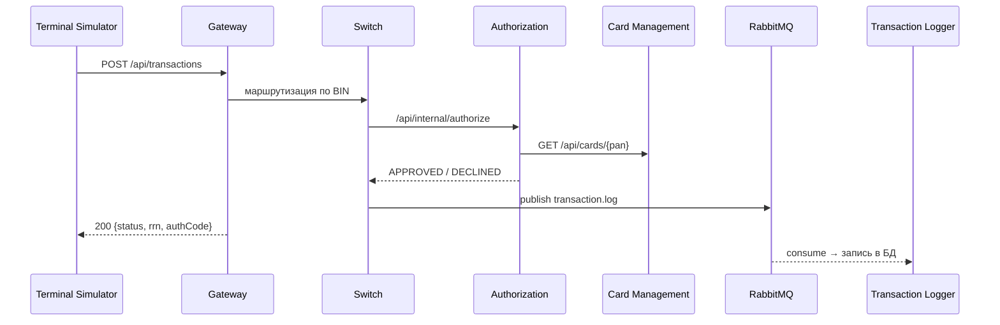

# Lecture 13: E2E-тестирование: сквозные сценарии и проверка результата

> **Модуль**: 7 — E2E и тестирование бизнес-сценариев
> **Лектор**: Ольга Лихачева
> **Длительность**: 1,5 астрономических часа (90 мин)
> **Слайдов**: 37
> **Формат**: Markdown, каждый слайд — раздел `###`
> **Структура слайда**: Заголовок + 3–5 тезисов + speaker notes; визуальная версия — `SlidevSlides/slides/module-07/lecture-13.md`
> **Связь с предыдущими лекциями**: пирамида и Testing Trophy — модуль 3, лекция 5; контракты и асинхронность — модуль 5, лекция 10; контейнеры и изоляция данных — модуль 6, лекция 2
> **Дата**: 26.11.2026
> **Литература**: см. [Источники](#источники) в конце файла

---

## Тайминг (90 минут)

| Время | Блок | Слайды | Назначение |
|:---:|---|:---:|---|
| 0:00–0:05 | Введение и план | 1–2 | Место лекции в модуле, обещание модуля 3 |
| 0:05–0:24 | Определение и границы уровня | 3–7 | Определение E2E, границы, отличие от системного тестирования, применимость |
| 0:24–0:38 | Место в стратегиях | 8–12 | Пирамида, Testing Trophy, формы наборов, экономика уровня |
| 0:38–1:00 | Сквозные сценарии СМП | 13–20 | Путь транзакции, точки наблюдения, бизнес- и технические сценарии |
| 1:00–1:15 | Проверка результата и стабильность | 21–26 | Трёхзвенная проверка, данные, асинхронность, нестабильность, диагностика |
| 1:15–1:28 | Паттерны, антипаттерны, метрики, конвейер | 27–34 | Паттерны, антипаттерны, разборы случаев, метрики, конвейер, границы автоматизации |
| 1:28–1:30 | Итоги и источники | 35–37 | Выводы, литература, вопросы |

---

### Ключевые положения лекции (памятка лектору)

1. Сквозная проверка определяется тремя признаками: вход на внешней границе, результат для потребителя, учёт отложенных последствий.
2. От системного тестирования уровень отличают объект проверки и источник ожиданий: система против бизнес-процесса, спецификация против сценария.
3. Сквозная проверка обоснована только там, где дефект не воспроизводится на нижних уровнях; объём набора ограничен экономикой уровня.
4. Результат подтверждается согласованием трёх звеньев; изоляция обеспечивается данными, асинхронность ожиданием условия.
5. Нестабильность уровня структурна: по данным 2025 года 75 процентов нестабильных тестов падают кластерами с общей причиной.

---

### Соответствие визуальной версии

Визуальная версия лекции (HTML-вёрстка, тема `slidev-theme-lekton`, 37 слайдов, экспорт в PDF): `SlidevSlides/slides/module-07/lecture-13.md`. Постановка практики 7 вынесена в отдельную деку `SlidevSlides/slides/module-07/practice-07-intro.md` (показывается на занятии 27.11). Нумерация разделов `### Слайд N` совпадает с порядком слайдов деки.

---

### Слайд 1. E2E-тестирование: сквозные сценарии и проверка результата

**Слайд:**

- Лекция 13. E2E-тестирование: сквозные сценарии и проверка результата
- Ольга Лихачева · Lekton
- 4 курс
- 26 ноября · Четверг 13:30–15:00

**Speaker notes:**

> Модуль 7 открывается лекцией о сквозном тестировании как отдельном уровне. Дальше в модуле будет вторая лекция, про исследовательские сессии и оформление дефектов, но она опирается на материал сегодняшней: до тех пор, пока не разобрано, что такое сквозная проверка, разговор про находки идёт без опоры на что-либо.
>
> Курс построен по уровням, и к сегодняшнему дню они пройдены почти все. Модуль 3 дал модель распределения тестов и показал, почему разные уровни стоят по-разному. Модуль 4 занял нижний уровень: модульные тесты, изоляция, тестовые двойники. Модуль 5 разобрал контракты: REST, статус-коды, асинхронные взаимодействия, идемпотентность. Модуль 6 добавил реальные базы данных и брокер в контейнерах: интеграционные проверки. Остался верхний уровень, и он сложнее остальных не технически, а методологически: здесь меньше всего проверок и больше всего соблазна проверять не то.
>
> Одно обещание из модуля 3 нужно закрыть сегодня. Вера Терентьева, разбирая уровни, упомянула трёхзвенную проверку: сверяем ответ, запись в логе и баланс. Мы разберём её в разделе 4 и покажем, как она реализуется в тесте. Это не отдельный приём, а способ удержать связь между ответом сервиса и фактическим состоянием системы.

---

### Слайд 2. План лекции

**Слайд:**

- Определение E2E
- Границы уровня, применимость и отличие от системного тестирования
- Место в стратегиях: пирамида и Testing Trophy
- Сквозные сценарии СМП: бизнес-логика и отказоустойчивость
- Трёхзвенная проверка результата
- Тестовые данные, асинхронность, диагностика падений
- Паттерны и антипаттерны: примеры из практики
- Метрики и размещение проверок в конвейере

**Speaker notes:**

> Порядок лекции подчинён одной логике: сначала точно определить, о чём речь, потом определить, где это применимо, и только затем переходить к моделям и практике. Поэтому пирамида и Testing Trophy стоят в середине, а не в начале: без определения они читаются как абстрактная схема, а не как обоснование.
>
> Первая часть отвечает на два вопроса: что такое сквозная проверка и чем она отличается от системного тестирования. Второй вопрос часто вызывает путаницу, потому что в отраслевых текстах термины употребляются как синонимы. Различие придётся удерживать до конца модуля, иначе набор тестов будет строиться произвольно.
>
> Дальше идут модели распределения тестов и экономика уровня: они объясняют, почему сквозных проверок должно быть мало. Затем три прикладных раздела: сценарии на нашем СМП, методика подтверждения результата, инженерная практика с паттернами, метриками и конвейером. Завершает лекцию разграничение автоматизации и исследования.

---

### Слайд 3. Определение и границы уровня

**Слайд:**

- _(визуальный слайд)_

**Speaker notes:**

> Первый раздел даёт определение и очерчивает область применения. Материал опирается на ISTQB CTFL и словарь терминов, на учебник Шпильнера и на инженерные публикации 2025–2026 годов. К концу раздела должно быть ясно, какие проверки относятся к сквозному уровню, какие к соседним и в каких случаях сквозная проверка не нужна вовсе.

---

### Слайд 4. Определение E2E

**Слайд:**

- Сквозное тестирование проверяет систему как единое целое на пути от внешней границы входа до наблюдаемого результата, включая последствия, возникающие после возврата ответа клиенту.
- Вход на внешней границе
- Проверка начинается на интерфейсе, которым пользуется клиент, а не на внутреннем вызове между сервисами.
- Результат для потребителя
- Оценивается исход операции, а не возвращаемое значение отдельного метода.
- Последствия после ответа
- Учитываются записи, уведомления и изменения состояния, в том числе возникающие асинхронно.

**Speaker notes:**

> Определение стоит разобрать по частям, потому что из него выводятся и объём набора, и выбор инструментов.
>
> Первая часть: путь от внешней границы входа. Для СМП внешняя граница это Gateway, куда обращается эмулятор терминала или мерчанта. Тест, который вызывает внутренний эндпоинт сервиса авторизации, сквозным не будет, даже если он затрагивает два сервиса: он не воспроизводит путь клиента и не проверяет то, что видит потребитель.
>
> Вторая часть: результат для потребителя. Оценивается исход операции: прошла ли транзакция, списались ли средства, получил ли клиент корректный ответ. Возвращаемое значение метода, внутренние структуры и приватные эндпоинты остаются за пределами проверки.
>
> Третья часть обычно выпадает, и напрасно: последствия после возврата ответа. Часть работы системы выполняется после того, как клиент уже получил ответ: Switch публикует сообщение в очередь, логгер записывает транзакцию, сервис уведомлений сохраняет карточное событие. Если проверять только ответ, дефект в этой части не будет обнаружен никогда, хотя для клиента он обернётся отсутствием подтверждения при разборе операции.
>
> Формального определения уровня в стандарте нет. ISTQB описывает системное тестирование как проверку интегрированной системы на соответствие требованиям и отдельно упоминает сквозное тестирование как проверку полного процесса. Мы будем пользоваться признаками на слайде: по ним можно проверить конкретный тест, а не обсуждать формулировки.

---

### Слайд 5. Границы уровня: что относится к соседним уровням

**Слайд:**

- Относится к другим уровням
- Вызов внутреннего эндпоинта относится к API-тестам, даже при участии двух сервисов.
- Проверка одного сервиса с реальной базой данных относится к интеграционным тестам.
- Проверка интерфейса без бизнес-процесса относится к UI-тестам.
- Пограничные случаи
- Два сервиса соединены внутренним вызовом: уровень остаётся API-уровнем.
- Сценарий от Gateway проверяет только ответ: уровень остаётся API-уровнем.
- Один сервис, но проверка отложенных последствий через брокер: интеграционный уровень.
- Признак сквозной проверки. Внешняя граница входа и проверка сквозного исхода вместе с отложенными последствиями.

**Speaker notes:**

> Границы уровня определяются проще всего через отнесение к соседним уровням: так снимается большинство спорных случаев, которые возникают при проектировании набора.
>
> Вызов внутреннего эндпоинта остаётся API-тестом уровня модуля 5, даже если проверка затрагивает два сервиса: клиентский путь при этом не воспроизводится. Проверка одного сервиса с реальной базой данных остаётся интеграционным тестом уровня модуля 6. Проверка интерфейса, не связанная с бизнес-процессом, относится к UI-проверкам, которых в СМП нет.
>
> Пограничные случаи стоит разобрать отдельно, потому что именно на них чаще всего ошибаются. Первый: два сервиса, соединённые внутренним вызовом. Второй: сценарий начинается на Gateway, но проверяет только ответ. Третий: сценарий охватывает один сервис, но проверяет отложенные последствия через брокер и базу данных. В первых двух случаях тест относится к нижнему уровню по существу, независимо от того, как он назван в проекте; в третьем он ближе к интеграционному уровню.
>
> Практическое следствие сформулировано в рамке: уровень определяется не числом сервисов в цепочке вызова, а наличием внешней границы входа и проверкой сквозного исхода вместе с отложенными последствиями. Если положить этот признак в основу, спорные случаи при проектировании почти исчезают.

---

### Слайд 6. Сквозное и системное тестирование: различия

**Слайд:**

| Аспект | Системное тестирование | Сквозное тестирование |
|---|---|---|
| Предмет проверки | Платформа и её свойства: инфраструктура, интерфейсы, шифрование, защита данных | Бизнес-процесс: доводит ли операция клиента до ожидаемого результата |
| Источник ожиданий | Спецификация системы и нефункциональные требования | Сквозной бизнес-сценарий |
| Что проверяется дополнительно | Нефункциональные свойства: производительность, безопасность, совместимость | Стыки сервисов, полнота вызовов, отложенные последствия |
| Типичный дефект | Отказ платформы: несовместимость, ошибка шифрования, просадка производительности | Разрыв цепочки: данные не дошли, состояние не изменилось, событие не доставлено |
| Типовой вопрос | Соответствует ли система требованиям, включая нефункциональные | Доводит ли процесс до результата для клиента |

**Speaker notes:**

> Этот слайд закрывает путаницу, которая встречается в отраслевых текстах: сквозное и системное тестирование часто употребляют как синонимы. Различие проходит по объекту проверки и по источнику ожиданий.
>
> Системное тестирование проверяет систему в сборе как чёрный ящик: на вход подаются данные, на выходе сверяется результат со спецификацией системы. Внутреннее устройство не рассматривается, но и выход за пределы системы не предполагается. Ожидания берутся из требований к системе.
>
> Сквозное тестирование проверяет бизнес-процесс, который проходит через несколько систем или сервисов и заканчивается результатом для потребителя. Ожидания берутся из бизнес-сценария, а не из спецификации одной системы. В проверку попадают стыки, порядок вызовов и отложенные последствия: то, чего в отдельной системе нет.
>
> Из различия следуют два практических вывода. Первый: дефект на стыке двух систем не обнаруживается системным тестированием ни одной из них, потому что он существует только между ними. Второй: сквозной набор не заменяет системный и не отменяет его: у них разные источники ожиданий, и они ловят разные классы дефектов.
>
> Стенд в обоих случаях полный: и системное, и сквозное тестирование выполняется на системе в сборе, поэтому окружение их не различает. Различие в предмете проверки. Системное тестирование отвечает за платформу: инфраструктура, интерфейсы, шифрование, защита данных, производительность, совместимость. Сквозное тестирование отвечает за бизнес: доводит ли операция клиента до ожидаемого результата и сохраняется ли целостность цепочки. Один и тот же стенд используется дважды, но проверяет разные свойства.
>
> Для нашего проекта граница проходит по масштабу системы. Отдельный сервис вместе с его базой данных и очередями относится к уровню модуля 6, сквозной уровень начинается там, где процесс охватывает несколько сервисов и клиент видит результат. Организационно работы разведены: системное тестирование ведёт команда системы или продукта, сквозные проверки ведёт команда интеграций.

---

### Слайд 7. Применимость: когда сквозная проверка нужна

**Слайд:**

- Проверка оправдана
- Изменения, затрагивающие несколько сервисов одновременно.
- Целостность цепочки: данные и события доходят до всех потребителей.
- Корректность при отказе зависимости: откат, деградация, очередь недоставленных сообщений.
- Сквозной процесс, результат которого важен потребителю.
- Проверка не оправдана
- Логика внутри одного сервиса: расчёт лимитов, валидация, преобразования.
- Комбинаторика значений: техники тест-дизайна нижних уровней.
- Свойства сервиса, видимые только через его базу данных.
- Разметка интерфейса: отдельный класс задач.
- Объём набора. Объём ограничен и определяется рисками и числом затронутых сервисов.

**Speaker notes:**

> Слайд отвечает на вопрос, который возникает раньше вопроса об инструментах: стоит ли писать сквозную проверку. Критерий один: дефект, который мы ищем, не воспроизводится на нижних уровнях. Если воспроизводится, сквозная проверка не нужна: она дороже, медленнее и менее стабильна.
>
> Проверка оправдана в четырёх случаях. Изменения, затрагивающие несколько сервисов одновременно. Целостность цепочки: данные и события доходят до всех потребителей. Сохранение корректности при отказе зависимости: откат резерва, деградация, размещение сообщения в очереди недоставленных сообщений. Сквозной процесс, результат которого важен потребителю.
>
> Теперь про случаи, где проверка не нужна, и здесь важна дисциплина. Логика внутри одного сервиса: расчёт лимитов и правила валидации дешевле проверять модульными тестами. Комбинаторика значений: её разбирают техниками тест-дизайна из модуля 2. Свойства сервиса, видимые только через его собственную базу данных: это интеграционный уровень. Разметка интерфейса: другой класс задач.
>
> Объём набора в рамке не случаен. Он определяется экономикой уровня, которую мы разберём в следующем разделе, и ограничивается рисками: сценарий, который годами ничего не находит, но требует обновления при каждом изменении чужого сервиса, относится к расходам, а не к покрытию.

---

### Слайд 8. Место сквозных проверок в стратегиях тестирования

**Слайд:**

- _(визуальный слайд)_

**Speaker notes:**

> Второй раздел объясняет, почему сквозных проверок должно быть мало. Изложение опирается на модель пирамиды из модуля 3 и на модель Testing Trophy: обе ограничивают долю верхнего уровня, но расходятся в оценке середины набора. Далее разбирается экономика уровня и её измеримые ориентиры.

---

### Слайд 9. Пирамида тестирования: повторение

**Слайд:**

- Пирамида тестирования, Майк Кон, 2009
- Основание: unit-тесты, около 70 процентов: проверка логики в изоляции, миллисекунды.
- Середина: API и интеграционные тесты, около 20 процентов: контракты между сервисами, реальные базы данных и брокер, сотни миллисекунд.
- Вершина: E2E, около 10 процентов: сквозной бизнес-процесс, секунды и десятки секунд.
- Суть модели: чем выше уровень, тем меньше проверок и тем дороже каждая.
- Следствия для сквозного уровня
- Пропорция описательная: она фиксирует устойчивое соотношение в командах, а не норму.
- Пропорция определяется экономикой: стоимость написания, скорость обратной связи, стоимость поддержки.
- Модель ограничивает область применения E2E, но не отменяет этот уровень.
- Правило 1 : 10 : 100. Стоимость обнаружения дефекта возрастает примерно на порядок при переходе на следующий уровень: unit 1, интеграционный 10, E2E 100, эксплуатация 1000.

**Speaker notes:**

> Модель введена в модуле 3, здесь она нужна как обоснование объёма. Разберём три положения.
>
> Пропорция 70/20/10 следует из экономики. С ростом уровня растут затраты на написание, на поддержку и время получения результата. Модель описал Майк Кон в 2009 году; нормативного статуса у неё нет, но соотношение описывает то, что устойчиво складывается в разных командах.
>
> Правило 1 : 10 : 100 объясняет, почему дефект выгоднее обнаружить на нижнем уровне. Возьмём ошибку в проверке лимита: модульный тест находит её за миллисекунды, а сквозная проверка обнаруживает ту же ошибку через минуты прогона, при этом диагностика занимает значительно больше времени. Разница не в аккуратности тестировщика, а в стоимости уровня.
>
> Третье положение относится к практике: если дефект ловится ниже, сквозная проверка не нужна. Разбирая на консультации чужой набор, почти всегда можно снять треть тестов, перенеся их на нижний уровень без потери покрытия и с выигрышем по времени прогона.

---

### Слайд 10. Testing Trophy: сравнение с пирамидой

**Слайд:**

- Testing Trophy, Кент Доддс, 2018
- Основание: статический анализ и типизация; модульных тестов немного.
- Середина: интеграционные тесты, основная масса набора: взаимодействие компонентов, устойчивее сквозных проверок.
- Вершина: E2E, мало: только критические пути.
- Суть модели: «Write tests. Not too many. Mostly integration».
- Следствия для сквозного уровня
- Различие моделей относится к середине набора, а не к вершине.
- Обе модели ограничивают долю сквозных проверок.
- Инженерная практика 2026 года использует гибрид: модульные тесты для домена, интеграционные для API, сквозные для критических путей.
- Конфигурация для СМП. Середину набора образуют API и интеграционные проверки. Сквозной уровень содержит не более десяти сценариев: покупка, отказ по лимиту, отказ по балансу, возврат, деградация при отказе зависимости.

**Speaker notes:**

> Testing Trophy предложен Кентом Доддсом в 2018 году. В основании модели статический анализ и типизация, в середине интеграционные тесты, а модульные и сквозные остаются в малом количестве. Аргумент автора: интеграционный тест проверяет фактическое взаимодействие компонентов и при этом устойчивее сквозного сценария.
>
> Если сравнивать модели, спор идёт о середине набора, а не о вершине. Пирамида говорит, что основную массу проверок составят модульные тесты; кубок говорит, что интеграционные. В оценке верхнего уровня модели сходятся: сквозных проверок мало, потому что их стоимость владения выше.
>
> Практика 2026 года приходит к гибриду. Модульные тесты покрывают доменную логику, интеграционные проверки закрывают взаимодействие сервисов с реальными базами и брокером, сквозные проверки остаются для критических путей. Признак, что набор пора сдвигать в сторону интеграционного уровня, формулируется так: подготовка моков занимает больше места, чем сами проверки, а изменение реализации ломает тесты без изменения поведения.
>
> Конфигурация для СМП показана в рамке. Основную массу проверок дают API и интеграционные тесты, а на верхнем уровне остаётся не более десяти сценариев: они соответствуют критическим бизнес-путям и поведению при отказах зависимостей.

---

### Слайд 11. Формы тестовых наборов и их предпосылки

**Слайд:**

| Форма | Происхождение | Основание | Условия применимости |
|---|---|---|---|
| Пирамида (Test Pyramid) | Майк Кон, 2009 | Модульные тесты, значительная доля | Развитый доменный слой, логика составляет основную ценность |
| Кубок (Testing Trophy) | Кент Доддс, 2018 | Статический анализ и интеграционные тесты | API-центричные системы, тонкий сервисный слой |
| Ромб (Test Diamond) | Практика микросервисов | Интеграционные тесты | Большое число межсервисных контрактов, мало интерфейсов |
| Гибрид | Инженерная практика, 2026 | Модульные тесты для домена, интеграционные для API | Большинство промышленных проектов |

**Speaker notes:**

> Таблица нужна, чтобы показать: форм набора несколько, и выбор между ними определяется архитектурой, а не вкусом. Пирамида подходит системам с развитым доменным слоем, где основная ценность сосредоточена в логике. Кубок подходит API-центричным системам с тонким сервисным слоем. Ромб встречается в микросервисных проектах, где много контрактов и почти нет интерфейсов.
>
> Строка про перевёрнутый конус описывает не модель, а состояние: так выглядит набор там, где нижние уровни не сформированы. Держим её в таблице как диагностический признак.
>
> Ещё один случай это смешанные наборы. Если одна и та же логика проверяется на модульном, интеграционном и сквозном уровне, это не повышение надёжности, а тройная стоимость поддержки. Каждая проверка должна иметь один уровень ответственности; дублирование возникает, когда набор наращивают, не разбираясь, где именно должен находиться очередной тест.

---

### Слайд 12. Экономика верхнего уровня

**Слайд:**

- Скорость
- Один сценарий выполняется секунды или десятки секунд, полный набор минуты. Результат поступает позже, чем на нижних уровнях.
- Стабильность
- Сценарий зависит от каждого сервиса на пути и от общей инфраструктуры: брокера, базы данных. Отказ любого звена отображается как падение теста.
- Стоимость поддержки
- Сквозные проверки дороже в сопровождении: тест ломается при изменении чужого сервиса, даже если логика проверки не менялась.

**Speaker notes:**

> Экономика уровня складывается из трёх измеримых величин, и все три можно посчитать на своём проекте.
>
> Скорость. Пока набор проходится быстро, разработчик запускает его осмысленно и получает результат до переключения на другую задачу. Когда набор затягивается на десятки минут, его перестают запускать локально, и первое сообщение об ошибке приходит из конвейера с большим запозданием.
>
> Стабильность. Сквозной сценарий проходит через цепочку сервисов и инфраструктуру между ними: каждый элемент цепочки это отдельная точка отказа, и отказ любого элемента выглядит как падение теста. Поэтому доля ложных падений у верхнего уровня структурно выше, чем у нижних. Когда таких падений становится много, разработчики перестают разбирать результаты, и настоящий дефект проходит вместе с ложными.
>
> Стоимость поддержки. Сквозной тест ломается при изменении в чужом сервисе: поменялся формат ответа, переехал эндпоинт, изменился контракт асинхронного события. Поэтому сопровождение обходится дороже, и число таких проверок держат под контролем.

---

### Слайд 13. Сквозные сценарии СМП

**Слайд:**

- _(визуальный слайд)_

**Speaker notes:**

> Третий раздел применяет определение к объекту тестирования курса. Разбираются путь транзакции, точки наблюдения результата, три класса бизнес-сценариев и технические сценарии при отказах инфраструктуры. Материал опирается на архитектуру СМП из модулей 1 и 6 и на контракты из модуля 5.

---

### Слайд 14. СМП: путь транзакции

**Слайд:**

- Одиннадцать сервисов, синхронный путь авторизации и асинхронный след. Каждая стрелка обозначает границу, на которой проверяется контракт.

**Speaker notes:**

> Схему вы видели дважды: в модуле 1 она иллюстрировала предметную область, в модуле 6 на ней разбирались точки интеграции. Сегодня она нужна в третьем качестве, как карта проверок.
>
> Читается она так. Синхронная часть идёт от эмулятора терминала через Gateway и Switch в сервис авторизации, который обращается к управлению картами и к справочнику BIN. В этой части результат виден клиенту: статус, код ответа, идентификаторы. Асинхронная часть начинается после ответа: Switch публикует сообщение в очередь, потребитель записывает транзакцию в лог; отдельно управление картами отправляет карточные события в сервис уведомлений.
>
> Для проектирования набора из схемы следует простой вывод: у сквозного сценария не одна точка проверки, а три. Зафиксируем, что карта проверок совпадает с картой вызовов, и что каждая стрелка на схеме это место, где контракт может быть нарушен незаметно для клиента.

---

### Слайд 15. Точки наблюдения результата

**Слайд:**

- Синхронная граница
- Ответ Gateway: статус транзакции, код ответа, идентификаторы rrn и authCode, время обработки.
- Состояние данных
- Баланс и лимиты в управлении картами, запись транзакции в таблице, создание или снятие резерва.
- Асинхронный след
- Запись у логгера, уведомление по карточному событию, отсутствие сообщений в очереди недоставленных сообщений.
- Что показывает каждая точка.
- Синхронная граница: что получил клиент.
- Состояние данных: изменились ли баланс, лимиты и записи.
- Асинхронный след: выполнено ли отложенное действие.

**Speaker notes:**

> Три точки наблюдения отвечают на три разных вопроса, и путать их не стоит: разные вопросы требуют разных способов проверки.
>
> Первый вопрос: что получил клиент. Ответ Gateway содержит статус, код ответа и идентификаторы транзакции. Это единственная точка, доступная внешнему потребителю, и она наименее надёжна: успешный ответ сам по себе не означает, что средства списаны. Именно на ней останавливаются тесты, которые потом не находят дефектов.
>
> Второй вопрос: изменились ли данные. Проверяем состояние в управлении картами и запись транзакции. Здесь становится ясно, есть ли у ответа клиента фактическое основание.
>
> Третий вопрос: выполнено ли отложенное действие. Проверяем запись у логгера, карточные уведомления и очередь недоставленных сообщений. Точка отвечает на вопрос, завершился ли процесс целиком, включая отложенные действия.
>
> Состав точек наблюдения определяем до написания кода теста, вместе с ожиданиями. Если сценарий проверяет только первую точку, он относится к API-уровню и должен быть перенесён в модуль 5: в сквозном наборе ему делать нечего.

---

### Слайд 16. Бизнес-сценарий: успешная покупка

**Слайд:**

- Предусловия и шаги
- Создаётся карта в статусе ACTIVE с балансом и лимитами, допускающими сумму.
- Запрос авторизации направляется на Gateway: POST /api/transactions, mti = 0100.
- Сумма передаётся в минорных единицах: 150000 соответствует 1500 рублям.
- Ожидаемый результат
- Статус APPROVED, код ответа 00, заполнены rrn и authCode.
- Баланс уменьшился на сумму операции; резерв учтён в лимитах.
- Транзакция доступна логгеру; при карточном событии создано уведомление.
- Требование к данным. Карта создаётся внутри сценария. Предзаполненный набор карт делает результат зависимым от порядка выполнения тестов.

**Speaker notes:**

> Успешная покупка это базовый сценарий: на нём удобно показать структуру проверки, которую потом повторяем в остальных сценариях.
>
> Предусловие формулируем как состояние системы, а не как последовательность вызовов: существует карта в статусе ACTIVE, баланс покрывает сумму покупки, лимиты не исчерпаны. Данные создаём внутри сценария через публичный интерфейс Gateway. Это не формальность: карта, которую создал тест, не зависит от того, какие ещё тесты выполнялись до него.
>
> Шаги повторяют путь клиента: запрос авторизации с типом сообщения 0100, корректной суммой и обязательными полями. Сумма указывается в минорных единицах; соглашение разбиралось в модуле 5 на контракте авторизации, и здесь мы его не меняем.
>
> Ожидаемый результат расписываем по трём точкам наблюдения. Ответ клиенту: статус, код, идентификаторы. Состояние: баланс уменьшился ровно на сумму, резерв учтён в лимитах. Асинхронный след: транзакция доступна логгеру.
>
> Требование в рамке стоит проверять на чужом коде в первую очередь. Если сценарий берёт карту из скрипта инициализации, он проходит поодиночке и падает в наборе; такие тесты чаще всего и попадают в карантин.

---

### Слайд 17. Бизнес-сценарий: классы отказов

**Слайд:**

| Причина отказа | Код ответа | Условие воспроизведения | Дополнительная проверка |
|---|---|---|---|
| Карта не найдена | 14 | PAN отсутствует в системе | Отказ не создаёт записей; резерв не сформирован |
| Недостаточно средств | 51 | Сумма больше доступного баланса | Баланс не изменился; резерв не сформирован |
| Просроченная карта | 54 | Срок действия меньше текущей даты | Отказ зафиксирован в логе с причиной |
| Превышен лимит | 61 | Сумма больше дневного или месячного лимита | Счётчики лимитов не увеличены |
| Карта заблокирована | 05 | Статус карты BLOCKED, причина CARD_BLOCKED | Отсутствуют побочные эффекты для других карт |

**Speaker notes:**

> Отказные сценарии важнее успешных по риску: именно на них бизнес теряет деньги или получает обязательства, которых не должно быть.
>
> В таблице собраны классы отказов, коды ответов и, что важнее всего, дополнительная проверка для каждого класса. Главный здесь последний столбец: в сквозной проверке отказа мы сверяем код ответа и отсутствие побочных эффектов. Баланс не изменился. Резерв не сформирован. Счётчики лимитов не увеличены.
>
> Классический дефект этой группы устроен так: ответ клиенту корректен, а состояние системы — нет. Ни модульные, ни API-тесты такой дефект не поймают: он виден только при совместной проверке ответа и состояния. Именно для этого и существует сквозной уровень.
>
> Числовые коды взяты из перечисления DeclineOutcome, которое разбиралось в модуле 5, и из технических заданий сервиса авторизации в эталонном репозитории: 14 карта не найдена, 51 недостаточно средств, 54 просроченная карта, 61 превышен лимит.

---

### Слайд 18. Бизнес-сценарий: возврат и идемпотентность

**Слайд:**

- Возврат как разрезервирование
- Операция возврата выполняется сообщением mti = 0400 и связывается с исходной транзакцией по rrn.
- Ожидаемый результат: баланс восстановлен, запись резерва снята, факт возврата зафиксирован логгером.
- В техническом задании возврат отнесён к расширенным сценариям; наличие операции определяется реализацией команды.
- Идемпотентность: проверка повторного возврата
- Повторный возврат по тому же rrn не должен возвращать средства повторно.
- Аналогично проверяется повтор авторизации с тем же stan, что рассматривалось в модуле 5.
- Ожидаемый результат повтора: тот же ответ, отсутствие второго изменения состояния.

**Speaker notes:**

> Возврат интересен тем, что ломает самую очевидную реализацию. Если разработчик написал «прибавить сумму обратно», повторный запрос вернёт деньги второй раз, и в отчётности появится операция, которой не было.
>
> Идемпотентность означает, что повторный идентичный запрос даёт тот же результат и не создаёт новых побочных эффектов. В модуле 5 это свойство разбиралось на повторной авторизации с тем же STAN: тогда речь шла о различении повторной доставки сообщения и новой операции. Возврат устроен так же, только ключом служит номер ссылки на исходную транзакцию.
>
> Отсюда приём, который стоит взять в практику: проверка повторного возврата. Мы не столько подтверждаем заявленное поведение, сколько устанавливаем фактическое, и результат такой проверки часто не совпадает с документацией. Это уже исследовательский приём, и подробно он разбирается на следующей лекции.
>
> Ограничение в рамке касается оценивания. Возврат отнесён техническим заданием к расширенным сценариям и может отсутствовать в реализации вашей ветки. Правильное действие в этом случае: зафиксировать ограничение в отчёте. Тест, проверяющий несуществующее поведение, даёт недостоверный результат, и на приёмке это считается ошибкой, а не находкой.

---

### Слайд 19. Технические сценарии: поведение при отказе

**Слайд:**

| Сбой | Механизм в системе | Наблюдаемый результат | Проверяемое свойство |
|---|---|---|---|
| Брокер не подтверждает публикацию | Подтверждение публикации брокером, ожидание 2 секунды | Ответ 96, резерв откатывается обратным запросом | Отсутствие одобренных транзакций без записи в логе |
| Брокер недоступен | Повтор доставки, затем очередь недоставленных сообщений, TTL 60 секунд | Сообщение в очереди недоставленных сообщений, разбор вручную | Отсутствие неограниченного повтора |
| Сервис Bin Lookup недоступен | Деградация на данные BIN-таблицы | Транзакция обрабатывается, идентификатор эмитента берётся из таблицы | Работоспособность при отказе необязательной зависимости |
| Управление картами недоступно | Таймаут 3 секунды на соединение, 5 секунд на чтение | Ответ 05, ISSUER_TIMEOUT в пределах таймаута | Отсутствие зависания запроса клиента |
| Потребитель остановлен | Сообщения накапливаются в очереди | Синхронный ответ без изменений; запись у логгера отсутствует | Корректное поведение при отложенной обработке |

**Speaker notes:**

> Технические сценарии проверяют не бизнес-результат, а поведение системы при сбое. Отличаются они способом подготовки: вместо данных под бизнес-кейс создаётся управляемый отказ, то есть останавливается брокер, отключается зависимость или приостанавливается потребитель.
>
> Ожидаемый результат в каждом случае сформулирован измеримо: конкретный код ответа, конкретное изменение состояния, конкретное расположение сообщения. Формулировка «система работает» здесь бесполезна, потому что такой результат нельзя проверить.
>
> Первый сценарий проверяет свойство целостности. Если брокер не подтвердил публикацию за две секунды, Switch откатывает резерв и возвращает клиенту код 96. Проверяем гарантию: одобренная транзакция не может остаться без записи в логе. Это ровно та область, где сквозная проверка незаменима, потому что свойство существует только на стыке сервисов.
>
> Четвёртая строка, про недоступность управления картами, проверяет ещё одну вещь, помимо кода ответа: укладывается ли система в таймаут. Зависший на тридцать секунд запрос клиента это тоже дефект, и на сквозном уровне он виден сразу.
>
> Для практики нужен один сценарий из таблицы. Проще всего воспроизводятся недоступность потребителя и отказ публикации.

---

### Слайд 20. Бизнес-сценарий и технический: критерии выбора

**Слайд:**

- Бизнес-сценарий
- Получил ли потребитель ожидаемый результат?
- Технический сценарий
- Сохранила ли система корректность при сбое?
- Признак
- Подготовка данных
- Карта и сумма под бизнес-кейс
- Управляемый отказ: брокер, зависимость, таймаут
- Ожидаемый результат
- Статус, изменение баланса, уведомление
- Код ошибки, откат состояния, размещение сообщения
- Потребитель отчёта
- Менеджер продукта, заказчик
- Эксплуатация, дежурная смена
- Доля в наборе
- Большинство сценариев
- Один-два на критичный сбой
- Частота запуска
- Стадия E2E в конвейере
- Ночной прогон, перед релизом

**Speaker notes:**

> Таблица разводит два класса сценариев по шести признакам. Различие проходит по вопросу, на который отвечает проверка, и по способу подготовки данных; инструменты при этом могут быть одни и те же.
>
> Последние две строки определяют организацию набора. Технических сценариев мало, один-два на наиболее критичный сбой, и запускаются они реже: они проверяют устойчивость, а не функциональность, и в ежедневном прогоне пользы не приносят.
>
> Правило для практики 7: из пяти сценариев четыре-пять бизнес-сценарии, не менее одного технический. Способ воспроизведения сбоя фиксируется в отчёте: без этого результат не сможет повторить ни проверяющий, ни разработчик через месяц.

---

### Слайд 21. Проверка результата, данные, стабильность

**Слайд:**

- _(визуальный слайд)_

**Speaker notes:**

> Четвёртый раздел отвечает на вопрос, как сделать так, чтобы зелёный сквозной тест соответствовал реальному поведению системы. Разбираются трёхзвенная проверка, управление данными, асинхронные ожидания, природа нестабильности и диагностика падений. Часть утверждений опирается на эмпирические исследования нестабильных тестов 2025 года.

---

### Слайд 22. Трёхзвенная проверка результата

**Слайд:**

- Звено 1. Ответ
- Что получил клиент: статус, код ответа, идентификаторы, время обработки.
- Звено 2. Состояние
- Что изменилось в данных: баланс, лимиты, запись резерва, наличие транзакции в базе.
- Звено 3. След
- Что выполнено отложенно: запись у логгера, уведомление, отсутствие недоставленных сообщений.
- Условие прохождения. Сценарий считается пройденным при согласовании всех трёх звеньев. Расхождение в любом звене означает падение, в том числе при корректном ответе.
- Асинхронность. Третье звено проверяется ожиданием условия. Интервал ожидания определяется сервисом.

**Speaker notes:**

> Трёхзвенная проверка обещана в модуле 3 и разбирается здесь подробно. Смысл конструкции в том, чтобы исключить ложно успешный результат: тест, который проверяет только ответ, пропускает целый класс дефектов.
>
> Разберём два дефекта. Первый: Gateway вернул APPROVED, ответ клиенту корректен, но средства не зарезервированы. Проверка первого звена его пропустит, проверка второго обнаружит. Второй: средства зарезервированы, запись в логе не создана. Дефект целостности, который ловится только третьим звеном.
>
> Звенья соответствуют вопросам предыдущего слайда и определяют способ реализации. Ответ проверяем обращением к Gateway. Состояние запросом к управлению картами или чтением базы данных. След ожиданием события у логгера.
>
> Третье звено разберём подробнее: с ним больше всего проблем. Система согласована не мгновенно, поэтому проверка строится как ожидание условия. В модуле 5 мы использовали ожидание с настройкой десять секунд, в модуле 6 пять секунд; значение зависит от сервиса и от нагрузки стенда. Неизменным остаётся предмет ожидания: событие, а не истечение времени. Пятисекундная пауза отличается от ожидания условия тем, что при первом же замедлении стенда превращается в случайное падение.

---

### Слайд 23. Тестовые данные: изоляция и воспроизводимость

**Слайд:**

- Правила подготовки данных
- Данные создаются внутри сценария через публичный интерфейс.
- Идентификаторы уникальны для сценария: PAN, stan, terminalId, merchantId.
- Разделяемые данные из скрипта инициализации не используются.
- Сценарий не зависит от порядка выполнения и выдерживает повторный прогон.
- Почему откат транзакции неприменим
- Границы транзакции не совпадают с границей HTTP-вызова.
- Часть работы выполняется другим сервисом и брокером, вне области отката.
- В сквозных проверках применяется изоляция по данным, а не по транзакции, в отличие от модуля 6.
- Критерий качества данных. Сценарий проходит отдельно, в любом порядке и параллельно с другими.

**Speaker notes:**

> Данные это первая из двух главных причин нестабильности сквозных проверок, и справиться с ней можно только дисциплиной, а не инструментами.
>
> Способ изоляции отличается от того, что вы применяли в модуле 6. В интеграционных тестах работал транзакционный откат: изменения отменялись после завершения теста. На сквозном уровне приём не работает. Транзакция не покрывает границу HTTP-вызова, а часть работы выполняется другим сервисом и брокером, то есть вне области отката. Поэтому применяется изоляция по данным: каждый сценарий работает со своим набором, уникальность обеспечивают идентификаторы.
>
> Критерий в рамке удобно использовать при диагностике. Если тест падает в одиночном запуске и проходит в наборе, ищите разделяемые данные. Если проходит последовательно и падает при параллельном запуске, ищите неуникальные идентификаторы, чаще всего STAN или номер терминала.
>
> У этого решения есть цена: создание собственных данных удлиняет сценарий, подготовка занимает несколько вызовов. Публикации 2026 года советуют сокращать подготовку, доводя состояние до нужного программными вызовами, и проверять сквозным путём только ту часть, которая относится к предмету сценария. Время уходит на подготовку, но результат становится воспроизводимым.

---

### Слайд 24. Асинхронность: ожидание условия вместо паузы

**Слайд:**

- Фиксированная пауза
- Значение подбирается по времени локального прогона.
- На быстром окружении пауза избыточна, на нагруженном недостаточна.
- Недостаточность обнаруживается при первом запуске в конвейере.
- Ожидание условия
- Задаётся условие завершения и предельное время ожидания.
- Опрос выполняется с малым интервалом; при выполнении условия проверка продолжается.
- Превышение времени даёт диагностику: какое условие не выполнено.
- Масштаб издержек. В наборе из 200 сквозных тестов фиксированные паузы по 3 секунды дают 10 минут ожидания на прогон; часть пауз при этом недостаточна для медленных окружений.

**Speaker notes:**

> Вторая причина нестабильности это ожидания. Выбор между паузой и ожиданием условия влияет и на надёжность, и на длительность прогона.
>
> У фиксированной паузы два независимых недостатка. Первый: значение зависит от загрузки окружения, поэтому оно всегда либо избыточно, либо недостаточно. Второй: при недостаточном значении дефект выглядит как случайное падение, и разбирать его приходится с нуля. Инженерные публикации называют фиксированные паузы самым частым источником нестабильности сквозных тестов.
>
> Ожидание условия задаётся условием: пока запись не появится, но не дольше указанного времени. Библиотека опрашивает состояние с малым интервалом и при выполнении условия продолжает проверку сразу. В результате тест устойчив к вариациям окружения, а при истечении времени выдаёт сообщение о том, какое условие не выполнено.
>
> Пример в рамке показывает порядок величин. Двести пауз по три секунды это десять минут ожидания на прогон, причём для части медленных стендов этого времени всё равно не хватит. Набор с такими паузами не уложится в ориентир по длительности, который мы разбирали в разделе 2.

---

### Слайд 25. Диагностика падения: локализация звена

**Слайд:**

- Порядок разбора
- Установить звено, в котором результаты не согласованы: ответ, состояние или след.
- Проверить гипотезу одним обращением к конкретному сервису.
- Зафиксировать наблюдения: тела ответов, значения баланса, идентификаторы.
- Перезапуск стенда применять после локализации причины.
- Соответствие симптома и подсистемы
- Неверный ответ указывает на контракт или маршрутизацию: Gateway, Switch.
- Верный ответ при ином состоянии указывает на резервирование, транзакционность, конкуренцию.
- Верное состояние без следа указывает на брокер, потребителя, очередь недоставленных сообщений.
- Сохраняемые данные. Идентификаторы транзакции (stan, rrn, PAN), тела ответов, снимок состояния до и после операции, лог сервиса. Этот же набор используется при оформлении дефекта на следующей лекции.

**Speaker notes:**

> Сквозной тест падает неинформативно, и это его свойство, а не недостаток конкретной библиотеки. Инструмент диагностики у нас уже есть: та же декомпозиция на три звена.
>
> Порядок разбора начинается с вопроса, какое звено не согласовано, и продолжается одним точечным обращением к сервису, на который указывает симптом. Перезапуск стенда до локализации причины это потеря времени: вы стираете состояние, по которому можно было разобраться.
>
> Таблица соответствия позволяет перейти от симптома к подсистеме. Неверный ответ указывает на контракт или маршрутизацию. Верный ответ при ином состоянии указывает на логику резервирования и на конкурентные операции. Верное состояние без следа указывает на инфраструктуру обмена сообщениями.
>
> Набор данных в рамке совпадает с набором доказательств, который потребуется в отчёте о дефекте. Практический совет: сохраняйте эти данные сразу при падении, а не при разборе. Через час после прогона состояние стенда изменится, и воспроизводить сценарий придётся заново.

---

### Слайд 26. Паттерны, антипаттерны и практика

**Слайд:**

- _(визуальный слайд)_

**Speaker notes:**

> Пятый раздел сводит материал в перечень паттернов и антипаттернов, вводит метрики набора, определяет размещение проверок в конвейере и завершается разграничением автоматизации и исследования. Изложение опирается на инженерные публикации 2025–2026 годов.

---

### Слайд 27. Паттерны сквозных проверок

**Слайд:**

- **Сценарий от пользовательского пути.** Проверяется путь потребителя; внутренняя реализация остаётся за пределами проверки. Ожидания формулируются через наблюдаемый результат.
- **Подготовка состояния через интерфейс.** Состояние доводится до предусловия программными вызовами. Сквозным путём проверяется только предмет сценария.
- **Изоляция по данным.** Уникальные идентификаторы на сценарий, отсутствие разделяемых фикстур, независимость от порядка выполнения.

**Speaker notes:**

> Перечень паттернов собран из инженерной практики 2025–2026 годов: это то, что отличает наборы, которые живут годами, от тех, что разбирают через полгода после создания.
>
> Первый паттерн определяет предмет проверки: путь потребителя. Публикации отмечают, что значительная часть падений в зрелых наборах вызвана изменениями, которые не влияют на поведение с точки зрения пользователя. По такому тесту невозможно сказать, что именно сломалось для клиента.
>
> Второй и третий паттерны относятся к подготовке. Состояние доводится программными вызовами, изоляция обеспечивается уникальными данными. Оба положения следуют из того, что транзакционный откат на сквозном уровне неприменим.
>
> На практике эти три паттерна проверяются тремя вопросами к любому своему тесту: какую операцию пользователя он проверяет, какие данные создаёт сам и что произойдёт при запуске двух таких тестов параллельно.

---

### Слайд 28. Паттерны: устойчивость и владение набором

**Слайд:**

- **Ожидание условия.** Асинхронный результат проверяется по условию с предельным временем ожидания; фиксированная пауза не применяется.
- **Диагностируемость.** Падение указывает несогласованное звено и сохраняет артефакты: ответы, состояние, записи в логах.
- **Регулярная ревизия.** Проверки, которые больше не нужны, удаляются. Нестабильные тесты выносятся в карантин с ограниченным сроком.

**Speaker notes:**

> Четвёртый паттерн касается асинхронности: ожидание условия вместо паузы. Пятый требует, чтобы падение было понятно без повторного запуска: сохраняются тела ответов, снимок состояния и записи в логах.
>
> Шестой паттерн игнорируют чаще всего. Набор требует ревизии, как и любой другой актив. Публикации предлагают конкретное правило: тест, который не удалось стабилизировать за отведённый срок, удаляется.
>
> Возражение, которое здесь обычно возникает: удаление теста это потеря покрытия. На деле это возврат набора к области ответственности. Проверки, дублирующие нижние уровни, покрытия не добавляют, а стоимость владения повышают: их приходится обновлять при каждом изменении чужого сервиса. Ревизия раз в квартал стоит нескольких часов и окупается на следующем же релизе.

---

### Слайд 29. Антипаттерны сквозных проверок

**Слайд:**

- **Составной сценарий.** Один тест проходит вход, покупку, возврат и просмотр истории. При падении шаг возникновения ошибки не устанавливается.
- **Фиксированная пауза.** Ожидание по времени вместо ожидания события: на быстром окружении ждёт лишнее, на нагруженном не дожидается результата.
- **Разделяемые данные.** Общая карта, общая учётная запись, общая очередь. Результат зависит от других тестов и порядка запуска.

**Speaker notes:**

> Антипаттерны это перечисленные ранее паттерны с обратным знаком; разберём первые три.
>
> Составной сценарий упоминался в примерах: при падении невозможно установить, на каком шаге возникла ошибка, и разбор начинается с повторного прогона, а не с чтения отчёта. Признак такой: если в отчёте о падении больше пяти шагов и три разных бизнес-действия, тест, скорее всего, составной.
>
> Фиксированная пауза и разделяемые данные дают нестабильность. Разница между ними в том, как они проявляются. Пауза падает при нагрузке на стенд, чаще всего в конвейере, и редко воспроизводится локально. Разделяемые данные падают при параллельном запуске или при полном наборе, а поодиночке тест проходит.

---

### Слайд 30. Антипаттерны: уровень и дисциплина

**Слайд:**

- **Проверка нижнего уровня.** Правила валидации, сортировка, форматирование, арифметика перенесены на верхний уровень в нарушение экономики 1 : 10 : 100.
- **Проверка реализации.** Утверждения о внутренних структурах и приватных эндпоинтах. Тест падает при рефакторинге и не выявляет дефектов.
- **Повтор вместо анализа.** Автоматический повтор падения без разбора причины маскирует дефект и снижает доверие к результату прогона.

**Speaker notes:**

> Три антипаттерна этого слайда объединены одной темой: дисциплиной работы с набором.
>
> Проверка нижнего уровня это следствие нарушения пропорции. Обычно она возникает так: дефект нашли в продакшене, написали сквозной тест вместо модульного, и через год таких тестов набралось сорок.
>
> Проверка реализации распознаётся по критерию, о котором говорили в первом разделе: тест падает при рефакторинге, не меняющем поведение. Типичный пример это утверждения о структуре таблиц в базе данных или о вызовах внутренних методов.
>
> Повтор без разбора опаснее, чем кажется. Как временная мера при расследовании он полезен, как постоянная практика вреден: набор постепенно перестаёт означать «всё работает» и начинает означать «иногда работает». Публикации формулируют следствие прямо: повтор без анализа превращает однократное падение в отложенный дефект.

---

### Слайд 31. Разбор практических случаев

**Слайд:**

- Случай 1. Разрастание набора. 200 сквозных тестов, прогон 42 минуты, доля успешных 91 процент. После удаления 80 тестов и разделения составных сценариев прогон занимает 12 минут, доля успешных 99 процентов, покрытие критических путей сохранено. Источник: Paulenko, QAPractices, 2026.
- Случай 2. Кластеризованная нестабильность. 75 процентов нестабильных тестов падают группами по общей причине. Преобладают сетевые взаимодействия и внешние зависимости. Устранение одной причины закрывает группу падений. Источник: Parry et al., 2025, arXiv:2504.16777.
- Случай 3. Границы ручной проверки. При высокой частоте релизов ручное сквозное тестирование не обеспечивает покрытия, а проверка на реальных пользователях создаёт риск. Nubank заменил её модельной средой: свыше 16 000 смоделированных диалогов до выпуска. Источник: Alcobaça et al., 2026, arXiv:2609.30137.
- Случай 4. Хрупкость сценарной автоматизации. Автоматизация, связанная с реализацией, требует постоянного сопровождения. Агентная система ARIA обнаружила все 5 известных дефектов пилота, но дала 52,6 процента ложных срабатываний против 72 у одноагентной конфигурации. Источник: Azevedo et al., 2026, arXiv:2609.04913.

**Speaker notes:**

> Четыре случая из материалов 2025–2026 годов, каждый иллюстрирует одно из положений лекции.
>
> Первый случай про пропорцию и её восстановление; это опубликованный опыт инженера Матиаса Пауленко. Из набора в 200 тестов удалили 80, разделили составные сценарии, и длительность упала с 42 до 12 минут, а доля успешных прогонов выросла с 91 до 99 процентов. Покрытие критических путей при этом не уменьшилось, потому что удалялись проверки, не относящиеся к верхнему уровню.
>
> Второй случай подтверждает, что нестабильность структурна. Практический вывод: при падении группы тестов ищите общую причину, одна правка закроет всю группу.
>
> Третий случай описывает границы ручной проверки. Когда релизы идут каждый день, ручной сквозной прогон не даёт покрытия, а проверка на реальных пользователях создаёт риск. Индустрия отвечает модельными средами и автоматизацией проверок до выпуска. Это тот же аргумент, которым в модуле 1 обосновывалась автоматизация вообще.
>
> Четвёртый случай относится к агентной автоматизации, которая активно развивается. В пилоте, опубликованном на ESEM 2026, мультиагентная система ARIA нашла все 5 известных дефектов контура, но на первом прогоне дала 52,6 процента ложных срабатываний; у одноагентной конфигурации — 72 процента. Для блокирующей стадии конвейера такой набор непригоден без дополнительной настройки: половина падений будет ложной, и доверие к стадии пропадёт за неделю.

---

### Слайд 32. Метрики сквозного набора

**Слайд:**

- Доля успешных прогонов выше 98 процентов
- При более низком значении падения перестают разбирать, и настоящие дефекты проходят вместе с ложными.
- Длительность набора до 10 минут
- При превышении набор перестают запускать локально, диагностика переносится в конвейер.
- Время диагностики до 15 минут
- Обеспечивается артефактами: снимками состояния, телами ответов, записями в логах, записью прогона.
- Трудозатраты до 4 часов в неделю
- Устойчивое превышение указывает на избыточный размер набора или разделяемое состояние между сценариями.
- Дополнительные показатели: покрытие критических путей 100 процентов; доля прогонов, прошедших только при повторе, отслеживается отдельно и служит индикатором скрытой нестабильности.

**Speaker notes:**

> Метрики нужны, чтобы разговор о качестве набора не оставался оценочным. Четыре показателя на слайде взяты из инженерной практики 2026 года; нормативными они не являются, но как границы допустимого работают хорошо.
>
> Трудозатраты это единственная метрика, которая прямо измеряет стоимость владения. Если она устойчиво превышена, есть две вероятные причины: набор слишком велик для своей задачи или сценарии разделяют состояние. Обе устраняются ревизией, о которой говорили в паттернах.
>
> Показатель в нижней рамке фиксирует нестабильность, которую обычно прячут автоматическим повтором. Рост этого показателя означает деградацию набора даже тогда, когда общая доля успешных прогонов остаётся высокой: тесты «проходят со второго раза», и это состояние легко принять за норму.
>
> В практике 7 метрики используются в упрощённом виде: набор укладывается в разумное время, проходит повторно и не зависит от порядка запуска.

---

### Слайд 33. Сквозные проверки в конвейере

**Слайд:**

| Триггер | Состав проверок | Обоснование |
|---|---|---|
| Каждый коммит | Критические пути, пять-десять сценариев | Результат нужен за минуты, до переключения на другую задачу |
| Слияние в основную ветку | Критические пути целиком | Проверка перед вливанием в общую ветку |
| Ночной прогон | Полный набор, включая технические сценарии | Технические проверки длительные, для каждого изменения они не нужны |
| Перед релизом | Полный набор и проверки совместимости | Дополнительные виды проверок нужны на релизной границе |

**Speaker notes:**

> Расписание запусков определяет, как быстро приходит результат и во сколько он обходится. В таблице четыре точки запуска: коммит, слияние, ночной прогон, релиз.
>
> Чем чаще срабатывает триггер, тем уже состав проверок. На каждый коммит идут пять-десять сценариев по критическим путям: этого хватает, чтобы заметить грубую поломку, а длится такой прогон недолго и не мешает работе. При слиянии в основную ветку критические пути выполняются целиком. Ночью добавляются технические сценарии: они длительные, и запускать их на каждое изменение не нужно. Перед релизом набор дополняется проверками совместимости.
>
> Из таблицы следует практическое правило. Набор, который выполняется дольше десяти минут, перестают запускать локально, и результат приходит только из конвейера. Поэтому для частых триггеров состав проверок держат узким.

---

### Слайд 34. Автоматизация и исследование: границы

**Слайд:**

**Проверка (автоматизируемая):**

- Сравнение результата с заранее заданным ожиданием
- Известные сценарии и фиксированные критерии
- Повторяемость: результат воспроизводится при каждом прогоне
- Защита установленного поведения от регрессий

**Исследование (выполняется человеком):**

- Поиск ситуаций, не предусмотренных ожиданиями
- Гипотезы о поведении на границах и при сбоях
- Выявление расхождений с требованиями
- Подготовка новых сценариев для автоматизации

**Speaker notes:**

> Слайд связывает лекцию со следующей. Разграничение проверки и исследования введено в модуле 1 и развёрнуто в дополнительном материале модуля 2, который мы разберём на следующей лекции; здесь оно нужно, чтобы обозначить границу автоматизации.
>
> Сквозной набор относится к первой категории: он сравнивает результат с заранее заданным ожиданием. Поэтому автоматическая проверка не находит того, чего нет в её ожиданиях: если дефект не предусмотрен критерием, тест его пропустит, и это нормальное свойство, а не недоработка.
>
> Исследование, в свою очередь, не заменяет набор: его результат не воспроизводится при каждом прогоне и не образует покрытия. Практический вывод для модуля: в практике 7 предсказуемое покрытие дают пять сценариев, а находки поставляет прогон против сборки с внесёнными дефектами. Находки оформляются как дефекты, и это тема сегодняшнего блока про баг-репорты.

---

### Слайд 35. Итоги лекции

**Слайд:**

- Введённые положения
- Сквозная проверка оценивает результат на внешней границе, включая отложенные последствия; от системного тестирования её отличают объект проверки и источник ожиданий.
- Проверка обоснована только там, где дефект не воспроизводится на нижних уровнях; объём набора ограничен экономикой уровня.
- Результат подтверждается трёхзвенной проверкой; изоляция обеспечивается данными, асинхронность ожиданием условия.
- Инженерные следствия
- Падение локализуется по звену; артефакты для разбора сохраняются в момент падения.
- Набор нормируется метриками: доля успешных прогонов, длительность, время диагностики, трудозатраты.
- Состав проверок определяется триггером: дымовой набор на коммит, полный по расписанию и перед релизом.
- Далее. Сейчас: блок «Баг-репорты», 30 минут. Практика 7: 27 ноября. Лекция 14 (3 декабря): исследовательские сессии, отчёт о сессии. Приёмка с 4 декабря.

**Speaker notes:**

> Подведём итог. Сегодня мы определили сквозной уровень, отграничили его от соседних уровней и от системного тестирования, показали, почему таких проверок должно быть мало, и разобрали, как их проектировать и подтверждать результат.
>
> Три положения стоит запомнить. Первое: сквозная проверка обоснована тогда, когда дефект не воспроизводится ниже, и объём набора ограничен экономикой, а не удобством. Второе: результат подтверждается согласованием трёх звеньев, и успешный ответ без проверки состояния ничего не доказывает. Третье: падение локализуется по звену, а артефакты сохраняются в момент падения, а не при разборе.
>
> Дальше по плану: практика 7 двадцать седьмого ноября, лекция про исследовательские сессии и оформление дефектов, приёмка четвёртого декабря. Подготовьтесь к практике так: прогоните вручную один сценарий покупки через Gateway и убедитесь, что видите все три звена.

---

### Слайд 36. Источники

**Слайд:**

- [1] ISTQB Glossary. Определения system testing и end-to-end testing; ISTQB CTFL v4.0, разделы об уровнях тестирования.
- [2] Parry, O., Kapfhammer, G., Hilton, M., McMinn, P. (2025). Systemic Flakiness: An Empirical Analysis of Co-Occurring Flaky Test Failures. EASE 2025; arXiv:2504.16777.
- [3] Azevedo, A., Lima, B., Faria, J. P. (2026). ARIA: An Agentic Framework for Autonomous Testing of Infotainment Systems. ESEM 2026; arXiv:2609.04913.
- [4] Alcobaça, E., et al. (2026). Screen Before You Serve: Simulation for Production Customer Experience AI Agents at 140M Scale. arXiv:2609.30137.
- [5] Paulenko, M., QAPractices (2026). E2E Testing Best Practices: 2025 Guide. qapractices.com.
- [6] Ankurm (2026). Test Pyramid vs Test Trophy: What Actually Works in Production. ankurm.com.
- [7] End-to-End Testing in Web Environments: Addressing Practical Challenges (2025). IEEE.
- [8] Architectural perspectives on GenAI-driven software testing systems: a systematic literature review (2026). Information and Software Technology.
- [9] Cohn, M. (2009). Succeeding with Agile. Addison-Wesley. Модель пирамиды.
- [10] Dodds, K. C. (2018). The Testing Trophy. Модель кубка.
- [11] Meszaros, G. (2007). xUnit Test Patterns. Addison-Wesley. Изоляция и воспроизводимость проверок.

**Speaker notes:**

> Источники разделены на две группы. Первые восемь позиций относятся к 2025–2026 годам и содержат количественные данные лекции: исследование кластеризованной нестабильности, агентная автоматизация сквозных проверок, модельные среды вместо ручного сквозного тестирования, инженерные руководства, обзор архитектурных подходов с применением языковых моделей. Вторая группа это словарь ISTQB и CTFL: на них основано различение системного и сквозного тестирования.
>
> Позиции 9–11 относятся к классическим работам: модель пирамиды Майка Кона, модель кубка Кента Доддса, паттерны организации тестов Джерарда Месароша.

---

### Слайд 37. Вопросы

**Слайд:**

- _(визуальный слайд)_

**Speaker notes:**

> Время на вопросы по материалу лекции.
>
> Подготовка к практике 7 сводится к одному шагу: прогнать вручную через Gateway один сценарий покупки и убедиться, что доступны все три звена проверки: ответ, состояние баланса и запись у логгера. Если какое-то звено проверить не удаётся, начинать работу нужно с него.

---
