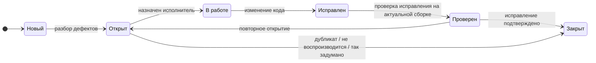

# Lecture 14: Баг-репорты

> **Модуль**: 7 — E2E и тестирование бизнес-сценариев
> **Тип**: Дополнительный блок к лекции 14 (30 минут)
> **Лектор**: Ольга Лихачева
> **Длительность**: 30 минут
> **Слайдов**: 18
> **Формат**: Markdown, каждый слайд — раздел `###`; визуальная версия — `SlidevSlides/slides/module-07/lecture-14-bug-reports.md`
> **Связь с материалами курса**: теория отчёта о дефекте — модуль 2, лекция 4, слайды 35–42 (определение, структура, severity и priority, единый шаблон); трёхзвенная проверка — лекция 13
> **Связь с практикой**: задание — [`practice-07.md`](../practice/practice-07.md); приёмка с 04.12.2026 по чек-листу этого блока
> **Дата**: 26.11.2026
> **Литература**: см. [Источники](#источники) в конце файла

---

## Тайминг (30 минут)

| Время | Блок | Слайды | Назначение |
|:---:|---|:---:|---|
| 0:00–0:04 | Определение и назначение | 1–4 | Что считается отчётом, кому он адресован, критерии качества |
| 0:04–0:12 | Структура и компоненты | 5–10 | Ядро и атрибуты; заголовок, шаги, результаты, доказательства, связи |
| 0:12–0:19 | Оценки и жизненный цикл | 11–13 | Severity и priority; состояния, варианты разрешения, схема переходов |
| 0:19–0:23 | Исследование качества отчётов | 14 | Данные 2025 года о выявлении пропущенных полей |
| 0:23–0:28 | Разбор примера и чек-лист | 15–16 | Отчёт по сквозному прогону; чек-лист самопроверки |
| 0:28–0:30 | Источники и вопросы | 17–18 | Литература курса и современные источники |

---

### Ключевые положения блока (памятка лектору)

1. Отчёт оценивается по воспроизводимости, а не по факту обнаружения дефекта.
2. Ядро отчёта: заголовок, шаги воспроизведения, ожидаемый и фактический результат.
3. Качество отчёта измеримо: атомарность, краткость, полнота, понятность, воспроизводимость.
4. Severity устанавливает автор отчёта, priority устанавливают на разборе дефектов; оценки независимы.
5. Доказательства прикладываются до назначения исполнителя.

---

### Слайд 1. Баг-репорты

**Слайд:**

- Лекция 14. Баг-репорты
- Ольга Лихачева · Lekton
- 4 курс
- 26 ноября · Четверг 13:30–15:00

**Speaker notes:**

> Этот блок идёт тридцать минут, и тема у него практическая: как оформить найденный дефект так, чтобы его взяли в работу без уточняющих вопросов. Теорию отчёта вы слышали в модуле 2, на лекции 4: определение, различие важности и срочности, единый шаблон курса из восьми полей. Сегодня утром на лекции 13 мы разбирали сквозное тестирование и три звена проверки: ответ, состояние, след. Завтра на практике 7 ваш набор прогонится против сборки с пятью внесёнными дефектами, и баг-репорты по найденному дадут три балла из шести, то есть половину оценки за модуль. Приёмка 4 декабря, проверять будут по чек-листу из этого блока. Поэтому полчаса работаем плотно.

---

### Слайд 2. План блока

**Слайд:**

- Определение баг-репорта
- Для чего нужен отчёт
- Структура отчёта
- Компоненты и их назначение
- Severity, priority и жизненный цикл дефекта
- Исследование качества отчётов
- Разбор примера и чек-лист самопроверки

**Speaker notes:**

> План повторяет порядок, в котором о теме думает человек, пишущий первый отчёт. Сначала договоримся, что вообще считать отчётом и кому он адресован. Потом разберём структуру и пройдём по каждому полю отдельно: заголовок, шаги, результаты, доказательства, связи. После этого поговорим об оценках и о пути дефекта до закрытия. Затем я покажу свежее исследование о том, какие поля авторы пропускают чаще всего, и в конце мы вместе разберём готовый отчёт из практики 7 и чек-лист, по которому 4 декабря будут принимать ваши работы. Пример намеренно стоит в конце: сначала правила, потом их сборка.

---

### Слайд 3. Определение баг-репорта

**Слайд:**

- Баг-репорт (defect report) фиксирует расхождение между ожидаемым и фактическим поведением системы и содержит данные, достаточные для воспроизведения дефекта и оценки его влияния.
- Что фиксирует
- Расхождение с требованием, спецификацией или контрактом между сервисами.
- Условия, при которых расхождение наблюдается.
- Последствия для потребителя.
- Чем отчёт отличается от неформального сообщения
- Хранение в трекере и уникальный идентификатор.
- Жизненный цикл: от заведения до проверки исправления.
- Связь с требованием, тест-кейсом или исследовательской сессией.

**Speaker notes:**

> Определение на слайде стоит на двух источниках: ISTQB CTFL, раздел 6.6.2, и учебник Шпильнера, раздел 6.6. Отчёт о дефекте фиксирует расхождение между ожидаемым и фактическим поведением системы и несёт сведения, по которым дефект можно воспроизвести и оценить его влияние. Вы это определение уже слышали в модуле 2; сегодня я добавлю уточнение, которое на лекции 4 осталось за кадром. Ожидаемое поведение всегда откуда-то берётся: из требования, спецификации, контракта между сервисами или технического задания. Фраза «так работать не должно» источником не считается, и отчёт без указания нормы у нас возвращают на уточнение.
>
> Правая колонка показывает, чем отчёт отличается от сообщения в чате или разговора у стены. У отчёта есть идентификатор, он хранится в трекере, у него есть жизненный цикл от заведения до проверки исправления, и он связан с требованием, тест-кейсом или исследовательской сессией. Сообщение в чате умирает через два дня; отчёт переживает релизы.
>
> Отдельно зафиксирую различие, которое всплывёт на приёмке: дефект живёт в системе, а отчёт живёт в трекере. Найти дефект и оставить его неописанным можно; тогда он доживёт до продакшена. Написать отчёт о том, чего нет, тоже можно; тогда разработчик потратит день на несуществующую проблему. Хороший отчёт держится на проверяемом соответствии между этими двумя мирами.

---

### Слайд 4. Для чего нужен отчёт

**Слайд:**

- Кому адресован
- Разработчику: воспроизвести дефект и найти причину. Нужны шаги и данные.
- Тест-менеджеру и менеджеру продукта на разборе дефектов: спланировать исправление. Нужны severity и priority.
- Менеджеру продукта: оценить влияние на потребителя и риск для выпуска.
- Критерии оценки отчёта
- Воспроизводимость: дефект повторяется по описанным шагам.
- Локализуемость: понятно, какой объект и какое правило затронуты.
- Обоснованность: ожидание опирается на требование.
- Цена неполного отчёта. Возврат на уточнение добавляет цикл ожидания. При постоянном потоке дефектов срок определяется не разработкой, а числом таких возвратов.

**Speaker notes:**

> Отчёт пишется для того, чтобы решение об исправлении принимали по документу, без переписки и пересказа. Читателей у него три, и каждому нужна своя часть. Разработчик воспроизводит дефект у себя и ищет причину: ему нужны шаги и данные. На разборе дефектов тест-менеджер и менеджер продукта ставят исправление в план: им нужны оценки важности и срочности. Менеджер продукта оценивает, сколько потребителей затронуто, есть ли обходной путь и что будет, если отложить исправление на следующий выпуск.
>
> Критерии качества вы знаете из модуля 2, и они никуда не делись: воспроизводимость, локализуемость, обоснованность. Воспроизводимость значит, что дефект повторяется по описанным шагам. Локализуемость значит, что понятно, какой объект и какое правило затронуты. Обоснованность значит, что ожидание опирается на требование. На приёмке практики 7 проверяющий смотрит ровно на эти три вещи.
>
> Про цену неполного отчёта честно скажу так. Каждый возврат на уточнение добавляет полный цикл ожидания: отчёт уходит назад, вы отвечаете, он снова встаёт в очередь. Когда дефектов поток, срок исправления задаёт число таких возвратов, и скорость разработки уходит на второй план. Тут студенты обычно спрашивают: зачем документ, если решение принимает один человек? Мой ответ: через месяц этот один человек уже другой. Отчёт вы пишете для читателя, которого не знаете: дежурного в воскресенье, разработчика соседней команды или себя самого в марте.

---

### Слайд 5. Структура отчёта

**Слайд:**

| Часть отчёта | Что входит | Назначение |
|---|---|---|
| Ядро | Заголовок, шаги воспроизведения, ожидаемый и фактический результат | Без ядра дефект нельзя повторить и понять |
| Атрибуты | Идентификатор, окружение, версия, дата, статус | Учёт и статистика по дефектам |
| Оценки | Severity и priority | Порядок исправления и оценка ущерба |
| Связи | Требование, тест-кейс, связанные дефекты | Прослеживаемость и история исправлений |
| Вложения | Ответы сервисов, снимки состояния, логи | Подтверждение наблюдения и ускорение разбора |

**Speaker notes:**

> Вся таблица делится на пять частей, и первая из них обязательна безусловно: ядро. Это заголовок, шаги воспроизведения, ожидаемый результат и фактический результат. Без этих четырёх полей дефект нельзя ни повторить, ни понять, поэтому отчёт с заполненными атрибутами и пустым ядром к разбору не принимается. Остальные четыре части работают вокруг ядра: атрибуты обеспечивают учёт и статистику, оценки задают порядок исправления и меру ущерба, связи дают прослеживаемость и историю, вложения подтверждают наблюдение.
>
> Из такого разделения следует и порядок работы над отчётом. Сначала вы формулируете ядро, потом дописываете окружение и версию, затем проставляете оценки, после этого связи и вложения. Заметьте, что читают отчёт в другом порядке, чем пишут: читатель начинает с заголовка, потом идёт в шаги и дальше по остальному. Следующие четыре слайда мы пройдём по компонентам в том же читательском порядке: заголовок, шаги, результаты, доказательства, потом связи, и отдельно оценки с жизненным циклом.
>
> Почему ядро именно такое, тоже понятно из читательских задач. Заголовок нужен, чтобы найти дефект среди сотен похожих. Шаги нужны, чтобы повторить его на своём стенде. Пара ожиданий и фактов нужна, чтобы расхождение было видно глазами, без веры автору на слово.

---

### Слайд 6. Компонент 1. Заголовок

**Слайд:**

- Назначение и требования
- По заголовку дефект ищут в трекере и группируют при разборе дефектов.
- Конструкция: объект, условие, наблюдаемое отклонение.
- Проверка: условие воспроизведения понятно без открытия отчёта.
- Заголовок описывает проблему, а не предполагаемое решение.
- Примеры
- Неудачно: «не работает оплата».
- Неудачно: «ошибка в авторизации».
- Удачно: «транзакция одобрена при сумме выше дневного лимита вместо отказа с кодом 61».
- Удачно: «запись транзакции отсутствует в логе более 5 секунд после ответа с кодом 00».

**Speaker notes:**

> Заголовок у отчёта самое читаемое поле. По нему ищут похожие дефекты перед заведением нового, по нему группируют список на разборе, по нему отчёт вспоминают через месяц после закрытия. Поэтому конструкция у него строгая: объект, условие, наблюдаемое отклонение. Проверка одна: условие воспроизведения должно быть понятно человеку, который отчёт ещё не открывал.
>
> Сравните пары из правой колонки. «Не работает оплата» и «ошибка в авторизации» условия не задают: оплата и авторизация это по полсистемы, и открывать отчёт придётся в любом случае. «Транзакция одобрена при сумме выше дневного лимита вместо отказа с кодом 61» задаёт условие целиком: видно объект, видно, при чём ломается, видно отклонение. Второй удачный пример тоже из нашей системы: «запись транзакции отсутствует в логе более 5 секунд после ответа с кодом 00». Условие и норма названы, гипотез о причине нет.
>
> Второе требование касается содержания: заголовок описывает поведение системы, а гипотезу о причине оставляет разработчику. Формулировка вроде «нужно исправить сравнение лимита» ломает отчёт, если гипотеза окажется неверной. Тут есть нюанс, о котором меня спрашивают каждый год: почему «ошибка в авторизации» плохо, если это факт? Как факт это честно; как заголовок не работает: ни поиска похожих, ни условия. Проверка у меня дома такая: читаю заголовок коллеге и спрашиваю, что он пойдёт делать. Если ответ «открою отчёт», заголовок надо переписать.

---

### Слайд 7. Компонент 2. Шаги воспроизведения

**Слайд:**

- Что включает шаг
- Начальное состояние: явно описанные предусловия.
- Точка входа: конкретный элемент интерфейса, через который выполняется операция: метод и адрес API, экран, команда.
- Данные, влияющие на результат: идентификаторы, значения полей, статусы.
- Порядок действий и ожидание на каждом шаге.
- Требование специфичности
- Запись «отправил запрос, не прошло» шагом не считается.
- Указываются объект, данные, точка входа и порядок операций.
- Повторяемость фиксируется числами: «3 раза из 3», «1 раз из 5».
- Шаги не должны требовать знания внутреннего устройства системы.

**Speaker notes:**

> По шагам воспроизведения отчёты возвращают чаще, чем по любому другому полю. Требование к ним сформулировал Куликов в разделе 2.5: каждый шаг специфичен, и по нему дефект воспроизводит другой человек. Запись «отправил запрос, не прошло» шагом не считается: в ней нет ни объекта, ни данных, ни точки входа.
>
> Что входит в нормальный шаг, видно в левой колонке. Начало это явно описанное состояние: какие сущности созданы и в каком они статусе. Дальше точка входа: конкретный метод и адрес API, экран или команда, через которые выполняется операция. Затем данные, влияющие на результат: идентификаторы, значения полей, статусы. Они нужны разработчику для поиска дефекта в базе и в логах; тут напрямую работает сегодняшняя лекция 13 про точки наблюдения. И наконец порядок действий с ожиданием на каждом шаге, который превращает пересказ в проверяемую последовательность.
>
> Отдельно о нестабильных дефектах. Если дефект наблюдается через раз, частоту пишут числами: «3 раза из 3» или «1 раз из 5». Такая запись отличает периодический дефект от неудачной попытки повторить и сразу говорит, сколько времени уйдёт на разбор. И честно скажу про главную учебную ошибку: шаги пишут по памяти и выбрасывают то, что «и так ясно»: создание карты, её статус, лимиты. Вам ясно сегодня; разработчику через месяц уже нет. Проверка полноты у вас одна: повторите дефект по своим шагам на чистом стенде сами. Не получилось: значит, шаги неполные.

---

### Слайд 8. Компонент 3. Ожидаемый и фактический результат

**Слайд:**

- Требования к полям
- Оба результата конкретны и сравнимы между собой.
- Ожидание опирается на требование, спецификацию или контракт.
- Фактический результат содержит наблюдаемые данные: код, тело ответа, значения полей.
- Сравнение двух полей делает дефект подтверждённым.
- Особенность сквозного уровня
- Ожидание описывает цепочку целиком, включая отложенные последствия.
- Фактический результат фиксируется по звеньям: ответ, состояние, след.
- Отчёт описывает наблюдаемое поведение, а не предполагаемого виновника.
- Источник ожиданий приводится явно: пункт ТЗ или контракт.

**Speaker notes:**

> Эти два поля превращают рассказ о дефекте в проверяемое утверждение. Запись «ожидалось корректное поведение» проверке не поддаётся, потому что норма в ней не названа. Запись «ожидался код 400 с телом VALIDATION_ERROR» проверяется сразу: норма есть, отклонение видно. Оба поля должны быть конкретными и сравнимыми между собой, а их сопоставление и делает дефект подтверждённым.
>
> На сквозном уровне, с которым вы работали сегодня утром на лекции 13, картина шире. Ожидание описывает цепочку целиком, включая отложенные последствия операции. Фактический результат вы фиксируете по трём звеньям: ответ внешней границы, состояние данных, асинхронный след. Завтра в практике 7 это будет ваш рабочий формат: дефект в сборке может не показать себя в ответе и всплыть только в состоянии или в следе.
>
> Ещё одна дисциплина этого поля: отчёт описывает наблюдаемое поведение и не назначает виновника. Записи вроде «сломан Switch» или «не работает брокер» вы заменяете тем, что видели глазами; вывод о причине делает разработчик. И источник ожидания приводится явно: пункт технического задания или контракт. Меня тут спрашивают: что делать, если я не знаю, каким должен быть ожидаемый результат? Честный ответ: тогда писать отчёт рано. Сначала ищете норму; если нормы нет, у вас заметка для исследования, и разница с отчётом принципиальная.

---

### Слайд 9. Компонент 4. Доказательства

**Слайд:**

- Что прикладывают
- Ответы сервисов: коды и тела запросов и ответов.
- Снимок состояния данных до и после операции.
- Записи в логах и содержимое очереди недоставленных сообщений.
- Идентификаторы для поиска: stan, rrn, PAN, время операции.
- Зачем и в каком объёме
- Подтверждение наблюдения: разработчик видит данные, а не пересказ.
- Сокращение пути до воспроизведения.
- Прикладываются до назначения исполнителя.
- Избыточные вложения увеличивают время разбора.

**Speaker notes:**

> Доказательства отвечают на один вопрос читателя: откуда известно, что дефект существует. Прикладывают ответы сервисов с кодами и телами, снимок состояния данных до операции и после, записи в логах, содержимое очереди недоставленных сообщений. Отдельно указывают идентификаторы, по которым всё это ищется: stan, rrn, PAN, время операции. По этим ссылкам разработчик находит транзакцию в базе и сообщение в очереди, не повторяя ваш сценарий целиком; это и есть сокращение пути до воспроизведения.
>
> С объёмом вложений у студентов две крайности. Первый сдаёт отчёт без единого файла, второй кладёт триста строк лога. Обе крайности означают одно: доказательства нет, в первом случае из-за отсутствия, во втором из-за того, что найти его невозможно. Рабочее правило у меня такое: приложите ровно то, что меняет ответ на вопрос «дефект есть или нет». Тело ответа, снимок баланса, две записи в логе хватит; остальное разработчик доберёт сам по вашим идентификаторам.
>
> Из инженерной практики пришло ещё одно требование: вложения прикладывают до назначения исполнителя. Отчёт, ушедший без доказательств, вернётся с запросом, и вы потеряете полный цикл. Тут есть нюанс, который коснётся вас завтра: на сквозном прогоне соблазн приложить всё подряд, потому что данных много. Сопротивляйтесь: триста строк лога читаются дольше, чем повторение сценария, и разбор в итоге замедляется.

---

### Слайд 10. Компонент 5. Связи и прослеживаемость

**Слайд:**

- Что указывается
- Идентификатор дефекта и версия, в которой он найден.
- Требование, спецификация или контракт, которые нарушены.
- Сценарий или исследовательская сессия, в ходе которых дефект найден.
- Связанные дефекты: дубликаты и родственные проявления.
- Зачем это нужно
- Обоснованность: ссылка на требование показывает, какое правило нарушено.
- Место поиска: разработчик понимает, в какой части системы искать причину.
- История: при повторном открытии видно, что уже исправлялось.
- Проверка: по связи видно, найден дефект прогоном или предположен.

**Speaker notes:**

> О связях и идентификаторах говорят редко, а ведь они превращают кипу записей в систему учёта дефектов. Идентификатор нужен для ссылок: на него ссылаются в отчёте о прогоне, в ветке с исправлением, в заметках к выпуску. Версия, в которой дефект найден, фиксирует точку наблюдения. Связь с требованием показывает, какое правило нарушено, и одновременно подсказывает, в какой части системы искать причину. Связь со сценарием или исследовательской сессией показывает, как дефект найден: прогоном набора или исследованием.
>
> На приёмке я вижу две повторяющиеся ошибки. Первая: отчёт без ссылки на требование и на сценарий. Такой текст проверить нельзя, и он уходит на доработку целиком. Вторая ошибка всплывает при повторном проявлении: вместо связи со старым отчётом заводят новую запись, история теряется, и разработчик разбирает тот же случай заново.
>
> Разницу между шагами и связью со сценарием объясняю каждый год. Шаги отвечают, как повторить; связь отвечает, откуда дефект взялся и где искать родственные проявления. Отметка SC-003 говорит проверяющему, что дефект найден прогоном сквозного набора, что повышает и доверие к отчёту, и точность поиска в коде. Завтра, когда ваш набор найдёт что-то из пяти внесённых дефектов, номер сценария в связях станет для меня первым признаком системной работы.

---

### Слайд 11. Severity и priority

**Слайд:**

| Оценка | Что означает | Кто устанавливает |
|---|---|---|
| Severity (важность) | Степень влияния дефекта на работу системы | Автор отчёта при заведении |
| Priority (срочность) | Порядок исправления с учётом релиза и договорённостей | Тест-менеджер или менеджер продукта на разборе дефектов |
| Шкала оценок | Перечень допустимых значений, единый для всех отчётов проекта: например, Blocker, Critical, Major, Minor | Тест-менеджер |
| Расхождение оценок | Опечатка в тексте перед демонстрацией заказчику: важность низкая, срочность высокая | Разбор дефектов |

**Speaker notes:**

> Важность и срочность: две независимые оценки одного дефекта, и вы это слышали ещё в модуле 2, на лекции 4. Важность измеряет ущерб: насколько сильно дефект влияет на работу системы. Срочность измеряет очередь: что чинят в ближайшем релизе, что откладывают. Различаются оценки и по авторам. Важность предлагает автор отчёта, потому что он видел поведение системы. Срочность назначают на разборе дефектов тест-менеджер или менеджер продукта, потому что она зависит от плана релиза и договорённостей с заказчиком, которых у автора может не быть.
>
> Шкала из третьей строки таблицы существует ради сравнимости: перечень допустимых значений, скажем Blocker, Critical, Major, Minor, задаётся проектом один раз. Иначе слово «высокая» у разных авторов означает разное. Последняя строка показывает законное расхождение: опечатка на видном месте перед демонстрацией заказчику: систему она не ломает, важность низкая; исправить её надо первой, срочность высокая. Важность пересматривают только при новых данных о влиянии; срочность могут поменять в любой момент.
>
> Две типовые ошибки встречаю в учебных работах постоянно. Первая: завышение важности во всех отчётах, после чего шкала перестаёт что-либо сообщать. Вторая: смешение оценок, когда важность ставят по желаемой срочности. Тут студенты обычно спрашивают: могу ли я как автор поднять срочность, потому что дефект мешает лично мне? Мешает вам: это влияние на вас, и для системы оно косвенное. Если дефект блокирует работу группы, опишите это в отчёте как аргумент для разбора, а решение о срочности оставьте встрече.

---

### Слайд 12. Жизненный цикл дефекта

**Слайд:**

- Состояния
- Новый, открыт, в работе, исправлен, проверен, закрыт.
- Проверка исправления выполняется на актуальной сборке.
- Повторное открытие допускается для того же дефекта после неудачного исправления.
- Каждый переход сопровождается записью в истории отчёта.
- Варианты разрешения
- Исправлен: изменение кода устраняет дефект.
- Дубликат: дефект заведён ранее, отчёты связываются.
- Воспроизвести не удалось: чаще всего следствие неполного отчёта.
- Так задумано: поведение соответствует спецификации.
- Новый отчёт: заводится, когда совпадает симптом, но причина иная.

**Speaker notes:**

> Знать жизненный цикл автору нужно, чтобы понимать, что происходит с его отчётом после отправки. Основная линия состояний: новый, открыт, в работе, исправлен, проверен, закрыт. Каждый переход оставляет запись в истории отчёта. Проверку исправления выполняют на актуальной сборке, на той, где дефект нашли, проверять бессмысленно.
>
> Из пяти вариантов разрешения два поясню подробнее. «Воспроизвести не удалось» в большинстве случаев говорит о нехватке сведений в отчёте: окружения, данных, условий; оно редко означает, что дефекта не существует. «Дубликат» означает, что дефект заведён ранее, и тогда отчёты связывают, сохраняя оба. Ещё одно тонкое различие: повторное открытие применяют, когда совпадают и шаги, и симптом после неудачного исправления; новый отчёт заводят, когда совпадает только симптом, а причина другая.
>
> Для практики 7 тут лежит критерий приёмки: если проверяющий 4 декабря не сможет повторить дефект по вашим шагам, отчёт уходит как неполный, что бы ни показал ваш прогон. И ещё одно уточнение про состояние «проверен»: это состояние автора отчёта, его или его команды. Вы проверяете исправление теми же шагами на актуальной сборке; с неполными шагами вы не проверите и само исправление. Получается замкнутый круг: качество шагов сегодня определяет вашу возможность закрыть дефект через неделю.

---

### Слайд 13. Жизненный цикл дефекта: схема

**Слайд:**

**Speaker notes:**

> Схема повторяет линию прошлого слайда и добавляет к ней два наблюдения, которые по тексту не видны. Первое: обратный переход на ней ровно один, из состояния «проверен» в состояние «открыт». Это и есть повторное открытие после неудачного исправления. Все остальные стрелки идут вперёд. Второе наблюдение: боковые выходы в «закрыт» без изменения кода: дубликат, «воспроизвести не удалось», «так задумано». Отчёт, остановившийся в таком выходе, никуда не пропадает: он остаётся в истории и связывается с будущими проявлениями того же поведения.
>
> Если читать схему слева направо глазами автора, видно и самое длинное ожидание: переход из «открыт» в «в работе». Он зависит от расписания разбора дефектов и от приоритета, то есть от людей, которых вы на этом этапе не контролируете. Косвенно вы на него влияете: полный воспроизводимый отчёт с оценками разбирается быстрее, чем тот, по которому надо созваниваться.
>
> Меня иногда спрашивают: зачем нужно состояние «проверен», если разработчик уже сказал, что починил? Потому что слово разработчика это утверждение, а «проверен» это подтверждённый факт на актуальной сборке. Практика знает немало дефектов, которые чинили по два раза, а они живы до сих пор. В состоянии «проверен» ответственность возвращается к автору, и именно поэтому ваши шаги из компонента 2 должны пережить неделю без ваших устных комментариев.

---

### Слайд 14. Исследование: качество отчётов

**Слайд:**

- Вопрос и метод
- Можно ли автоматически приводить неструктурированный отчёт к шаблону и указывать пропущенные поля.
- Три открытые модели с инструктивной донастройкой и ChatGPT-4o для сравнения.
- Качество измерялось по сводной метрике: атомарность, краткость, полнота, понятность, воспроизводимость.
- Результаты
- Лучшая модель: 77 процентов по сводной метрике; альтернативы 71 и 63 процента.
- ChatGPT-4o в режиме трёх примеров: 75 процентов.
- На незнакомых проектах качество сохраняется, до 70 процентов.
- Лучше всего модели находят отсутствующие ожидаемый и фактический результат; шаги воспроизведения, F1 76 процентов.
- Вывод для курса. Пропущенные поля выявляются автоматически, поэтому самопроверка перед отправкой имеет смысл. Источник: Acharya, Ginde, 2025, EASE; arXiv:2504.18804.

**Speaker notes:**

> Теперь данные вместо моих слов. В 2025 году на конференции EASE представили работу Ачарьи и Гинде; препринт лежит на arXiv под номером 2504.18804. Вопрос они ставили такой: можно ли автоматически приводить неструктурированный отчёт к шаблону и подсказывать автору, какие обязательные поля он пропустил, ещё до отправки.
>
> Метод: три открытые модели с инструктивной донастройкой и для сравнения ChatGPT-4o. Качество измеряли сводной метрикой из пяти свойств: атомарность, краткость, полнота, понятность, воспроизводимость. Лучший результат показала дообученная Qwen 2.5 с 77 процентами; Mistral набрала 71, Llama 3.2 набрала 63, а ChatGPT-4o в режиме трёх примеров показал 75. На проектах, которых модели раньше не видели, среди них Eclipse и GCC, качество держалось на уровне до 70 процентов.
>
> Для нас ценна одна отдельная задача из их работы. Лучше всего модели распознают отсутствующие поля: в первую очередь ожидаемый и фактический результат, а на шагах воспроизведения метрика F1 составила 76 процентов. Вывод из работы я формулирую так: пропуски в отчёте выявляются автоматически, значит, ручная самопроверка перед отправкой тем более осмысленна. На приёмке 4 декабря я делаю то же, что модель: сначала ищу пропущенные поля по чек-листу и только потом читаю текст целиком. Две минуты самопроверки вечером среды сэкономят вам полный цикл возврата.

---

### Слайд 15. Разбор примера отчёта

**Слайд:**

- BR-002. Повтор авторизации с тем же stan создаёт второй резерв.
- Связи: требование идемпотентности авторизации, сценарий SC-003. Severity: критическая. Priority: высокий.
- Шаги. 1. Поднять стенд, дождаться готовности сервисов. 2. Создать карту ACTIVE: баланс 10 000, лимиты 50 000 и 500 000, зафиксировать PAN. 3. Отправить POST /api/transactions: mti 0100, сумма 150 000, stan 000042, terminalId TERM001, merchantId MERCH00000000042. 4. Зафиксировать ответ и rrn. 5. Повторить запрос без изменений. 6. Запросить состояние карты и список резервов.
- Ожидалось: повторный запрос возвращает исходный rrn, резерв остаётся один. Получено: второй ответ APPROVED с новым rrn; два холда на карту; баланс уменьшился на 300 000.
- Доказательства: оба тела ответа Gateway (один stan, разные rrn), снимок баланса и списка резервов, две записи в логе с одним stan. Воспроизводится 3 раза из 3.

**Speaker notes:**

> Перед вами отчёт BR-002 по дефекту, который сквозной прогон нашёл на учебном стенде. Пройдёмся по нему как проверяющие. Заголовок: «Повтор авторизации с тем же stan создаёт второй резерв». Есть объект, условие, отклонение; по нему можно искать похожие. Связи на месте: требование идемпотентности авторизации и сценарий SC-003.
>
> Шаги дают начальное состояние: поднятый стенд, карта ACTIVE с балансом 10 000 и лимитами 50 000 и 500 000, зафиксированный PAN. Точка входа названа точно: POST /api/transactions с mti 0100, суммой 150 000, stan 000042, терминалом TERM001 и мерчантом MERCH00000000042. Суть дефекта в повторе, поэтому пятый шаг отправляет запрос без изменений; шестой смотрит состояние карты и список резервов. Ожидание опирается на требование: повторный запрос вернёт исходный rrn, резерв останется один. Факт собран по звеньям лекции 13: второй ответ APPROVED с новым rrn, два холда на карте, баланс уменьшился на 300 000. Версий о причине ноль.
>
> Доказательства лежат по тем же трём звеньям: оба тела ответа Gateway с одним stan и разными rrn, снимок баланса и резервов, две записи в логе с одним stan. Воспроизводимость указана: три раза из трёх. Оценки тоже читаются: важность критическая, потому что деньги клиента заблокированы дважды и при клиринге это обернётся двойным списанием; срочность высокая, потому что идемпотентность входной границы относится к критичным для выпуска свойствам. Каждое поле здесь отвечает на один вопрос читателя; отчёт без ответа хотя бы на один уходит назад, и это конструкция процесса.

---

### Слайд 16. Чек-лист самопроверки

**Слайд:**

- Ядро отчёта
- Дефект воспроизведён дважды, а не однократно.
- Заголовок содержит объект, условие и отклонение.
- В шагах есть начальное состояние, точка входа, данные и ожидание на шаге.
- Ожидаемый результат опирается на требование или контракт.
- Оценки, связи, вложения
- Приложены доказательства: ответ, состояние данных, записи в логах.
- Указаны severity и priority, важность обоснована влиянием.
- Указана связь с требованием и со сценарием SC-NNN.
- Проверено, что такой дефект ещё не заведён: поиск по объекту и условию.
- Отчёт проверен на актуальной сборке.

**Speaker notes:**

> Этот чек-лист собран из всего, что мы разобрали за последние полчаса, и именно по нему 4 декабря будут принимать практику 7. Проверка занимает несколько минут, если отчёт перед вами.
>
> Левая колонка про ядро. Первый пункт, воспроизведение дважды, отсеивает единичные наблюдения: поведение, замеченное один раз, относится к результатам исследовательской сессии, и в отчёт оно попадает с честно указанной частотой. Дальше заголовок с объектом, условием и отклонением; шаги с начальным состоянием, точкой входа, данными и ожиданием на каждом шаге; ожидание, опирающееся на требование или контракт. Правая колонка про остальное: доказательства по трём звеньям, обе оценки с обоснованной важностью, связь с требованием и со сценарием вида SC-NNN, проверка на актуальной сборке.
>
> Отдельный пункт про дубликаты выполняется в трекере: ищете по объекту и условию до отправки. Найденный дубликат остаётся в трекере и связывается с прежним отчётом; так история сохраняется. Что вернётся на доработку без разговоров: отчёт без вложений, без связи с требованием, с ожиданием в духе «должно работать корректно». Тут студенты обычно спрашивают: обязателен ли чек-лист, если я и так всё помню? Особенно тогда, когда помните. Он ловит усталость: пятый отчёт в вечер сдачи пишется заметно хуже первого утреннего, и чек-лист эту разницу выравнивает.

---

### Слайд 17. Источники

**Слайд:**

- Материалы курса
- [1] ISTQB CTFL v4.0, раздел 6.6.2. Отчёт о дефекте: условия воспроизведения, ожидаемый и фактический результат, оценка влияния.
- [2] Spillner, A., et al. Software Testing Foundations, раздел 6.6. Шаблон отчёта, severity и priority.
- [3] Куликов, С. С. Тестирование программного обеспечения, раздел 2.5. Структура отчёта, требования к шагам, типичные ошибки.
- [4] Bach, J., & Bolton, M. Lessons Learned in Software Testing. Стоимость обработки отчёта.
- [5] ISO/IEC/IEEE 29119-3. Документация тестирования.
- Современные источники
- [6] Acharya, J., & Ginde, G. (2025). Can We Enhance Bug Report Quality Using LLMs? EASE 2025; arXiv:2504.18804.
- [7] Towards enhancing the reproducibility of deep learning bugs (2025). Empirical Software Engineering.
- [8] An empirical study on the capability of LLMs in decomposing bug reports (2026). Information and Software Technology.
- [9] QAPractices (2026). How to Write a Great Bug Report; Defect Report Template.

**Speaker notes:**

> Список источников разбит на две части. Первые пять: теория курса. Стандарт ISTQB, раздел 6.6.2; учебник Шпильнера, раздел 6.6; Куликов, раздел 2.5; книга Баха и Болтона про цену обработки отчёта; стандарт ISO/IEC/IEEE 29119-3 о документации. Дальше свежие работы: исследование Ачарьи и Гинде 2025 года с данными о пропущенных полях, статья о воспроизводимости дефектов глубокого обучения, работа 2026 года об автоматическом разложении сложного отчёта на отдельные дефекты и практические руководства QAPractices. Если читать одно: Куликов, раздел 2.5, он короткий и совпадает с нашей приёмкой почти слово в слово.

---

### Слайд 18. Вопросы

**Слайд:**

- _(визуальный слайд)_

**Speaker notes:**

> Время вопросов. Три вещи прошу унести с собой: отчёт ценится воспроизводимостью; важность и срочность ставят разные люди по разным основаниям; доказательства прикладывают до назначения исполнителя. Завтра на практике 7 вы напишете пять сквозных сценариев, прогоните их против сборки с пятью внесёнными дефектами и оформите найденное по шаблону. Приёмка 4 декабря, чек-лист вы только что видели. И если из всего блока останется одна фраза, пусть это будет: отчёт пишется для читателя, которого вы не знаете. Заголовок, шаги и доказательства: это уважение к его времени.

---
