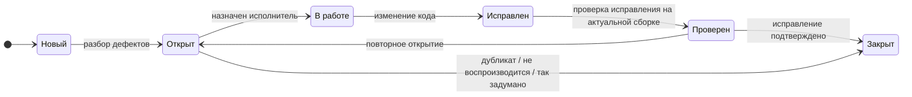

# Lecture 14: Баг-репорты

> **Модуль**: 7 — E2E и тестирование бизнес-сценариев
> **Тип**: Дополнительный блок к лекции 14 (30 минут)
> **Лектор**: Ольга Лихачева
> **Длительность**: 30 минут
> **Слайдов**: 18
> **Формат**: Markdown, каждый слайд — раздел `###`; визуальная версия — `SlidevSlides/slides/module-07/lecture-14-bug-reports.md`
> **Связь с материалами курса**: теория отчёта о дефекте — модуль 2, лекция 4, слайды 35–42 (определение, структура, severity и priority, единый шаблон); трёхзвенная проверка — лекция 13
> **Связь с практикой**: задание — [`practice-07.md`](../practice/practice-07.md); приёмка с 04.12.2026 по чек-листу этого блока
> **Дата**: 26.11.2026
> **Литература**: см. [Источники](#источники) в конце файла

---

## Тайминг (30 минут)

| Время | Блок | Слайды | Назначение |
|:---:|---|:---:|---|
| 0:00–0:04 | Определение и назначение | 1–4 | Что считается отчётом, кому он адресован, критерии качества |
| 0:04–0:12 | Структура и компоненты | 5–10 | Ядро и атрибуты; заголовок, шаги, результаты, доказательства, связи |
| 0:12–0:19 | Оценки и жизненный цикл | 11–13 | Severity и priority; состояния, варианты разрешения, схема переходов |
| 0:19–0:23 | Исследование качества отчётов | 14 | Данные 2025 года о выявлении пропущенных полей |
| 0:23–0:28 | Разбор примера и чек-лист | 15–16 | Отчёт по сквозному прогону; чек-лист самопроверки |
| 0:28–0:30 | Источники и вопросы | 17–18 | Литература курса и современные источники |

---

### Ключевые положения блока (памятка лектору)

1. Отчёт оценивается по воспроизводимости, а не по факту обнаружения дефекта.
2. Ядро отчёта: заголовок, шаги воспроизведения, ожидаемый и фактический результат.
3. Качество отчёта измеримо: атомарность, краткость, полнота, понятность, воспроизводимость.
4. Severity устанавливает автор отчёта, priority устанавливают на разборе дефектов; оценки независимы.
5. Доказательства прикладываются до назначения исполнителя.

---

### Слайд 1. Баг-репорты

**Слайд:**

- Лекция 14. Баг-репорты
- Ольга Лихачева · Lekton
- 4 курс
- 26 ноября · Четверг 13:30–15:00

**Speaker notes:**

> Блок на тридцать минут. Тема: как оформить найденный дефект так, чтобы его взяли в работу без уточняющих вопросов.
>
> Теория отчёта о дефекте разбиралась в модуле 2, лекция 4, слайды 35–42. Там были определение, различение severity и priority, единый шаблон курса. Здесь материал доводится до практики: разбирается каждый компонент отчёта, приводятся данные исследования о качестве отчётов, разбирается пример из практики 7.
>
> Порядок изложения: определение, назначение, структура, компоненты, оценки и жизненный цикл, исследование, разбор примера, чек-лист.

---

### Слайд 2. План блока

**Слайд:**

- Определение баг-репорта
- Для чего нужен отчёт
- Структура отчёта
- Компоненты и их назначение
- Severity, priority и жизненный цикл дефекта
- Исследование качества отчётов
- Разбор примера и чек-лист самопроверки

**Speaker notes:**

> Порядок блока повторяет вопросы, которые возникают у того, кто пишет первый отчёт.
>
> Сначала определение: что считается отчётом. Затем назначение: кому и зачем нужен документ. Дальше структура и компоненты: из чего отчёт состоит и зачем нужно каждое поле. После этого оценки и жизненный цикл: как дефект получает приоритет и какой путь проходит до закрытия. Затем данные исследования о том, какие поля пропускают чаще всего. В конце разбор конкретного отчёта и чек-лист, по которому проверяются работы на приёмке.

---

### Слайд 3. Определение баг-репорта

**Слайд:**

- Баг-репорт (defect report) фиксирует расхождение между ожидаемым и фактическим поведением системы и содержит данные, достаточные для воспроизведения дефекта и оценки его влияния.
- Что фиксирует
- Расхождение с требованием, спецификацией или контрактом между сервисами.
- Условия, при которых расхождение наблюдается.
- Последствия для потребителя.
- Чем отчёт отличается от неформального сообщения
- Хранение в трекере и уникальный идентификатор.
- Жизненный цикл: от заведения до проверки исправления.
- Связь с требованием, тест-кейсом или исследовательской сессией.

**Speaker notes:**

> Определение опирается на ISTQB CTFL, раздел 6.6.2, и на учебник Шпильнера, раздел 6.6. Отчёт фиксирует расхождение и данные для его воспроизведения. Дефект существует в коде, отчёт описывает наблюдение.
>
> Ожидаемый результат всегда имеет источник: требование, спецификацию, контракт или техническое задание. Формулировка «так работать не должно» источником не считается, и отчёт без источника возвращается на уточнение.
>
> Вторая часть слайда показывает разницу между отчётом и неформальным сообщением — устным или в переписке. Такое сообщение не имеет идентификатора, не хранится в системе учёта и не связано с требованием. Отчёт хранится в трекере, к нему возвращаются при проверке исправления и при разборе повторного дефекта.

---

### Слайд 4. Для чего нужен отчёт

**Слайд:**

- Кому адресован
- Разработчику: воспроизвести дефект и найти причину. Нужны шаги и данные.
- Тест-менеджеру и менеджеру продукта на разборе дефектов: спланировать исправление. Нужны severity и priority.
- Менеджеру продукта: оценить влияние на потребителя и риск для выпуска.
- Критерии оценки отчёта
- Воспроизводимость: дефект повторяется по описанным шагам.
- Локализуемость: понятно, какой объект и какое правило затронуты.
- Обоснованность: ожидание опирается на требование.
- Цена неполного отчёта. Возврат на уточнение добавляет цикл ожидания. При постоянном потоке дефектов срок определяется не разработкой, а числом таких возвратов.

**Speaker notes:**

> Назначение отчёта в том, чтобы решение об исправлении принималось по документу, без переписки и дополнительных вопросов. Решение принимают разные роли, и каждой нужна своя часть отчёта.
>
> Разработчику нужны шаги и данные: по ним он повторяет дефект у себя. На разборе дефектов нужны оценки, чтобы поставить исправление в план. Менеджеру продукта нужно влияние: сколько пользователей затронуто, есть ли обходной путь, что будет при отсрочке.
>
> Три критерия качества взяты из модуля 2 и остаются рабочими: воспроизводимость, локализуемость, обоснованность. На приёмке практики 7 проверяются те же три критерия. Отчёт, который невозможно повторить, считается неполным независимо от того, что дефект найден реально.

---

### Слайд 5. Структура отчёта

**Слайд:**

| Часть отчёта | Что входит | Назначение |
|---|---|---|
| Ядро | Заголовок, шаги воспроизведения, ожидаемый и фактический результат | Без ядра дефект нельзя повторить и понять |
| Атрибуты | Идентификатор, окружение, версия, дата, статус | Учёт и статистика по дефектам |
| Оценки | Severity и priority | Порядок исправления и оценка ущерба |
| Связи | Требование, тест-кейс, связанные дефекты | Прослеживаемость и история исправлений |
| Вложения | Ответы сервисов, снимки состояния, логи | Подтверждение наблюдения и ускорение разбора |

**Speaker notes:**

> Структура делится на пять частей. Ядро обязательно: заголовок, шаги, ожидаемый результат, фактический результат. Остальные части уточняют и подтверждают ядро.
>
> Разделение задаёт порядок работы. Сначала формулируется ядро, затем добавляются атрибуты окружения, затем оценки, затем связи и вложения. Отчёт, в котором заполнены атрибуты, но нет ядра, разбору не подлежит.
>
> Следующие четыре слайда разбирают компоненты по отдельности: заголовок, шаги, результаты, вложения. Затем отдельный слайд про оценки и ещё один про связи. Такой порядок соответствует тому, как читают отчёт: сначала заголовок, потом шаги, потом всё остальное.

---

### Слайд 6. Компонент 1. Заголовок

**Слайд:**

- Назначение и требования
- По заголовку дефект ищут в трекере и группируют при разборе дефектов.
- Конструкция: объект, условие, наблюдаемое отклонение.
- Проверка: условие воспроизведения понятно без открытия отчёта.
- Заголовок описывает проблему, а не предполагаемое решение.
- Примеры
- Неудачно: «не работает оплата».
- Неудачно: «ошибка в авторизации».
- Удачно: «транзакция одобрена при сумме выше дневного лимита вместо отказа с кодом 61».
- Удачно: «запись транзакции отсутствует в логе более 5 секунд после ответа с кодом 00».

**Speaker notes:**

> Заголовок читают чаще остальных полей. По нему ищут похожие дефекты перед заведением, по нему группируют список при разборе дефектов, по нему отчёт вспоминают через месяц.
>
> Требование к заголовку одно: из него должно быть понятно условие воспроизведения. Формулировка «транзакция одобрена при сумме выше дневного лимита» задаёт условие сразу. Формулировка «ошибка в авторизации» условия не задаёт, и открывать отчёт всё равно придётся.
>
> Второе требование относится к содержанию. Заголовок описывает поведение системы, а не гипотезу о причине. Формулировка «нужно исправить сравнение лимита» относится к типичным ошибкам: если гипотеза неверна, отчёт теряет смысл.

---

### Слайд 7. Компонент 2. Шаги воспроизведения

**Слайд:**

- Что включает шаг
- Начальное состояние: явно описанные предусловия.
- Точка входа: конкретный элемент интерфейса, через который выполняется операция: метод и адрес API, экран, команда.
- Данные, влияющие на результат: идентификаторы, значения полей, статусы.
- Порядок действий и ожидание на каждом шаге.
- Требование специфичности
- Запись «отправил запрос, не прошло» шагом не считается.
- Указываются объект, данные, точка входа и порядок операций.
- Повторяемость фиксируется числами: «3 раза из 3», «1 раз из 5».
- Шаги не должны требовать знания внутреннего устройства системы.

**Speaker notes:**

> Шаги воспроизведения это поле, по которому чаще всего возвращают отчёты. Требование к ним сформулировал Куликов в разделе 2.5: шаг должен быть специфичным и воспроизводимым другим человеком.
>
> Три элемента пропускают чаще всего. Первый: начальное состояние. Без него неизвестно, какой объект участвовал и в каком он был состоянии. Второй: данные, влияющие на результат. Идентификаторы и значения полей нужны не для отчёта как такового, а для поиска дефекта в базе и в логах. Третий: ожидание на каждом шаге, которое превращает описание действий в проверяемую последовательность.
>
> Если дефект наблюдается не при каждом прогоне, это указывается с числами. Такая фиксация отличает периодический дефект от неудачной попытки его повторить. По ней понятно, сколько времени уйдёт на разбор.

---

### Слайд 8. Компонент 3. Ожидаемый и фактический результат

**Слайд:**

- Требования к полям
- Оба результата конкретны и сравнимы между собой.
- Ожидание опирается на требование, спецификацию или контракт.
- Фактический результат содержит наблюдаемые данные: код, тело ответа, значения полей.
- Сравнение двух полей делает дефект подтверждённым.
- Особенность сквозного уровня
- Ожидание описывает цепочку целиком, включая отложенные последствия.
- Фактический результат фиксируется по звеньям: ответ, состояние, след.
- Отчёт описывает наблюдаемое поведение, а не предполагаемого виновника.
- Источник ожиданий приводится явно: пункт ТЗ или контракт.

**Speaker notes:**

> Ожидаемый и фактический результат превращают отчёт в проверяемое утверждение. Формулировка «ожидалось корректное поведение» проверке не поддаётся, потому что норма не названа. Формулировка «ожидался код 400 с телом VALIDATION_ERROR» проверяема: норма названа, отклонение видно сразу.
>
> На сквозном уровне ожидание описывает цепочку, а факт фиксируется по трём звеньям: ответ внешней границы, состояние данных, асинхронный след. Такой отчёт не назначает виновника. Записи вида «сломан Switch» или «не работает брокер» заменяются наблюдаемым поведением: вывод о причине делает разработчик.

---

### Слайд 9. Компонент 4. Доказательства

**Слайд:**

- Что прикладывают
- Ответы сервисов: коды и тела запросов и ответов.
- Снимок состояния данных до и после операции.
- Записи в логах и содержимое очереди недоставленных сообщений.
- Идентификаторы для поиска: stan, rrn, PAN, время операции.
- Зачем и в каком объёме
- Подтверждение наблюдения: разработчик видит данные, а не пересказ.
- Сокращение пути до воспроизведения.
- Прикладываются до назначения исполнителя.
- Избыточные вложения увеличивают время разбора.

**Speaker notes:**

> Доказательства отвечают на вопрос, откуда известно, что дефект существует. Они нужны разработчику: по данным из вложений он находит транзакцию в базе и сообщение в очереди, не повторяя сценарий целиком.
>
> Объём вложений ограничивается пользой. Пара «запрос и ответ» или короткая запись действий отвечает на несколько вопросов сразу. Полный набор логов увеличивает время разбора и не добавляет сведений.
>
> Правило из инженерной практики: вложения прикладываются до назначения исполнителя. Отчёт, отправленный без доказательств, возвращается с запросом, и цикл повторяется.

---

### Слайд 10. Компонент 5. Связи и прослеживаемость

**Слайд:**

- Что указывается
- Идентификатор дефекта и версия, в которой он найден.
- Требование, спецификация или контракт, которые нарушены.
- Сценарий или исследовательская сессия, в ходе которых дефект найден.
- Связанные дефекты: дубликаты и родственные проявления.
- Зачем это нужно
- Обоснованность: ссылка на требование показывает, какое правило нарушено.
- Место поиска: разработчик понимает, в какой части системы искать причину.
- История: при повторном открытии видно, что уже исправлялось.
- Проверка: по связи видно, найден дефект прогоном или предположен.

**Speaker notes:**

> Связи и идентификатор редко обсуждаются, хотя именно они превращают набор записей в систему учёта дефектов.
>
> Идентификатор нужен для ссылок: на него ссылаются в отчётах о прогоне, в ветке с исправлением и в выпуске. Связь с требованием показывает, какое правило нарушено, и куда смотреть в коде. Связь со сценарием или сессией показывает, каким образом дефект найден: прогоном набора или исследованием.
>
> Типичная ошибка на приёмке: отчёт без связи с требованием и без ссылки на сценарий. Такой отчёт невозможно проверить, и он возвращается на доработку. Вторая ошибка относится к повторному открытию: новая запись вместо связи с прежней теряет историю, и разработчик повторно разбирает тот же случай.

---

### Слайд 11. Severity и priority

**Слайд:**

| Оценка | Что означает | Кто устанавливает |
|---|---|---|
| Severity (важность) | Степень влияния дефекта на работу системы | Автор отчёта при заведении |
| Priority (срочность) | Порядок исправления с учётом релиза и договорённостей | Тест-менеджер или менеджер продукта на разборе дефектов |
| Шкала оценок | Перечень допустимых значений, единый для всех отчётов проекта: например, Blocker, Critical, Major, Minor | Тест-менеджер |
| Расхождение оценок | Опечатка в тексте перед демонстрацией заказчику: важность низкая, срочность высокая | Разбор дефектов |

**Speaker notes:**

> Severity и priority это две независимые оценки одного дефекта. Важность описывает ущерб: насколько сильно дефект влияет на работу системы. Срочность описывает порядок исправления: что делают в этом релизе, что откладывают.
>
> Оценки различаются и по тому, кто их ставит. Важность предлагает автор отчёта, потому что он наблюдал поведение системы. Срочность устанавливают на разборе дефектов: она зависит от ближайшего релиза, обещаний заказчику и договорённостей, которых у автора отчёта может не быть.
>
> Шкала из третьей строки нужна для сравнимости: перечень значений задаётся проектом один раз, иначе «высокая» у разных авторов означает разное. Последняя строка показывает, что оценки могут не совпадать: опечатка не ломает систему, но перед демонстрацией заказчику её исправляют первой. Такие случаи и разбираются на встрече по разбору дефектов.
>
> Важность не меняется без новых данных о влиянии. Срочность пересматривается в любой момент. Типичные ошибки: завышение важности по всем отчётам, после чего оценки перестают нести информацию, и смешение оценок, при котором важность ставят по срочности.

---

### Слайд 12. Жизненный цикл дефекта

**Слайд:**

- Состояния
- Новый, открыт, в работе, исправлен, проверен, закрыт.
- Проверка исправления выполняется на актуальной сборке.
- Повторное открытие допускается для того же дефекта после неудачного исправления.
- Каждый переход сопровождается записью в истории отчёта.
- Варианты разрешения
- Исправлен: изменение кода устраняет дефект.
- Дубликат: дефект заведён ранее, отчёты связываются.
- Воспроизвести не удалось: чаще всего следствие неполного отчёта.
- Так задумано: поведение соответствует спецификации.
- Новый отчёт: заводится, когда совпадает симптом, но причина иная.

**Speaker notes:**

> Жизненный цикл нужен автору отчёта для понимания того, что происходит с его работой дальше. Основная линия состояний: новый, открыт, в работе, исправлен, проверен, закрыт. Проверка исправления выполняется на актуальной сборке, а не на той, где дефект обнаружен.
>
> Из вариантов разрешения два заслуживают пояснения. Первый: «воспроизвести не удалось». В большинстве случаев это означает, что в отчёте не хватает сведений об окружении, данных или условиях, а не то, что дефекта нет. Второй: различение повторного открытия и нового отчёта. Повторное открытие применяется, когда совпадают шаги и симптом. Новый отчёт заводится, когда совпадает только симптом, а причина другая.
>
> Для практики 7 существенен критерий приёмки: если проверяющий не смог повторить дефект по описанным шагам, отчёт считается неполным.

---

### Слайд 13. Жизненный цикл дефекта: схема

**Слайд:**

**Speaker notes:**

> Схема повторяет основную линию прошлого слайда и добавляет к ней два факта. Первый: единственный обратный переход — повторное открытие, из состояния «проверен» в «открыт». Все остальные переходы идут вперёд. Второй: боковые выходы в «закрыт» без исправления: дубликат, «воспроизвести не удалось», «так задумано». Отчёт, остановившийся в таком выходе, не теряется: он остаётся в истории и связывается с будущими проявлениями.
>
> При чтении схемы слева направо видно, где отчёт ждёт дольше всего: переход «открыт → в работе» зависит от разбора дефектов и приоритета, а не от автора отчёта. Автор влияет на скорость этого перехода косвенно: полным и воспроизводимым отчётом.

---

### Слайд 14. Исследование: качество отчётов

**Слайд:**

- Вопрос и метод
- Можно ли автоматически приводить неструктурированный отчёт к шаблону и указывать пропущенные поля.
- Три открытые модели с инструктивной донастройкой и ChatGPT-4o для сравнения.
- Качество измерялось по сводной метрике: атомарность, краткость, полнота, понятность, воспроизводимость.
- Результаты
- Лучшая модель: 77 процентов по сводной метрике; альтернативы 71 и 63 процента.
- ChatGPT-4o в режиме трёх примеров: 75 процентов.
- На незнакомых проектах качество сохраняется, до 70 процентов.
- Лучше всего модели находят отсутствующие ожидаемый и фактический результат; шаги воспроизведения, F1 76 процентов.
- Вывод для курса. Пропущенные поля выявляются автоматически, поэтому самопроверка перед отправкой имеет смысл. Источник: Acharya, Ginde, 2025, EASE; arXiv:2504.18804.

**Speaker notes:**

> Исследование 2025 года, представленное на конференции EASE. Авторы проверяли, можно ли автоматически превращать неструктурированный отчёт в отчёт по шаблону и указывать автору пропущенные поля до отправки.
>
> Метод: три открытые модели с инструктивной донастройкой и ChatGPT-4o. Качество измерялось по сводной метрике, которая объединяет атомарность, краткость, полноту, понятность и воспроизводимость. Лучший результат у дообученной Qwen 2.5, 77 процентов; Mistral 71, Llama 3.2 63, ChatGPT-4o в режиме трёх примеров 75. На незнакомых проектах, среди которых Eclipse и GCC, качество сохранялось и достигало 70 процентов.
>
> Практический результат связан не со сводной оценкой, а с отдельной задачей. Лучше всего модели обнаруживают отсутствующие обязательные поля, прежде всего ожидаемый и фактический результат, а для шагов воспроизведения F1 составляет 76 процентов. Из этого следует, что проверка отчёта перед отправкой реалистична, и на приёмке она проверяется вручную по чек-листу.

---

### Слайд 15. Разбор примера отчёта

**Слайд:**

- BR-002. Повтор авторизации с тем же stan создаёт второй резерв.
- Связи: требование идемпотентности авторизации, сценарий SC-003. Severity: критическая. Priority: высокий.
- Шаги. 1. Поднять стенд, дождаться готовности сервисов. 2. Создать карту ACTIVE: баланс 10 000, лимиты 50 000 и 500 000, зафиксировать PAN. 3. Отправить POST /api/transactions: mti 0100, сумма 150 000, stan 000042, terminalId TERM001, merchantId MERCH00000000042. 4. Зафиксировать ответ и rrn. 5. Повторить запрос без изменений. 6. Запросить состояние карты и список резервов.
- Ожидалось: повторный запрос возвращает исходный rrn, резерв остаётся один. Получено: второй ответ APPROVED с новым rrn; два холда на карту; баланс уменьшился на 300 000.
- Доказательства: оба тела ответа Gateway (один stan, разные rrn), снимок баланса и списка резервов, две записи в логе с одним stan. Воспроизводится 3 раза из 3.

**Speaker notes:**

> Разберём отчёт по дефекту, найденному на сквозном прогоне. Здесь видны все части структуры: ядро, оценки, связи и вложения.
>
> Заголовок содержит объект, условие и отклонение: повтор авторизации, второй резерв. Шаги задают начальное состояние, точку входа, данные и порядок действий; суть дефекта в повторе, поэтому пятый шаг воспроизводит запрос без изменений. Фактический результат фиксирует наблюдаемое поведение и не содержит версий о причине.
>
> Доказательства собраны по трём звеньям: ответ внешней границы, состояние данных и асинхронный след. Указана воспроизводимость: три раза из трёх. Такой отчёт принимается без уточняющих вопросов: разработчик получает условие воспроизведения, данные для поиска и подтверждение того, что дефект устойчив.
>
> Выставлены обе оценки. Важность критическая: деньги клиента заблокированы дважды, при клиринге это двойное списание. Срочность высокая по другой причине: идемпотентность входной границы относится к критичным для выпуска свойствам.

---

### Слайд 16. Чек-лист самопроверки

**Слайд:**

- Ядро отчёта
- Дефект воспроизведён дважды, а не однократно.
- Заголовок содержит объект, условие и отклонение.
- В шагах есть начальное состояние, точка входа, данные и ожидание на шаге.
- Ожидаемый результат опирается на требование или контракт.
- Оценки, связи, вложения
- Приложены доказательства: ответ, состояние данных, записи в логах.
- Указаны severity и priority, важность обоснована влиянием.
- Указана связь с требованием и со сценарием SC-NNN.
- Проверено, что такой дефект ещё не заведён: поиск по объекту и условию.
- Отчёт проверен на актуальной сборке.

**Speaker notes:**

> Чек-лист используется при приёмке практики 7. Он собран из требований, разобранных на предыдущих слайдах, и проверяется за несколько минут.
>
> Первый пункт, воспроизведение дважды, отсеивает единичные наблюдения. Если поведение замечено один раз и не повторяется, это результат исследовательской сессии, а не подтверждённый дефект, и в отчёт он попадает с указанием частоты.
>
> Пункт про дубликаты проверяется в трекере: поиск по объекту и условию. Найденный дубликат не удаляется, а связывается с прежним отчётом — так сохраняется история.
>
> Остальные пункты проверяются по тексту. Отчёт без доказательств, без связи с требованием или с ожиданием вида «должно работать корректно» возвращается на доработку.

---

### Слайд 17. Источники

**Слайд:**

- Материалы курса
- [1] ISTQB CTFL v4.0, раздел 6.6.2. Отчёт о дефекте: условия воспроизведения, ожидаемый и фактический результат, оценка влияния.
- [2] Spillner, A., et al. Software Testing Foundations, раздел 6.6. Шаблон отчёта, severity и priority.
- [3] Куликов, С. С. Тестирование программного обеспечения, раздел 2.5. Структура отчёта, требования к шагам, типичные ошибки.
- [4] Bach, J., & Bolton, M. Lessons Learned in Software Testing. Стоимость обработки отчёта.
- [5] ISO/IEC/IEEE 29119-3. Документация тестирования.
- Современные источники
- [6] Acharya, J., & Ginde, G. (2025). Can We Enhance Bug Report Quality Using LLMs? EASE 2025; arXiv:2504.18804.
- [7] Towards enhancing the reproducibility of deep learning bugs (2025). Empirical Software Engineering.
- [8] An empirical study on the capability of LLMs in decomposing bug reports (2026). Information and Software Technology.
- [9] QAPractices (2026). How to Write a Great Bug Report; Defect Report Template.

**Speaker notes:**

> Источники разделены на две группы.
>
> Первая группа это материалы курса, на которых основана теория отчёта: ISTQB, учебник Шпильнера, курс Куликова, книга Баха и Болтона, стандарт документации тестирования.
>
> Вторая группа это современные работы. Исследование Ачарьи и Гинде дало данные о метриках качества и о выявлении пропущенных полей. Исследование воспроизводимости приводит оценки прироста точности при работе над полнотой отчёта. Работа 2026 года показывает следующее направление: автоматическое разложение сложного отчёта на отдельные дефекты. Инженерные руководства использованы для практических разделов.

---

### Слайд 18. Вопросы

**Слайд:**

- _(визуальный слайд)_

**Speaker notes:**

> Время на вопросы.
>
> Основное, что стоит вынести из блока: отчёт оценивается по воспроизводимости, а не по факту обнаружения дефекта; важность и срочность выставляются разными участниками и по разным основаниям; доказательства прикладываются до назначения исполнителя.
>
> Приёмка практики 7 проходит 4 декабря по чек-листу из этого блока.

---
